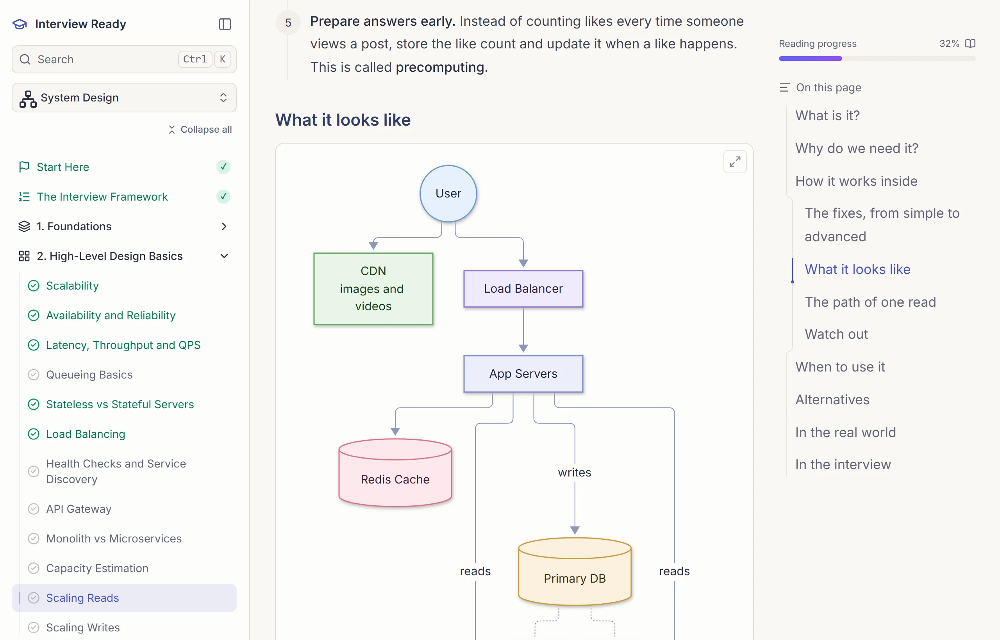
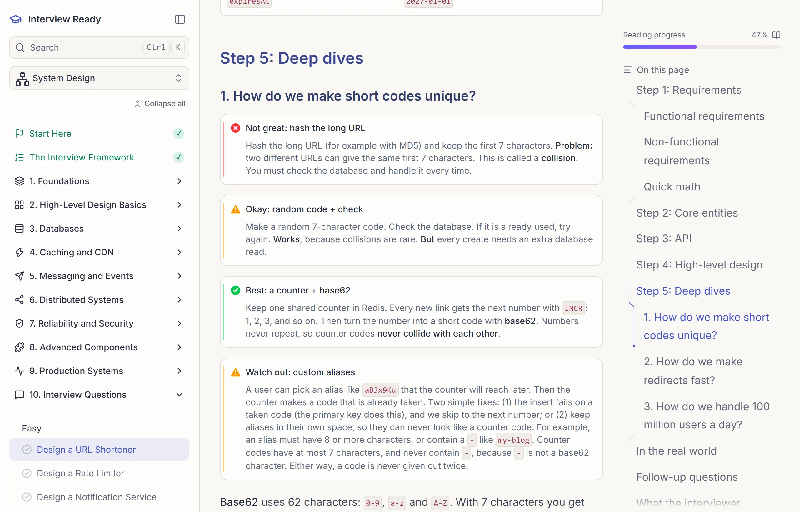
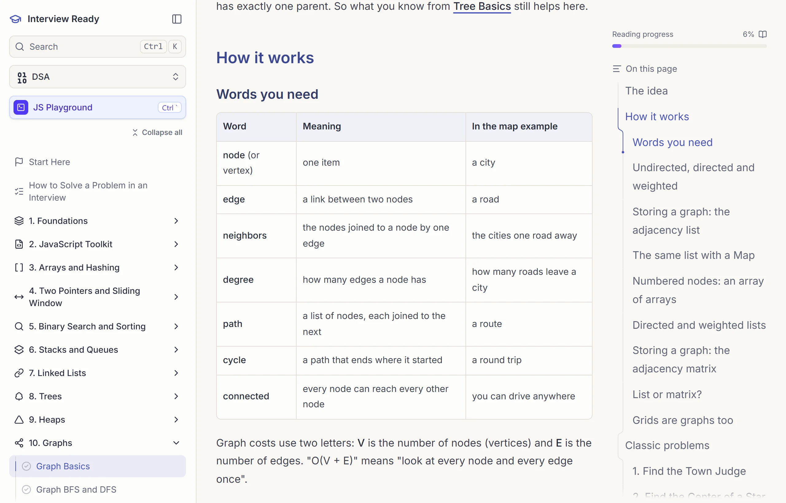
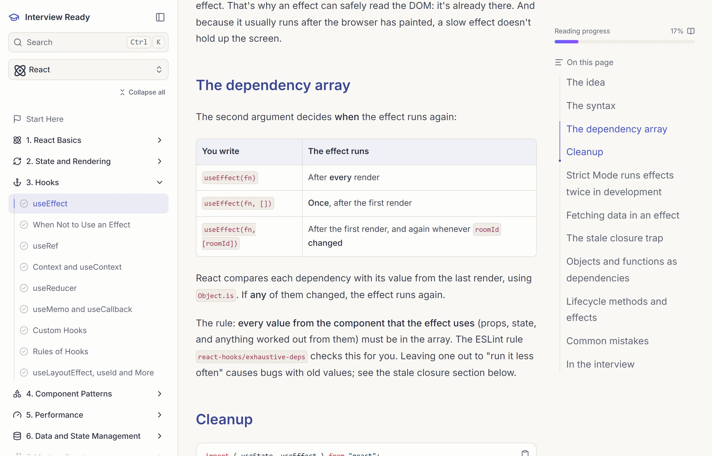
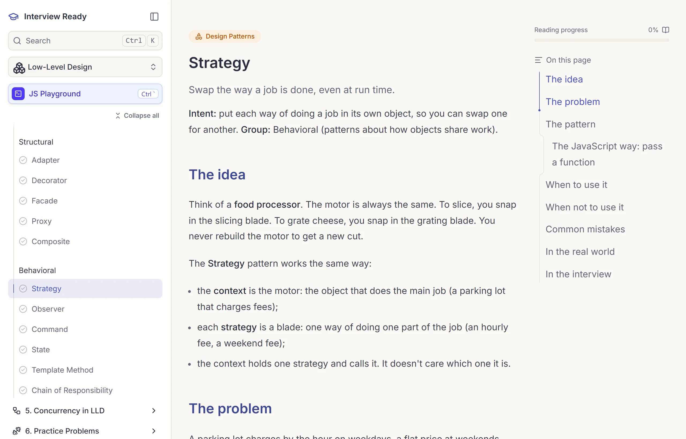
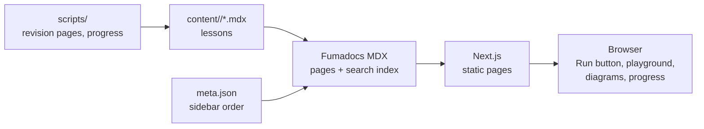

# Interview Ready

Get ready for tech interviews in one place. Six tracks of short lessons in simple English: **System Design**, **Low-Level Design**, **React**, **DSA**, **JavaScript** and **Git**. Each lesson has clear diagrams, code you can run on the page, and what to say in the interview.

**Live:** [interview-ready-two.vercel.app](https://interview-ready-two.vercel.app)



## About

Preparing for interviews means jumping between books, blogs, paid courses and problem lists, and much of it goes deeper than any interview will. Interview Ready keeps to what interviews ask: the idea, the classic traps, and the answer to give.

- **System Design.** From DNS and HTTP through databases, caching, messaging and distributed systems to full questions like WhatsApp, Uber and a payment system. Each question compares weak and strong answers, and says why.
- **Low-Level Design.** OOP, SOLID, design patterns and practice problems like a parking lot, all in JavaScript.
- **React.** From JSX and hooks to performance, Server Components and React 19, then machine-coding tasks (autocomplete, a modal, infinite scroll) and predict-the-output puzzles.
- **DSA.** Ordered by interview pattern, from two pointers to dynamic programming, with classic problems solved step by step.
- **JavaScript.** The language from closures and the event loop to promises, OOP, TypeScript and guess-the-output puzzles.
- **Git.** The commands interviews ask about: branches, merge and rebase, undoing changes, stash and cherry-pick.

Every track has a **cheat sheet** and a **last-minute revision** page, built from the key points of its lessons.

| Compare weak and strong answers                                                                                                          | Each DSA pattern built up from zero                                                                                                 |
| ---------------------------------------------------------------------------------------------------------------------------------------- | ------------------------------------------------------------------------------------------------------------------------------------ |
|  |       |
| **React, at interview depth**                                                                                                            | **Design patterns in JavaScript**                                                                                                    |
|                        |  |

## Features

- **Interview depth only.** Each lesson starts with an everyday comparison, shows the idea in a diagram or a step-by-step table, lists the common mistakes, and ends with **In the interview** and **Remember this**.
- **Code you can run.** JavaScript examples have a Run button, and a later step runs together with the earlier blocks it needs. A playground slides in from the side to try an idea without leaving the page. Code runs in a Web Worker, so an infinite loop can't freeze the page, and `console.log` prints like Node.
- **Diagrams written as text.** Every diagram is Mermaid, next to the lesson. Each kind of part has its own soft color on every page: users blue, servers indigo, databases amber, caches rose, queues teal. Any diagram opens large with one click.
- **A drawing board.** System Design and Low-Level Design each have an Excalidraw board for practising a design the way you would on an interview whiteboard. Drawings are saved in the browser.
- **Progress without an account.** Mark a lesson as done to tick it in the sidebar and go straight to the next one. The home page shows how far you've got in each track. Progress is saved in the browser: no login, no server.
- **Easy to read.** A calm, light theme for long study sessions, a reading-progress bar, and search across every track.

## How it works



- **Lessons are files.** Each lesson is an MDX file: Markdown with a few components like callouts, tabs and fold-out answers. Small `meta.json` files set the order of the sidebar. A page that isn't written yet has `planned: true` and shows dimmed.
- **Everything is static.** Every page is built ahead of time, so the site loads fast from Vercel's free plan. Diagrams, the Run button, the playground and progress all run in the browser.
- **Revision pages build themselves.** `scripts/build-revision.mjs` collects each lesson's key points into its track's last-minute revision page, and runs before every dev start and build.

## Tech stack

| Part      | Tools                                         | Why                                                                                     |
| --------- | --------------------------------------------- | --------------------------------------------------------------------------------------- |
| Site      | Next.js 16, React 19, TypeScript              | Static pages built ahead of time, with strict types.                                    |
| Docs      | Fumadocs, MDX                                 | Sidebar, search and table of contents out of the box; lessons stay plain files.         |
| Diagrams  | Mermaid                                       | Diagrams are text, so they're easy to change and review.                                |
| Code      | CodeMirror, a Web Worker                      | An editor for the playground; running code off the main thread keeps the page responsive. |
| Drawing   | Excalidraw                                    | A whiteboard for practising designs, loaded only on its own page.                       |
| Styling   | Tailwind CSS 4, lucide icons                  | Quick to build a consistent interface.                                                  |
| Hosting   | Vercel                                        | Free, and every push to `main` redeploys it.                                            |

## Running it

You need Node.js 20.9 or newer (what Next.js 16 needs).

```bash
npm install
npm run dev          # http://localhost:3000
```

| Command               | What it does                                                    |
| --------------------- | --------------------------------------------------------------- |
| `npm run build`       | Builds the static site                                          |
| `npm run types:check` | Generates the route types and runs the TypeScript checker       |
| `npm run lint`        | ESLint                                                          |
| `npm run progress`    | Rebuilds `PROGRESS.md` from the sidebar and each page's `planned` flag |
| `npm run revision`    | Rebuilds every track's last-minute revision page                |

## Project structure

```
content/
  system-design/      one folder per track: lessons (MDX), meta.json for the sidebar,
  low-level-design/   a cheat sheet and a last-minute revision page
  react/
  dsa/
  javascript/
  git/
src/
  app/                the home page, each track's lesson pages, and the drawing boards
  components/         lesson page, Run button and playground, diagrams, progress, search
  lib/                content source, sections, progress, the playground's runner
scripts/              revision pages, PROGRESS.md, MDX checks
docs/screenshots/     the screenshots in this README
```

`PROGRESS.md` lists every page in sidebar order and which are written. `REVIEW.md` logs each review round and what it fixed.
