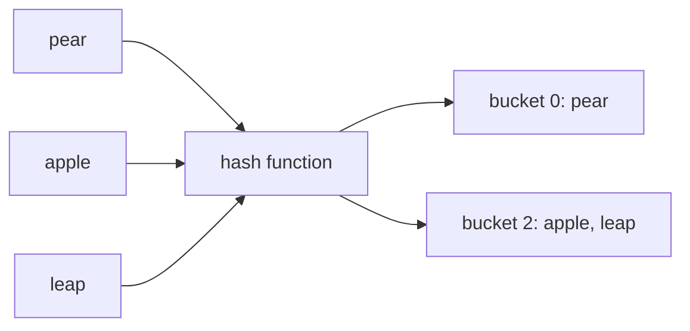

## The idea

A **hash map** stores **key → value** pairs and finds any key in **O(1)** time on average. A **set** stores only keys, and answers "have I seen this?" in O(1). You pay with extra memory, O(n), and in return many O(n²) problems become O(n).

Think of a **coat check** at a theatre. You hand over your coat and get ticket number 42. When you come back, the attendant walks straight to hook 42. Nobody looks through every coat. A hash map works the same way: it turns the key into a hook number, so it can go straight to it.

## How it works

### Key → value

In JavaScript, a hash map is a `Map`. Here is a small price list:

```js
const prices = new Map();

prices.set("apple", 3);
prices.set("pear", 5);

console.log(prices.get("apple")); // 3
console.log(prices.has("fig")); // false
console.log(prices.size); // 2
```

A `Set` keeps each value once. Adding the same value again does nothing.

```js
const seen = new Set();

seen.add("apple");
seen.add("apple");

console.log(seen.has("apple")); // true
console.log(seen.size); // 1
```

All the methods, and the traps of plain objects, are in [Objects, Maps and Sets](../js-toolkit/objects-maps-sets.mdx).

### How it finds a key so fast

Inside, a hash map is an **array of buckets**. A **hash function** turns the key into a number, and that number picks the bucket. To find the key later, the map works out the same number and goes **straight to that bucket**. No searching.

Here is a toy hash function. It adds up the character codes, then uses `%` to get a bucket number. Real hash functions mix the bits much better, but the idea is the same.

```js
function toyHash(key, bucketCount) {
    let total = 0;

    for (const char of key) {
        total = total + char.charCodeAt(0);
    }

    // % keeps the number between 0 and bucketCount - 1.
    return total % bucketCount;
}

console.log(toyHash("pear", 8)); // 0
console.log(toyHash("apple", 8)); // 2
console.log(toyHash("leap", 8)); // 2
```



`"apple"` and `"leap"` land in the **same bucket**. That's called a **collision**. The bucket keeps a short list, and the map checks the few keys in it. With a good hash function, buckets stay tiny, so a lookup is **O(1) on average**. If every key landed in one bucket, a lookup would be O(n), but that almost never happens. When the map gets full, it moves to a bigger array of buckets, like a [dynamic array](../foundations/how-memory-works.mdx).

### What it costs

| Operation | Map | Set | Array |
| --- | --- | --- | --- |
| Add | `set`: O(1) | `add`: O(1) | `push`: O(1) |
| Find | `has`, `get`: **O(1)** | `has`: **O(1)** | `includes`: **O(n)** |
| Remove | `delete`: O(1) | `delete`: O(1) | `splice`: O(n) |
| Extra memory | O(n) | O(n) | O(n) |

The O(1) costs are "on average". In an interview, just say "O(1) on average".

### The four jobs

Almost every hash map problem is one of these four jobs:

| Job | Use | How |
| --- | --- | --- |
| Have I seen this before? | Set | check `has`, then `add` |
| How many of each? | Map: item → count | get the old count (or 0), set it plus 1 |
| Where did I see it? | Map: value → index | store each value with its index |
| Which items belong together? | Map: key → list | work out a key, push the item into that key's list |

Counting comes up the most. The first time we see an item, `get` gives `undefined`, so we start from 0:

```js
function countItems(items) {
    const counts = new Map();

    for (const item of items) {
        const oldCount = counts.get(item) || 0;
        counts.set(item, oldCount + 1);
    }

    return counts;
}

const counts = countItems(["a", "b", "a", "c", "a"]);
console.log(counts); // Map(3) { 'a' => 3, 'b' => 1, 'c' => 1 }
```

## Classic problems

### 1. Contains Duplicate

**Problem:** does any value appear at least twice? `[1, 2, 3, 1]` is `true`. `[1, 2, 3, 4]` is `false`.

**Idea:** comparing every pair is O(n²). Instead, walk once and keep a **Set of the values seen so far**. If the current value is already in the Set, we found a duplicate.

```js
function containsDuplicate(numbers) {
    const seen = new Set();

    for (const number of numbers) {
        if (seen.has(number)) {
            return true;
        }

        seen.add(number);
    }

    return false;
}

console.log(containsDuplicate([1, 2, 3, 1])); // true
console.log(containsDuplicate([1, 2, 3, 4])); // false
```

**Time:** O(n) · **Space:** O(n). One pass, each `has` and `add` is O(1), and the Set may end up holding every value.

Another way: sort, then check each number against its neighbour. That's O(n log n) time and no Set, if you may sort the input. The neighbour check needs only O(1) extra space, but say "apart from the sort": JavaScript's built-in `sort` can use up to O(n) memory inside (see [Sorting](../searching-sorting/sorting.mdx)).

### 2. Valid Anagram

**Problem:** are two words made of exactly the same letters, the same number of times? `"anagram"` and `"nagaram"` are `true`. `"rat"` and `"car"` are `false`.

**Idea:** if the lengths differ, it's `false`. Otherwise count the letters of the first word. Then **use the letters up** with the second word. If the second word needs a letter that has run out, it's `false`.

```js
function isAnagram(first, second) {
    if (first.length !== second.length) {
        return false;
    }

    // Count every letter of the first word.
    const counts = new Map();
    for (const char of first) {
        const oldCount = counts.get(char) || 0;
        counts.set(char, oldCount + 1);
    }

    // Use the letters up with the second word.
    for (const char of second) {
        const oldCount = counts.get(char) || 0;

        // None left: the second word has a letter the first doesn't.
        if (oldCount === 0) {
            return false;
        }

        counts.set(char, oldCount - 1);
    }

    return true;
}

console.log(isAnagram("anagram", "nagaram")); // true
console.log(isAnagram("rat", "car")); // false
```

**Time:** O(n) · **Space:** O(1) for lowercase letters. Two passes over the words. The Map holds at most one entry per different letter: at most 26 for `a` to `z`, so O(1). For any characters at all, it's O(n).

Other ways: sort both words and compare (O(n log n)), or count into an array of 26 when the input is only `a` to `z` (see [Strings](../js-toolkit/strings.mdx)).

### 3. Two Sum

**Problem:** the array is **not sorted**. Return the indexes of the two numbers that add up to `target`. You can't use the same item twice. `[2, 7, 11, 15]` with target 9 gives `[0, 1]`.

**Idea:** for each number, the partner it needs is `target - number`. If we have **already seen** that partner, we're done. If not, remember this number and its index in a Map, for the numbers that come later. Check **before** you store, so a number can't pair with itself.

```js
function twoSum(numbers, target) {
    // value -> the index where we saw it
    const indexByValue = new Map();

    for (let i = 0; i < numbers.length; i++) {
        const needed = target - numbers[i];

        if (indexByValue.has(needed)) {
            return [indexByValue.get(needed), i];
        }

        indexByValue.set(numbers[i], i);
    }

    // No pair adds up to target.
    return [];
}

console.log(twoSum([2, 7, 11, 15], 9)); // [ 0, 1 ]
console.log(twoSum([3, 2, 4], 6)); // [ 1, 2 ]
```

How it runs on `[3, 2, 4]` with target 6:

| i | Number | Needed | In the Map? | Map after |
| --- | --- | --- | --- | --- |
| 0 | 3 | 6 - 3 = 3 | no: the Map is empty | `3 → 0` |
| 1 | 2 | 6 - 2 = 4 | no | `3 → 0, 2 → 1` |
| 2 | 4 | 6 - 4 = 2 | yes, at index 1 | return `[1, 2]` |

At `i = 0`, the number needed is 3, which is the number itself. Because we check before we store, 3 doesn't pair with itself.

**Time:** O(n) · **Space:** O(n). One pass with O(1) lookups, and the Map can hold up to n numbers.

**The Two Sum family.** The same question comes back in other forms:

| Problem | What's different | Tool |
| --- | --- | --- |
| Two Sum | not sorted, return indexes | Map value → index: O(n) time, O(n) space |
| Two Sum II | the array is sorted | [Two pointers](../two-pointers/two-pointers.mdx): O(n) time, O(1) space |
| 3Sum | three numbers, all unique triplets | Sort + [two pointers](../two-pointers/two-pointers.mdx): O(n²) |
| Subarray Sum Equals K | a run of items in a row, not a pair | Map of running sums: [Prefix Sum](./prefix-sum.mdx) |

### 4. Group Anagrams

**Problem:** put words that are anagrams of each other into groups. `["eat", "tea", "tan", "ate", "nat", "bat"]` gives `[["eat", "tea", "ate"], ["tan", "nat"], ["bat"]]`.

**Idea:** anagrams have the same letters, so their **sorted letters are the same**: `"eat"`, `"tea"` and `"ate"` all become `"aet"`. Use the sorted letters as the key in a Map, and the value is the list of words with that key.

```js
function groupAnagrams(words) {
    // sorted letters -> the words made of those letters
    const groups = new Map();

    for (const word of words) {
        const letters = word.split("");
        letters.sort();
        const key = letters.join("");

        // First word with this key: start an empty group.
        if (!groups.has(key)) {
            groups.set(key, []);
        }

        groups.get(key).push(word);
    }

    return Array.from(groups.values());
}

const words = ["eat", "tea", "tan", "ate", "nat", "bat"];
console.log(groupAnagrams(words));
// [ [ 'eat', 'tea', 'ate' ], [ 'tan', 'nat' ], [ 'bat' ] ]
```

At the end, the Map looks like this:

| Key | Words |
| --- | --- |
| `"aet"` | eat, tea, ate |
| `"ant"` | tan, nat |
| `"abt"` | bat |

**Time:** O(n · k log k) · **Space:** O(n · k). There are n words of up to k letters, and sorting each word costs k log k. Every word is stored once in the groups.

**Faster key:** count the letters instead of sorting them. The same counts give the same key, and counting is O(k).

```js
function countKey(word) {
    const counts = new Array(26).fill(0);

    for (const char of word) {
        const place = char.charCodeAt(0) - 97;
        counts[place]++;
    }

    // "1#0#0#..." : the same counts give the same key.
    return counts.join("#");
}

console.log(countKey("eat") === countKey("tea")); // true
console.log(countKey("eat") === countKey("tan")); // false
```

With `countKey` as the key, Group Anagrams is O(n · k).

### 5. Top K Frequent Elements

**Problem:** return the `k` numbers that appear the most. `[1, 1, 1, 2, 2, 3]` with k = 2 gives `[1, 2]`.

**Idea:** first **count** each number with a Map. Then pick the top ones. The simple way: sort the `[number, count]` pairs by count, biggest first, and take the first k.

```js
function topKFrequent(numbers, howMany) {
    // Step 1: count each number.
    const counts = new Map();
    for (const number of numbers) {
        const oldCount = counts.get(number) || 0;
        counts.set(number, oldCount + 1);
    }

    // Step 2: sort the [number, count] pairs, biggest count first.
    const pairs = Array.from(counts.entries());
    pairs.sort((pairA, pairB) => pairB[1] - pairA[1]);

    // Step 3: keep the first howMany numbers.
    const result = [];
    for (let i = 0; i < howMany; i++) {
        result.push(pairs[i][0]);
    }

    return result;
}

console.log(topKFrequent([1, 1, 1, 2, 2, 3], 2)); // [ 1, 2 ]
```

**Time:** O(n log n) · **Space:** O(n). Counting is O(n), but sorting up to n different numbers costs O(n log n).

**Faster: buckets by count.** A number can appear at most n times. So make a list for every possible count, from 0 to n, and put each number in the list for its count. For `[1, 1, 1, 2, 2, 3]`:

| Count | 0 | 1 | 2 | 3 | 4 | 5 | 6 |
| --- | --- | --- | --- | --- | --- | --- | --- |
| Numbers | | 3 | 2 | 1 | | | |

Then walk from the biggest count down, until we have k numbers.

**Step 1: count, then put each number in its bucket.**

```js
function makeBuckets(numbers) {
    const counts = new Map();
    for (const number of numbers) {
        const oldCount = counts.get(number) || 0;
        counts.set(number, oldCount + 1);
    }

    // buckets[count] holds every number that appears exactly count times.
    const buckets = [];
    for (let count = 0; count <= numbers.length; count++) {
        buckets.push([]);
    }

    for (const [number, count] of counts) {
        buckets[count].push(number);
    }

    return buckets;
}

const buckets = makeBuckets([1, 1, 1, 2, 2, 3]);

// 1 appears 3 times, 2 appears twice, 3 appears once.
console.log(buckets[3], buckets[2], buckets[1]); // [ 1 ] [ 2 ] [ 3 ]
```

**Step 2: walk from the biggest count down.**

```js
function topKFrequentFast(numbers, howMany) {
    const buckets = makeBuckets(numbers);
    const result = [];

    for (let count = buckets.length - 1; count >= 1; count--) {
        for (const number of buckets[count]) {
            result.push(number);

            if (result.length === howMany) {
                return result;
            }
        }
    }

    return result;
}

console.log(topKFrequentFast([1, 1, 1, 2, 2, 3], 2)); // [ 1, 2 ]
```

**Time:** O(n) · **Space:** O(n). Counting is O(n), there are n + 1 buckets, and each number is placed and read once. A heap also works, in O(n log k): see [Top K](../heaps/top-k.mdx).

### 6. Longest Consecutive Sequence

**Problem:** the array is **not sorted**. Return the length of the longest run of numbers that follow each other, like 1, 2, 3, 4. Do it in O(n). `[100, 4, 200, 1, 3, 2]` gives 4: the run 1, 2, 3, 4.

**Idea:** sorting would make the runs easy to see, but sorting is O(n log n). Instead, put every number in a **Set**. A number **starts** a run only when `number - 1` is not in the Set. From each start, count up while `number + 1`, `number + 2`, ... are in the Set.

```js
function longestConsecutive(numbers) {
    const allNumbers = new Set(numbers);
    let best = 0;

    for (const number of allNumbers) {
        // Not the start of a run: number - 1 will count it.
        if (allNumbers.has(number - 1)) {
            continue;
        }

        // A run starts here. Count up: number + 1, number + 2, ...
        let length = 1;
        while (allNumbers.has(number + length)) {
            length++;
        }

        best = Math.max(best, length);
    }

    return best;
}

console.log(longestConsecutive([100, 4, 200, 1, 3, 2])); // 4
console.log(longestConsecutive([0, 3, 7, 2, 5, 8, 4, 6, 0, 1])); // 9
console.log(longestConsecutive([])); // 0
```

How it runs on `[100, 4, 200, 1, 3, 2]`:

| number | `number - 1` in the Set? | What happens | Run length |
| --- | --- | --- | --- |
| 100 | no (99) | a start: 101 is missing | 1 |
| 4 | yes (3) | skip | |
| 200 | no (199) | a start: 201 is missing | 1 |
| 1 | no (0) | a start: 2, 3 and 4 are there, 5 is missing | **4** |
| 3 | yes (2) | skip | |
| 2 | yes (1) | skip | |

**Time:** O(n) · **Space:** O(n). The `while` loop only runs from the start of a run, and each number belongs to one run, so over the whole loop it steps at most n times. Loop over the **Set**, not the array: with many copies of a start number, the array loop would count the same run again for every copy, which can make it O(n²).

### 7. Valid Sudoku

**Problem:** a 9 × 9 Sudoku board holds digits `"1"` to `"9"`, and `"."` for an empty cell. Return `true` if no digit repeats in any **row**, any **column**, or any of the nine **3 × 3 boxes**. Only the filled cells are checked. The board doesn't have to be solvable.

**Idea:** "seen this digit before?" is a Set's job. Keep **one Set for each row, each column and each box**: 27 Sets. Walk every cell once. If its digit is already in its row's, column's or box's Set, the board is not valid.

The boxes are numbered 0 to 8, across and then down:

```
0 1 2
3 4 5
6 7 8
```

A cell's box is `Math.floor(row / 3) * 3 + Math.floor(col / 3)`. For example, row 4, column 7: box row 1, box column 2, so box 1 × 3 + 2 = **5**.

**Step 1: two small helpers.**

```js
// Which 3 x 3 box a cell is in, numbered 0 to 8.
function boxNumber(row, col) {
    const boxRow = Math.floor(row / 3);
    const boxCol = Math.floor(col / 3);

    return boxRow * 3 + boxCol;
}

// An array of 9 empty Sets.
function nineEmptySets() {
    const sets = [];

    for (let i = 0; i < 9; i++) {
        sets.push(new Set());
    }

    return sets;
}

console.log(boxNumber(4, 7)); // 5
```

**Step 2: check every cell.**

```js
function isValidSudoku(board) {
    // The digits seen so far in each row, column and box.
    const rows = nineEmptySets();
    const cols = nineEmptySets();
    const boxes = nineEmptySets();

    for (let row = 0; row < 9; row++) {
        for (let col = 0; col < 9; col++) {
            const digit = board[row][col];

            // An empty cell can't break a rule.
            if (digit === ".") {
                continue;
            }

            const box = boxNumber(row, col);
            const inRow = rows[row].has(digit);
            const inCol = cols[col].has(digit);
            const inBox = boxes[box].has(digit);

            if (inRow || inCol || inBox) {
                return false;
            }

            rows[row].add(digit);
            cols[col].add(digit);
            boxes[box].add(digit);
        }
    }

    return true;
}
```

LeetCode gives each row as an array of single characters. Here each row is a string, to keep it short: `board[row][col]` reads a string the same way.

```js
const sudokuBoard = [
    "53..7....",
    "6..195...",
    ".98....6.",
    "8...6...3",
    "4..8.3..1",
    "7...2...6",
    ".6....28.",
    "...419..5",
    "....8..79",
];

console.log(isValidSudoku(sudokuBoard)); // true

// Put an 8 in the top-left corner. Column 0 and box 0 now have two 8s.
const badBoard = sudokuBoard.slice();
badBoard[0] = "83..7....";

console.log(isValidSudoku(badBoard)); // false
```

**Time:** O(1) · **Space:** O(1). The board is always 9 × 9, so it's 81 cells and at most 81 digits in each group of Sets. For an n × n board it would be O(n²).

Another common way: one Set of strings like `"5 in row 0"`, `"5 in col 4"` and `"5 in box 1"`. Same speed, one Set instead of 27.

## How to spot it

- "**Duplicate**", "**unique**", "seen before", "first repeating": a Set.
- "**Count**", "**frequency**", "most common", "**top k**", "same letters": a Map of counts.
- A **pair that adds up** to a target, in an **unsorted** array: a Map from value to index.
- "**Group**" things that share something: a Map from key to list.
- "**Consecutive**" numbers in an unsorted array, in O(n): a Set, and look for `number - 1` and `number + 1`.
- "**No repeats in any row, column or box**" (Valid Sudoku): one Set for each group.
- The brute force has an **inner loop that searches for one value**. Replace that search with a lookup.

## Common mistakes

- **Storing before checking in Two Sum.** With target 6 and the number 3, the number finds itself. Check first, then store.
- **`counts.get(item) + 1` the first time.** `undefined + 1` is `NaN`. Write `counts.get(item) || 0` first.
- **`if (counts.get(key))` to check a key.** A count of 0 is falsy, so it looks missing. Use `counts.has(key)`.
- **Arrays as keys.** `map.get([1, 2])` never finds an array you stored earlier, because arrays are matched by reference. Turn them into a string key like `"1,2"`.
- **A plain object for counts.** Its keys become strings, so the number `1` and the string `"1"` are the same key. A Map keeps them apart.
- **Forgetting the memory cost.** Always say "O(n) extra space" for the Map or Set.

## In the interview

Say what the Map saves you from:

> "The brute force checks every pair: O(n²). The inner loop only searches for one value, the target minus the current number. So I'll keep a Map from value to index. Each lookup is O(1) on average, so one pass is O(n) time, and the Map costs O(n) space."

**Likely follow-up:** "Can you do it with O(1) extra space?"

**Answer:** "If I may sort and I don't need the original indexes, almost. I sort and use two pointers from both ends: O(n log n) time, and the pointers need only O(1) extra space. JavaScript's built-in sort can itself use up to O(n) memory, so for a strict O(1) I'd need an in-place sort like heap sort. For Contains Duplicate, I sort and compare each number with its neighbour."

<Callout title="Remember this" type="success">
  - A hash map finds a key in **O(1) on average**; a set answers "seen it?" in O(1). The price is **O(n) extra memory**.
  - Four jobs: **seen before** (Set), **counting** (item → count), **where** (value → index), **grouping** (key → list).
  - Two Sum: `needed = target - number`. **Check the Map before you store** the number.
  - Anagrams have the **same counts**, and the same **sorted letters**. Sorted letters make a good group key.
  - Top K: count, then sort (O(n log n)) or **bucket by count** (O(n)).
  - Longest Consecutive Sequence: a Set; only count up from numbers whose `number - 1` is missing. O(n).
  - Valid Sudoku: one Set per row, column and box. Box number = `Math.floor(row / 3) * 3 + Math.floor(col / 3)`.
  - Start counts from 0: `counts.get(item) || 0`.
</Callout>
