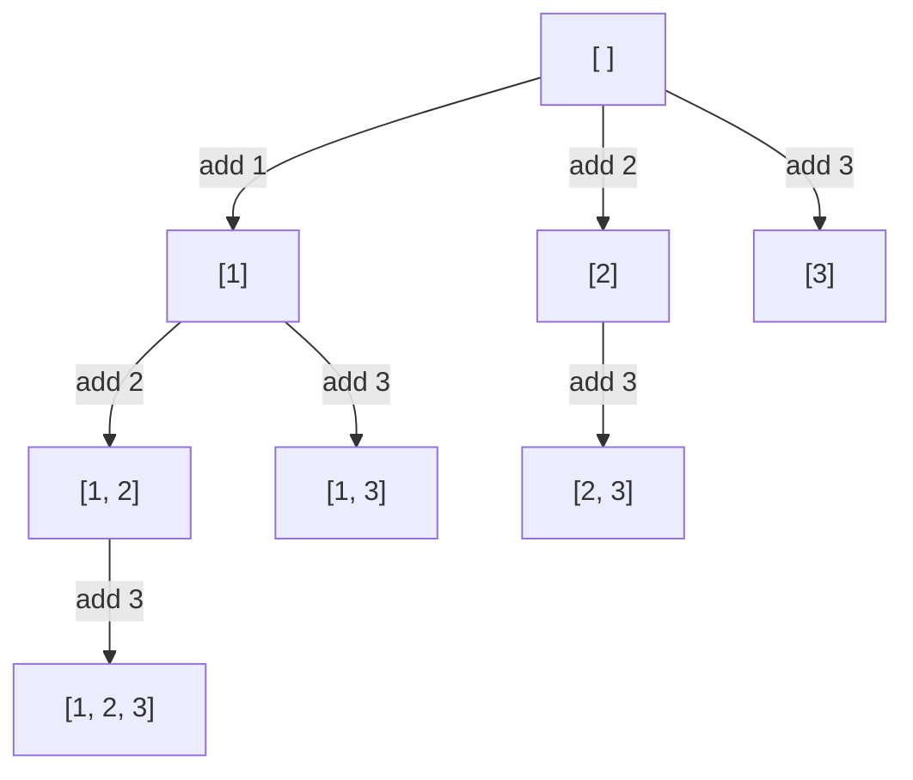

## The idea

Backtracking is a way to **try every possible choice, one step at a time**. You make a choice and go deeper. When that path is finished, or can't work, you **undo the last choice** and try the next one.

Think of walking through a **maze**. At each fork you pick a path. If you hit a dead end, you walk back to the last fork and try a path you haven't tried yet. You never go back to the entrance to start over. You only step back as far as you need to.

Use it when a problem asks for **all** the answers: all subsets, all orderings, all ways to reach a target. It is built on [recursion](../foundations/recursion.mdx): each choice is one recursive call.

## How it works

### Choose, explore, undo

Every backtracking solution repeats three moves:

1. **Choose:** add one option to the answer you are building (`path.push(choice)`).
2. **Explore:** call the function again to make the next choice.
3. **Undo:** take that option back out (`path.pop()`), so the next option starts from a clean state.

Here is the template. `isComplete` and `getChoices` stand for whatever your problem needs.

```js
function backtrack(path, result) {
    // A full answer: save a copy and go back.
    if (isComplete(path)) {
        result.push([...path]);
        return;
    }

    for (const choice of getChoices(path)) {
        // 1. Choose
        path.push(choice);

        // 2. Explore
        backtrack(path, result);

        // 3. Undo
        path.pop();
    }
}
```

The data is just two arrays:

- `path` is the answer you are building right now, like `[1, 2]`. There is only **one** `path` array. It grows and shrinks as you go.
- `result` collects every finished answer, like `[[1], [1, 2], ...]`.

### First example: all subsets of [1, 2, 3]

A **subset** is any group of items taken from the array. `[1, 2, 3]` has 8 subsets:

`[]`, `[1]`, `[1, 2]`, `[1, 2, 3]`, `[1, 3]`, `[2]`, `[2, 3]`, `[3]`

Picture the choices as a tree. Start with an empty path. From each box, you may add any number that comes **after** the last number you added. Every box is one subset: 8 boxes, 8 subsets.



How to read the tree:

- Going **down** an arrow is "choose, then explore".
- Going back **up** is "undo".
- We only add numbers that come after the last one, so `[2, 1]` never appears. For subsets, `[1, 2]` and `[2, 1]` are the same, so we want only one of them.

The code walks this tree from the top, going as deep as it can first. `start` is the index of the first number we are still allowed to add.

```js
function subsets(nums) {
    const result = [];
    const path = [];

    function backtrack(start) {
        // Every box in the tree is a subset, so save it right away.
        result.push([...path]);

        for (let i = start; i < nums.length; i++) {
            // Choose
            path.push(nums[i]);

            // Explore: only numbers after i from now on.
            backtrack(i + 1);

            // Undo
            path.pop();
        }
    }

    backtrack(0);
    return result;
}

// JSON.stringify prints nested arrays on one line.
console.log(JSON.stringify(subsets([1, 2, 3])));
// [[],[1],[1,2],[1,2,3],[1,3],[2],[2,3],[3]]
```

There is no `if ... return` at the top. When `start` reaches the end of the array, the loop doesn't run, and the call ends by itself.

Here is the whole run. The last column shows `path` after each step.

| Step | Running | What happens | path after |
| --- | --- | --- | --- |
| 1 | `backtrack(0)` | save `[]`, choose 1 | `[1]` |
| 2 | `backtrack(1)` | save `[1]`, choose 2 | `[1, 2]` |
| 3 | `backtrack(2)` | save `[1, 2]`, choose 3 | `[1, 2, 3]` |
| 4 | `backtrack(3)` | save `[1, 2, 3]`. No numbers left, go back | `[1, 2, 3]` |
| 5 | `backtrack(2)` | undo 3. Loop done, go back | `[1, 2]` |
| 6 | `backtrack(1)` | undo 2, choose 3 | `[1, 3]` |
| 7 | `backtrack(3)` | save `[1, 3]`, go back | `[1, 3]` |
| 8 | `backtrack(1)` | undo 3. Loop done, go back | `[1]` |
| 9 | `backtrack(0)` | undo 1, choose 2 | `[2]` |
| 10 | `backtrack(2)` | save `[2]`, choose 3 | `[2, 3]` |
| 11 | `backtrack(3)` | save `[2, 3]`, go back | `[2, 3]` |
| 12 | `backtrack(2)` | undo 3. Loop done, go back | `[2]` |
| 13 | `backtrack(0)` | undo 2, choose 3 | `[3]` |
| 14 | `backtrack(3)` | save `[3]`, go back | `[3]` |
| 15 | `backtrack(0)` | undo 3. Loop done. Finished | `[]` |

**Time:** O(n · 2ⁿ) · **Space:** O(n). Each number is either in a subset or not, so there are 2ⁿ subsets, and copying one takes up to n steps. The path and the call stack are at most n deep (the result itself is not counted).

### Why we push a copy: `[...path]`

There is only one `path` array. If you save `path` itself, you save a **link** to that one array, not a snapshot of it. Every later push and pop changes what you saved. At the end, after all the undos, `path` is empty, so every saved answer is empty too.

```js
function subsetsBuggy(nums) {
    const result = [];
    const path = [];

    function backtrack(start) {
        // Bug: saves the same array every time, not a copy.
        result.push(path);

        for (let i = start; i < nums.length; i++) {
            path.push(nums[i]);
            backtrack(i + 1);
            path.pop();
        }
    }

    backtrack(0);
    return result;
}

console.log(subsetsBuggy([1, 2])); // [ [], [], [], [] ]
```

Four answers, and all four are the same empty array. `[...path]` makes a **new** array with the items `path` has right now, so later changes don't touch it. `path.slice()` does the same. (Arrays are passed around by reference; see [Objects, Maps and Sets](../js-toolkit/objects-maps-sets.mdx).)

### When the path is a string, there is nothing to undo

In some problems the path is a string. Strings can't be changed in JavaScript: `path + "a"` makes a **new** string and leaves `path` as it was. So each call gets its own string, and there is nothing to undo or copy. You'll see this in Generate Parentheses below.

## Classic problems

### 1. Combinations

**Problem:** return every way to pick `size` numbers from the numbers 1 to `maxNumber`. Order doesn't matter, so `[1, 2]` and `[2, 1]` count once. Picking 2 from 1 to 4 gives `[1, 2] [1, 3] [1, 4] [2, 3] [2, 4] [3, 4]`.

**Idea:** the same tree as subsets, but save a path only when it has exactly `size` numbers. Then go back right away: there is no point going deeper.

```js
function combine(maxNumber, size) {
    const result = [];
    const path = [];

    function backtrack(start) {
        // The path is full: save a copy and go back.
        if (path.length === size) {
            result.push([...path]);
            return;
        }

        for (let number = start; number <= maxNumber; number++) {
            path.push(number);
            backtrack(number + 1);
            path.pop();
        }
    }

    backtrack(1);
    return result;
}

console.log(combine(4, 2));
// [ [ 1, 2 ], [ 1, 3 ], [ 1, 4 ], [ 2, 3 ], [ 2, 4 ], [ 3, 4 ] ]
```

**Time:** O(k · C(n, k)) · **Space:** O(k). Here n is `maxNumber` and k is `size`. There are C(n, k) answers ("n choose k": 6 for 4 choose 2), and copying each one takes k steps. The path and the stack hold at most k items.

### 2. Permutations

**Problem:** return every ordering of an array of different numbers. `[1, 2, 3]` has 6: `[1, 2, 3] [1, 3, 2] [2, 1, 3] [2, 3, 1] [3, 1, 2] [3, 2, 1]`.

**Idea:** now order matters, so `[1, 2]` and `[2, 1]` are different answers. The loop starts at 0 every time, not at `start`. A `used` array remembers which items are already in the path (`used[i]` is `true` while `nums[i]` is in it), so no item is picked twice.

```js
function permute(nums) {
    const result = [];
    const path = [];
    const used = new Array(nums.length).fill(false);

    function backtrack() {
        if (path.length === nums.length) {
            result.push([...path]);
            return;
        }

        // Loop from 0 every time: order matters.
        for (let i = 0; i < nums.length; i++) {
            if (used[i]) {
                continue;
            }

            used[i] = true;
            path.push(nums[i]);
            backtrack();
            path.pop();
            used[i] = false;
        }
    }

    backtrack();
    return result;
}

console.log(JSON.stringify(permute([1, 2, 3])));
// [[1,2,3],[1,3,2],[2,1,3],[2,3,1],[3,1,2],[3,2,1]]
```

There are two things to undo here: take the number off the path **and** mark it as free again.

**Time:** O(n · n!) · **Space:** O(n). There are n! orderings (3 × 2 × 1 = 6), and copying each takes n steps. The path, `used` and the stack are all size n.

### 3. Subsets II: when the input has duplicates

**Problem:** return all subsets, but `nums` can contain the same number twice, and no subset may appear twice. `[1, 2, 2]` gives `[] [1] [1, 2] [1, 2, 2] [2] [2, 2]`.

Plain `subsets([1, 2, 2])` returns `[1, 2]` twice and `[2]` twice: once using the first 2, once using the second 2.

**Idea:**

1. **Sort**, so equal numbers sit next to each other.
2. In one loop (one level of the tree), try each **value** only once. If `nums[i]` equals the number just before it, skip it.
3. Skip only when `i > start`. The first copy at each level is fine, and a deeper level can still take the second 2. That is how `[2, 2]` and `[1, 2, 2]` get built.

```js
function subsetsWithDup(nums) {
    // Sort so equal numbers sit next to each other.
    // toSorted makes a sorted copy, so nums is not changed.
    const sorted = nums.toSorted((first, second) => first - second);
    const result = [];
    const path = [];

    function backtrack(start) {
        result.push([...path]);

        for (let i = start; i < sorted.length; i++) {
            // Same value as the one just tried at this level: skip it.
            if (i > start && sorted[i] === sorted[i - 1]) {
                continue;
            }

            path.push(sorted[i]);
            backtrack(i + 1);
            path.pop();
        }
    }

    backtrack(0);
    return result;
}

console.log(subsetsWithDup([2, 1, 2]));
// [ [], [ 1 ], [ 1, 2 ], [ 1, 2, 2 ], [ 2 ], [ 2, 2 ] ]
```

**Time:** O(n · 2ⁿ) · **Space:** O(n). With no duplicates, this is the same work as plain subsets. Sorting adds O(n log n), which is smaller.

### 4. Combination Sum

**Problem:** given different positive numbers `candidates` and a `target`, return every combination that adds up to the target. You may use the same number **as many times as you like**. `[2, 3, 6, 7]` with target 7 gives `[2, 2, 3]` and `[7]`.

**Idea:** keep track of `remaining`, what is still needed to reach the target.

- `remaining` is 0: the path adds up exactly. Save it.
- `remaining` is below 0: we went past the target. Dead end, go back.
- To allow reuse, the next call starts at `i` (the same number again), not `i + 1`.

```js
function combinationSum(candidates, target) {
    const result = [];
    const path = [];

    function backtrack(start, remaining) {
        // Hit the target exactly: save a copy.
        if (remaining === 0) {
            result.push([...path]);
            return;
        }

        // Went past the target: dead end.
        if (remaining < 0) {
            return;
        }

        for (let i = start; i < candidates.length; i++) {
            path.push(candidates[i]);

            // Pass i, not i + 1: the same number can be used again.
            backtrack(i, remaining - candidates[i]);

            path.pop();
        }
    }

    backtrack(0, target);
    return result;
}

console.log(combinationSum([2, 3, 6, 7], 7)); // [ [ 2, 2, 3 ], [ 7 ] ]
```

**Time:** about O(n^(t/m)) · **Space:** O(t/m). Here t is the target and m is the smallest candidate. A path holds at most t/m numbers (with 2 and a target of 7, at most three 2s fit), and each step tries up to n numbers. The stack is never deeper than one path.

This one line decides what kind of problem you are solving:

| Next call | Means | Used in |
| --- | --- | --- |
| `backtrack(i + 1)` | each item at most once | subsets, combinations |
| `backtrack(i)` | the same item can be picked again | combination sum |
| loop from 0, with `used` | order matters | permutations |

### 5. Generate Parentheses

**Problem:** return every valid string of `pairs` pairs of brackets. With 3 pairs: `((()))`, `(()())`, `(())()`, `()(())`, `()()()`.

**Idea:** build the string from left to right. Two rules keep it valid at every step, so we never build a broken string:

- Add `(` if you have used fewer than `pairs` of them.
- Add `)` only if there are more `(` than `)` so far. Then it closes something.

When the string has `pairs * 2` characters, it is complete.

```js
function generateParenthesis(pairs) {
    const result = [];

    function backtrack(path, open, close) {
        // Every bracket is used: path is a full, valid string.
        if (path.length === pairs * 2) {
            result.push(path);
            return;
        }

        // Rule 1: open a new bracket if any are left.
        if (open < pairs) {
            backtrack(path + "(", open + 1, close);
        }

        // Rule 2: close a bracket only if one is open.
        if (close < open) {
            backtrack(path + ")", open, close + 1);
        }
    }

    backtrack("", 0, 0);
    return result;
}

console.log(generateParenthesis(3));
// [ '((()))', '(()())', '(())()', '()(())', '()()()' ]
```

`path` is a string, so `path + "("` makes a new one. There is no undo and no copy.

How it runs for 2 pairs:

| path | open | close | Add `(`? | Add `)`? |
| --- | --- | --- | --- | --- |
| `""` | 0 | 0 | yes | no |
| `"("` | 1 | 0 | yes | yes |
| `"(("` | 2 | 0 | no | yes |
| `"(()"` | 2 | 1 | no | yes |
| `"(())"` | 2 | 2 | complete: save | |
| `"()"` | 1 | 1 | yes | no |
| `"()("` | 2 | 1 | no | yes |
| `"()()"` | 2 | 2 | complete: save | |

**Time:** O(4ⁿ / √n) · **Space:** O(n). The number of valid strings (1, 2, 5, 14, 42, ...) grows a little slower than 4ⁿ, and each one takes n steps to build. In an interview, "about 4ⁿ" is a fine first answer. The stack is 2n calls deep.

### 6. Letter Combinations of a Phone Number

**Problem:** on an old phone keypad, each digit from 2 to 9 has letters (2 is "abc", 3 is "def", and so on). Return every string the digits could spell. `"23"` gives `ad ae af bd be bf cd ce cf`.

**Idea:** one level of the tree per digit. At level `index`, try each letter of `digits[index]`. When the path has one letter per digit, save it.

```js
// The index is the digit. 0 and 1 have no letters.
const PHONE_LETTERS = [
    "", "", "abc", "def", "ghi",
    "jkl", "mno", "pqrs", "tuv", "wxyz",
];

function letterCombinations(digits) {
    // No digits means no combinations, not one empty string.
    if (digits.length === 0) {
        return [];
    }

    const result = [];

    function backtrack(index, path) {
        // One letter for every digit: done.
        if (index === digits.length) {
            result.push(path);
            return;
        }

        const digit = Number(digits[index]);

        for (const letter of PHONE_LETTERS[digit]) {
            backtrack(index + 1, path + letter);
        }
    }

    backtrack(0, "");
    return result;
}

console.log(letterCombinations("23").join(" ")); // ad ae af bd be bf cd ce cf
```

**Time:** O(n · 4ⁿ) · **Space:** O(n). Each digit has 3 or 4 letters (7 and 9 have 4), so there are up to 4ⁿ strings, each n letters long. The stack is n calls deep.

## How to spot it

- The problem says **"return all"**: all subsets, combinations, permutations, arrangements, ways or paths.
- It says **"generate every valid ..."**: brackets, IP addresses, ways to split a string into palindromes.
- The input is **small**, often n ≤ 10 to 20. All answers can mean 2ⁿ or n! of them, so the problem has to keep n small.
- It asks **"how many ways"** or for the **best** answer, not a list? That is usually [Dynamic Programming](../dynamic-programming/dp-basics.mdx). Backtracking lists answers; DP counts them or picks the best.
- A grid or a board? See [Backtracking on Grids](./grid-backtracking.mdx).

| Problem | Key trick |
| --- | --- |
| Subsets | save at every call, loop from `start` |
| Combinations | save when `path.length === size` |
| Permutations | loop from 0, `used` array |
| Subsets II | sort, skip `nums[i] === nums[i - 1]` when `i > start` |
| Combination Sum | track `remaining`, call `backtrack(i)` to reuse |
| Generate Parentheses | count `open` and `close` |
| Phone letters | one level per digit |

## Common mistakes

- **Saving `path` instead of `[...path]`.** Every saved answer is the same array, and it ends up empty.
- **Forgetting the undo.** Leave out `path.pop()` (or `used[i] = false`), and the next choice starts with leftovers.
- **`backtrack(start + 1)` instead of `backtrack(i + 1)`.** The next level must start after the item you just picked (`i`), not after where this loop began.
- **Skipping duplicates with `i > 0` instead of `i > start`.** That also throws away good answers like `[2, 2]`.
- **Skipping duplicates without sorting first.** Equal numbers must sit next to each other for `nums[i] === nums[i - 1]` to work.
- **No `remaining < 0` check in Combination Sum.** `remaining` keeps going down, the calls never stop, and you get a stack overflow.

## In the interview

- **Draw the tree** for a tiny input like `[1, 2, 3]` first. It shows the choices at each level and when to stop.
- Say the three moves out loud: **choose, explore, undo**.
- Give the Big O as **the number of answers × the cost to copy one**.

> "I'll use backtracking. `path` holds the subset I'm building. Each call saves a copy of it, then for each number from `start` on, I push it, recurse with `i + 1`, and pop it. There are 2ⁿ subsets and copying one is O(n), so it's O(n · 2ⁿ) time and O(n) extra space for the path and the call stack."

**Likely follow-up:** "What if the input has duplicates?"

**Answer:** "I'll sort it first. Then in each loop I skip a number that equals the one before it, but only when `i > start`. So each value is picked once per level and no subset repeats, but a deeper level can still use the second copy."

<Callout title="Remember this" type="success">
  - **Backtracking = choose, explore, undo.** One recursive call per choice; undo it before trying the next.
  - Save **a copy**: `result.push([...path])`. Saving `path` itself saves one shared array that ends up empty.
  - `backtrack(i + 1)` → each item once (subsets, combinations). `backtrack(i)` → reuse (combination sum). Loop from 0 with `used` → order matters (permutations).
  - Duplicates: **sort**, then skip `nums[i] === nums[i - 1]` when `i > start`.
  - Cost = number of answers × cost to copy one: subsets O(n · 2ⁿ), permutations O(n · n!).
  - "Return all ..." with a small n → backtracking. "How many ways" or "the best" → think DP.
</Callout>
