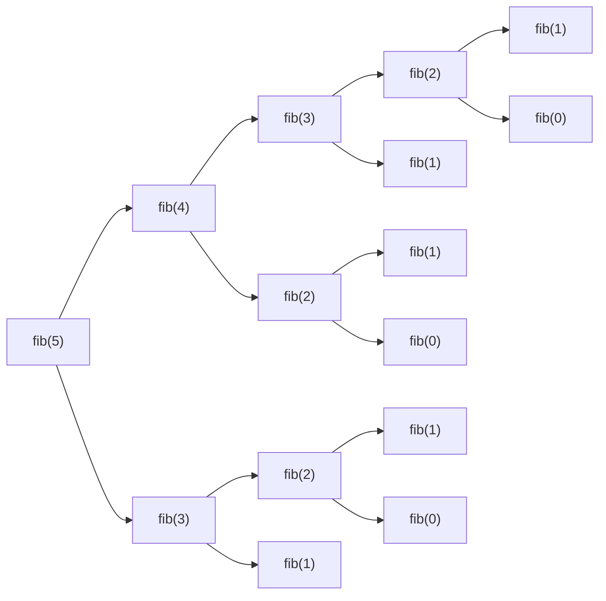
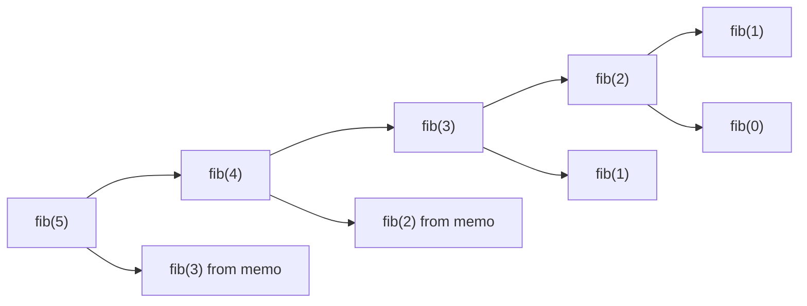

## The idea

**Dynamic Programming (DP)** means: break a problem into smaller problems, solve each small problem **once**, write the answer down, and **reuse** it whenever the same small problem comes up again.

Think of a friend who writes `1 + 1 + 1 + 1 + 1` on paper and asks you for the total. You count: 5. Then they add one more `+ 1` and ask again. You don't count from the start. You say "6" right away, because you **remember** the 5. That is DP: keep old answers so you never redo the same work.

DP works when a problem has two things:

- **The same smaller problems come up again and again.** Plain recursion would solve them many times.
- **The big answer is built from smaller answers.** If you know the answers for smaller inputs, one simple step gives the answer for the bigger one.

## How it works

### Fibonacci: the same work again and again

In the Fibonacci numbers, each number is the sum of the two before it: 0, 1, 1, 2, 3, 5, 8, 13, ... So `fib(n) = fib(n - 1) + fib(n - 2)`, with `fib(0) = 0` and `fib(1) = 1`. Here is the plain recursive version from the [Recursion](../foundations/recursion.mdx) page, with a counter for the number of calls.

```js
let calls = 0;

function slowFib(number) {
    calls++;

    // Base cases: fib(0) is 0 and fib(1) is 1.
    if (number <= 1) {
        return number;
    }

    return slowFib(number - 1) + slowFib(number - 2);
}

console.log(slowFib(20)); // 6765
console.log(calls); // 21891
```

Almost 22,000 calls to get one small number. To see why, here is every call that `fib(5)` makes, read from left to right. The **red boxes** are work that was already done somewhere else in the tree.



- `fib(3)` is worked out **twice** and `fib(2)` **three times**, each time from scratch.
- More than half of the 15 calls repeat old work. The bigger `n` gets, the bigger the waste: each step up roughly **doubles** the calls. That is **O(2ⁿ)** time.

### Fix 1: memoization (top-down)

**Memoization** means: keep a notebook (an object called `memo`). Before you work something out, look in the notebook. If the answer is there, use it. If not, work it out once and write it down.

```js
function fib(number, memo = {}) {
    // Base cases.
    if (number <= 1) {
        return number;
    }

    // Already solved? Reuse the saved answer.
    if (memo[number] !== undefined) {
        return memo[number];
    }

    // Solve it once and write the answer down.
    const answer = fib(number - 1, memo) + fib(number - 2, memo);
    memo[number] = answer;

    return answer;
}

console.log(fib(50)); // 12586269025

// Pass in our own notebook to see what it holds afterwards.
const notebook = {};
fib(6, notebook);
console.log(notebook); // { '2': 1, '3': 2, '4': 3, '5': 5, '6': 8 }
```

`memo = {}` gives each new top-level call a fresh, empty notebook. Inside, we pass the **same** `memo` down to every call, so they all share it.

Now the tree from before shrinks to a straight line. The **yellow boxes** are answers read from the notebook, with no more calls below them.



**Time:** O(n), because each `fib(k)` is worked out only once, and each one does O(1) work (one addition). `fib(20)` now makes 39 calls instead of 21,891. **Space:** O(n): the notebook holds up to `n` answers, and the call stack can be `n` calls deep.

This is called **top-down**: you start at the big problem (`fib(5)`) and go down to the small ones.

### The DP recipe: four steps

Every DP problem on this site is solved with the **same four steps**. Say them out loud in an interview.

<Callout title="The DP recipe" type="info">
  1. **What does `dp[i]` mean, in words?** Write one sentence. Example: "`dp[i]` is the i-th Fibonacci number."
  2. **The recurrence:** how is `dp[i]` built from smaller answers? Example: `dp[i] = dp[i - 1] + dp[i - 2]`.
  3. **Base cases:** the smallest answers you know without any work. Example: `dp[0] = 0`, `dp[1] = 1`.
  4. **Order of filling:** which cells must be ready before `dp[i]`? Fill in that order, and say where the final answer is. Example: `i` from 2 up to `n`. Answer: `dp[n]`.
</Callout>

Step 1 is the hardest and the most important. If you can't say what `dp[i]` means in one plain sentence, the recurrence will not come.

With memoization, the recursion picks the order for you. With a table (next), **you** pick it in step 4.

### Fix 2: tabulation (bottom-up)

**Tabulation** means: skip the recursion. Make an array `dp`, fill in the base cases, then fill the rest with a loop **from small to big**. When you reach `dp[i]`, the cells it needs are already filled.

Here is the recipe for Fibonacci:

1. **What `dp[i]` means:** the i-th Fibonacci number.
2. **Recurrence:** `dp[i] = dp[i - 1] + dp[i - 2]`
3. **Base cases:** `dp[0] = 0`, `dp[1] = 1`
4. **Order:** `i` from 2 up to `n`. **Answer:** `dp[n]`.

Here is the table filling up for `n = 6`, one cell per step:

| Step | i | dp[i - 2] | dp[i - 1] | dp[i] | dp so far |
| --- | --- | --- | --- | --- | --- |
| base | 0, 1 | - | - | 0, 1 | `[0, 1]` |
| 1 | 2 | 0 | 1 | 1 | `[0, 1, 1]` |
| 2 | 3 | 1 | 1 | 2 | `[0, 1, 1, 2]` |
| 3 | 4 | 1 | 2 | 3 | `[0, 1, 1, 2, 3]` |
| 4 | 5 | 2 | 3 | 5 | `[0, 1, 1, 2, 3, 5]` |
| 5 | 6 | 3 | 5 | **8** | `[0, 1, 1, 2, 3, 5, 8]` |

The code does exactly what the table shows.

```js
function fibTable(number) {
    if (number <= 1) {
        return number;
    }

    // dp[i] will hold fib(i). We need cells 0 to number.
    const dp = new Array(number + 1).fill(0);

    // Base cases.
    dp[0] = 0;
    dp[1] = 1;

    // Small to big: dp[i - 1] and dp[i - 2] are always ready.
    for (let i = 2; i <= number; i++) {
        dp[i] = dp[i - 1] + dp[i - 2];
    }

    return dp[number];
}

console.log(fibTable(6)); // 8
console.log(fibTable(50)); // 12586269025
```

**Time:** O(n), one loop step per cell. **Space:** O(n) for the array, but no call stack, so no risk of a stack overflow.

This is called **bottom-up**: you start at the smallest problems and build up to the big one.

### Fix 3: keep only the last two values

Look at the recurrence again: `dp[i]` only needs the **last two** cells. Everything older is never read again. So we can throw the array away and keep two variables.

```js
function fibTwoValues(number) {
    if (number <= 1) {
        return number;
    }

    // The answers two steps back and one step back.
    let twoBack = 0;
    let oneBack = 1;

    for (let i = 2; i <= number; i++) {
        const current = oneBack + twoBack;

        // Slide forward: the old "one back" becomes "two back".
        twoBack = oneBack;
        oneBack = current;
    }

    return oneBack;
}

console.log(fibTwoValues(6)); // 8
console.log(fibTwoValues(50)); // 12586269025
```

How the two values slide along for `number = 6`:

| i | current = oneBack + twoBack | twoBack after | oneBack after |
| --- | --- | --- | --- |
| start | - | 0 | 1 |
| 2 | 1 + 0 = 1 | 1 | 1 |
| 3 | 1 + 1 = 2 | 1 | 2 |
| 4 | 2 + 1 = 3 | 2 | 3 |
| 5 | 3 + 2 = 5 | 3 | 5 |
| 6 | 5 + 3 = 8 | 5 | **8** |

**Time:** O(n) · **Space:** O(1), because only two numbers are kept, however big `n` is.

The rule: **if `dp[i]` only looks back a fixed number of cells, keep just those cells.** You'll use this trick again in House Robber, Kadane and Unique Paths.

### Memoization or tabulation?

Both give the same answers with the same Big O. They just fill the notebook in a different order.

|  | Memoization (top-down) | Tabulation (bottom-up) |
| --- | --- | --- |
| How | recursion + a `memo` object | a loop + a `dp` array |
| Starts from | the big problem, goes down | the smallest problems, goes up |
| Order of filling | the recursion picks it | you pick it (recipe step 4) |
| Solves | only the subproblems it needs | every subproblem |
| Risk | stack overflow when very deep | none |
| Best for | writing a first version from a recursive idea | interviews where you want speed and less space |

A good way to work: write the recursion, add a memo, then (if there's time) turn it into a table and save space. All four Fibonacci versions side by side:

| Version | Time | Space | Why |
| --- | --- | --- | --- |
| Plain recursion | O(2ⁿ) | O(n) | each call makes two more calls |
| Memoization | O(n) | O(n) | each value worked out once; memo + stack |
| Tabulation | O(n) | O(n) | one loop step per cell; the array |
| Two variables | O(n) | O(1) | same loop, only two numbers kept |

## Classic problems

### 1. Climbing Stairs

**Problem:** a staircase has `n` steps. Each move, you climb **1 or 2** steps. In how many different ways can you reach the top? For `n = 3` the answer is 3: `1 + 1 + 1`, `1 + 2`, `2 + 1`.

**Idea:** think about your **last move**. To stand on step `i`, you either came from step `i - 1` (a 1-step) or from step `i - 2` (a 2-step). Every way to reach `i - 1` gives one way to reach `i`, and so does every way to reach `i - 2`. The two groups never overlap (their last move differs), so we add them.

1. **What `dp[i]` means:** the number of ways to reach step `i`.
2. **Recurrence:** `dp[i] = dp[i - 1] + dp[i - 2]`
3. **Base cases:** `dp[0] = 1` (one way to stand at the bottom: do nothing), `dp[1] = 1` (one 1-step).
4. **Order:** `i` from 2 up to `n`. **Answer:** `dp[n]`.

The table for `n = 5`:

| i | dp[i - 2] | dp[i - 1] | dp[i] | the ways (for small i) |
| --- | --- | --- | --- | --- |
| 0 | - | - | 1 | (stand still) |
| 1 | - | - | 1 | 1 |
| 2 | 1 | 1 | 2 | 1+1, 2 |
| 3 | 1 | 2 | 3 | 1+1+1, 1+2, 2+1 |
| 4 | 2 | 3 | 5 | |
| 5 | 3 | 5 | **8** | |

It's the Fibonacci numbers again, shifted by one. Here is the table version.

```js
function climbStairs(steps) {
    // dp[i] = number of ways to reach step i.
    const dp = new Array(steps + 1).fill(0);

    // Base cases.
    dp[0] = 1;
    dp[1] = 1;

    for (let i = 2; i <= steps; i++) {
        // Last move was 1 step (from i - 1) or 2 steps (from i - 2).
        dp[i] = dp[i - 1] + dp[i - 2];
    }

    return dp[steps];
}

console.log(climbStairs(3)); // 3
console.log(climbStairs(5)); // 8
```

`dp[i]` only looks at the last two cells, so two variables are enough.

```js
function climbStairsTwoValues(steps) {
    // Ways to reach the step two below and one below.
    let twoBack = 1;
    let oneBack = 1;

    for (let i = 2; i <= steps; i++) {
        const current = oneBack + twoBack;

        twoBack = oneBack;
        oneBack = current;
    }

    return oneBack;
}

console.log(climbStairsTwoValues(5)); // 8
console.log(climbStairsTwoValues(45)); // 1836311903
```

**Time:** O(n), one loop step per stair. **Space:** O(n) for the table, O(1) for the two-variable version.

### 2. Min Cost Climbing Stairs

**Problem:** `cost[i]` is the price of stepping on step `i`. You may start on step 0 or step 1 for free. Each move is 1 or 2 steps. The top is just past the last step. Find the cheapest way to the top. `[10, 15, 20]` → **15** (start on step 1, pay 15, jump 2 steps to the top).

**Idea:** same shape as Climbing Stairs, but instead of **adding** the ways, we take the **cheaper** of the two ways in.

1. **What `dp[i]` means:** the cheapest cost to reach step `i` (not counting `cost[i]` yet). The top is step `n`.
2. **Recurrence:** `dp[i] = min(dp[i - 1] + cost[i - 1], dp[i - 2] + cost[i - 2])`
3. **Base cases:** `dp[0] = 0`, `dp[1] = 0` (you start there for free).
4. **Order:** `i` from 2 up to `n`. **Answer:** `dp[n]`.

The table for `cost = [10, 15, 20]`:

| i | from one below: dp[i - 1] + cost[i - 1] | from two below: dp[i - 2] + cost[i - 2] | dp[i] |
| --- | --- | --- | --- |
| 0 | - | - | 0 |
| 1 | - | - | 0 |
| 2 | 0 + 15 = 15 | 0 + 10 = 10 | 10 |
| 3 (top) | 10 + 20 = 30 | 0 + 15 = 15 | **15** |

```js
function minCostClimbingStairs(cost) {
    const top = cost.length;

    // dp[i] = cheapest cost to reach step i.
    const dp = new Array(top + 1).fill(0);

    // Base cases: steps 0 and 1 are free to start on.
    dp[0] = 0;
    dp[1] = 0;

    for (let i = 2; i <= top; i++) {
        // Come from one step below: pay for that step.
        const fromOneBelow = dp[i - 1] + cost[i - 1];

        // Come from two steps below: pay for that step.
        const fromTwoBelow = dp[i - 2] + cost[i - 2];

        dp[i] = Math.min(fromOneBelow, fromTwoBelow);
    }

    return dp[top];
}

const prices = [1, 100, 1, 1, 1, 100, 1, 1, 100, 1];

console.log(minCostClimbingStairs([10, 15, 20])); // 15
console.log(minCostClimbingStairs(prices)); // 6
```

**Time:** O(n), one loop step per stair. **Space:** O(n) for the table. Again `dp[i]` only needs the last two cells, so two variables bring it down to O(1).

## How to spot it

Think DP when the problem:

- asks for the **number of ways** to do something ("how many ways to climb", "to decode", "to make change");
- asks for the **minimum or maximum** ("fewest coins", "most money", "longest", "cheapest");
- asks **"is it possible?"** ("can the string be split into words", "can the array be split into two equal halves");
- makes a **choice at each step** (take or skip, 1 step or 2 steps), and that choice changes what's left;
- has a **brute-force recursion that repeats the same calls**. Draw a small call tree. If you see the same call twice, add a memo.

Not DP:

- "**List all** the combinations" wants every answer, not a count. That's [Backtracking](../backtracking/backtracking.mdx).
- If taking the best-looking choice right now is always safe, it's [Greedy](../greedy-intervals/greedy.mdx). DP is for when the obvious choice can be wrong.

### Which DP fits which problem

| The problem says... | `dp[i]` usually means | Pattern | Examples |
| --- | --- | --- | --- |
| ways to reach step `n` with small moves | ways to reach `i` | add the previous answers | Climbing Stairs, [Decode Ways](./one-d-dp.mdx) |
| can't pick two neighbours | best total from the first `i` items | take or skip | [House Robber](./one-d-dp.mdx) |
| fewest coins (or steps) to make an amount | best for amount `i` | min over each choice | [Coin Change](./one-d-dp.mdx) |
| best sum of a contiguous subarray | best sum **ending at** `i` | extend or restart | [Maximum Subarray](./one-d-dp.mdx) |
| longest increasing subsequence | longest **ending at** `i` | look back at every earlier item | [LIS](./one-d-dp.mdx) |
| split a string into dictionary words | can the first `i` letters be split | valid prefix + a word | [Word Break](./one-d-dp.mdx) |
| moves right/down on a grid | answer for cell `[row][col]` | from above + from the left | [Unique Paths](./two-d-dp.mdx) |
| compare two strings | answer for the first `row` and `col` letters | match → diagonal, else best neighbour | [LCS, Edit Distance](./two-d-dp.mdx) |
| pick items under a limit, each item once | best for the first `i` items and capacity `c` | take or skip the item | [0/1 Knapsack, Partition, Target Sum](./knapsack.mdx) |
| pick items under a limit, reuse allowed | best (or ways) for amount `c` | loop the amount upward | [Coin Change II](./knapsack.mdx) |

## Common mistakes

- **Not saying what `dp[i]` means.** Most wrong recurrences come from a fuzzy step 1. Write the sentence first.
- **Array one cell too short.** You need cells `0` to `n`, so `new Array(n + 1)`. With `new Array(n)`, `dp[n]` is `undefined`.
- **Missing or wrong base cases.** Without `dp[1]`, the loop reads a cell that was never set.
- **Filling in the wrong order.** If `dp[i]` reads `dp[i - 1]`, the loop must go up. Reading a cell that is not filled yet gives a silent wrong answer.
- **Checking the memo with `if (memo[n])`.** If the saved answer is `0`, this is false and you redo the work. Use `memo[n] !== undefined`.
- **Sharing one memo across different inputs.** A memo saved for one array gives wrong answers for another. Make a fresh memo per top-level call.

## In the interview

- Start with the brute-force recursion, then point at the **repeated calls**: "fib(3) is worked out twice, so I'll cache it."
- Walk through the **four recipe steps** out loud before you write the loop.
- Fill a **tiny table by hand** (5 or 6 cells). It catches base case bugs before you code.
- Give Big O as **(number of cells) × (work per cell)**.

> "Let `dp[i]` be the number of ways to reach step `i`. My last move was 1 or 2 steps, so `dp[i] = dp[i - 1] + dp[i - 2]`. Base cases: `dp[0] = 1`, `dp[1] = 1`. I fill `i` from 2 up to `n` and return `dp[n]`. That's n cells with O(1) work each: O(n) time."

**Likely follow-up:** "Can you do it with less memory?"

**Answer:** "Yes. Each cell only reads the last two cells, so I keep two variables instead of the array. Time stays O(n), and space drops to O(1)."

<Callout title="Remember this" type="success">
  - **DP = solve each small problem once and reuse the answer.** It needs repeated subproblems and a big answer built from smaller ones.
  - The recipe: **1. what `dp[i]` means, 2. the recurrence, 3. base cases, 4. order of filling** (and where the answer is).
  - **Memoization** = recursion + a notebook (top-down). **Tabulation** = a loop filling an array from small to big (bottom-up).
  - Plain Fibonacci is O(2ⁿ). With a memo or a table it's O(n). If `dp[i]` only needs the last two cells, keep **two variables**: O(1) space.
  - Signals: **number of ways, min/max, is it possible**, a choice at each step, repeated recursive calls.
  - Big O of DP = **number of cells × work per cell**.
</Callout>
