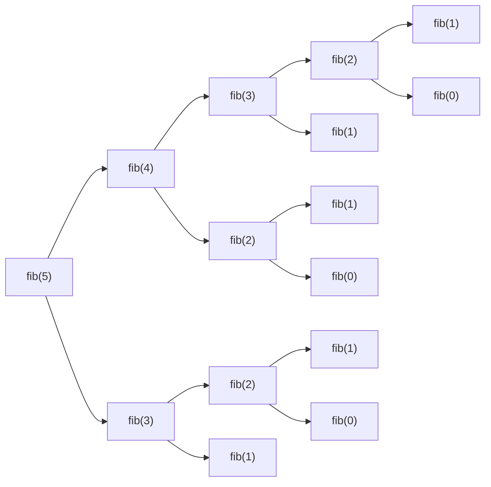

## The idea

Recursion is when a function **calls itself** to solve a **smaller copy** of the same problem. It keeps going until the problem is so small that the answer is obvious. Then the answers travel back up, one call at a time.

Think of a **long line at the cinema**. You want to know your place, but you can't see the front. So you ask the person ahead of you: "What number are you?" They don't know either, so they ask the person ahead of them, and so on. The person at the very front knows: "I'm number 1." Now the answers travel back: "I'm 2", "I'm 3"... until the person ahead of you answers, and you add 1.

- Asking the person ahead is the **recursive call**.
- The person at the front, who just knows the answer, is the **base case**.
- Adding 1 on the way back is how each call **uses the smaller answer**.

## How it works

### Two parts: the base case and the recursive case

Every recursive function has two parts:

- **Base case:** the smallest input. The function answers it right away, **without** calling itself. This is what stops the recursion.
- **Recursive case:** the function calls itself with a **smaller** input.

Here is the smallest example: counting down.

```js
function countDown(number) {
    // Base case: stop at 0.
    if (number === 0) {
        console.log("Done!");
        return;
    }

    console.log(number);

    // Recursive case: the same job with a smaller number.
    countDown(number - 1);
}

countDown(3);
// 3
// 2
// 1
// Done!
```

### Writing one: three questions

Ask these three questions every time:

1. **What is the smallest input I can answer right away?** That is the base case.
2. **How do I make the input smaller?** Usually `number - 1`, the rest of the string, or a child node.
3. **If the smaller problem were already solved, how do I use its answer?** Trust that the call works. Only think about one step.

Let's use them on **factorial**. `5!` means 5 × 4 × 3 × 2 × 1 = 120. Notice that `5!` is just 5 × `4!`.

1. Smallest input: `factorial(1)` is 1. (`factorial(0)` is also 1, so we check `number <= 1`.)
2. Make it smaller: `number - 1`.
3. Use the answer: `number` × `factorial(number - 1)`.

```js
function factorial(number) {
    // Base case.
    if (number <= 1) {
        return 1;
    }

    // Recursive case: trust that this gives (number - 1)!
    const smallerAnswer = factorial(number - 1);

    return number * smallerAnswer;
}

console.log(factorial(3)); // 6
console.log(factorial(5)); // 120
```

### The call stack, step by step

When a function calls another function, JavaScript has to remember where to come back to, and the values of the local variables. It keeps this on the **call stack**.

Think of a **stack of plates**. Each call puts a new plate (called a **frame**) on top, with its own copy of `number`. Only the top plate is running. When a call returns, its plate is taken off, and the plate below carries on from where it stopped.

Here is `factorial(3)`, one step at a time:

| Step | What happens | Call stack (bottom → top) |
| --- | --- | --- |
| 1 | `factorial(3)` starts. 3 is not 1, so it calls `factorial(2)` and **waits**. | factorial(3) |
| 2 | `factorial(2)` starts. It calls `factorial(1)` and waits. | factorial(3), factorial(2) |
| 3 | `factorial(1)` hits the base case and returns **1**. | factorial(3), factorial(2), factorial(1) |
| 4 | `factorial(2)` gets 1 back and returns 2 × 1 = **2**. | factorial(3), factorial(2) |
| 5 | `factorial(3)` gets 2 back and returns 3 × 2 = **6**. | factorial(3) |
| 6 | The stack is empty. The answer is **6**. | (empty) |

There are two phases: **going down** (calls pile up and wait) and **coming back up** (answers return and get multiplied). You can watch both phases by adding logs.

```js
function factorialWithLogs(number) {
    console.log(`start factorial(${number})`);

    if (number <= 1) {
        console.log("factorial(1) returns 1");
        return 1;
    }

    const smallerAnswer = factorialWithLogs(number - 1);
    const answer = number * smallerAnswer;

    console.log(`factorial(${number}) returns ${answer}`);
    return answer;
}

factorialWithLogs(3);
// start factorial(3)
// start factorial(2)
// start factorial(1)
// factorial(1) returns 1
// factorial(2) returns 2
// factorial(3) returns 6
```

**Time:** O(n), because there are `n` calls and each one does O(1) work. **Space:** O(n), because at the deepest point `n` frames wait on the stack at the same time. Recursion always uses stack space equal to **how deep the calls go**.

### Fibonacci: when the same call happens again and again

In the Fibonacci numbers, each number is the sum of the two before it: 0, 1, 1, 2, 3, 5, 8, 13, ... So `fib(n)` = `fib(n - 1)` + `fib(n - 2)`, with `fib(0)` = 0 and `fib(1)` = 1. This one makes **two** recursive calls.

```js
function fib(number) {
    // Base cases: fib(0) is 0 and fib(1) is 1.
    if (number <= 1) {
        return number;
    }

    return fib(number - 1) + fib(number - 2);
}

console.log(fib(5)); // 5
console.log(fib(10)); // 55
```

Each call splits into two more, so the calls form a tree. Here is every call `fib(5)` makes, read from left to right. The red boxes are `fib(2)`, and the green boxes are base cases.



Look at the waste:

- `fib(2)` is worked out **three times**, and `fib(3)` **twice**. Each time from scratch.
- `fib(5)` makes 15 calls. `fib(40)` makes over **330 million** calls.
- Each extra step roughly doubles the work: **O(2ⁿ) time**. The space is only **O(n)**, because the stack holds one path from the top to the bottom at a time.

The fix: **remember each answer** the first time you work it out, and look it up next time. Then every `fib(k)` is worked out only once, and the time drops to O(n). That idea is the start of [Dynamic Programming](../dynamic-programming/dp-basics.mdx).

### Recursion vs loops

Anything you can write with recursion, you can also write with a loop (sometimes with your own stack array). Here is factorial again, as a loop.

```js
function factorialLoop(number) {
    let result = 1;

    for (let i = 2; i <= number; i++) {
        result = result * i;
    }

    return result;
}

console.log(factorialLoop(5)); // 120
```

Same answer, O(n) time, but only **O(1) space**: there is no pile of waiting calls.

|  | Recursion | Loop |
| --- | --- | --- |
| Best for | nested shapes: trees, graphs, "try every choice", splitting in half | straight walks: arrays, strings, counting |
| Code | often shorter, and reads like the definition | sometimes longer (may need your own stack) |
| Extra memory | O(depth) on the call stack | often O(1) |
| Risk | stack overflow when very deep | none |

A good rule: if the data is **nested or tree-shaped**, or you must try **all combinations**, use recursion. If it's a simple walk from start to end, use a loop.

### Stack overflow

The call stack is small. If the calls go too deep, JavaScript stops with `RangeError: Maximum call stack size exceeded`. This is a **stack overflow**. There are two causes.

**1. No base case, or one you never reach.** Here the numbers go 5, 3, 1, -1, -3... and never hit 0.

```js
// Bug: the base case is never reached.
function countDownByTwo(number) {
    if (number === 0) {
        return;
    }

    countDownByTwo(number - 2);
}

try {
    countDownByTwo(5);
} catch (error) {
    console.log(error.message); // Maximum call stack size exceeded
}
```

The fix is a safer base case: `if (number <= 0)`.

**2. The code is right, but the input is too deep.** In Node, a simple function runs out of stack somewhere around **10,000 calls deep** (the exact limit depends on the engine and on how much each call stores).

```js
function sumTo(number) {
    if (number === 0) {
        return 0;
    }

    return number + sumTo(number - 1);
}

console.log(sumTo(100)); // 5050

try {
    sumTo(100000);
} catch (error) {
    console.log(error.message); // Maximum call stack size exceeded
}
```

A loop handles 100,000 with no trouble. For deep input, use a loop, or keep your own stack in an array. (Some languages turn certain recursive calls into loops for you. Node does not, so don't count on it.)

## Classic problems

### 1. Reverse a string

**Problem:** reverse a string using recursion. `"hello"` becomes `"olleh"`.

**Idea:** the reverse of a string is the reverse of **everything after the first letter**, with the first letter moved to the end. So `reverse("abc")` is `reverse("bc") + "a"`. Base case: an empty string or a single letter is already reversed.

```js
function reverseString(text) {
    // Base case: "" or one letter is already reversed.
    if (text.length <= 1) {
        return text;
    }

    const firstLetter = text[0];
    const rest = text.slice(1);

    // Reverse the rest, then put the first letter at the end.
    return reverseString(rest) + firstLetter;
}

console.log(reverseString("hello")); // olleh
console.log(reverseString("abc")); // cba
```

How `reverseString("abc")` runs:

| Call | It returns | Value |
| --- | --- | --- |
| `reverseString("abc")` | `reverseString("bc") + "a"` | `"cba"` |
| `reverseString("bc")` | `reverseString("c") + "b"` | `"cb"` |
| `reverseString("c")` | base case | `"c"` |

The calls go down to `"c"`, then each one adds its first letter on the way back up.

**Time:** O(n²) · **Space:** O(n²). There are `n` calls, and each one copies the rest of the string with `slice`. Those copies add up to about n²/2 characters, and each waiting call keeps its copy.

**Faster version: swap the two ends.** Interviews often give the string as an array of characters. Swap the first and last characters, then do the same job on the part in between. This is [two pointers](../two-pointers/two-pointers.mdx), written with recursion.

```js
function reverseChars(chars, left, right) {
    // Base case: the pointers met or crossed. Nothing left to swap.
    if (left >= right) {
        return;
    }

    // Swap the two ends.
    const temp = chars[left];
    chars[left] = chars[right];
    chars[right] = temp;

    // Same job on the part in between.
    reverseChars(chars, left + 1, right - 1);
}

const chars = ["h", "e", "l", "l", "o"];
reverseChars(chars, 0, chars.length - 1);

console.log(chars.join("")); // olleh
```

**Time:** O(n) · **Space:** O(n). There are about n/2 calls, each doing one O(1) swap and no copying; those n/2 calls wait on the stack at the deepest point.

### 2. Power: x to the power n

**Problem:** work out `base` to the power `exponent` without `**` or `Math.pow`. `power(2, 10)` is 1024.

**Simple idea:** 2¹⁰ is 2 × 2⁹. Base case: anything to the power 0 is 1.

```js
function power(base, exponent) {
    if (exponent === 0) {
        return 1;
    }

    return base * power(base, exponent - 1);
}

console.log(power(2, 10)); // 1024
console.log(power(3, 4)); // 81
```

**Time:** O(n) · **Space:** O(n). The exponent goes down by 1 each call, so there are `n` calls, all waiting on the stack.

**Faster idea:** 2¹⁰ is 2⁵ × 2⁵. Work out the half **once** and multiply it by itself. If the exponent is odd, one base is left over: 2⁵ is 2² × 2² × 2. Each call cuts the exponent in half.

```js
function fastPower(base, exponent) {
    // Base case: anything to the power 0 is 1.
    if (exponent === 0) {
        return 1;
    }

    // Solve the half-size problem once.
    const half = fastPower(base, Math.floor(exponent / 2));
    const squared = half * half;

    // Odd exponent: one base is left over.
    if (exponent % 2 === 1) {
        return squared * base;
    }

    return squared;
}

console.log(fastPower(2, 10)); // 1024
console.log(fastPower(3, 5)); // 243
```

How `fastPower(2, 10)` runs (read the last column from the bottom up):

| Call | Exponent | Half | It returns |
| --- | --- | --- | --- |
| `fastPower(2, 10)` | 10, even | `fastPower(2, 5)` = 32 | 32 × 32 = **1024** |
| `fastPower(2, 5)` | 5, odd | `fastPower(2, 2)` = 4 | 4 × 4 × 2 = 32 |
| `fastPower(2, 2)` | 2, even | `fastPower(2, 1)` = 2 | 2 × 2 = 4 |
| `fastPower(2, 1)` | 1, odd | `fastPower(2, 0)` = 1 | 1 × 1 × 2 = 2 |
| `fastPower(2, 0)` | 0 | base case | 1 |

**Time:** O(log n) · **Space:** O(log n). The exponent is cut in half on every call, so there are only about log n calls. An exponent of 1,000,000 needs about 20.

If the exponent can be negative (LeetCode 50, "Pow(x, n)"), work out `fastPower(base, -exponent)` and return 1 divided by it.

## How to spot it

- The data is **nested** or **tree-shaped**: trees, folders inside folders, nested arrays, graphs. See [Binary Trees and DFS](../trees/binary-trees.mdx).
- The problem asks for **all** combinations, subsets, permutations or paths. See [Backtracking](../backtracking/backtracking.mdx).
- The answer for `n` can be built from the answer for `n - 1` or `n / 2`: factorial, power, climbing stairs.
- The algorithm **splits the input in half**: merge sort, quick sort, binary search.

## Common mistakes

- **No base case, or one that is never reached.** Use a safe check like `number <= 0`, not `number === 0`, when a step might jump past it.
- **The input does not get smaller.** Calling `factorial(number)` instead of `factorial(number - 1)` runs forever.
- **Forgetting `return`.** Writing `reverseString(rest) + firstLetter;` without `return` gives back `undefined`.
- **Making the same call twice.** `fastPower(base, half) * fastPower(base, half)` brings back O(n) time. Store the result in a variable and reuse it.
- **Hidden copies.** `slice` in every call adds O(n) work per call. Pass indexes (`left`, `right`) instead.
- **Forgetting the stack in Big O.** Even with no arrays, recursion uses O(depth) space.

## In the interview

- Say the **base case first**, then the recursive case.
- Give the space as the **depth of the recursion**.
- If the input can be very large, say how deep the calls could go.

> "My base case is exponent 0, which returns 1. Otherwise I work out the power for half the exponent once, square it, and multiply one extra base if the exponent is odd. The exponent halves each time, so it's O(log n) time and O(log n) space for the call stack."

**Likely follow-up:** "What if the input has 100,000 items?"

**Answer:** "A recursion that goes one call per item would be 100,000 calls deep. That's too deep for the JavaScript call stack, which overflows around 10,000. I'd turn it into a loop, or for a tree or graph, keep my own stack in an array."

<Callout title="Remember this" type="success">
  - **Recursion = a function calling itself on a smaller input.** It needs a **base case** (stop) and a **recursive case** (smaller step).
  - Three questions: what is the smallest case? How do I shrink the input? How do I use the smaller answer?
  - Each waiting call sits on the **call stack**, so recursion uses **O(depth) space**.
  - **No base case, or too deep → stack overflow** (`Maximum call stack size exceeded`). Node's limit is around 10,000 calls.
  - Plain Fibonacci repeats work (`fib(2)` three times inside `fib(5)`): O(2ⁿ). **Remember the answers → DP.**
  - Trees, nested data, "all combinations" → recursion. Simple walks → a loop.
</Callout>
