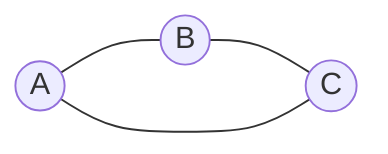
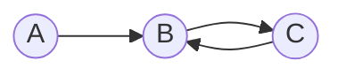
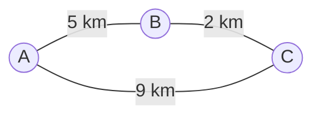
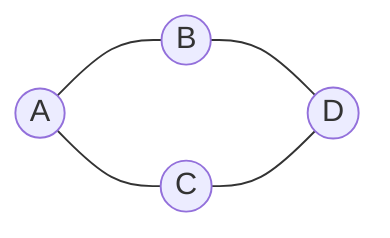

## The idea

A **graph** is a set of **nodes** (the things) joined by **edges** (the links between them). A node can link to any number of other nodes, and the links can go round in loops.

Think of a **map of cities and roads**. Each city is a node. Each road between two cities is an edge. "Can I drive from Mumbai to Delhi?" and "What is the shortest route?" are graph questions.

Graphs are everywhere:

- **Facebook friends:** people are nodes, friendships are edges.
- **Instagram follows:** you can follow someone who doesn't follow you back, so each edge has a direction.
- **Google Maps:** places are nodes, roads are edges, and each road has a length or a travel time.
- **Course prerequisites:** courses are nodes, and "take A before B" is an edge.

A tree is a special graph: it has no loops, and every node except the root has exactly one parent. So what you know from [Tree Basics](../trees/tree-basics.mdx) still helps here.

## How it works

### Words you need

| Word | Meaning | In the map example |
| --- | --- | --- |
| **node** (or vertex) | one item | a city |
| **edge** | a link between two nodes | a road |
| **neighbors** | the nodes joined to a node by one edge | the cities one road away |
| **degree** | how many edges a node has | how many roads leave a city |
| **path** | a list of nodes, each joined to the next | a route |
| **cycle** | a path that ends where it started | a round trip |
| **connected** | every node can reach every other node | you can drive anywhere |

Graph costs use two letters: **V** is the number of nodes (vertices) and **E** is the number of edges. "O(V + E)" means "look at every node and every edge once".

### Undirected, directed and weighted

**Undirected:** an edge works both ways. If A is friends with B, then B is friends with A.



**Directed:** each edge is an arrow and works one way only. Here A follows B, but B doesn't follow A. B and C follow each other, so that takes two arrows. One-way streets and "do A before B" are directed too.



In a directed graph a node has an **in-degree** (arrows coming in) and an **out-degree** (arrows going out). Above, B has in-degree 2 and out-degree 1.

**Weighted:** each edge has a number, like a distance, a time or a price.



A graph can be directed **and** weighted, like one-way flights with prices.

### Storing a graph: the adjacency list

We will store this small graph. It has 4 nodes and 4 edges: A-B, A-C, B-D and C-D.



An **adjacency list** gives each node a list of its neighbors. In JavaScript, an object works well: the key is the node, the value is the array of neighbors.

```js
// Each key is a node. Its value is the list of its neighbors.
const graph = {
    A: ["B", "C"],
    B: ["A", "D"],
    C: ["A", "D"],
    D: ["B", "C"],
};

// Who are A's neighbors?
console.log(graph["A"]); // [ 'B', 'C' ]

// How many edges does D have? That is D's degree.
console.log(graph["D"].length); // 2

// Is there an edge from A to D?
console.log(graph["A"].includes("D")); // false
```

The graph is undirected, so every edge is stored **twice**: B is in A's list, and A is in B's list.

Most graph code loops over the neighbors of one node:

```js
for (const neighbor of graph["A"]) {
    console.log("A is joined to", neighbor);
}
// A is joined to B
// A is joined to C
```

### The same list with a Map

A `Map` works the same way. It is a good choice when node names are not plain strings (with a Map, the number `1` stays a number), and it has handy methods: `has`, `get`, `set` and `size`. See [Map](../js-toolkit/objects-maps-sets.mdx#map).

Problems often give you the edges as a list of pairs. Here we turn that list into a Map. A node seen for the first time gets an empty list.

```js
function buildGraphFromNames(edges) {
    const graph = new Map();

    for (const [from, to] of edges) {
        if (!graph.has(from)) {
            graph.set(from, []);
        }

        if (!graph.has(to)) {
            graph.set(to, []);
        }

        // Undirected: add the edge in both directions.
        graph.get(from).push(to);
        graph.get(to).push(from);
    }

    return graph;
}
```

Now give it the 4 edges of the square graph:

```js
const edges = [
    ["A", "B"],
    ["A", "C"],
    ["B", "D"],
    ["C", "D"],
];

const graphMap = buildGraphFromNames(edges);

console.log(graphMap.get("A")); // [ 'B', 'C' ]
console.log(graphMap.has("E")); // false
console.log(graphMap.size); // 4
```

### Numbered nodes: an array of arrays

In most interview problems the nodes are numbers from `0` to `n - 1`, and you get the edges as pairs, like `n = 4` and `edges = [[0, 1], [0, 2], [1, 3], [2, 3]]`. Then an **array of arrays** is the simplest: `graph[0]` is the list of node 0's neighbors.

```js
function buildGraph(n, edges) {
    // One empty list per node: graph[0] to graph[n - 1].
    const graph = [];
    for (let node = 0; node < n; node++) {
        graph.push([]);
    }

    for (const [from, to] of edges) {
        graph[from].push(to);
        // Undirected: the edge also goes back.
        graph[to].push(from);
    }

    return graph;
}

const numberGraph = buildGraph(4, [[0, 1], [0, 2], [1, 3], [2, 3]]);

console.log(numberGraph); // [ [ 1, 2 ], [ 0, 3 ], [ 0, 3 ], [ 1, 2 ] ]
console.log(numberGraph[3]); // [ 1, 2 ]
```

The empty lists can also be made in one line with `Array.from({ length: n }, () => [])`. Never use `new Array(n).fill([])`: that puts the **same** array in every slot (see [Making 2D arrays the right way](../js-toolkit/arrays.mdx#making-2d-arrays-the-right-way)).

### Directed and weighted lists

For a **directed** graph, push only one way:

```js
const directedEdges = [[0, 1], [1, 2], [2, 1]];
const directedGraph = [[], [], []];

for (const [from, to] of directedEdges) {
    // Directed: the edge goes from -> to only.
    directedGraph[from].push(to);
}

console.log(directedGraph); // [ [ 1 ], [ 2 ], [ 1 ] ]
```

For a **weighted** graph, store a pair `[neighbor, weight]` in each list:

```js
// Each road is [from, to, km].
const roads = [[0, 1, 5], [1, 2, 2], [0, 2, 9]];
const weightedGraph = [[], [], []];

for (const [from, to, km] of roads) {
    weightedGraph[from].push([to, km]);
    weightedGraph[to].push([from, km]);
}

console.log(weightedGraph[0]); // [ [ 1, 5 ], [ 2, 9 ] ]

for (const [neighbor, km] of weightedGraph[0]) {
    console.log("0 to", neighbor, "is", km, "km");
}
// 0 to 1 is 5 km
// 0 to 2 is 9 km
```

| Graph type | What you push for the edge `[from, to]` |
| --- | --- |
| Undirected | `graph[from].push(to)` **and** `graph[to].push(from)` |
| Directed | only `graph[from].push(to)` |
| Weighted | `graph[from].push([to, weight])` (and back, if undirected) |

Building the list takes **O(V + E)** time and space: one empty list per node, then one push (or two) per edge.

### Storing a graph: the adjacency matrix

An **adjacency matrix** is a V × V grid. `matrix[i][j]` is 1 when there is an edge from node i to node j, and 0 when there isn't. Here is the same square graph, with A, B, C, D as 0, 1, 2, 3:

|   | 0 | 1 | 2 | 3 |
| --- | --- | --- | --- | --- |
| **0** | 0 | 1 | 1 | 0 |
| **1** | 1 | 0 | 0 | 1 |
| **2** | 1 | 0 | 0 | 1 |
| **3** | 0 | 1 | 1 | 0 |

An undirected matrix is a mirror image along its diagonal. For a weighted graph, store the weight instead of 1.

```js
const matrix = [
    [0, 1, 1, 0],
    [1, 0, 0, 1],
    [1, 0, 0, 1],
    [0, 1, 1, 0],
];

// Is there an edge from 0 to 3? One lookup: O(1).
console.log(matrix[0][3] === 1); // false

// Node 1's neighbors: scan its whole row. O(V).
const neighbors = [];
for (let node = 0; node < matrix.length; node++) {
    if (matrix[1][node] === 1) {
        neighbors.push(node);
    }
}

console.log(neighbors); // [ 0, 3 ]
```

### List or matrix?

|  | Adjacency list | Adjacency matrix |
| --- | --- | --- |
| Memory | **O(V + E)** | O(V²) |
| Is there an edge from u to v? | O(degree of u): scan the list | **O(1)** |
| All neighbors of u | **O(degree of u)** | O(V): scan the whole row |
| Visit the whole graph (BFS, DFS) | **O(V + E)** | O(V²) |
| Best for | almost every interview problem | small graphs with lots of edges |

Why lists win: picture 1 million users with about 100 friends each. A list stores about 100 million entries. A matrix needs 1 million × 1 million = a **trillion** cells, almost all of them 0.

Use a matrix only when the problem **gives** you one (like "Number of Provinces"), or the graph is small and almost every pair is linked. If you need fast "is there an edge?" checks with a list, store each node's neighbors in a `Set` instead of an array: `has` is O(1).

### Grids are graphs too

Many problems give you a 2D grid, like a map of land (`"1"`) and water (`"0"`). A grid is a graph in disguise:

- each **cell** is a node, found by its `row` and `col`;
- its **neighbors** are the cells up, down, left and right.

You don't build an adjacency list for a grid. You work out the neighbors when you need them. Here are the neighbors of the cell at row 1, col 1:

|  | col 0 | col 1 | col 2 |
| --- | --- | --- | --- |
| **row 0** |  | up (0, 1) |  |
| **row 1** | left (1, 0) | **(1, 1)** | right (1, 2) |
| **row 2** |  | down (2, 1) |  |

Up is one row less, down is one row more, left is one column less, right is one column more. Write those 4 moves in a `directions` array, then loop over it. A cell on the edge has fewer neighbors, so check that each new cell is **inside** the grid.

```js
// The 4 moves: up, down, left, right. Each is [row change, col change].
const directions = [
    [-1, 0],
    [1, 0],
    [0, -1],
    [0, 1],
];

function getNeighbors(grid, row, col) {
    const neighbors = [];

    for (const [rowChange, colChange] of directions) {
        const newRow = row + rowChange;
        const newCol = col + colChange;

        // Skip cells outside the grid.
        const insideRows = newRow >= 0 && newRow < grid.length;
        const insideCols = newCol >= 0 && newCol < grid[0].length;

        if (insideRows && insideCols) {
            neighbors.push([newRow, newCol]);
        }
    }

    return neighbors;
}
```

Now try it on a 3 × 3 grid. The corner cell has only 2 neighbors.

```js
const grid = [
    ["1", "1", "0"],
    ["0", "1", "0"],
    ["1", "0", "1"],
];

const middle = getNeighbors(grid, 1, 1);
const corner = getNeighbors(grid, 0, 0);

console.log(middle); // [ [ 0, 1 ], [ 2, 1 ], [ 1, 0 ], [ 1, 2 ] ]
console.log(corner); // [ [ 1, 0 ], [ 0, 1 ] ]

// The value in a cell: grid[row][col]
console.log(grid[2][0]); // 1
```

- `grid.length` is the number of **rows**. `grid[0].length` is the number of **columns**.
- Always write `grid[row][col]`: the row first. Names like `row` and `col` stop you mixing them up (with `x` and `y` it happens all the time).
- If diagonal cells also count as touching, add 4 more moves: `[-1, -1]`, `[-1, 1]`, `[1, -1]` and `[1, 1]`.
- A grid with R rows and C columns has V = R × C nodes and at most 4 edges per cell, so exploring it is **O(R × C)**.

## Classic problems

### 1. Find the Town Judge

**Problem:** there are `n` people, numbered 1 to `n`. `trust[i] = [a, b]` means person `a` trusts person `b`. The town judge trusts nobody, and everybody else trusts the judge. Return the judge's number, or -1 if there is no judge. With `n = 3` and `trust = [[1, 3], [2, 3]]`, the answer is 3.

**Idea:** this is a directed graph: each trust is an arrow from `a` to `b`. The judge has **out-degree 0** (trusts nobody) and **in-degree n - 1** (trusted by everyone else). Count both for every person, then look for that person. We don't even need the adjacency list, only the counts.

```js
function findJudge(n, trust) {
    // People are numbered 1 to n, so use size n + 1. Index 0 is unused.
    const trusts = new Array(n + 1).fill(0);
    const trustedBy = new Array(n + 1).fill(0);

    for (const [person, trustedPerson] of trust) {
        trusts[person]++;
        trustedBy[trustedPerson]++;
    }

    for (let person = 1; person <= n; person++) {
        const trustsNobody = trusts[person] === 0;
        const trustedByAll = trustedBy[person] === n - 1;

        if (trustsNobody && trustedByAll) {
            return person;
        }
    }

    return -1;
}

console.log(findJudge(3, [[1, 3], [2, 3]])); // 3
console.log(findJudge(3, [[1, 3], [2, 3], [3, 1]])); // -1
console.log(findJudge(1, [])); // 1
```

**Time:** O(V + E) · **Space:** O(V). One pass over the trust pairs (the edges), one pass over the people (the nodes), and two count arrays of size n + 1.

### 2. Find the Center of a Star Graph

**Problem:** an undirected star graph has one center node joined to every other node, and no other edges. Given the edges, return the center. With `edges = [[1, 2], [2, 3], [4, 2]]`, the answer is 2.

**Idea:** the center is in **every** edge. So it must be the node that the first two edges share. No need to look at the rest.

```js
function findCenter(edges) {
    const firstEdge = edges[0];
    const secondEdge = edges[1];
    const candidate = firstEdge[0];

    // The center is the node that both edges share.
    if (candidate === secondEdge[0] || candidate === secondEdge[1]) {
        return candidate;
    }

    return firstEdge[1];
}

console.log(findCenter([[1, 2], [2, 3], [4, 2]])); // 2
console.log(findCenter([[1, 2], [5, 1], [1, 3], [1, 4]])); // 1
```

**Time:** O(1) · **Space:** O(1). We only ever look at two edges, however big the graph is. Thinking about **degrees** first saved us from building anything.

## How to spot a graph problem

Graphs are often hidden. Look for:

- **Things and links between them:** network, connections, friends, cities and roads, flights, routes.
- **"Before" and "depends on":** prerequisites, build order, tasks that wait for other tasks. That is a directed graph; see [Topological Sort](./topological-sort.mdx).
- **A 2D grid** with islands, regions, rooms, or something that spreads to the cells around it. Each cell is a node.
- **Moves between states:** "change one letter at a time" ([Word Ladder](./graph-bfs-dfs.mdx#4-word-ladder-hard)) or "turn one wheel of a lock" (Open the Lock). Each state is a node and each move is an edge. You never build the whole graph; you make the neighbors as you go.
- **Groups:** "are these two in the same group?" or "how many separate groups?". See [Union-Find](./union-find.mdx).

Once you see the graph, exploring it is the next step: [Graph BFS and DFS](./graph-bfs-dfs.mdx).

## Common mistakes

- **`new Array(n).fill([])`.** Every slot gets the same array, so a push to one node's list shows up in all of them. Make a new array for each node in a loop.
- **Forgetting the second push** in an undirected graph. Then you can walk from A to B but not back.
- **Losing nodes that have no edges.** When you build a Map from the edge list, a node with no edges never appears. When the problem gives `n`, make all `n` lists first.
- **Labels from 1 to n.** Make arrays of size `n + 1` (and skip index 0), or subtract 1 from every label.
- **Mixing up rows and columns.** It's `grid[row][col]`. Rows go with `grid.length`, columns with `grid[0].length`.
- **A matrix for a big graph.** O(V²) memory runs out fast. Use a list.

## In the interview

Before writing any code, ask about the graph:

- Is it **directed** or **undirected**?
- Is it **weighted**? Can a weight be negative?
- Can it have **cycles**? Can it be in several separate pieces?
- Can there be an edge from a node to itself, or the same edge twice?
- How many nodes and edges? Are the labels 0 to n - 1, or 1 to n?

> "The input is a list of edges, so first I'll build an adjacency list: an array of n lists. The graph is undirected, so I add each edge in both directions. That takes O(V + E) time and space."

**Likely follow-up:** "Why an adjacency list and not a matrix?"

**Answer:** "Most real graphs have far fewer edges than V². The list uses O(V + E) memory and lets me loop straight over a node's neighbors. The matrix uses O(V²) memory, and finding the neighbors means scanning a whole row. I'd only pick a matrix for a small graph where almost every pair is linked. If I need fast edge checks, I can keep a Set of neighbors per node instead."

<Callout title="Remember this" type="success">
  - **Graph = nodes + edges.** Edges can be two-way (undirected) or one-way (directed), and can carry a weight.
  - Use an **adjacency list**: `graph[node]` is the list of its neighbors. O(V + E) memory. A matrix is O(V²).
  - Build from an edge list: one empty list per node, then push each edge, **both ways if undirected**.
  - Never `new Array(n).fill([])`: all slots share one array. Use a loop or `Array.from({ length: n }, () => [])`.
  - **A grid is a graph:** cells are nodes, a `directions` array gives the 4 neighbors, and you always check the bounds.
  - Ask first: directed? weighted? cycles? separate pieces? labels from 0 or from 1?
</Callout>
