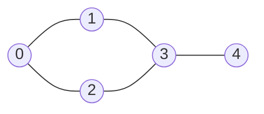
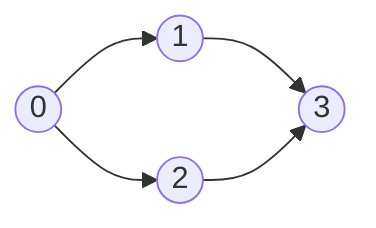

## The idea

To **explore** a graph means to visit every node you can reach from a start node, each one **once**. There are two ways to do it:

- **DFS (depth-first search)** goes as **deep** as it can down one path. At a dead end, it steps back and tries the next path. Like walking through a maze: follow one path until you hit a wall, go back to the last turn, try another way.
- **BFS (breadth-first search)** goes out in **rings**: first every node 1 step away, then every node 2 steps away, and so on. Like a stone dropped in a pond: the ripples spread out evenly.

Both keep a **visited** set, like chalk marks on the maze walls, so they never walk the same place twice. Without it, a loop in the graph would trap you forever.

You see this every day:

- LinkedIn's "1st", "2nd" and "3rd" connections are BFS rings: your contacts, their contacts, and one ring further.
- The paint bucket tool in an image editor fills every touching pixel of the same color. That's a DFS or BFS over a grid of pixels.

## How it works

### The example graph

All the code in this section uses this small undirected graph, stored as an adjacency list (see [Graph Basics](./graph-basics.mdx)). The **Run** button on the blocks below runs this block first.

```js
// graph[node] is the list of that node's neighbors.
// Edges: 0-1, 0-2, 1-3, 2-3, 3-4
const graph = [
    [1, 2],
    [0, 3],
    [0, 3],
    [1, 2, 4],
    [3],
];
```



There is a loop: 0, 1, 3, 2 and back to 0. That loop is why we need the visited set.

### DFS with recursion

DFS in three steps: mark the node as visited, then for each neighbor that is not visited yet, do DFS on it. Recursion does the "go back" part for us: when a call finishes, we are back in the call before it (see [Recursion](../foundations/recursion.mdx)).

```js
function dfs(graph, start) {
    const visited = new Set();
    const order = [];

    function explore(node) {
        visited.add(node);
        order.push(node);

        for (const neighbor of graph[node]) {
            if (!visited.has(neighbor)) {
                explore(neighbor);
            }
        }
    }

    explore(start);
    return order;
}

console.log(dfs(graph, 0)); // [ 0, 1, 3, 2, 4 ]
```

How it runs:

| Step | Visit | Why | Call stack (bottom → top) |
| --- | --- | --- | --- |
| 1 | 0 | the start | 0 |
| 2 | 1 | first unvisited neighbor of 0 | 0, 1 |
| 3 | 3 | first unvisited neighbor of 1 (0 is visited) | 0, 1, 3 |
| 4 | 2 | first unvisited neighbor of 3 (1 is visited) | 0, 1, 3, 2 |
| 5 | none | 2's neighbors 0 and 3 are visited, so go back to 3 | 0, 1, 3 |
| 6 | 4 | next neighbor of 3 | 0, 1, 3, 4 |
| 7 | none | nothing left: the calls return one by one | (empty) |

DFS went 0 → 1 → 3 → 2 as deep as it could, then came back to 3 to pick up 4.

### DFS with your own stack

Recursion uses the call stack, and Node's call stack overflows at around 10,000 calls deep. A big graph (or a big grid) can go deeper than that. The fix: keep your own stack in an array. `push` adds to the top and `pop` takes from the top.

```js
function dfsWithStack(graph, start) {
    const visited = new Set();
    const order = [];
    const stack = [start];

    while (stack.length > 0) {
        const node = stack.pop();

        // A node can be pushed more than once. Skip it if it is already visited.
        if (visited.has(node)) {
            continue;
        }

        visited.add(node);
        order.push(node);

        for (const neighbor of graph[node]) {
            if (!visited.has(neighbor)) {
                stack.push(neighbor);
            }
        }
    }

    return order;
}

console.log(dfsWithStack(graph, 0)); // [ 0, 2, 3, 4, 1 ]
```

The order is different from the recursive one, because `pop` takes the **last** neighbor pushed first. It is still DFS: it went 0 → 2 → 3 → 4 as deep as it could before coming back for 1. If you need the same order as the recursive version, push the neighbors in reverse order.

### BFS with a queue

BFS uses a **queue**: first in, first out, like a line at a shop. Take a node from the front, add its unvisited neighbors to the back. Nodes 1 step away join the line before nodes 2 steps away, so BFS visits them in rings.

```js
function bfs(graph, start) {
    const visited = new Set([start]);
    const order = [];
    const queue = [start];

    // head is the index of the next node to take from the queue.
    let head = 0;

    while (head < queue.length) {
        const node = queue[head];
        head++;
        order.push(node);

        for (const neighbor of graph[node]) {
            // Mark it when you add it, so it is never added twice.
            if (!visited.has(neighbor)) {
                visited.add(neighbor);
                queue.push(neighbor);
            }
        }
    }

    return order;
}

console.log(bfs(graph, 0)); // [ 0, 1, 2, 3, 4 ]
```

How it runs:

| Step | Take | Add to the queue | Queue (front → back) |
| --- | --- | --- | --- |
| 1 | 0 | 1, 2 | 1, 2 |
| 2 | 1 | 3 (0 is visited) | 2, 3 |
| 3 | 2 | nothing (0 and 3 are visited) | 3 |
| 4 | 3 | 4 | 4 |
| 5 | 4 | nothing | (empty) |

Here are the rings. Green is the start, blue is 1 step away, purple is 2 steps, and amber is 3 steps.


**Mark nodes as visited when you add them to the queue**, not when you take them out. Otherwise node 3 would be added twice: once by 1 and once by 2, before either copy is taken out.

### Why a head index, and not shift()

`queue.shift()` also takes the first item, but then it moves **every other item** one place to the left. That is O(n) for each call. BFS takes out every node once, so with `shift()` the whole BFS can become O(V²).

With a head index, nothing moves. We read `queue[head]` and add 1 to `head`. That is O(1). The items before `head` stay in the array, but that's fine: each node enters the queue only once, so the array never holds more than V items. See [Why shift and unshift are O(n)](../js-toolkit/arrays.mdx#why-shift-and-unshift-are-on) and [Queues and Deques](../stacks-queues/queues-and-deques.mdx).

### Shortest path in an unweighted graph

BFS reaches nodes ring by ring. So the **first** time BFS reaches a node, it got there with the **fewest edges**. That makes BFS the tool for "fewest steps" when every edge costs the same.

Instead of a visited set, keep a `distance` array. `-1` means "not reached yet", so it also does the job of the visited set.

```js
function shortestPath(graph, start, target) {
    // distance[node] = fewest edges from start. -1 = not reached yet.
    const distance = new Array(graph.length).fill(-1);
    distance[start] = 0;

    const queue = [start];
    let head = 0;

    while (head < queue.length) {
        const node = queue[head];
        head++;

        if (node === target) {
            return distance[node];
        }

        for (const neighbor of graph[node]) {
            if (distance[neighbor] === -1) {
                distance[neighbor] = distance[node] + 1;
                queue.push(neighbor);
            }
        }
    }

    // The queue ran out: target can't be reached.
    return -1;
}

console.log(shortestPath(graph, 0, 4)); // 3
console.log(shortestPath(graph, 1, 2)); // 2
```

DFS can't do this. It might wander 0 → 1 → 3 → 2 and reach node 2 in 3 steps, while the direct edge 0 → 2 is just 1 step. If edges have **different** costs, BFS isn't enough either: see [Shortest Paths](./shortest-paths.mdx).

### DFS or BFS?

|  | DFS | BFS |
| --- | --- | --- |
| Tool | recursion, or a stack | a queue (array + head index) |
| Order | one path deep, then back up | ring by ring |
| Fewest steps (unweighted) | no | **yes** |
| Good for | visit everything, count groups, find cycles, clone a graph | fewest steps, levels, "spreads every minute" |
| Code | shortest (recursion) | a little longer |

**Time:** O(V + E) for both. Each node is visited once, and each edge is looked at once (twice in an undirected graph, once from each end). **Space:** O(V) for the visited set plus the stack or queue. (The stack version can push a node more than once, so its stack can grow to O(E).) For a grid, V is rows × columns.

## Classic problems

### 1. Number of Islands

**Problem:** a grid has `"1"` for land and `"0"` for water. An island is a group of land cells joined up, down, left or right. Count the islands.

```
1 1 0 0
1 0 0 1
0 0 1 1
1 0 0 0
```

This grid has 3 islands: top left, right, and the single cell at the bottom left.

**Idea:** scan every cell. When you find land, that's a new island: add 1 to the count, then run a DFS that **sinks** the whole island (turns its land into water), so you never count it again. Turning `"1"` into `"0"` is our visited mark.

This "loop over every node, start a search from each unvisited one" trick counts the separate pieces of **any** graph.

**Step 1: sink one island.** DFS on the grid. Stop at the grid's edge or at water.

```js
function sinkIsland(grid, row, col) {
    const outsideRows = row < 0 || row >= grid.length;
    const outsideCols = col < 0 || col >= grid[0].length;

    // Check the bounds BEFORE reading grid[row][col].
    if (outsideRows || outsideCols) {
        return;
    }

    if (grid[row][col] !== "1") {
        return;
    }

    // Turn land into water, so this cell is never visited again.
    grid[row][col] = "0";

    sinkIsland(grid, row - 1, col);
    sinkIsland(grid, row + 1, col);
    sinkIsland(grid, row, col - 1);
    sinkIsland(grid, row, col + 1);
}
```

**Step 2: count.** Each time the scan finds land, it's a new island.

```js
function numIslands(grid) {
    let islands = 0;

    for (let row = 0; row < grid.length; row++) {
        for (let col = 0; col < grid[0].length; col++) {
            if (grid[row][col] === "1") {
                islands++;
                sinkIsland(grid, row, col);
            }
        }
    }

    return islands;
}

const grid = [
    ["1", "1", "0", "0"],
    ["1", "0", "0", "1"],
    ["0", "0", "1", "1"],
    ["1", "0", "0", "0"],
];

console.log(numIslands(grid)); // 3
```

This **changes the input grid**. If that's not allowed, keep a `visited` Set of strings like `"2,3"` instead. (A Set can't hold `[2, 3]` usefully: two arrays with the same numbers are still different objects.)

**Time:** O(rows × cols) · **Space:** O(rows × cols). The scan looks at each cell once, and each land cell is sunk once. In the worst case (all land), the recursion can go as deep as the number of cells.

### 2. Clone Graph

**Problem:** you get one node of a connected undirected graph. Each node has a `val` and a list of `neighbors`. Return a **deep copy**: all new nodes, joined in the same shape.

**Idea:** DFS, plus a Map from each original node to its copy. When you reach a node:

- If it is in the Map, it's already copied: return the copy. This also stops the loops.
- Otherwise make a copy, put it in the Map **before** you visit the neighbors, then copy each neighbor and add it to the copy's list.

**Step 1: the node class.**

```js
class GraphNode {
    constructor(val) {
        this.val = val;
        this.neighbors = [];
    }
}
```

**Step 2: clone with DFS.**

```js
function cloneGraph(node) {
    if (node === null) {
        return null;
    }

    // original node -> its copy
    const copies = new Map();

    function copy(original) {
        // Already copied: reuse it. This also stops us looping forever.
        if (copies.has(original)) {
            return copies.get(original);
        }

        const clone = new GraphNode(original.val);

        // Save it BEFORE the neighbors, so a loop back finds it.
        copies.set(original, clone);

        for (const neighbor of original.neighbors) {
            clone.neighbors.push(copy(neighbor));
        }

        return clone;
    }

    return copy(node);
}
```

**Step 3: try it** on a square: 1 - 2 - 3 - 4 - back to 1.

```js
const one = new GraphNode(1);
const two = new GraphNode(2);
const three = new GraphNode(3);
const four = new GraphNode(4);

one.neighbors.push(two, four);
two.neighbors.push(one, three);
three.neighbors.push(two, four);
four.neighbors.push(one, three);

const cloned = cloneGraph(one);

console.log(cloned.val); // 1
console.log(cloned.neighbors.map((node) => node.val)); // [ 2, 4 ]

// A real copy: new objects, not the old ones.
console.log(cloned === one); // false
console.log(cloned.neighbors[0] === two); // false
```

**Time:** O(V + E) · **Space:** O(V). Each node is copied once and each edge is followed once from each end. The Map and the recursion hold up to V items.

### 3. Rotting Oranges

**Problem:** in a grid, `0` is empty, `1` is a fresh orange and `2` is a rotten orange. Every minute, each fresh orange next to a rotten one (up, down, left, right) turns rotten. Return the minutes until no fresh orange is left, or -1 if some can never rot.

```
2 1 1
1 1 0
0 1 1
```

The answer here is 4.

**Idea:** the rot spreads in rings, one ring per minute. That's BFS. But there can be **many** rotten oranges at the start, and they all spread at the same time. So put **all** of them in the queue at the start, at minute 0. This is called **multi-source BFS**: like dropping several stones into the pond at once.

| Minute | Oranges that turn rotten (row, col) |
| --- | --- |
| 0 | (0, 0) is rotten at the start |
| 1 | (0, 1) and (1, 0) |
| 2 | (0, 2) and (1, 1) |
| 3 | (2, 1) |
| 4 | (2, 2) |

**Step 1: the moves and a helper.** `isFresh` checks the bounds first, then the cell.

```js
const directions = [
    [-1, 0],
    [1, 0],
    [0, -1],
    [0, 1],
];

function isFresh(grid, row, col) {
    const insideRows = row >= 0 && row < grid.length;
    const insideCols = col >= 0 && col < grid[0].length;

    if (!insideRows || !insideCols) {
        return false;
    }

    return grid[row][col] === 1;
}
```

**Step 2: spread the rot.** Each queue item is `[row, col, minute]`. When a fresh orange rots, it joins the queue one minute later than the orange that rotted it.

```js
function spreadRot(grid, queue, fresh) {
    let minutes = 0;
    let head = 0;

    while (head < queue.length) {
        const [row, col, minute] = queue[head];
        head++;
        minutes = minute;

        for (const [rowChange, colChange] of directions) {
            const newRow = row + rowChange;
            const newCol = col + colChange;

            if (isFresh(grid, newRow, newCol)) {
                grid[newRow][newCol] = 2;
                fresh--;
                queue.push([newRow, newCol, minute + 1]);
            }
        }
    }

    // Some fresh oranges were never reached.
    if (fresh > 0) {
        return -1;
    }

    return minutes;
}
```

**Step 3: start.** Put every rotten orange in the queue, and count the fresh ones.

```js
function orangesRotting(grid) {
    const queue = [];
    let fresh = 0;

    for (let row = 0; row < grid.length; row++) {
        for (let col = 0; col < grid[0].length; col++) {
            if (grid[row][col] === 2) {
                queue.push([row, col, 0]);
            }

            if (grid[row][col] === 1) {
                fresh++;
            }
        }
    }

    return spreadRot(grid, queue, fresh);
}

console.log(orangesRotting([[2, 1, 1], [1, 1, 0], [0, 1, 1]])); // 4
console.log(orangesRotting([[2, 1, 1], [0, 1, 1], [1, 0, 1]])); // -1
console.log(orangesRotting([[0, 2]])); // 0
```

In the second grid, the orange at the bottom left is cut off by empty cells, so the answer is -1.

**Time:** O(rows × cols) · **Space:** O(rows × cols). Each cell enters the queue at most once, and the queue can hold every cell.

## Detecting a cycle

"Is there a loop?" is a common question, and the answer is different for undirected and directed graphs.

### In an undirected graph: skip the parent

Do a DFS. If you meet a neighbor that is **already visited** and it is **not the node you just came from** (the parent), you found a loop.

Why skip the parent? In an undirected graph, the edge 0-1 is stored both ways. From 1, you see 0 again, but walking back along the same edge is not a loop.

**Step 1: DFS that remembers where it came from.**

```js
function findLoop(graph, node, parent, visited) {
    visited.add(node);

    for (const neighbor of graph[node]) {
        // Walking back along the edge we came from is not a loop.
        if (neighbor === parent) {
            continue;
        }

        // Seen before, and not the way we came: a loop.
        if (visited.has(neighbor)) {
            return true;
        }

        if (findLoop(graph, neighbor, node, visited)) {
            return true;
        }
    }

    return false;
}
```

**Step 2: try every piece.** The graph can be in several separate pieces, so start from every node that isn't visited yet. The start has no parent, so we pass `-1`.

```js
function hasCycleUndirected(graph) {
    const visited = new Set();

    for (let node = 0; node < graph.length; node++) {
        if (!visited.has(node)) {
            if (findLoop(graph, node, -1, visited)) {
                return true;
            }
        }
    }

    return false;
}

// Our example graph has the loop 0-1-3-2-0.
console.log(hasCycleUndirected(graph)); // true

// A straight line 0-1-2 has no loop.
console.log(hasCycleUndirected([[1], [0, 2], [1]])); // false
```

### In a directed graph: three states

In a directed graph, reaching a visited node is **not** enough. Look at this graph: DFS reaches node 3 twice (through 1, then through 2), but there is no loop, because no arrow leads from 3 back to 0.



A loop exists only when you reach a node that is **still on the path you are walking right now**. So each node gets one of three states:

| State | Often drawn as | Meaning |
| --- | --- | --- |
| `NOT_VISITED` | white | not seen yet |
| `VISITING` | gray | on the current path: its DFS call hasn't finished |
| `DONE` | black | it and everything after it are checked: no loop there |

An arrow to a `VISITING` node means you walked in a circle back onto your own path: a loop. An arrow to a `DONE` node is fine: skip it.

**Step 1: DFS with states.**

```js
const NOT_VISITED = 0;
const VISITING = 1;
const DONE = 2;

function findLoopFrom(graph, node, state) {
    state[node] = VISITING;

    for (const neighbor of graph[node]) {
        // Back to a node on the current path: a loop.
        if (state[neighbor] === VISITING) {
            return true;
        }

        if (state[neighbor] === NOT_VISITED) {
            if (findLoopFrom(graph, neighbor, state)) {
                return true;
            }
        }
    }

    // Everything after this node is checked. No loop through here.
    state[node] = DONE;
    return false;
}
```

**Step 2: try every node.**

```js
function hasCycleDirected(graph) {
    const state = new Array(graph.length).fill(NOT_VISITED);

    for (let node = 0; node < graph.length; node++) {
        if (state[node] === NOT_VISITED) {
            if (findLoopFrom(graph, node, state)) {
                return true;
            }
        }
    }

    return false;
}

// The picture above: 3 is reached twice, but there is no loop.
const noLoop = [[1, 2], [3], [3], []];

// 0 -> 1 -> 2 -> 0 is a loop.
const withLoop = [[1], [2], [0]];

console.log(hasCycleDirected(noLoop)); // false
console.log(hasCycleDirected(withLoop)); // true
```

In `withLoop`, DFS marks 0, 1 and 2 as `VISITING`, one after another. Then 2 has an arrow to 0, which is still `VISITING`: a loop.

**Time:** O(V + E) for both versions: one DFS over every node and edge. **Space:** O(V) for the states and the recursion. [Topological Sort](./topological-sort.mdx) shows another way to find loops in a directed graph, and [Union-Find](./union-find.mdx) another way for undirected ones.

## How to spot it

- **"Number of islands / regions / groups / provinces"** → DFS (or BFS) from each unvisited cell or node, and count the starts.
- **"Fewest steps", "minimum moves", "shortest path"** where every move costs the same → **BFS**.
- **"Every minute it spreads"**, or "distance to the nearest X" with many starting points → **multi-source BFS**: put all the starts in the queue at once.
- **"Which cells can reach the edge / the ocean?"** (Pacific Atlantic Water Flow, Surrounded Regions) → search **backwards**: start from the edge cells and mark everything they can reach, instead of starting a new search from every cell.
- **"Copy" or "clone"** a graph → DFS plus a Map from old node to new node.
- **"Is there a loop?", "deadlock", "can every task finish?"** → cycle detection (three states for directed graphs).
- **"Can you reach...?", "is there a path?"** → either one works.

## Common mistakes

- **No visited set.** A loop in the graph means an endless loop in your code.
- **In BFS, marking visited when you take a node out.** The same node gets added to the queue many times. Mark it when you add it.
- **`queue.shift()`.** It's O(n) per call, so BFS becomes O(V²). Use a head index.
- **DFS for "fewest steps".** DFS finds *a* path, not the shortest one. Use BFS.
- **Deep recursion on a big grid.** A grid of 1000 × 1000 land cells can make the recursion far deeper than Node's limit of about 10,000 calls. Use BFS or a stack.
- **Reading the cell before checking the bounds.** `grid[-1]` is `undefined`, so `grid[-1][0]` throws an error. Check the bounds first.
- **Changing the input without asking.** Sinking islands edits the grid. Ask first, or use a visited Set.
- **Forgetting the separate pieces.** One DFS from node 0 only explores node 0's piece. Loop over all nodes as starts.
- **Cycle checks:** in an undirected graph, forgetting to skip the parent makes every edge look like a loop. In a directed graph, a plain visited set gives false alarms. Use three states.

## In the interview

- Say **which one and why**: "fewest steps, so BFS", or "I just need to visit every cell, so DFS".
- Say **how you mark visited**, and whether you change the input.
- Give the cost as O(V + E), or O(rows × cols) for a grid.

> "Each land cell is a node, and its neighbors are the 4 cells around it. I scan the grid. When I find land, I count a new island and run a DFS that sinks the whole island, so it isn't counted again. Each cell is handled at most twice, so it's O(rows × cols) time. The recursion can be O(rows × cols) deep in the worst case."

**Likely follow-up:** "What if the grid is huge and the recursion overflows the stack?"

**Answer:** "I'd switch to BFS with a queue, or to DFS with my own stack array. The time is the same, O(rows × cols), but the waiting cells live in an array instead of on the call stack, which is small."

**Another follow-up:** "Your BFS returns the length of the shortest path. How do you return the path itself?"

**Answer:** "I keep a `previous` array. When BFS first reaches a neighbor, I set `previous[neighbor] = node`. At the end I walk back from the target through `previous` until I reach the start, then reverse that list."

<Callout title="Remember this" type="success">
  - **DFS** goes deep (recursion or a stack). **BFS** goes ring by ring (a queue). Both need a **visited** set and cost **O(V + E)**.
  - The BFS queue is an array plus a **head index**. `shift()` is O(n) and makes BFS O(V²).
  - In BFS, **mark visited when you add** a node to the queue, not when you take it out.
  - **Fewest steps** with equal-cost edges → BFS. Many starting points → put them **all in the queue at once** (Rotting Oranges).
  - Count groups (islands): loop over every node; each unvisited one starts a new search and is a new group.
  - Cycles: undirected → **skip the parent**. Directed → **three states**; a loop is an arrow to a node that is still `VISITING`.
</Callout>
