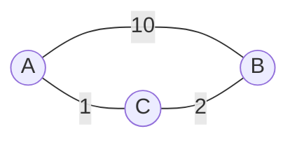
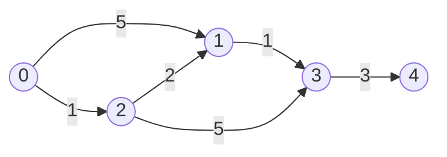
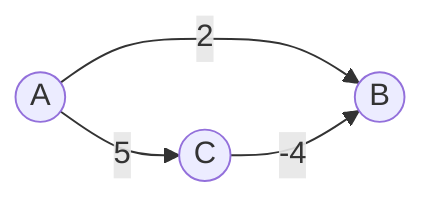

## The idea

When every edge costs the same, the shortest path is the one with the **fewest edges**, and [BFS](./graph-bfs-dfs.mdx) finds it. But real edges often have **different costs**: kilometers, minutes, money. Then a path with fewer edges can cost more.

**Dijkstra's algorithm** finds the cheapest path from one start node to every other node, as long as no edge has a negative cost. Its one rule: **always continue from the closest node you haven't finished yet.**

Think of **water flowing through pipes** from a tap. It reaches the nearest junctions first, then the ones further away. The moment the water first reaches a junction is the shortest time to get there. Dijkstra does the same: it always moves the "water front" forward at its closest point.

In the real world, internet routers that use the OSPF protocol run Dijkstra's algorithm to work out the shortest routes through their network.

## How it works

### Why BFS is not enough



BFS sees that B is just one edge from A, so it answers "A → B", which costs 10. But A → C → B costs 1 + 2 = **3**. Fewer edges is not the same as cheaper.

### The plan

Dijkstra keeps two things:

- **`dist[node]`**: the cheapest cost found so far from the start. At first `dist[start]` is 0 and every other node is `Infinity` (not reached yet).
- **A min-heap of `[distance, node]` pairs**: the places the water front could move to next. A min-heap always gives back the pair with the **smallest** distance, fast. See [Heaps and Priority Queues](../heaps/heaps.mdx).

Then it repeats:

1. Take out the pair with the smallest distance: `[distance, node]`.
2. If `distance` is bigger than `dist[node]`, this pair is **old news**: a cheaper way to `node` was already found. Skip it.
3. Otherwise, look at each edge from `node` to a `neighbor`, with cost `weight`. If `distance + weight` is less than `dist[neighbor]`, you found a cheaper way: save it in `dist` and push `[distance + weight, neighbor]` onto the heap. This step is called **relaxing** the edge.

When the heap is empty, `dist` holds the cheapest cost to every node.

**Why it works:** when a node comes out of the heap, every other way to reach it would have to pass through a node that is at least as far away, and no edge can make a path cheaper. So nothing cheaper can still be coming. Its cost is final.

### A small min-heap

JavaScript has no built-in heap, so here is a small one. It is a tree stored in an array: index 0 holds the smallest item, and the children of index `i` sit at `2 * i + 1` and `2 * i + 2`. [Heaps and Priority Queues](../heaps/heaps.mdx) explains it in full.

Each item is an array whose **first number is the distance**, like `[distance, node]`. The heap compares only that first number, `item[0]`.

**Step 1: move an item up.** A new item starts at the end and swaps with its parent while it is smaller.

```js
function swap(items, indexA, indexB) {
    const temp = items[indexA];
    items[indexA] = items[indexB];
    items[indexB] = temp;
}

function bubbleUp(items, index) {
    while (index > 0) {
        const parentIndex = Math.floor((index - 1) / 2);

        // The parent is smaller or equal: the item is in its place.
        if (items[parentIndex][0] <= items[index][0]) {
            return;
        }

        swap(items, parentIndex, index);
        index = parentIndex;
    }
}
```

**Step 2: move an item down.** After the top item is taken out, the last item moves to the top, then swaps with its smaller child while that child is smaller.

```js
function sinkDown(items, index) {
    while (true) {
        const leftIndex = 2 * index + 1;
        const rightIndex = 2 * index + 2;
        const hasLeft = leftIndex < items.length;
        const hasRight = rightIndex < items.length;
        let smallestIndex = index;

        if (hasLeft && items[leftIndex][0] < items[smallestIndex][0]) {
            smallestIndex = leftIndex;
        }

        if (hasRight && items[rightIndex][0] < items[smallestIndex][0]) {
            smallestIndex = rightIndex;
        }

        // No child is smaller: the item is in its place.
        if (smallestIndex === index) {
            return;
        }

        swap(items, index, smallestIndex);
        index = smallestIndex;
    }
}
```

**Step 3: the MinHeap class.**

```js
class MinHeap {
    constructor() {
        this.items = [];
    }

    size() {
        return this.items.length;
    }

    push(item) {
        this.items.push(item);
        bubbleUp(this.items, this.items.length - 1);
    }

    // Takes out and returns the item with the smallest distance.
    pop() {
        const smallest = this.items[0];
        const last = this.items.pop();

        if (this.items.length > 0) {
            this.items[0] = last;
            sinkDown(this.items, 0);
        }

        return smallest;
    }
}
```

Try it:

```js
const heap = new MinHeap();

heap.push([5, "B"]);
heap.push([1, "C"]);
heap.push([3, "D"]);

console.log(heap.pop()); // [ 1, 'C' ]
console.log(heap.pop()); // [ 3, 'D' ]
console.log(heap.size()); // 1
```

`push` and `pop` are both **O(log n)**: an item moves at most one level per swap, and a heap of n items has about log n levels.

On LeetCode, JavaScript also comes with a ready-made `MinPriorityQueue` (from the `@datastructures-js/priority-queue` library). In a live interview you may have to write your own, or ask if you can assume one exists.

### Dijkstra, step by step

We will use this directed graph. The numbers are the edge costs.



**Step 1: build the graph.** Each list holds `[neighbor, weight]` pairs (see [Graph Basics](./graph-basics.mdx)).

```js
// Each edge is [from, to, weight]. The graph is directed.
function buildWeightedGraph(n, edges) {
    const graph = [];
    for (let node = 0; node < n; node++) {
        graph.push([]);
    }

    for (const [from, to, weight] of edges) {
        graph[from].push([to, weight]);
    }

    return graph;
}
```

**Step 2: Dijkstra.** It uses the `MinHeap` from above.

```js
function dijkstra(graph, start) {
    // dist[node] = the cheapest cost found so far. Infinity = not reached.
    const dist = new Array(graph.length).fill(Infinity);
    dist[start] = 0;

    const heap = new MinHeap();
    heap.push([0, start]);

    while (heap.size() > 0) {
        const [distance, node] = heap.pop();

        // Old news: a cheaper way to this node was already found.
        if (distance > dist[node]) {
            continue;
        }

        for (const [neighbor, weight] of graph[node]) {
            const newDistance = distance + weight;

            // A cheaper way to neighbor: save it and push it.
            if (newDistance < dist[neighbor]) {
                dist[neighbor] = newDistance;
                heap.push([newDistance, neighbor]);
            }
        }
    }

    return dist;
}
```

**Step 3: run it** from node 0.

```js
const edges = [
    [0, 1, 5],
    [0, 2, 1],
    [2, 1, 2],
    [1, 3, 1],
    [2, 3, 5],
    [3, 4, 3],
];

const graph = buildWeightedGraph(5, edges);

console.log(dijkstra(graph, 0)); // [ 0, 3, 1, 4, 7 ]
```

How it runs. The heap column lists its pairs smallest first.

| Step | Pop | What happens | dist for nodes 0 to 4 | Heap after |
| --- | --- | --- | --- | --- |
| 1 | [0, 0] | relax: 1 costs 5, 2 costs 1 | 0, 5, 1, ∞, ∞ | [1, 2], [5, 1] |
| 2 | [1, 2] | relax: 1 costs 1 + 2 = 3 (cheaper than 5), 3 costs 1 + 5 = 6 | 0, 3, 1, 6, ∞ | [3, 1], [5, 1], [6, 3] |
| 3 | [3, 1] | relax: 3 costs 3 + 1 = 4 (cheaper than 6) | 0, 3, 1, 4, ∞ | [4, 3], [5, 1], [6, 3] |
| 4 | [4, 3] | relax: 4 costs 4 + 3 = 7 | 0, 3, 1, 4, 7 | [5, 1], [6, 3], [7, 4] |
| 5 | [5, 1] | **skip**: 5 is more than dist[1] = 3 | no change | [6, 3], [7, 4] |
| 6 | [6, 3] | **skip**: 6 is more than dist[3] = 4 | no change | [7, 4] |
| 7 | [7, 4] | node 4 has no edges | 0, 3, 1, 4, 7 | (empty) |

The cheapest way to node 1 is 0 → 2 → 1 (cost 3), not the direct edge (cost 5).

### Why skip the old entries

The heap can hold **several pairs for the same node**: above, node 1 had `[5, 1]` and later `[3, 1]`. Taking the old pair out of a heap is slow, so we leave it there and skip it when it comes out (steps 5 and 6). Without the skip, the answer is still right, but the code redoes work for nothing.

### No negative weights



Dijkstra trusts one promise: when a node comes out of the heap, nobody can reach it cheaper later. A negative edge breaks that promise. Here B comes out first with cost 2, but A → C → B costs 5 − 4 = **1**. So never use Dijkstra with negative weights. The algorithm for those is **Bellman-Ford**.

**Time:** O(E log V) · **Space:** O(V + E). Each edge can push at most one pair onto the heap, so the heap gets at most E pushes and E pops, and each one costs about log V. You may also see this written as O((V + E) log V).

## Classic problems

### 1. Network Delay Time

**Problem:** there are `n` network nodes, labeled 1 to `n`. `times[i] = [u, v, w]` means a signal takes `w` milliseconds to go from `u` to `v` (one way). A signal is sent from node `k`. How long until every node has it? Return -1 if some node never gets it. With `times = [[2, 1, 1], [2, 3, 1], [3, 4, 1]]`, `n = 4` and `k = 2`, the answer is 2.

**Idea:** the time a node gets the signal is its **shortest path** from `k`. Everyone has the signal when the **last** node gets it, so the answer is the **largest** value in `dist`. If any node is still `Infinity`, it was never reached: return -1. The labels start at 1, so make `n + 1` slots and skip slot 0.

This uses `MinHeap` and `dijkstra` from above.

```js
function networkDelayTime(times, n, k) {
    // Labels are 1 to n, so make n + 1 lists. List 0 stays empty.
    const graph = [];
    for (let node = 0; node <= n; node++) {
        graph.push([]);
    }

    for (const [from, to, time] of times) {
        graph[from].push([to, time]);
    }

    const dist = dijkstra(graph, k);

    // The last node to get the signal decides the answer.
    let slowest = 0;
    for (let node = 1; node <= n; node++) {
        if (dist[node] === Infinity) {
            return -1;
        }

        slowest = Math.max(slowest, dist[node]);
    }

    return slowest;
}
```

Try it:

```js
const times = [[2, 1, 1], [2, 3, 1], [3, 4, 1]];

console.log(networkDelayTime(times, 4, 2)); // 2
console.log(networkDelayTime([[1, 2, 1]], 2, 1)); // 1

// From node 2 the signal can't go back to node 1.
console.log(networkDelayTime([[1, 2, 1]], 2, 2)); // -1
```

**Time:** O(E log V) · **Space:** O(V + E). It's one Dijkstra run plus one pass over the nodes.

### 2. Path With Minimum Effort

**Problem:** a grid holds heights. You start at the top-left cell and want to reach the bottom-right one, moving up, down, left or right. A path's **effort** is the biggest height difference between two cells next to each other on it. Find the smallest possible effort.

```
1 2 2
3 8 2
5 3 5
```

The answer is 2: the path 1 → 3 → 5 → 3 → 5 (down the left side, then along the bottom) never climbs or drops more than 2.

**Idea:** Dijkstra on a grid. Cells are nodes, and each cell's neighbors are the 4 cells around it (see [Graph Basics](./graph-basics.mdx)). The one change: a path's cost is not the **sum** of its steps but its **biggest** step, so the new cost is `Math.max(effort, step)` instead of `distance + weight`. Dijkstra still works, because the cost of a path never goes down as it gets longer.

**Step 1: the neighbors of a cell.**

```js
const directions = [
    [-1, 0],
    [1, 0],
    [0, -1],
    [0, 1],
];

function getNeighbors(grid, row, col) {
    const neighbors = [];

    for (const [rowChange, colChange] of directions) {
        const newRow = row + rowChange;
        const newCol = col + colChange;
        const insideRows = newRow >= 0 && newRow < grid.length;
        const insideCols = newCol >= 0 && newCol < grid[0].length;

        if (insideRows && insideCols) {
            neighbors.push([newRow, newCol]);
        }
    }

    return neighbors;
}
```

**Step 2: a grid filled with Infinity.** `best[row][col]` is the smallest effort found so far to reach that cell.

```js
function makeGrid(rows, cols, value) {
    const grid = [];

    for (let row = 0; row < rows; row++) {
        grid.push(new Array(cols).fill(value));
    }

    return grid;
}
```

**Step 3: Dijkstra with "biggest step" as the cost.** Heap items are `[effort, row, col]`. The heap only compares the first number, so the extra numbers are fine.

```js
function minimumEffortPath(heights) {
    const lastRow = heights.length - 1;
    const lastCol = heights[0].length - 1;
    const best = makeGrid(heights.length, heights[0].length, Infinity);
    best[0][0] = 0;

    const heap = new MinHeap();
    heap.push([0, 0, 0]);

    while (heap.size() > 0) {
        const [effort, row, col] = heap.pop();

        // The first time the corner comes out, its effort is the smallest.
        if (row === lastRow && col === lastCol) {
            return effort;
        }

        if (effort > best[row][col]) {
            continue;
        }

        for (const [newRow, newCol] of getNeighbors(heights, row, col)) {
            const step = Math.abs(heights[newRow][newCol] - heights[row][col]);
            const newEffort = Math.max(effort, step);

            if (newEffort < best[newRow][newCol]) {
                best[newRow][newCol] = newEffort;
                heap.push([newEffort, newRow, newCol]);
            }
        }
    }

    return 0;
}
```

Try it:

```js
const heights = [
    [1, 2, 2],
    [3, 8, 2],
    [5, 3, 5],
];

console.log(minimumEffortPath(heights)); // 2
console.log(minimumEffortPath([[1, 10, 6, 7, 9, 10, 4, 9]])); // 9
```

We can stop as soon as the bottom-right cell comes out of the heap: like any node in Dijkstra, its cost is final at that moment.

**Time:** O(R × C × log(R × C)) · **Space:** O(R × C), for a grid with R rows and C columns. There are R × C cells and up to 4 edges per cell, and each heap step costs a log.

## When to use BFS instead

| The edges... | Use | Time |
| --- | --- | --- |
| all cost the same (or have no cost) | **BFS** with a queue | O(V + E) |
| have different costs, none negative | **Dijkstra** with a min-heap | O(E log V) |
| can be negative | **Bellman-Ford** | O(V × E) |

BFS is what Dijkstra becomes when all the edges cost the same: a plain queue already hands out the nodes in order of distance, so you don't need a heap. Dijkstra on an unweighted graph gives the right answer too, just slower than it needs to be.

A quick check: **is there a number on each edge, and do the numbers differ?** Yes → Dijkstra. No → BFS.

## How to spot it

- **"Minimum time / cost / distance / price"**, and each edge has its own number.
- **"Network delay", "signal", "cheapest route", "fastest way"**.
- **A grid where moving between cells costs different amounts** (height differences, effort, a cost per cell) → Dijkstra on a grid.
- **Every move costs 1** ("minimum number of moves / steps") → that's BFS, not Dijkstra.

## Common mistakes

- **BFS on a weighted graph.** It finds the fewest edges, not the cheapest path.
- **Marking nodes as done when you push them** (like in BFS). A node can be pushed again later with a cheaper cost. A node is final only when it **comes out** of the heap.
- **Sorting an array on every step** instead of using a heap. Each sort is O(n log n), which makes the whole run much slower.
- **Comparing the pairs themselves.** `[10, 1] < [9, 2]` is `true` in JavaScript, because arrays get compared as text ("10,1" vs "9,2"). Compare `pair[0]`.
- **Labels from 1 to n.** Make `n + 1` slots, and don't count slot 0 when you look for the largest distance.
- **Forgetting unreachable nodes.** They stay `Infinity`. Check for it, and return -1 when the problem says so.
- **Negative weights.** Dijkstra gives wrong answers. Use Bellman-Ford.

## In the interview

> "The edges have different travel times, so BFS won't work: fewest edges isn't fastest. I'll run Dijkstra from k, with a dist array that starts at Infinity and a min-heap of [time, node] pairs. I pop the closest node, skip it if the pair is out of date, and relax its edges. The answer is the largest distance, or -1 if some node is still Infinity. That's O(E log V) time and O(V + E) space."

**Likely follow-up:** "How would you return the path itself, not just its cost?"

**Answer:** "I keep a `previous` array. Each time I find a cheaper way to a neighbor, I set `previous[neighbor] = node`. At the end I walk back from the target through `previous` until I reach the start, then reverse the list."

**Another follow-up:** "What if all the weights are 1?"

**Answer:** "Then BFS gives the same answer in O(V + E), without a heap, so I'd use BFS."

<Callout title="Remember this" type="success">
  - **Different edge costs → Dijkstra.** All the same cost → **BFS** (simpler, O(V + E)).
  - Dijkstra: `dist` starts at Infinity (the start is 0), plus a **min-heap of [distance, node]**. Pop the closest, **skip old pairs**, relax its edges.
  - **Relax** = if `dist[node] + weight` is less than `dist[neighbor]`, save the cheaper cost and push it.
  - A node is final when it **comes out** of the heap, not when it goes in.
  - O(E log V) time. **No negative weights** (that's Bellman-Ford).
  - Network Delay Time = the **largest** shortest distance; any Infinity → -1.
</Callout>
