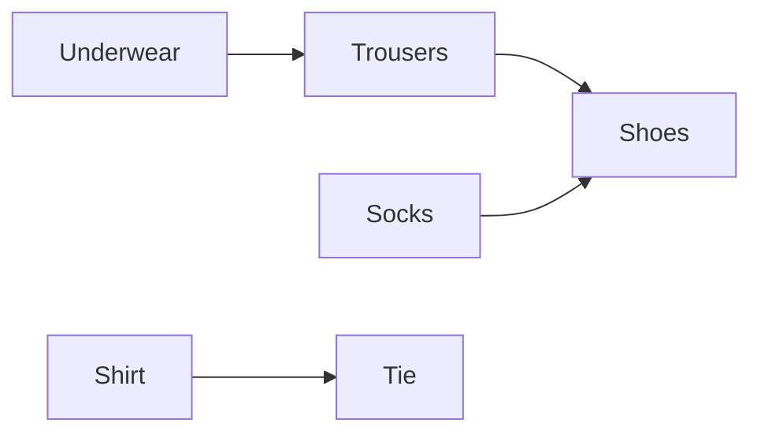
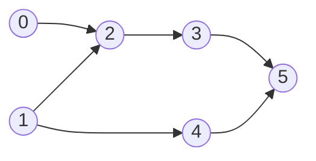

## The idea

A **topological sort** puts tasks in an order where every task comes **after** all the tasks it depends on.

Think of **getting dressed**. Underwear goes on before trousers. Trousers and socks both go on before shoes. You can start with socks or with underwear, either works, but shoes always come after both. A topological sort finds one order that breaks no rule.

You meet it in real life:

- **University courses:** you take a course only after its prerequisites.
- **Build tools and package managers:** a package is built only after the packages it needs.
- **Spreadsheets:** a cell like `=A1+B1` is worked out after A1 and B1. When cells depend on each other in a loop, the spreadsheet warns you about a "circular reference".

That last point matters: a topological sort is only possible when there is **no loop**. If A needs B and B needs A, neither can go first. A directed graph with no loops is called a **DAG** (directed acyclic graph).

## How it works

### Tasks as a directed graph

Each task is a node. Draw an arrow **from** the task that must come first **to** the task that waits for it.



Two valid orders:

- Underwear, Socks, Shirt, Trousers, Tie, Shoes
- Shirt, Tie, Socks, Underwear, Trousers, Shoes

There is usually **more than one** right answer. Any order that follows all the arrows is fine.

### In-degree: how many tasks you are waiting for

The **in-degree** of a node is the number of arrows coming into it. In plain words: how many tasks must be done before this one.

| Task | Waits for | In-degree |
| --- | --- | --- |
| Underwear | nothing | 0 |
| Socks | nothing | 0 |
| Shirt | nothing | 0 |
| Trousers | Underwear | 1 |
| Tie | Shirt | 1 |
| Shoes | Trousers, Socks | 2 |

**In-degree 0 means "ready now".** When you finish a task, every task waiting for it waits for one task less.

### Kahn's algorithm in plain steps

1. Count the in-degree of every node.
2. Put every node with in-degree 0 in a queue. These are ready now.
3. Take a node from the queue and add it to the answer. For each node that waited for it, lower its in-degree by 1. If one drops to 0, it's ready: add it to the queue.
4. Repeat until the queue is empty.
5. If the answer has fewer nodes than the graph, some nodes were never ready. That means there is a loop.

It's like cooking from a recipe: start any step whose ingredients are ready. Finishing a step can make other steps ready.

### A run, step by step

Here is a numbered example with 6 tasks. An edge `[from, to]` means "from comes before to".



The in-degrees at the start: 0 and 1 have 0, nodes 3 and 4 have 1, nodes 2 and 5 have 2. So the queue starts as `[0, 1]`.

| Step | Take | Lower the in-degree of | Now ready | Queue after | Order so far |
| --- | --- | --- | --- | --- | --- |
| 1 | 0 | 2 (2 → 1) | none | 1 | 0 |
| 2 | 1 | 2 (1 → 0), 4 (1 → 0) | 2, 4 | 2, 4 | 0, 1 |
| 3 | 2 | 3 (1 → 0) | 3 | 4, 3 | 0, 1, 2 |
| 4 | 4 | 5 (2 → 1) | none | 3 | 0, 1, 2, 4 |
| 5 | 3 | 5 (1 → 0) | 5 | 5 | 0, 1, 2, 4, 3 |
| 6 | 5 | nothing | none | (empty) | 0, 1, 2, 4, 3, 5 |

All 6 nodes made it into the order, so there is no loop.

### The code

The code comes in three small steps. **Run** on a step also runs the earlier steps it needs.

**Step 1: build the graph and count the in-degrees.**

```js
function buildGraph(n, edges) {
    const graph = [];
    const indegree = [];

    for (let node = 0; node < n; node++) {
        graph.push([]);
        indegree.push(0);
    }

    // [from, to] means: from must come before to.
    for (const [from, to] of edges) {
        graph[from].push(to);
        indegree[to]++;
    }

    return { graph, indegree };
}
```

**Step 2: find the nodes that are ready at the start.** Loop over **all** nodes, so nodes with no edges at all are not forgotten.

```js
function findReadyNodes(indegree) {
    const ready = [];

    for (let node = 0; node < indegree.length; node++) {
        if (indegree[node] === 0) {
            ready.push(node);
        }
    }

    return ready;
}
```

**Step 3: Kahn's algorithm.** The queue uses a head index, like [BFS](./graph-bfs-dfs.mdx).

```js
function topologicalSort(n, edges) {
    const { graph, indegree } = buildGraph(n, edges);
    const queue = findReadyNodes(indegree);
    const order = [];
    let head = 0;

    while (head < queue.length) {
        const node = queue[head];
        head++;
        order.push(node);

        // node is done, so each task after it waits for one less.
        for (const next of graph[node]) {
            indegree[next]--;

            if (indegree[next] === 0) {
                queue.push(next);
            }
        }
    }

    // Fewer than n nodes: some were stuck in a loop.
    if (order.length < n) {
        return [];
    }

    return order;
}
```

Try it on the example above:

```js
const edges = [[0, 2], [1, 2], [1, 4], [2, 3], [3, 5], [4, 5]];

console.log(topologicalSort(6, edges)); // [ 0, 1, 2, 4, 3, 5 ]
```

### Detecting a loop

Nodes inside a loop **never** reach in-degree 0: each one waits for another node in the same loop. So they never enter the queue, and the order comes out short.

Here, 3 comes before 0, and then 0 → 1 → 2 → 0 is a loop.

```js
const loopEdges = [[3, 0], [0, 1], [1, 2], [2, 0]];

console.log(topologicalSort(4, loopEdges)); // []
```

Kahn's takes 3 (in-degree 0), which lowers 0 from 2 to 1. Then the queue is empty. Nodes 0, 1 and 2 each still wait for one another, so the order is only `[3]`, shorter than 4 nodes, and we return `[]`.

So Kahn's algorithm gives you **two answers in one run**: an order, and whether a loop exists.

**Time:** O(V + E) · **Space:** O(V + E). Each node enters the queue once, and each edge lowers one in-degree once. The graph itself takes O(V + E) memory.

## Classic problems

### 1. Course Schedule

**Problem:** there are `numCourses` courses, numbered 0 to `numCourses - 1`. `prerequisites[i] = [a, b]` means you must take course `b` before course `a`. Can you finish all the courses?

- `numCourses = 2`, `prerequisites = [[1, 0]]` → `true` (take 0, then 1).
- `numCourses = 2`, `prerequisites = [[1, 0], [0, 1]]` → `false` (each one needs the other).

**Idea:** courses are nodes. The only trap is the **direction**: `[a, b]` means "a needs b", so the arrow goes **b → a** (b first). Then run Kahn's algorithm and see how many courses you manage to take. If you take all of them, there is no loop.

**Step 1: build the graph** with the arrows pointing the right way.

```js
function buildCourseGraph(numCourses, prerequisites) {
    const graph = [];
    const indegree = [];

    for (let course = 0; course < numCourses; course++) {
        graph.push([]);
        indegree.push(0);
    }

    // [course, before]: take "before" first, so the arrow is before -> course.
    for (const [course, before] of prerequisites) {
        graph[before].push(course);
        indegree[course]++;
    }

    return { graph, indegree };
}
```

**Step 2: take courses** until no more are ready. This is Kahn's algorithm. It returns the courses in the order they were taken. Courses stuck in a loop are never taken, so they are missing from the list.

```js
function takeCourses(graph, indegree) {
    const queue = [];
    for (let course = 0; course < graph.length; course++) {
        if (indegree[course] === 0) {
            queue.push(course);
        }
    }

    const taken = [];
    let head = 0;

    while (head < queue.length) {
        const course = queue[head];
        head++;
        taken.push(course);

        for (const next of graph[course]) {
            indegree[next]--;

            if (indegree[next] === 0) {
                queue.push(next);
            }
        }
    }

    return taken;
}
```

**Step 3: the answer.** If every course was taken, there was no loop.

```js
function canFinish(numCourses, prerequisites) {
    const { graph, indegree } = buildCourseGraph(numCourses, prerequisites);
    const taken = takeCourses(graph, indegree);

    return taken.length === numCourses;
}

console.log(canFinish(2, [[1, 0]])); // true
console.log(canFinish(2, [[1, 0], [0, 1]])); // false
```

In an interview you can write all of this as one function. Here it's split so each part stays small.

**Time:** O(V + E) · **Space:** O(V + E). V is the number of courses and E the number of prerequisite pairs. Each course enters the queue at most once, and each pair is used once.

### 2. Course Schedule II

**Problem:** the same input, but return an order in which you can take all the courses. If it's impossible, return an empty array. With `numCourses = 4` and `prerequisites = [[1, 0], [2, 0], [3, 1], [3, 2]]`, one answer is `[0, 1, 2, 3]` (`[0, 2, 1, 3]` is also right).

**Idea:** exactly the same work as problem 1. Only the answer changes: return the list of taken courses instead of a yes or no. It uses `buildCourseGraph` and `takeCourses` from problem 1.

```js
function findOrder(numCourses, prerequisites) {
    const { graph, indegree } = buildCourseGraph(numCourses, prerequisites);
    const taken = takeCourses(graph, indegree);

    // A loop left some courses out: there is no valid order.
    if (taken.length < numCourses) {
        return [];
    }

    return taken;
}

console.log(findOrder(4, [[1, 0], [2, 0], [3, 1], [3, 2]])); // [ 0, 1, 2, 3 ]
console.log(findOrder(2, [[1, 0], [0, 1]])); // []
console.log(findOrder(3, [])); // [ 0, 1, 2 ]
```

With no prerequisites at all, every course is ready at the start, so any order works.

**Time:** O(V + E) · **Space:** O(V + E). The same as problem 1.

### 3. Alien Dictionary (Hard)

**Problem:** an alien language uses the English lowercase letters, but in a different order. You get a list of words **sorted in the alien order**. Return a string of all the letters that appear, in an order that fits. If no order fits, return `""`. Any valid order is accepted. (On LeetCode it is a premium problem.)

`["wrt", "wrf", "er", "ett", "rftt"]` gives `"wertf"`.

**Idea:** compare each word with the **next** one. The first place where they differ gives one rule: the letter in the first word comes before the letter in the second. Every rule is an arrow, the letters are nodes, and the order is a topological sort.

| Pair | First difference | Rule |
| --- | --- | --- |
| wrt, wrf | t, f | t → f |
| wrf, er | w, e | w → e |
| er, ett | r, t | r → t |
| ett, rftt | e, r | e → r |

The rules chain up as w → e → r → t → f.

Two traps:

- **Only the first difference counts.** In "wrt" and "wrf", the letters after t and f tell you nothing.
- **A word followed by its own prefix** ("abc" before "ab") can't happen in any order. Return `""`.

**Step 1: every letter that appears is a node,** even letters with no rules.

```js
function buildLetterGraph(words) {
    // letter -> the Set of letters that come after it.
    const after = new Map();
    // letter -> how many letters must come before it.
    const indegree = new Map();

    for (const word of words) {
        for (const letter of word) {
            if (!after.has(letter)) {
                after.set(letter, new Set());
                indegree.set(letter, 0);
            }
        }
    }

    return { after, indegree };
}
```

**Step 2: read the rule from one pair of neighboring words.** It returns `false` for the impossible prefix case.

```js
function addRule(first, second, after, indegree) {
    const shorter = Math.min(first.length, second.length);

    for (let i = 0; i < shorter; i++) {
        const letterA = first[i];
        const letterB = second[i];

        if (letterA !== letterB) {
            // The first difference: letterA comes before letterB.
            // Count each rule once, even if two pairs give the same one.
            if (!after.get(letterA).has(letterB)) {
                after.get(letterA).add(letterB);
                indegree.set(letterB, indegree.get(letterB) + 1);
            }

            // Letters after the first difference tell us nothing.
            return true;
        }
    }

    // No difference: the shorter word must come first.
    return first.length <= second.length;
}
```

**Step 3: Kahn's algorithm,** with letters instead of numbers.

```js
function sortLetters(after, indegree) {
    const queue = [];
    for (const [letter, count] of indegree) {
        if (count === 0) {
            queue.push(letter);
        }
    }

    let order = "";
    let head = 0;

    while (head < queue.length) {
        const letter = queue[head];
        head++;
        order = order + letter;

        for (const nextLetter of after.get(letter)) {
            indegree.set(nextLetter, indegree.get(nextLetter) - 1);

            if (indegree.get(nextLetter) === 0) {
                queue.push(nextLetter);
            }
        }
    }

    return order;
}
```

**Step 4: put it together.** If some letters are missing from the order, the rules have a loop.

```js
function alienOrder(words) {
    const { after, indegree } = buildLetterGraph(words);

    for (let i = 0; i + 1 < words.length; i++) {
        const possible = addRule(words[i], words[i + 1], after, indegree);

        if (!possible) {
            return "";
        }
    }

    const order = sortLetters(after, indegree);

    // Some letters never got ready: a loop.
    if (order.length < indegree.size) {
        return "";
    }

    return order;
}

console.log(alienOrder(["wrt", "wrf", "er", "ett", "rftt"])); // wertf
console.log(alienOrder(["z", "x"])); // zx

// z before x, then x before z: a loop.
console.log(alienOrder(["z", "x", "z"]) === ""); // true

// "abc" before "ab": impossible.
console.log(alienOrder(["abc", "ab"]) === ""); // true
```

**Time:** O(C), where C is the total number of letters in all the words. Each pair of neighbors is compared once, letter by letter, and the sort itself is tiny. **Space:** O(1) extra: at most 26 letters and 26 × 25 rules, whatever the input size.

Comparing neighbors is enough. If the list is sorted, any rule you'd get from comparing word 1 with word 3 already follows from the neighbor pairs.

## How to spot it

- **"Prerequisites", "depends on", "must come before", "build order", "install order"**: tasks with rules about what comes first.
- **"Is it possible to finish all ...?"** → Kahn's algorithm, and check that every node made it (a loop check).
- **"Return an order"** → Kahn's algorithm, return the list.
- **"Find the order of letters in an alien language"** from a sorted word list ([Alien Dictionary](#3-alien-dictionary-hard)): each pair of neighboring words gives one "this letter comes before that letter" arrow.
- **"Minimum number of semesters / rounds"** when you can do many tasks at once → Kahn's algorithm, one level of the queue at a time.

## Common mistakes

- **Arrows the wrong way.** In Course Schedule, `[a, b]` means "a needs b", so the arrow is `b → a`. Read the problem twice, and test with the tiny example.
- **Forgetting nodes with no edges.** Find the ready nodes by looping over **all** n nodes, not only the ones in the pairs.
- **Returning a partial order when there's a loop.** Always check `order.length < n`.
- **Alien Dictionary: reading past the first difference,** or missing the prefix case (`"abc"` before `"ab"`).
- **Thinking there is only one right answer.** Many orders can be valid, and LeetCode accepts any of them.
- **Adding a node to the queue before its in-degree reaches 0.** Lower the count first, then add it only when it hits exactly 0.
- **`queue.shift()`.** It's O(n) per call. Use a head index.

## In the interview

> "Courses are nodes, and each pair `[a, b]` is an arrow from b to a. I count each course's in-degree and start a queue with every course that has none. I keep taking courses from the queue; each one lowers the in-degree of the courses that need it, and any that drop to 0 join the queue. If I take all n courses, there's no loop. It's O(V + E) time and space."

**Likely follow-up:** "What is the minimum number of semesters, if you can take any number of courses at once?"

**Answer:** "I run Kahn's algorithm level by level. Everything in the queue right now can be taken in the same semester. I take all of them, collect the newly ready courses as the next level, and count the levels. If some courses are never taken, there's a loop, so I return -1."

**Another follow-up:** "Can you do it with DFS instead?"

**Answer:** "Yes. I run DFS with the three states from [Graph BFS and DFS](./graph-bfs-dfs.mdx). When a node's call finishes, everything after it is already done, so I push it onto a list. At the end I reverse the list. An arrow to a node that is still `VISITING` means a loop."

<Callout title="Remember this" type="success">
  - **Topological sort = an order where every task comes after the tasks it needs.** Only possible with **no loops** (a DAG).
  - **In-degree** = how many tasks a node still waits for. **In-degree 0 = ready.**
  - **Kahn's algorithm:** queue every in-degree-0 node; take one, lower its neighbors' in-degree, and add any that reach 0.
  - **Loop check:** if the order has fewer than n nodes, there is a loop (Course Schedule → `false`).
  - `[a, b]` = "a needs b" means the arrow is **b → a**. Get the direction right.
  - O(V + E) time and space. Many valid orders can exist.
</Callout>
