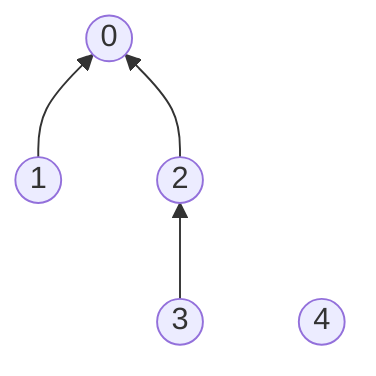
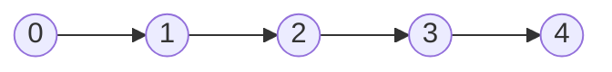
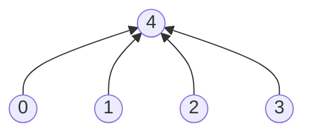
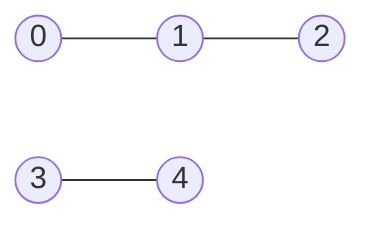

## The idea

**Union-Find** (also called **Disjoint Set Union**, or **DSU**) keeps track of items that are split into groups. It answers one question very fast: **are these two items in the same group?** And it can **merge** two groups in one step.

Think of **companies and bosses**. Every person reports to a boss, who reports to a boss, all the way up to the CEO. To check if two people work for the same company, follow each one's chain of bosses to the top and compare the CEOs. When two companies merge, one CEO starts reporting to the other CEO. Now everyone in both companies ends up at the same top boss.

- The CEO is the group's **root** (its leader).
- **find(x)** = follow the bosses up from x until you reach the root.
- **union(a, b)** = make the root of one group report to the root of the other.

In the real world, Kruskal's algorithm uses union-find to connect a set of points (say, cities with cables) at the lowest total cost: it adds the cheapest cables first, and union-find tells it to skip any cable that joins two cities that are already connected.

## How it works

### The parent array

Each item points to its **parent**, the item above it. A root points to **itself**. At the start, every item is alone in its own group, so every item is its own root: `parent[i] = i`.

```js
const n = 5;
const parent = [];

for (let i = 0; i < n; i++) {
    parent.push(i);
}

console.log(parent); // [ 0, 1, 2, 3, 4 ]
```

### find: follow the parents up to the root

Keep moving to the parent until you reach an item that points to itself.

```js
function find(parent, item) {
    let current = item;

    while (parent[current] !== current) {
        current = parent[current];
    }

    return current;
}
```

### union: link one root under the other

Find both roots. If they are the same, the items are already in one group. Otherwise, hang one root under the other. Always link the **roots**, never the items themselves.

```js
function union(parent, itemA, itemB) {
    const rootA = find(parent, itemA);
    const rootB = find(parent, itemB);

    // Already in the same group: nothing to do.
    if (rootA === rootB) {
        return false;
    }

    parent[rootB] = rootA;
    return true;
}
```

Let's merge some groups, using the `parent` array from the first block:

```js
union(parent, 0, 1);
union(parent, 2, 3);
union(parent, 1, 3);

console.log(parent); // [ 0, 0, 0, 2, 4 ]

// Same group? Compare the roots.
console.log(find(parent, 3) === find(parent, 1)); // true
console.log(find(parent, 4) === find(parent, 1)); // false
```

| Step | Call | Roots found | Change | `parent` after |
| --- | --- | --- | --- | --- |
| start |  |  |  | [0, 1, 2, 3, 4] |
| 1 | union(0, 1) | 0 and 1 | parent[1] = 0 | [0, 0, 2, 3, 4] |
| 2 | union(2, 3) | 2 and 3 | parent[3] = 2 | [0, 0, 2, 2, 4] |
| 3 | union(1, 3) | 0 (from 1) and 2 (from 3) | parent[2] = 0 | [0, 0, 0, 2, 4] |
| 4 | find(3) | 3 → 2 → 0 | none | root is 0 |

The groups are now {0, 1, 2, 3} and {4}. Each arrow points to the parent. The roots are green.



Notice that 3 and 1 are in the same group, but `parent[3]` is 2 and `parent[1]` is 0. That's why you always compare **roots** with `find`, never the parents.

### The problem: tall trees

This simple version can build a long line. Call `union(1, 0)`, then `union(2, 1)`, `union(3, 2)` and `union(4, 3)`, and each old root ends up under a new one:



Now `find(0)` walks the whole line: O(n). Two small fixes make the trees almost flat. You use both together.

### Fix 1: path compression

While `find` walks up to the root, point every item on the way **straight at the root**. The next `find` on any of them takes one step.

```js
function findAndCompress(parent, item) {
    // A root points to itself.
    if (parent[item] === item) {
        return item;
    }

    // Find the root, then point this item straight at it.
    const root = findAndCompress(parent, parent[item]);
    parent[item] = root;

    return root;
}

// The long line from the picture: 0 -> 1 -> 2 -> 3 -> 4.
const chain = [1, 2, 3, 4, 4];

console.log(findAndCompress(chain, 0)); // 4
console.log(chain); // [ 4, 4, 4, 4, 4 ]
```

The calls go up the line to the root (4). On the way back, each item on the path gets `parent[item] = 4`. One `find` turned the line into this:



### Fix 2: union by size

When you merge two groups, hang the root of the **smaller** group under the root of the **bigger** one. Keep `size[root]` = how many items are in that root's group.

Say group {0, 1, 2} has root 0, and item 3 is alone:

| Merge | Result | Longest walk to the root |
| --- | --- | --- |
| small under big: 3 goes under 0 | 0 is the root of 1, 2 and 3 | 1 step |
| big under small: 0 goes under 3 | 3 is the root, 0 under it, 1 and 2 under 0 | 2 steps |

Only the items of the smaller group get one step further from the root. Each time that happens to an item, its group at least doubles in size. A group can only double about log n times, so no tree gets taller than log n.

### The UnionFind class

Here are both fixes packed into one class you can reuse. It's the pieces from above, put together.

```js
class UnionFind {
    constructor(n) {
        this.parent = [];
        this.size = [];

        for (let i = 0; i < n; i++) {
            this.parent.push(i);
            this.size.push(1);
        }
    }

    find(item) {
        if (this.parent[item] === item) {
            return item;
        }

        // Path compression: point item straight at its root.
        const root = this.find(this.parent[item]);
        this.parent[item] = root;

        return root;
    }

    // Returns false when the two were already in the same group.
    union(itemA, itemB) {
        const rootA = this.find(itemA);
        const rootB = this.find(itemB);

        if (rootA === rootB) {
            return false;
        }

        // Union by size: the smaller group goes under the bigger root.
        if (this.size[rootA] >= this.size[rootB]) {
            this.parent[rootB] = rootA;
            this.size[rootA] += this.size[rootB];
        } else {
            this.parent[rootA] = rootB;
            this.size[rootB] += this.size[rootA];
        }

        return true;
    }
}
```

How it works:

- `parent[i]` is the item above `i`. `size[root]` is how many items that root's group has. Every item starts alone, with size 1.
- `find` returns the root, and flattens the path on the way (path compression).
- `union` finds both roots. Same root: return `false`. Different roots: hang the smaller group under the bigger one, add the sizes, and return `true`.

Try it:

```js
const groups = new UnionFind(5);

console.log(groups.union(0, 1)); // true
console.log(groups.union(1, 2)); // true

// 0 and 2 are already together, so nothing changes.
console.log(groups.union(0, 2)); // false

console.log(groups.find(2) === groups.find(0)); // true
console.log(groups.find(3) === groups.find(0)); // false

// The group {0, 1, 2} has 3 items.
console.log(groups.size[groups.find(0)]); // 3
```

### How fast is it?

| Version | One find or union |
| --- | --- |
| No fixes | O(n) in the worst case (a long line) |
| Path compression + union by size | **almost O(1)** on average |

"Almost O(1)": the exact cost is O(α(n)), where α is a function that grows so slowly that it stays below 5 for any n you could ever store. So treat it as constant time. **Space:** O(n) for the two arrays.

The recursion in `find` is safe: union by size keeps every tree at most about log n tall, which is only about 20 for a million items.

### Union-Find or DFS?

Both can tell you if two nodes are connected. They shine in different cases.

|  | Union-Find | DFS or BFS |
| --- | --- | --- |
| Edges arrive one at a time, answer after each one | **great**: each edge costs almost O(1) | you would search the graph again each time |
| Many "are a and b connected?" questions | **almost O(1)** each | O(V + E) each, unless you label the groups first |
| You need the actual path or the distance | no | **yes** |
| Directed graphs | no | yes |
| Removing an edge | no | rebuild and search again |

## Classic problems

### 1. Number of Connected Components

**Problem:** there are `n` nodes, numbered 0 to `n - 1`, and a list of undirected edges. How many connected pieces does the graph have? With `n = 5` and `edges = [[0, 1], [1, 2], [3, 4]]`, the answer is 2.



**Idea:** start with `n` groups, one per node. For each edge, union its two ends. A union that really merges two groups lowers the count by 1. A union that returns `false` (both ends already together) changes nothing. This uses the `UnionFind` class from above.

```js
function countComponents(n, edges) {
    const groups = new UnionFind(n);
    let count = n;

    for (const [from, to] of edges) {
        // union returns true only when two groups were merged.
        if (groups.union(from, to)) {
            count--;
        }
    }

    return count;
}

console.log(countComponents(5, [[0, 1], [1, 2], [3, 4]])); // 2
console.log(countComponents(5, [[0, 1], [1, 2], [2, 3], [3, 4]])); // 1
console.log(countComponents(3, [])); // 3
```

**Time:** O(V + E) · **Space:** O(V). Making the arrays is O(V), and each edge is one almost-O(1) union. DFS from each unvisited node gives the same answer (see [Graph BFS and DFS](./graph-bfs-dfs.mdx)).

### 2. Redundant Connection

**Problem:** a tree with `n` nodes (labeled 1 to `n`) got one extra edge, so now it has `n` edges and one loop. Return the edge you can remove to make it a tree again. If there are several answers, return the one that comes last in the input. With `edges = [[1, 2], [1, 3], [2, 3]]`, the answer is `[2, 3]`.

**Idea:** add the edges one by one. If the two ends of an edge are **already in the same group**, this edge closes a loop: it's the extra one. Because we go in input order, the first edge that closes the loop is the loop's last edge in the input, which is exactly the one the problem wants.

```js
function findRedundantConnection(edges) {
    // n nodes and n edges. Labels go from 1 to n, so make n + 1 slots.
    // Slot 0 is never used.
    const n = edges.length;
    const groups = new UnionFind(n + 1);

    for (const edge of edges) {
        const [from, to] = edge;

        // Already connected: this edge closes a loop.
        if (!groups.union(from, to)) {
            return edge;
        }
    }

    return [];
}

const triangle = [[1, 2], [1, 3], [2, 3]];
const bigger = [[1, 2], [2, 3], [3, 4], [1, 4], [1, 5]];

console.log(findRedundantConnection(triangle)); // [ 2, 3 ]
console.log(findRedundantConnection(bigger)); // [ 1, 4 ]
```

How the second example runs:

| Edge | Ends already in the same group? | What happens |
| --- | --- | --- |
| [1, 2] | no | merge: {1, 2} |
| [2, 3] | no | merge: {1, 2, 3} |
| [3, 4] | no | merge: {1, 2, 3, 4} |
| [1, 4] | **yes**: 1 and 4 are both in {1, 2, 3, 4} | return [1, 4] |

**Time:** O(n) · **Space:** O(n). Each edge is one almost-O(1) union, and the arrays hold n + 1 items.

## How to spot it

- **"Groups", "connected", "same group", "friend circles", "provinces", "merge accounts".**
- **Edges or connections arrive one at a time**, and you must answer after each one ("after each new road, how many regions are there?").
- **"Which edge makes a loop?"** (Redundant Connection), or **"is this a valid tree?"** (a tree has exactly n - 1 edges, and no union returns `false`).
- **"Connect all points with the smallest total cost"** (Min Cost to Connect All Points): Kruskal's algorithm, which uses union-find.
- **The input is an adjacency matrix** of who is connected to whom (Number of Provinces): union `i` and `j` whenever `isConnected[i][j]` is 1, then count the groups.

## Common mistakes

- **Comparing parents instead of roots.** `parent[a] === parent[b]` can be false even when a and b are in the same group. Always compare `find(a) === find(b)`.
- **Linking the items instead of the roots.** `parent[a] = b` moves only a (and whatever is under it) and leaves the rest of a's group behind. Always link `rootB` under `rootA`.
- **Labels from 1 to n.** Make the arrays size `n + 1`, or you'll read past the end.
- **Counting a union that did nothing.** Only lower the group count when `union` returns `true`.
- **Adding the size to the wrong root.** The root that stays on top gets the other group's size added to it.
- **Skipping both fixes.** It still gives the right answer, but long lines make each `find` O(n), and big inputs time out.

## In the interview

> "I'll use union-find. Every node starts in its own group. For each edge I union the two ends. `union` returns false when they were already in the same group, which means this edge closes a loop. With path compression and union by size, each operation is almost O(1), so the whole thing is about O(n)."

**Likely follow-up:** "Why not just use DFS?"

**Answer:** "DFS works for one question on a fixed graph. But here the edges come one by one, and I need an answer after each one. With DFS I'd search the graph again for every edge: O(n) each, O(n²) in total. Union-find handles each edge in almost O(1)."

**Another follow-up:** "What do path compression and union by size each do?"

**Answer:** "Path compression points every item on a find path straight at the root, so later finds are one step. Union by size hangs the smaller group under the bigger one, so trees stay at most log n tall. Together, each operation is almost constant time."

<Callout title="Remember this" type="success">
  - **Union-Find = groups with a leader.** `parent[i]` points up; a **root points to itself**.
  - **find(x)** follows parents up to the root. **union(a, b)** links one **root** under the other.
  - Same group means **`find(a) === find(b)`**. Never compare `parent[a]` with `parent[b]`.
  - **Path compression** (point straight at the root) + **union by size** (small under big) → **almost O(1)** per operation.
  - `union` returning **false** means "already connected": that edge closes a loop (Redundant Connection).
  - Count groups: start at n, and subtract 1 for every union that returns `true`.
</Callout>
