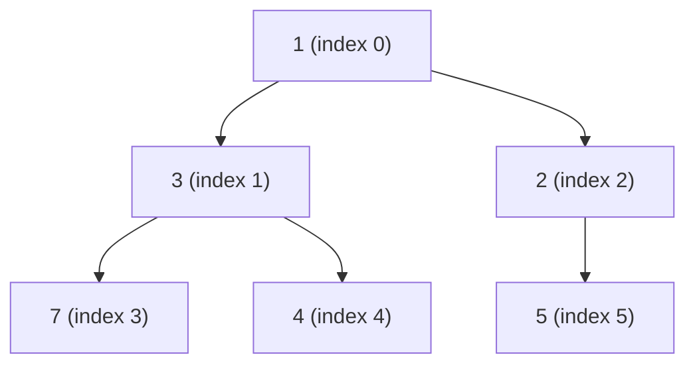

## The idea

A **priority queue** is a waiting line where the **most important** item comes out first, not the one that arrived first. A **heap** is the usual way to build one. A **min-heap** always gives you the **smallest** item; a **max-heap** always gives you the **biggest**.

Think of a **hospital emergency room**. Patients aren't seen in the order they arrive: the most serious case goes next. When a new patient comes in, the nurse slots them in by how serious they are. But the nurse doesn't keep the whole waiting room in perfect order. She only needs to know **who is next**.

That is the heap's trick: it is **not fully sorted**. It keeps just enough order to know the top item. That's why it's faster than sorting:

- See the top item: **O(1)**.
- Add an item, or remove the top: **O(log n)**.

**JavaScript has no built-in heap** (Java has `PriorityQueue`, Python has `heapq`). In an interview you either write one, about 50 lines, or ask if you can assume one exists. On LeetCode, `MinPriorityQueue` and `MaxPriorityQueue` from the `@datastructures-js/priority-queue` library are ready to use, but other interview editors usually don't have them.

## How it works

### A tree where every parent is smaller than its children

A min-heap is a **binary tree** (each node has at most 2 children) with two rules:

1. **Order rule:** every parent is **smaller than or equal to** its children. So the smallest item is always at the top, the **root**.
2. **Shape rule:** the tree fills up **level by level, left to right**, with no gaps.

Here is a min-heap holding 1, 3, 2, 7, 4 and 5:



Every parent is smaller than its children: 1 is above 3 and 2; 3 is above 7 and 4; 2 is above 5. But it's **not sorted**: on the bottom row, 7 comes before the smaller 4 and 5, and the left child 3 is bigger than the right child 2. The rule is only "parent ≤ children".

### Stored in a plain array

Because the tree has no gaps, we don't need node objects. We store it in an array, one level after another:

| Index | 0 | 1 | 2 | 3 | 4 | 5 |
| --- | --- | --- | --- | --- | --- | --- |
| Value | 1 | 3 | 2 | 7 | 4 | 5 |

You find a node's relatives with simple math:

| To find | Formula | Example: index 1 (value 3) |
| --- | --- | --- |
| Left child | `2 * i + 1` | index 3 → 7 |
| Right child | `2 * i + 2` | index 4 → 4 |
| Parent | `Math.floor((i - 1) / 2)` | index 0 → 1 |

```js
const heap = [1, 3, 2, 7, 4, 5];
const index = 1;

const leftIndex = 2 * index + 1;
const rightIndex = 2 * index + 2;
const parentIndex = Math.floor((index - 1) / 2);

console.log(heap[index]); // 3
console.log(heap[leftIndex]); // 7
console.log(heap[rightIndex]); // 4
console.log(heap[parentIndex]); // 1

// Index 2 (value 2) has a left child, but no right child.
console.log(heap[2 * 2 + 1]); // 5
console.log(heap[2 * 2 + 2]); // undefined
```

A child index that is `>= heap.length` means "no child there". The smallest item is always `heap[0]`.

### Two moves keep the order

Adding or removing breaks the order rule for a moment. Two moves fix it:

- **Bubble up** (after `push`): the new item goes at the **end** of the array, the bottom of the tree. While it is smaller than its parent, swap them.
- **Bubble down** (after `pop`): take out the top. Move the **last** item to the top. While it is bigger than its smaller child, swap them.

Each move walks along **one path** between the top and the bottom. The tree is only about **log n levels tall** (a million items fit in 20 levels), so each move takes at most about log n swaps. That's why `push` and `pop` are O(log n).

## Writing a MinHeap in JavaScript

The code comes in four steps. Paste them in order into the JS Playground, one below the other.

### Step 1: swap and bubble up

A small `swap` helper, then `bubbleUp`: move the item at `index` up while it is smaller than its parent.

```js
// Swap two items in an array.
function swap(array, indexA, indexB) {
    const temp = array[indexA];
    array[indexA] = array[indexB];
    array[indexB] = temp;
}

// Move the item at index up while it is smaller than its parent.
function bubbleUp(heap, index) {
    while (index > 0) {
        const parentIndex = Math.floor((index - 1) / 2);

        // The parent is smaller or equal: the item is in the right place.
        if (heap[parentIndex] <= heap[index]) {
            break;
        }

        swap(heap, parentIndex, index);
        index = parentIndex;
    }
}
```

Here is a push of 0 into `[1, 3, 2, 7, 4, 5]`:

| Step | The new item is at | Its parent | What happens | Array after |
| --- | --- | --- | --- | --- |
| Start | index 6 | | 0 is added at the end | `[1, 3, 2, 7, 4, 5, 0]` |
| 1 | index 6 | 2 (index 2) | 0 < 2: swap | `[1, 3, 0, 7, 4, 5, 2]` |
| 2 | index 2 | 1 (index 0) | 0 < 1: swap | `[0, 3, 1, 7, 4, 5, 2]` |
| 3 | index 0 | none | it's at the top: stop | `[0, 3, 1, 7, 4, 5, 2]` |

### Step 2: bubble down

Move the item at `index` down while one of its children is smaller. Always swap with the **smaller** child: it becomes the parent of the other child, so it must be the smaller of the two.

```js
// Move the item at index down while a child is smaller than it.
function bubbleDown(heap, index) {
    while (true) {
        const leftIndex = 2 * index + 1;
        const rightIndex = 2 * index + 2;
        let smallest = index;

        // Is the left child smaller? (It must exist first.)
        if (leftIndex < heap.length && heap[leftIndex] < heap[smallest]) {
            smallest = leftIndex;
        }

        // Is the right child smaller still?
        if (rightIndex < heap.length && heap[rightIndex] < heap[smallest]) {
            smallest = rightIndex;
        }

        // No child is smaller: the item is in the right place.
        if (smallest === index) {
            break;
        }

        swap(heap, index, smallest);
        index = smallest;
    }
}
```

Here is a pop from `[0, 3, 1, 7, 4, 5, 2]`, the heap we just made:

| Step | The moving item is at | Its children | What happens | Array after |
| --- | --- | --- | --- | --- |
| Start | | | take out 0; move the last item (2) to the top | `[2, 3, 1, 7, 4, 5]` |
| 1 | index 0 | 3 and 1 | 1 is the smaller child, and 1 < 2: swap | `[1, 3, 2, 7, 4, 5]` |
| 2 | index 2 | 5 | 5 > 2: stop | `[1, 3, 2, 7, 4, 5]` |

We got 0 back, and the heap is the same as before the push.

### Step 3: the MinHeap class

The class keeps the array and uses the two helpers. `pop` takes the last item off **first**, then puts it at the top only if there is something left. (With one item, writing `heap[0] = heap.pop()` would put the item straight back.)

```js
class MinHeap {
    constructor() {
        this.heap = [];
    }

    size() {
        return this.heap.length;
    }

    // The smallest item, or undefined if the heap is empty.
    peek() {
        return this.heap[0];
    }

    push(value) {
        // Add at the end, then move it up to its place.
        this.heap.push(value);
        bubbleUp(this.heap, this.heap.length - 1);
    }

    pop() {
        const smallest = this.heap[0];
        const last = this.heap.pop();

        // If items are left, put the last one on top and move it down.
        if (this.heap.length > 0) {
            this.heap[0] = last;
            bubbleDown(this.heap, 0);
        }

        return smallest;
    }
}
```

### Step 4: use it

Items come out smallest first, whatever order they went in.

```js
const minHeap = new MinHeap();

minHeap.push(5);
minHeap.push(2);
minHeap.push(8);
minHeap.push(1);

console.log(minHeap.peek()); // 1
console.log(minHeap.size()); // 4

// The array is NOT sorted. Only the top is guaranteed.
console.log(minHeap.heap); // [ 1, 2, 8, 5 ]

console.log(minHeap.pop()); // 1
console.log(minHeap.pop()); // 2
console.log(minHeap.pop()); // 5
console.log(minHeap.pop()); // 8
console.log(minHeap.pop()); // undefined
```

## Heap operations and their costs

| Operation | Time | Why |
| --- | --- | --- |
| `peek()` | O(1) | the smallest item is always at index 0 |
| `push(value)` | O(log n) | bubbles up one path; the tree is about log n levels tall |
| `pop()` | O(log n) | bubbles down one path |
| `size()` | O(1) | the array's length |
| Build a heap by pushing n items | O(n log n) | n pushes |
| Build a heap with heapify | O(n) | see below |
| Search for any value | O(n) | the heap isn't sorted, so you may check everything |

**Heapify** turns any array into a heap in place. Start at the last parent and bubble each parent down, working back to the top. Paste it below Step 4.

```js
// Turn any array into a min-heap, in place.
function heapify(array) {
    const lastParent = Math.floor(array.length / 2) - 1;

    for (let i = lastParent; i >= 0; i--) {
        bubbleDown(array, i);
    }
}

const numbers = [9, 4, 7, 1, 8, 2];
heapify(numbers);

console.log(numbers); // [ 1, 4, 2, 9, 8, 7 ]
```

Why O(n) and not O(n log n)? About half the items are leaves at the bottom and don't move at all. Only the few items near the top can move far. Added up, that's O(n) swaps.

## Max-heap: flip the comparison

A max-heap keeps the **biggest** item on top. It is the same code with two comparisons flipped:

| Where | Min-heap | Max-heap |
| --- | --- | --- |
| `bubbleUp`: stop when | `heap[parentIndex] <= heap[index]` | `heap[parentIndex] >= heap[index]` |
| `bubbleDown`: pick the child when | `heap[leftIndex] < heap[smallest]` (and the same for right) | `heap[leftIndex] > heap[largest]` (and the same for right) |

For numbers there is a shortcut: **push the negative**. The biggest number becomes the smallest negative, so a min-heap gives it first. Flip the sign back when you read it.

```js
const maxHeap = new MinHeap();

for (const value of [5, 2, 8, 1]) {
    maxHeap.push(-value);
}

console.log(-maxHeap.peek()); // 8
console.log(-maxHeap.pop()); // 8
console.log(-maxHeap.pop()); // 5
```

### One heap for any order: a compare function

In real problems the heap often holds pairs or objects: `[number, count]`, points, list nodes. Then you give the heap a **compare function**, just like `sort`. `compare(a, b) < 0` means `a` comes out first.

| Compare function | What comes out first |
| --- | --- |
| `(a, b) => a - b` | the smallest number (min-heap) |
| `(a, b) => b - a` | the biggest number (max-heap) |
| `(a, b) => a[1] - b[1]` | the pair with the smallest second item |
| `(a, b) => a.priority - b.priority` | the object with the lowest priority number |

The code changes in only two places: `heap[parentIndex] <= heap[index]` becomes `compare(heap[parentIndex], heap[index]) <= 0`, and `heap[leftIndex] < heap[smallest]` becomes `compare(heap[leftIndex], heap[smallest]) < 0`. The full version, a `Heap` class that takes a compare function, is at the top of [Top K and Merge K](./top-k.mdx). Every problem there uses it.

## Classic problem: Last Stone Weight (LeetCode 1046)

**Problem:** you have stones with weights. Each turn, smash the **two heaviest** together. If they weigh the same, both are gone. If not, a stone weighing the difference is left. Return the weight of the last stone, or 0 if none is left. `[2, 7, 4, 1, 8, 1]` gives 1.

**Idea:** "take the biggest, again and again, while new items arrive" is a max-heap. We use `MinHeap` with negative weights. Paste this below Step 3.

```js
function lastStoneWeight(stones) {
    // A max-heap: MinHeap with negative weights.
    const heap = new MinHeap();

    for (const stone of stones) {
        heap.push(-stone);
    }

    while (heap.size() > 1) {
        const heaviest = -heap.pop();
        const secondHeaviest = -heap.pop();

        // Equal stones both break. Otherwise the difference is left.
        if (heaviest !== secondHeaviest) {
            heap.push(-(heaviest - secondHeaviest));
        }
    }

    if (heap.size() === 0) {
        return 0;
    }

    return -heap.peek();
}

console.log(lastStoneWeight([2, 7, 4, 1, 8, 1])); // 1
console.log(lastStoneWeight([3, 3])); // 0
```

| Turn | Stones left (heaviest first) | Smash | Left over |
| --- | --- | --- | --- |
| 1 | 8, 7, 4, 2, 1, 1 | 8 and 7 | 1 |
| 2 | 4, 2, 1, 1, 1 | 4 and 2 | 2 |
| 3 | 2, 1, 1, 1 | 2 and 1 | 1 |
| 4 | 1, 1, 1 | 1 and 1 | nothing |
| End | 1 | | answer: 1 |

**Time:** O(n log n) · **Space:** O(n). Each turn removes at least one stone, so there are at most n turns, and each does a few O(log n) pops and pushes. The heap holds up to n stones.

More heap problems are on [Top K and Merge K](./top-k.mdx).

## When to reach for a heap

| The problem says | Use |
| --- | --- |
| "kth largest", "top k", "k closest", "k most frequent" | a heap of size k: see [Top K](./top-k.mdx) |
| "again and again, take the smallest (or biggest)", while new items arrive | a min-heap (or max-heap) |
| "merge k sorted lists" or arrays | a min-heap of the k front items |
| "median" of numbers that keep arriving | two heaps |
| "by priority", "earliest deadline first", "the next event" | a priority queue |
| shortest path in a graph with weights | Dijkstra's algorithm uses a min-heap: see [Shortest Paths](../graphs/shortest-paths.mdx) |

You don't need a heap when:

- You need the whole list sorted once, and no new items arrive. Just sort: O(n log n).
- You need the smallest item only once. One loop is O(n).

In the real world, Node.js keeps its `setTimeout` timers in a priority queue, so it always knows which timer fires next.

## Common mistakes

- **Thinking the array is sorted.** Only `heap[0]` is guaranteed. To get everything in order, pop again and again.
- **The wrong parent formula.** `Math.floor(i / 2)` is for heaps that start at index 1. With index 0, it's `Math.floor((i - 1) / 2)`.
- **Swapping with the wrong child** in bubble down. Always pick the **smaller** child (the bigger one in a max-heap), not just the left one.
- **Forgetting the "does the child exist?" check.** Past the end of the array you get `undefined`. With objects, `undefined.priority` crashes.
- **`heap[0] = heap.pop()` with one item.** It removes the item and puts it right back. Pop the last item first, then check if anything is left.
- **Sorting the array after every push.** That's O(n log n) per push instead of O(log n).
- **Using `shift()` to take the top.** It's O(n), and it shifts every item, which breaks the parent and child positions.

## In the interview

- **Ask first:** "JavaScript has no built-in heap. Should I write one, or can I assume a `MinHeap` with `push`, `pop`, `peek` and `size`?" Many interviewers say "assume it". Be ready to write it in about 5 minutes anyway.
- **Say the costs** when you choose it.

> "I need the smallest item again and again while new items keep arriving, so I'll use a min-heap. `peek` is O(1). `push` and `pop` are O(log n), because each one walks one path of a tree that is about log n levels tall."

**Likely follow-up:** "Why not just keep a sorted array?"

**Answer:** "Reading the smallest is O(1) either way. But inserting into a sorted array is O(n), because the items after it shift over to make room. A heap insert is O(log n). With many inserts, the heap wins."

<Callout title="Remember this" type="success">
  - A heap gives the smallest (min-heap) or biggest (max-heap) item in **O(1)**; `push` and `pop` are **O(log n)**.
  - It lives in an array: children at `2i + 1` and `2i + 2`, parent at `Math.floor((i - 1) / 2)`.
  - **push** = add at the end, bubble up. **pop** = take the top, move the last item to the top, bubble down (swap with the **smaller** child).
  - Only `heap[0]` is in order; the rest of the array is **not sorted**.
  - **Max-heap:** flip the comparisons, push negative numbers, or pass a compare function.
  - **JavaScript has no built-in heap:** be ready to write one, or ask to assume one.
</Callout>
