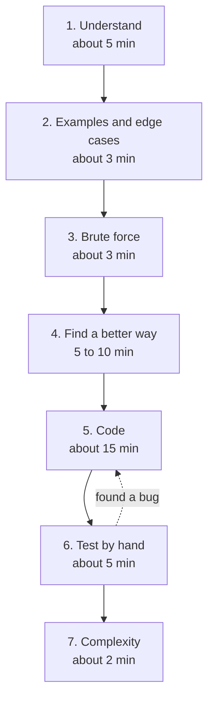

Think of a **doctor**. A good doctor doesn't hand you medicine the moment you walk in. They ask questions, examine you, think about what it could be, start with a safe treatment, and then check that it worked.

A coding problem works the same way. If you start typing right away, you may solve the wrong problem, or get stuck halfway with nothing to show. This page gives you **7 fixed steps** to follow every time. You always know what comes next, and the interviewer can follow along.

We use one problem the whole way: **Two Sum** (problem 1 on LeetCode).

> Given an array `numbers` and a number `target`, return the **indexes** of the two numbers that add up to `target`.
>
> Example: `numbers = [2, 7, 11, 15]` and `target = 9` give `[0, 1]`, because `2 + 7 = 9`.

## The 7 steps at a glance



| Step | What you do | Time |
| --- | --- | --- |
| 1. Understand | Say the problem back. Ask about the input and the output. | about 5 min |
| 2. Examples and edge cases | Write 3 or 4 small inputs with their answers, including the tricky ones. | about 3 min |
| 3. Brute force | Say the simplest idea that works, and its Big O. | about 3 min |
| 4. Find a better way | Find the slow part. Match the problem to a pattern. | 5 to 10 min |
| 5. Code | Write clean code, and talk as you go. | about 15 min |
| 6. Test by hand | Walk through an example line by line. Fix bugs. | about 5 min |
| 7. Complexity | Say the time and space Big O, and why. | about 2 min |

That is about 40 minutes, which fits a 45-minute round with a short intro. Two problems in one round? Do the same steps, faster.

## Step 1: Understand the problem

**Time:** about 5 minutes.

Don't think about the solution yet. First make sure you solve the **right** problem. Interview problems often leave things out on purpose, to see if you ask.

Say the problem back in your own words. Then ask about the input and the output:

| Question | Why it matters | Two Sum answer |
| --- | --- | --- |
| Is the array sorted? | Sorted input opens up two pointers and binary search. | No. |
| Can numbers be negative, or zero? | Some tricks only work with positive numbers. | Yes, both. |
| Can the same number appear twice? | Duplicates break many first ideas. | Yes. `[3, 3]` with target 6 gives `[0, 1]`. |
| Can I use the same item twice? | `3 + 3` from one index is not allowed here. | No, two different indexes. |
| Is there always an answer? | It decides what you return when there is none. | Yes, exactly one. |
| What do I return? | The numbers or the indexes? In what order? | The two indexes, in any order. |
| How big can the input be? | The size tells you how fast your code must be (Step 4). | From 2 to 10,000 numbers. |

**What to say:**

> "Let me say it back to check I understand. I get an unsorted array of numbers and a target. I return the indexes of two different items that add up to the target. There is always exactly one answer. Numbers can be negative and can repeat, and there are up to 10,000 of them. Is that right?"

## Step 2: Examples and edge cases

**Time:** about 3 minutes.

Write a few small inputs and their answers in the editor, as comments. They help you understand the problem, and later you test your code with them.

Pick the examples on purpose:

- one **normal** case;
- a few **edge cases**: the smallest input, duplicates, negative numbers;
- one **trap** case: an input where a quick, wrong idea gives a wrong answer.

```js
// [2, 7, 11, 15], target 9  →  [0, 1]   normal: 2 + 7
// [3, 2, 4], target 6       →  [1, 2]   trap: 3 + 3 would use index 0 twice
// [3, 3], target 6          →  [0, 1]   the same number at two indexes
// [-1, 5, 4], target 3      →  [0, 2]   a negative number: -1 + 4
```

Edge cases worth trying in almost any problem:

| Input | Edge cases to try |
| --- | --- |
| Array | Empty, one item, two items, all the same, duplicates, negatives and zero, already sorted, sorted backwards |
| String | Empty, one character, all the same character, spaces, upper and lower case |
| Number | 0, negative, very large |
| Linked list or tree | Empty (`null`), one node, a long thin line of nodes |
| Graph or grid | One cell, no edges, a cycle, parts that are not connected |

Two Sum always has at least 2 numbers and one answer, so an empty array can't happen. Say that out loud anyway: it shows you thought about it.

**What to say:**

> "Let me write a few examples. [2, 7, 11, 15] with target 9 gives [0, 1]. [3, 2, 4] with target 6 is a trap: 3 plus 3 is 6, but that uses index 0 twice, so the answer is [1, 2]. And [3, 3] gives [0, 1], so duplicates are fine."

## Step 3: Brute force first

**Time:** about 3 minutes.

The **brute force** is the simplest idea that works, even if it is slow. It usually means "try everything".

Say it first, for three reasons:

- It shows you understand the problem.
- It is your safety net: if you can't find a faster way, you code this one.
- The faster idea usually comes from asking: "What is slow about the brute force?"

Most of the time you only **say** the brute force and its Big O. Code it only if the interviewer asks, or if you can't find anything better.

For Two Sum: try every pair of indexes, and check if the pair adds up to the target.

```js
function twoSumBruteForce(numbers, target) {
    for (let first = 0; first < numbers.length; first++) {
        // Start after first, so we never use the same index twice
        for (let second = first + 1; second < numbers.length; second++) {
            const sum = numbers[first] + numbers[second];

            if (sum === target) {
                return [first, second];
            }
        }
    }

    // No pair adds up to target
    return [];
}

console.log(twoSumBruteForce([2, 7, 11, 15], 9)); // [ 0, 1 ]
console.log(twoSumBruteForce([3, 2, 4], 6)); // [ 1, 2 ]
```

**Time:** O(n²) · **Space:** O(1). For each number, we check every number after it: about n × n / 2 pairs. With 10,000 numbers, that is about 50 million pairs. We only keep a few variables, so the space is O(1).

**What to say:**

> "The simplest idea is to try every pair: two loops, and check if the pair adds up to the target. That's O(n²) time and O(1) space. It works, but with 10,000 numbers it's about 50 million checks. Let me look for something faster."

## Step 4: Find a better way

**Time:** 5 to 10 minutes.

Now improve the brute force. Ask yourself three questions:

1. **How fast must it be?** The input size tells you.
2. **What work repeats?** Find the part of the brute force that does the same kind of work again and again.
3. **Which pattern removes it?** Look for clues in the problem. See [the clue tables below](#match-the-clue-to-a-pattern).

### The input size tells you the Big O you need

As a rough rule, plan for about 10 to 100 million simple steps per second. So:

| Input size (n) | Fast enough | Often means |
| --- | --- | --- |
| up to about 20 | O(2ⁿ) | Backtracking: try every choice |
| up to about 1,000 | O(n²) | Two loops are fine |
| up to about 1,000,000 | O(n log n) or O(n) | Sorting, a hash map, two pointers, a sliding window, a heap |
| far more (like a billion), or "do it in O(log n)" | O(log n) | Binary search |

Two Sum has up to 10,000 numbers. O(n²) is about 100 million steps, which is too close for comfort. So aim for O(n log n) or O(n).

There is also a floor. You must look at every number at least once, so **O(n) is the best possible** here. Once you reach O(n), stop improving.

### Find the repeated work in Two Sum

Look at the inner loop of the brute force. When the outer loop is at the number `2` and the target is `9`, the inner loop scans the rest of the array for one exact value: `9 - 2 = 7`. Every number does its own full scan.

So the repeated work is **searching for one value**. A **hash map** finds a value in O(1) instead of O(n). In JavaScript, that is a `Map` (see [Hash Maps and Sets](./arrays-hashing/hash-maps-and-sets.mdx)).

The new idea:

1. Walk through the array once.
2. For each number, work out the partner it needs: `needed = target - number`.
3. If `needed` is already in the Map, we found the pair. Return both indexes.
4. If not, store the number and its index in the Map, for the numbers that come later.

The Map keeps each number we have seen as a key, and its index as the value. After reading `[2, 7]`, it looks like this:

```js
const seen = new Map();
seen.set(2, 0);
seen.set(7, 1);

console.log(seen); // Map(2) { 2 => 0, 7 => 1 }
console.log(seen.get(7)); // 1
console.log(seen.has(11)); // false
```

**What to say:**

> "In the brute force, the inner loop searches for one value: the target minus the current number. Searching is the slow part, and a Map finds a value in O(1). So I'll walk the array once. For each number, I check if its partner is already in the Map. If it isn't, I store the number with its index. That's O(n) time and O(n) space: I use extra memory to save time. Shall I code that?"

Wait for a yes before you code. The interviewer may want a different idea, or may push you to improve it more.

## Step 5: Code

**Time:** about 15 minutes.

Now write it. A few habits help:

- **Talk while you type,** at a high level: "Now I loop over the array...". Don't read out every character.
- **Use clear names:** `seen` and `needed`, not `m` and `x`. It helps you as much as the interviewer.
- **Write small steps.** One idea per line is easier to test and to fix.
- **Stuck on a small part?** Write a helper name, like `isValid(row, col)`, and fill it in later. Keep the main idea moving.

```js
function twoSum(numbers, target) {
    // Each number we have seen so far, and its index
    const seen = new Map();

    for (let i = 0; i < numbers.length; i++) {
        const number = numbers[i];
        const needed = target - number;

        // Did an earlier number pair up with this one?
        if (seen.has(needed)) {
            const neededIndex = seen.get(needed);
            return [neededIndex, i];
        }

        // Store it after the check, so a number can't pair with itself
        seen.set(number, i);
    }

    // No pair adds up to target
    return [];
}
```

Run it on the examples from Step 2 (paste these lines under the function):

```js
console.log(twoSum([2, 7, 11, 15], 9)); // [ 0, 1 ]
console.log(twoSum([3, 2, 4], 6)); // [ 1, 2 ]
console.log(twoSum([3, 3], 6)); // [ 0, 1 ]
console.log(twoSum([-1, 5, 4], 3)); // [ 0, 2 ]
```

**What to say** (while you type):

> "I'll make a Map called `seen`, from each number to its index. I loop with an index, because I have to return indexes. For each number, I work out `needed`, the partner it's looking for. If `seen` has it, I return both indexes. If not, I store the current number. I store it **after** the check, so a number never pairs with itself."

## Step 6: Test by hand

**Time:** about 5 minutes.

Never say "I think it works." **Show** that it works. Pick an example from Step 2 and walk through the code line by line, writing down each variable. A **trace table** keeps this clear: one row for each turn of the loop.

The trap case is the best test. Trace `twoSum([3, 2, 4], 6)`:

| Step | i | number | needed | seen, before the check | needed in seen? | What happens |
| --- | --- | --- | --- | --- | --- | --- |
| 1 | 0 | 3 | 3 | empty | no | store 3 → 0 |
| 2 | 1 | 2 | 4 | 3 → 0 | no | store 2 → 1 |
| 3 | 2 | 4 | 2 | 3 → 0, 2 → 1 | yes, at index 1 | return `[1, 2]` |

Correct: `2 + 4 = 6`.

The trace also shows why the order of the two lines matters. If the code stored the number **before** the check, step 1 would store 3 → 0, then find `needed = 3` right away and return `[0, 0]`: the same item twice. The trap case catches that bug.

Then check the edge cases quickly, out loud:

- `[3, 3]` with target 6: step 1 stores 3 → 0. Step 2 finds 3 at index 0 and returns `[0, 1]`. Correct.
- Negative numbers: `needed` can be negative, and a Map key can be any number. It still works.
- No pair: the loop ends, and we return `[]`.

**Practice tip:** when you practice (not in the interview), print the trace with `console.log` and compare it with your table.

```js
function twoSumTrace(numbers, target) {
    const seen = new Map();

    for (let i = 0; i < numbers.length; i++) {
        const number = numbers[i];
        const needed = target - number;
        console.log(`i = ${i}: number is ${number}, needs ${needed}`);

        if (seen.has(needed)) {
            const neededIndex = seen.get(needed);
            console.log(`  found ${needed} at index ${neededIndex}`);
            return [neededIndex, i];
        }

        console.log(`  not found, store ${number} at index ${i}`);
        seen.set(number, i);
    }

    return [];
}

console.log(twoSumTrace([3, 2, 4], 6));
// i = 0: number is 3, needs 3
//   not found, store 3 at index 0
// i = 1: number is 2, needs 4
//   not found, store 2 at index 1
// i = 2: number is 4, needs 2
//   found 2 at index 1
// [ 1, 2 ]
```

**What to say:**

> "Let me trace the trap case, [3, 2, 4] with target 6. At index 0, the number is 3 and it needs 3. The Map is empty, so I store 3. At index 1, 2 needs 4. It's not there, so I store 2. At index 2, 4 needs 2, and 2 is in the Map at index 1. So I return [1, 2], which is right. Because I store after the check, the 3 never pairs with itself."

## Step 7: State the complexity

**Time:** about 2 minutes.

Say the **time** and the **space**, each with a one-line reason. If you don't, the interviewer will ask.

- **Time: O(n).** We visit each number once, and each Map `has`, `get` and `set` is O(1) on average.
- **Space: O(n).** In the worst case the pair is at the very end, so the Map stores almost every number.

| Solution | Time | Space | With 10,000 numbers |
| --- | --- | --- | --- |
| Try every pair | O(n²) | O(1) | about 50 million checks |
| Map | O(n) | O(n) | about 10,000 steps |

Watch out for **hidden loops**. Some JavaScript methods walk the whole array inside, so each call costs O(n): `includes`, `indexOf`, `slice`, `shift` and `splice`. One of them inside a `for` loop makes your code O(n²). For example, calling `numbers.indexOf(needed)` inside the loop would make Two Sum slow again, even with only one loop on the screen. See [Arrays in JavaScript](./js-toolkit/arrays.mdx).

**What to say:**

> "Time is O(n): I visit each number once, and each Map lookup is O(1) on average. Space is O(n), because in the worst case the Map holds almost every number. Compared with the brute force, I use O(n) extra memory to go from O(n²) to O(n)."

## Match the clue to a pattern

In Step 4, the words in the problem point you to a pattern. Use these tables to find a starting idea, then check that it really fits.

### The input is an array or a string

| If you see | Think of |
| --- | --- |
| "Have I seen this before?", counting, duplicates, a pair that adds up (unsorted) | [Hash map or set](./arrays-hashing/hash-maps-and-sets.mdx) |
| "Sum of a range", "subarray sum equals K" | [Prefix sum](./arrays-hashing/prefix-sum.mdx) |
| A sorted array, and a pair or triplet with a given sum | [Two pointers](./two-pointers/two-pointers.mdx) from both ends |
| Change the array in place, remove duplicates, reverse | [Two pointers](./two-pointers/two-pointers.mdx): one reads, one writes |
| The longest or shortest **contiguous** subarray or substring, "at most K" | [Sliding window](./two-pointers/sliding-window.mdx) |
| A sorted array, find a value or a position, "in O(log n)" | [Binary search](./searching-sorting/binary-search.mdx) |
| "The smallest speed / size / time that still works" | [Binary search on the answer](./searching-sorting/binary-search.mdx) |
| The problem gets easy if the input is in order | [Sort first](./searching-sorting/sorting.mdx) |
| Matching brackets, undo, nested things, "most recent first" | [Stack](./stacks-queues/stacks.mdx) |
| "Next greater" or "next smaller" element, "days until a warmer day" | [Monotonic stack](./stacks-queues/monotonic-stack.mdx) |
| The biggest or smallest item in every window of size k | [Deque](./stacks-queues/queues-and-deques.mdx) |
| Top K, the Kth largest, the K closest | [Heap](./heaps/top-k.mdx) |
| Start and end times, meetings, overlapping ranges | [Intervals](./greedy-intervals/intervals.mdx): sort by start |

### The input is a linked list or a tree

| If you see | Think of |
| --- | --- |
| Reverse or merge linked lists | [Linked list pointer moves](./linked-lists/linked-lists.mdx) and a dummy node |
| A cycle, the middle node, "the Nth node from the end" | [Fast and slow pointers](./linked-lists/fast-slow-pointers.mdx) |
| Depth, paths, "check every node" | [Tree DFS](./trees/binary-trees.mdx) with recursion |
| "Level by level", "right side view", "closest to the root" | [Tree BFS](./trees/tree-bfs.mdx) with a queue |
| A binary search tree, sorted order, "the Kth smallest" | [BST rules](./trees/binary-search-trees.mdx): left is smaller, right is bigger |
| Words, prefixes, autocomplete | [Trie](./trees/tries.mdx) |

### The input is a grid, or things connected to each other

| If you see | Think of |
| --- | --- |
| A grid of cells, islands, regions | [Graph BFS or DFS](./graphs/graph-bfs-dfs.mdx) |
| The fewest steps, when every step costs the same | [BFS](./graphs/graph-bfs-dfs.mdx) |
| The shortest path, when steps cost different amounts | [Dijkstra](./graphs/shortest-paths.mdx) |
| Tasks that depend on other tasks, the order of courses | [Topological sort](./graphs/topological-sort.mdx) |
| "Are these in the same group?", connecting items, counting groups | [Union-find](./graphs/union-find.mdx) |

### The ask is "all", "how many ways" or "the best"

| If you see | Think of |
| --- | --- |
| "Find all" subsets, permutations or combinations | [Backtracking](./backtracking/backtracking.mdx) |
| Find a word on a board, place queens on a board | [Backtracking on grids](./backtracking/grid-backtracking.mdx) |
| "How many ways", "the minimum cost", "the maximum profit", where each choice depends on earlier ones | [Dynamic programming](./dynamic-programming/dp-basics.mdx) |
| Comparing two strings, paths in a grid | [2D dynamic programming](./dynamic-programming/two-d-dp.mdx) |
| Pick items to fit a limit, like a weight or a sum | [Knapsack](./dynamic-programming/knapsack.mdx) |
| The best choice right now always leads to the best result | [Greedy](./greedy-intervals/greedy.mdx) |

### Other clues

| If you see | Think of |
| --- | --- |
| The smallest or biggest item, again and again, while items keep arriving | [Heap](./heaps/heaps.mdx) |
| "Every number appears twice except one", powers of 2 | [Bit manipulation](./math-bits/bit-manipulation.mdx) with XOR |
| Rotate a matrix, or walk around it in a spiral | [Matrix moves](./math-bits/math-and-matrices.mdx) |

No clue fits? Go back to the brute force and ask what work repeats. A hash map is the most common fix.

## When you get stuck

- **Solve an example by hand,** slowly, and watch what you do. Your hands often find the idea before your head does.
- **Look at the brute force again.** What work repeats? Can a Map remember it? Would sorting help?
- **Try a simpler version.** What if the array were sorted? What if there were only 2 items?
- **Think out loud.** Say what you tried and why it doesn't work. The interviewer often gives a hint, and taking one is fine.
- **Running out of time?** Code the brute force. Slow code that works beats no code.

## Common mistakes

- **Coding before you understand.** You solve the wrong problem, or miss that the input is sorted.
- **Staying silent.** The interviewer can't score thinking they can't hear.
- **Waiting for the perfect idea.** Ten quiet minutes with an empty editor is the worst outcome. Say the brute force early.
- **Coding without a yes.** Explain the idea first. The interviewer may want a different one.
- **"I think it works."** Trace it by hand. Test the trap case, not only the easy one.
- **Forgetting edge cases:** empty input, one item, duplicates, negative numbers.
- **Hidden O(n) calls,** like `indexOf` or `shift` inside a loop, which make the code O(n²).
- **Changing the input by accident.** For example, sorting `numbers` in Two Sum moves the items, so the indexes you return are wrong.

## In the interview

The interviewer rarely stops at the first answer. Likely follow-ups on Two Sum:

**"What if the array is sorted?"**

"Then I can use two pointers, one at each end. If the sum is too small, I move the left one right. If it's too big, I move the right one left. That's O(n) time and O(1) space, with no Map." See [Two Pointers](./two-pointers/two-pointers.mdx).

**"What if you can't use extra memory?"**

"Then it's the brute force: O(n²) time, O(1) space. If you only need the two numbers, not their indexes, I can sort the array and use two pointers: O(n log n) time, and no Map."

**"What if the numbers arrive one at a time, like a stream?"**

"The Map version already works that way. I keep the Map, and for each new number I check if its partner is in it before I store it."

<Callout title="Remember this" type="success">
  - **7 steps:** Understand → Examples → Brute force → Better way → Code → Test by hand → Complexity.
  - **Ask before you code:** sorted? negatives? duplicates? always an answer? how big?
  - **Say the brute force first,** with its Big O. Then find the work that repeats, and pick a pattern that removes it.
  - Two Sum: a **Map** of "number → index" turns the inner loop into an O(1) lookup: O(n²) becomes O(n).
  - **Test with a trace table** on a normal case and a trap case before you say "done".
  - **Always say time and space,** with a one-line reason each. Talk the whole time.
</Callout>
