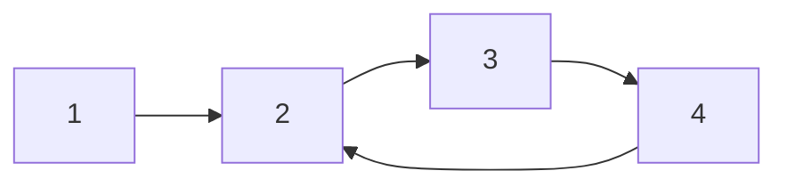

## The idea

Walk the same linked list with **two pointers at different speeds**: `slow` moves 1 node per step, and `fast` moves 2 nodes per step.

Think of **two runners**, one twice as fast as the other, starting together:

- On a **straight road**, when the fast runner reaches the finish line, the slow runner is exactly **halfway**. That finds the **middle** of a list.
- On a **round track**, the fast runner never finishes. It laps the slow runner, and they **meet**. That finds a **cycle**.

A linked list has no indexes and no `length`, so you can't jump to the middle. Fast and slow pointers find it in **one pass** with **O(1) space**.

A close cousin: two pointers at the **same speed**, but one starts **n nodes ahead**. That finds the nth node from the end.

## How it works

### The helpers

The examples use the helpers from [Linked Lists](./linked-lists.mdx). Paste this block first, then paste one example below it.

```js
class ListNode {
    constructor(val) {
        this.val = val;
        this.next = null;
    }
}

function buildList(values) {
    let head = null;

    for (let i = values.length - 1; i >= 0; i--) {
        const node = new ListNode(values[i]);
        node.next = head;
        head = node;
    }

    return head;
}

function printList(head) {
    let text = "";
    let current = head;

    while (current !== null) {
        text = text + current.val + " -> ";
        current = current.next;
    }

    console.log(text + "null");
}
```

### The basic loop

Both pointers start at the head. Each step, `slow` moves one node and `fast` moves two.

```js
const head = buildList([1, 2, 3, 4, 5]);

let slow = head;
let fast = head;

while (fast !== null && fast.next !== null) {
    slow = slow.next;
    fast = fast.next.next;
}

console.log(slow.val); // 3
```

The loop condition has two checks, because `fast` can stop in two ways:

- `fast !== null`: the list has an **even** length, and `fast` jumped past the end.
- `fast.next !== null`: the list has an **odd** length, and `fast` is on the last node, with no room for a jump of two.

The order matters. If `fast` is `null`, reading `fast.next` would crash. `&&` stops at the first `false`, so check `fast` first.

Here is the loop on `1 -> 2 -> 3 -> 4 -> 5` (odd length):

| Step | slow | fast | Why it stops |
| --- | --- | --- | --- |
| Start | 1 | 1 | |
| 1 | 2 | 3 | |
| 2 | 3 | 5 | `fast.next` is `null` |

And on `1 -> 2 -> 3 -> 4 -> 5 -> 6` (even length):

| Step | slow | fast | Why it stops |
| --- | --- | --- | --- |
| Start | 1 | 1 | |
| 1 | 2 | 3 | |
| 2 | 3 | 5 | |
| 3 | 4 | `null` | `fast` is `null` |

Either way, `fast` went twice as far as `slow`, so `slow` stops in the middle.

## Classic problems

### 1. Middle of the Linked List (LeetCode 876)

**Problem:** return the middle node. If there are two middle nodes, return the second one. `1 -> 2 -> 3 -> 4 -> 5` gives 3; `1 -> 2 -> 3 -> 4 -> 5 -> 6` gives 4.

**Idea:** exactly the basic loop. When `fast` reaches the end, `slow` is in the middle.

```js
function middleNode(head) {
    let slow = head;
    let fast = head;

    while (fast !== null && fast.next !== null) {
        slow = slow.next;
        fast = fast.next.next;
    }

    // fast went twice as far, so slow is halfway.
    return slow;
}

console.log(middleNode(buildList([1, 2, 3, 4, 5])).val); // 3
console.log(middleNode(buildList([1, 2, 3, 4, 5, 6])).val); // 4
```

**Time:** O(n) · **Space:** O(1). `fast` crosses the list once (n/2 steps), and we only keep two pointers.

**Need the first middle instead?** Start `fast` one node ahead: `let fast = head.next;`. Then for `1 -> 2 -> 3 -> 4 -> 5 -> 6`, `slow` stops on 3. Odd lengths still give the true middle. This is the version you want when you **split a list in half** (Reorder List below uses it).

The simple way works too: count the nodes in one pass, then walk half of them in a second pass. Also O(n), but two passes.

### 2. Linked List Cycle (LeetCode 141)

**Problem:** return `true` if the list has a **cycle**: some node's `next` points back to an earlier node, so walking the list never ends.



**First idea: remember every node you've seen.** If you reach a node twice, there's a loop.

```js
function hasCycleWithSet(head) {
    const seen = new Set();
    let current = head;

    while (current !== null) {
        // We've stood on this node before: we're going round a loop.
        if (seen.has(current)) {
            return true;
        }

        seen.add(current);
        current = current.next;
    }

    return false;
}
```

The Set stores **nodes** (objects), not values, because two different nodes can hold the same value. This works, but it costs **O(n) space**.

**Better idea: fast and slow.** If there's no loop, `fast` reaches `null`. If there is a loop, both pointers end up going round it. Each step, `fast` gains one node on `slow`, so the gap between them shrinks by 1 every step. It can't jump over `slow`: the gap goes 3, 2, 1, 0, and they meet.

```js
function hasCycle(head) {
    let slow = head;
    let fast = head;

    while (fast !== null && fast.next !== null) {
        slow = slow.next;
        fast = fast.next.next;

        // The same node (not just the same value): fast lapped slow.
        if (slow === fast) {
            return true;
        }
    }

    // fast reached the end, so there is no loop.
    return false;
}
```

To test it, build a list and then point the last node back at node 2 by hand. Paste this below `hasCycle`.

```js
const straight = buildList([1, 2, 3, 4]);
console.log(hasCycle(straight)); // false

const looped = buildList([1, 2, 3, 4]);
const node2 = looped.next;
const node4 = looped.next.next.next;

// Make the loop: 4 points back to 2.
node4.next = node2;

console.log(hasCycle(looped)); // true
```

| Step | slow | fast | Same node? |
| --- | --- | --- | --- |
| Start | 1 | 1 | (not checked) |
| 1 | 2 | 3 | no |
| 2 | 3 | 2 (3 → 4 → 2) | no |
| 3 | 4 | 4 (2 → 3 → 4) | **yes**: return `true` |

Don't call `printList(looped)`: it would walk round the loop forever.

**Time:** O(n) · **Space:** O(1). With no loop, `fast` reaches the end in n/2 steps. With a loop, once `slow` enters it, `fast` catches up in less than one lap. Only two pointers, no Set.

### 3. Remove Nth Node From End of List (LeetCode 19)

**Problem:** remove the nth node from the end and return the head. `1 -> 2 -> 3 -> 4 -> 5` with n = 2 becomes `1 -> 2 -> 3 -> 5`.

**Idea:** the simple way is two passes: count the length, then remove node number `length - n + 1` from the start. To do it in **one pass**, use two pointers with a **gap of n**:

1. Move `fast` n steps ahead.
2. Move both one step at a time until `fast` is on the **last** node.
3. Now `slow` is just **before** the node to remove. Point past it.

Both pointers start on a **dummy node**. That way, removing the head (n = length) works with no special case.

```js
function removeNthFromEnd(head, n) {
    const dummy = new ListNode(0);
    dummy.next = head;

    let slow = dummy;
    let fast = dummy;

    // 1. Give fast a head start of n nodes.
    for (let i = 0; i < n; i++) {
        fast = fast.next;
    }

    // 2. Move both until fast is on the last node.
    while (fast.next !== null) {
        slow = slow.next;
        fast = fast.next;
    }

    // 3. slow is just before the node to remove. Skip over it.
    slow.next = slow.next.next;

    return dummy.next;
}

const list = buildList([1, 2, 3, 4, 5]);
printList(removeNthFromEnd(list, 2)); // 1 -> 2 -> 3 -> 5 -> null

const shortList = buildList([1, 2]);
printList(removeNthFromEnd(shortList, 2)); // 2 -> null
```

For `1 -> 2 -> 3 -> 4 -> 5` and n = 2:

| Step | slow | fast | |
| --- | --- | --- | --- |
| Start | dummy | dummy | |
| After the head start | dummy | 2 | fast is 2 nodes ahead |
| 1 | 1 | 3 | |
| 2 | 2 | 4 | |
| 3 | 3 | 5 | fast is on the last node: stop |
| Remove | 3 | | `slow.next` is 4: point 3 at 5 |

The gap stays at n the whole time, so when `fast` is on the last node, `slow` is n nodes behind it: right before the nth node from the end. In the second example the head itself is removed, and the dummy makes that work.

**Time:** O(n) · **Space:** O(1). One pass through the list, and two pointers.

### 4. Reorder List (LeetCode 143)

**Problem:** reorder the list in place: first, last, second, second-to-last, and so on. `1 -> 2 -> 3 -> 4 -> 5` becomes `1 -> 5 -> 2 -> 4 -> 3`. Return nothing; change the list itself.

**Idea:** three things you already know, one after another:

1. **Split** the list in the middle (fast and slow).
2. **Reverse** the second half (see [Linked Lists](./linked-lists.mdx)).
3. **Weave** the two halves together: one node from the first half, one from the second.

| Step | First half | Second half |
| --- | --- | --- |
| 1. Split | `1 -> 2 -> 3` | `4 -> 5` |
| 2. Reverse the second half | `1 -> 2 -> 3` | `5 -> 4` |
| 3. Weave | `1 -> 5 -> 2 -> 4 -> 3` | |

The code comes in four small blocks. Paste them in order, below the helpers.

**Step 1: split the list in half.** `fast` starts one node ahead, so `slow` stops on the **last node of the first half**. Then we cut the link there.

```js
// Cut the list in the middle. Return the head of the second half.
function splitInHalf(head) {
    let slow = head;
    let fast = head.next;

    while (fast !== null && fast.next !== null) {
        slow = slow.next;
        fast = fast.next.next;
    }

    const secondHalf = slow.next;

    // End the first half here, so the halves are separate.
    slow.next = null;

    return secondHalf;
}
```

**Step 2: reverse the second half.** The same code as in Linked Lists.

```js
function reverseList(head) {
    let prev = null;
    let current = head;

    while (current !== null) {
        const next = current.next;
        current.next = prev;
        prev = current;
        current = next;
    }

    return prev;
}
```

**Step 3: weave the halves together.** The second half has the same number of nodes as the first, or one fewer, so we stop when it runs out.

```js
// Take one node from first, then one from second, and repeat.
function weave(first, second) {
    while (second !== null) {
        // Save what comes next in each half.
        const firstNext = first.next;
        const secondNext = second.next;

        // first -> second -> (the rest of first)
        first.next = second;
        second.next = firstNext;

        first = firstNext;
        second = secondNext;
    }
}
```

**Step 4: put it together.**

```js
function reorderList(head) {
    // 0 or 1 nodes: nothing to reorder.
    if (head === null || head.next === null) {
        return;
    }

    const secondHalf = splitInHalf(head);
    const reversedHalf = reverseList(secondHalf);

    weave(head, reversedHalf);
}

const oddList = buildList([1, 2, 3, 4, 5]);
reorderList(oddList);
printList(oddList); // 1 -> 5 -> 2 -> 4 -> 3 -> null

const evenList = buildList([1, 2, 3, 4]);
reorderList(evenList);
printList(evenList); // 1 -> 4 -> 2 -> 3 -> null
```

**Time:** O(n) · **Space:** O(1). Split, reverse and weave are one pass each, and we only move pointers. (Copying the nodes into an array and picking from both ends also works, but costs O(n) space.)

## How to spot it

- A linked list and the word "**middle**", or you need to **split a list in half**.
- "**Cycle**", "**loop**", "does it ever come back".
- "**nth from the end**" or "**kth from the end**": two pointers with a gap.
- "**O(1) extra space**" on a linked list, when a Set or an array would make it easy.
- Problems that combine steps: **Palindrome Linked List** (LeetCode 234) is "find the middle, reverse the second half, compare the halves", just like Reorder List.
- Anything with a "next" step can have a cycle, not only linked lists: **Happy Number** (LeetCode 202) and **Find the Duplicate Number** (LeetCode 287) use the same fast and slow trick on numbers.

## Common mistakes

- **`fast.next.next` without checking `fast.next`.** It throws `TypeError: Cannot read properties of null`. Use `while (fast !== null && fast.next !== null)`.
- **The checks in the wrong order.** `fast.next !== null && fast !== null` crashes when `fast` is `null`. Check `fast` first.
- **Comparing values instead of nodes.** `slow.val === fast.val` can be true for two different nodes. Compare the nodes: `slow === fast`.
- **Checking `slow === fast` before moving.** They both start at the head, so the check is `true` at once. Move first, then compare.
- **No dummy in Remove Nth.** When n equals the length, the head must go, and there is no node before it. The dummy fixes that.
- **An off-by-one gap.** With both pointers on the dummy, move `fast` exactly n steps, and stop when `fast.next` is `null`.
- **Not cutting the list in Reorder List.** Forget `slow.next = null`, and the halves stay joined: you build a loop.
- **Printing a list that has a cycle.** `printList` never ends.

## In the interview

> "I'll use fast and slow pointers. `slow` moves one step and `fast` moves two. If there's no loop, `fast` hits `null`. If there is a loop, `fast` gains one node on `slow` every step, so it can't skip past it: they must meet. That's O(n) time and O(1) space, better than a Set of seen nodes, which is O(n) space."

**Likely follow-up:** "Can you find the node where the cycle starts?" (LeetCode 142)

**Answer:** "Yes. After they meet, I put one pointer back at the head and move both one step at a time. They meet again exactly at the start of the cycle."

Why it works, in short: `fast` walked twice as far as `slow`, and the extra distance is whole laps of the loop. So the distance from the head to the start of the loop is the same as the distance from the meeting point forward to the start (plus maybe some whole laps).

```js
function detectCycleStart(head) {
    let slow = head;
    let fast = head;

    while (fast !== null && fast.next !== null) {
        slow = slow.next;
        fast = fast.next.next;

        if (slow === fast) {
            // Phase 2: one pointer back at the head, both at speed 1.
            let pointer = head;

            while (pointer !== slow) {
                pointer = pointer.next;
                slow = slow.next;
            }

            return pointer;
        }
    }

    // No cycle.
    return null;
}

const looped = buildList([1, 2, 3, 4]);

// 4 points back to 2.
looped.next.next.next.next = looped.next;

console.log(detectCycleStart(looped).val); // 2
```

<Callout title="Remember this" type="success">
  - `slow` moves 1, `fast` moves 2. Loop while `fast !== null && fast.next !== null`.
  - When `fast` reaches the end, `slow` is in the **middle** (the second middle for even lengths; start `fast` at `head.next` for the first).
  - **Cycle:** if `slow === fast` (the same node), there's a loop. O(n) time, O(1) space, instead of a Set's O(n).
  - **Nth from the end:** give `fast` an n-node head start, then move both together. A dummy node handles removing the head.
  - **Reorder List / Palindrome:** find the middle, reverse the second half, then walk both halves.
</Callout>
