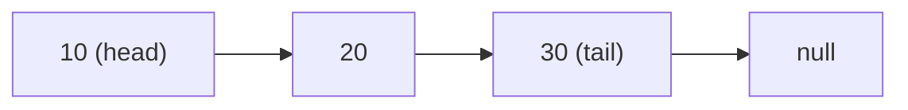
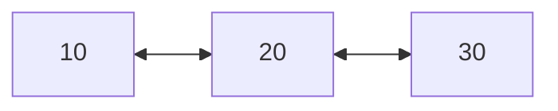

## The idea

A linked list is a chain of small objects called **nodes**. Each node holds a **value** and a **pointer to the next node**. The last node points to `null`, which means "the end".

Think of a **treasure hunt**. Each clue tells you where the next clue is hidden. To reach clue 4, you start at clue 1 and follow the chain: 1, 2, 3, 4. You can't jump straight to clue 4. But adding a new first clue is easy: write one new clue that points to the old first one.

Linked lists work the same way:

- **Adding or removing at the front is fast:** O(1).
- **Finding the 4th item is slow:** you walk from the start, O(n).

| | Array | Linked list |
| --- | --- | --- |
| Read the item at position i | O(1): jump straight to it | O(n): walk from the head |
| Add or remove at the front | O(n): everything shifts | O(1): change one pointer |
| Where the items live in memory | Side by side, in one block | Anywhere; `next` links them |

(Why arrays shift, and why their reads are O(1): see [How Memory Works](../foundations/how-memory-works.mdx).)

## How it works

The blocks in this section build on each other. **Run** on a block also runs the earlier blocks it needs.

### A node is a small object

A node has two fields: `val` (the value) and `next` (the next node, or `null`). LeetCode uses these exact names, so we use them too.

```js
class ListNode {
    constructor(val) {
        this.val = val;
        this.next = null;
    }
}

const node = new ListNode(10);

console.log(node); // ListNode { val: 10, next: null }
console.log(node.val); // 10
console.log(node.next); // null
```

### Link nodes into a list

Make three nodes, then point each one at the next. The first node is the **head**. The last node is the **tail**: its `next` is `null`.

```js
const first = new ListNode(10);
const second = new ListNode(20);
const third = new ListNode(30);

first.next = second;
second.next = third;

const head = first;

console.log(head);
// ListNode {
//   val: 10,
//   next: ListNode { val: 20, next: ListNode { val: 30, next: null } }
// }
```



The console prints the list as **objects inside objects**. `head` doesn't hold the whole list. It holds only the first node. You reach the others by following `next`.

Add a fourth node and print again. Node stops printing after a few levels and shows `[ListNode]`:

```js
const fourth = new ListNode(40);
third.next = fourth;

console.log(head);
// ListNode {
//   val: 10,
//   next: ListNode { val: 20, next: ListNode { val: 30, next: [ListNode] } }
// }
```

`[ListNode]` means "there is another node here, but I won't print this deep". The node is still there. To see the whole list, walk it.

### Walk the list

Start at the head and follow `next` until you reach `null`. `current = current.next` is the linked list version of `i++`.

```js
function printList(head) {
    let text = "";
    let current = head;

    // Stop when we fall off the end.
    while (current !== null) {
        text = text + current.val + " -> ";
        current = current.next;
    }

    console.log(text + "null");
}

printList(head); // 10 -> 20 -> 30 -> 40 -> null
```

| Step | current | text so far |
| --- | --- | --- |
| 1 | node 10 | `10 -> ` |
| 2 | node 20 | `10 -> 20 -> ` |
| 3 | node 30 | `10 -> 20 -> 30 -> ` |
| 4 | node 40 | `10 -> 20 -> 30 -> 40 -> ` |
| 5 | `null` | the loop stops, print it with `null` at the end |

### Build a list from an array

Linking nodes by hand gets tiring. This helper builds a list from an array. It goes through the values **backwards** and adds each one at the **front**, so the list ends up in the right order.

```js
function buildList(values) {
    let head = null;

    for (let i = values.length - 1; i >= 0; i--) {
        const node = new ListNode(values[i]);

        // The new node points at the list built so far...
        node.next = head;

        // ...and becomes the new head.
        head = node;
    }

    return head;
}

const myList = buildList([1, 2, 3]);
printList(myList); // 1 -> 2 -> 3 -> null
```

| i | New node | It points to | head is now |
| --- | --- | --- | --- |
| 2 | 3 | `null` | `3 -> null` |
| 1 | 2 | node 3 | `2 -> 3 -> null` |
| 0 | 1 | node 2 | `1 -> 2 -> 3 -> null` |

### The helpers for the rest of this page

Every example below uses these three helpers. Each example's **Run** button runs this block first.

```js
class ListNode {
    constructor(val) {
        this.val = val;
        this.next = null;
    }
}

function buildList(values) {
    let head = null;

    for (let i = values.length - 1; i >= 0; i--) {
        const node = new ListNode(values[i]);
        node.next = head;
        head = node;
    }

    return head;
}

function printList(head) {
    let text = "";
    let current = head;

    while (current !== null) {
        text = text + current.val + " -> ";
        current = current.next;
    }

    console.log(text + "null");
}
```

On LeetCode, `ListNode` is already written for you, with the same `val` and `next`.

## Basic operations

### Insert at the front: O(1)

The new node points at the old head, and becomes the new head. The function **returns the new head**, because the first node changed.

```js
function insertAtFront(head, value) {
    const node = new ListNode(value);
    node.next = head;

    return node;
}

let list = buildList([10, 20, 30]);
list = insertAtFront(list, 5);

printList(list); // 5 -> 10 -> 20 -> 30 -> null
```

### Insert at the end: O(n)

You must walk to the last node first. Notice the loop: `current.next !== null` stops **on** the last node, while `current !== null` would walk **past** it.

```js
function insertAtEnd(head, value) {
    const node = new ListNode(value);

    // An empty list: the new node is the whole list.
    if (head === null) {
        return node;
    }

    // Walk to the last node: the one whose next is null.
    let current = head;
    while (current.next !== null) {
        current = current.next;
    }

    current.next = node;
    return head;
}

let list = buildList([10, 20, 30]);
list = insertAtEnd(list, 40);

printList(list); // 10 -> 20 -> 30 -> 40 -> null
```

If you add at the end a lot, keep a `tail` variable that always points at the last node. Then adding at the end is O(1) too.

### Insert after a node you already have: O(1)

No walking and no shifting: just two pointer changes. The **order matters**. Link the new node to the rest first. If you change `node.next` first, you lose the rest of the list.

```js
function insertAfter(node, value) {
    const newNode = new ListNode(value);

    // 1. The new node points at the rest of the list.
    newNode.next = node.next;

    // 2. The old node points at the new node.
    node.next = newNode;
}

const list = buildList([10, 30]);
insertAfter(list, 20);

printList(list); // 10 -> 20 -> 30 -> null
```

### Search: O(n)

Walk until you find the value or fall off the end.

```js
function contains(head, target) {
    let current = head;

    while (current !== null) {
        if (current.val === target) {
            return true;
        }

        current = current.next;
    }

    return false;
}

const list = buildList([10, 20, 30]);

console.log(contains(list, 20)); // true
console.log(contains(list, 99)); // false
```

### Remove a value: O(n)

A node only knows the node **after** it, never the one before. So to remove a node, you stop on the node **before** it and point past it. Removing the head is a special case, because nothing comes before the head.

```js
function removeValue(head, target) {
    if (head === null) {
        return null;
    }

    // Special case: the head itself must go.
    if (head.val === target) {
        return head.next;
    }

    // Stop on the node BEFORE the one to remove.
    let current = head;
    while (current.next !== null) {
        if (current.next.val === target) {
            // Point past it.
            current.next = current.next.next;
            return head;
        }

        current = current.next;
    }

    return head;
}
```

Try it:

```js
let list = buildList([10, 20, 30]);

list = removeValue(list, 20);
printList(list); // 10 -> 30 -> null

list = removeValue(list, 10);
printList(list); // 30 -> null
```

Nothing points to the removed node any more, so JavaScript frees its memory for you.

| Operation | Cost | Why |
| --- | --- | --- |
| Insert or remove at the front | O(1) | change one pointer |
| Insert after a node you have | O(1) | change two pointers |
| Insert at the end | O(n), or O(1) with a `tail` | walk to the last node |
| Search, or read position i | O(n) | walk from the head |
| Remove a value | O(n) | walk to the node before it |

## The dummy node trick

`removeValue` needed an extra `if` for the head, because the head has no node before it. The **dummy node** trick gets rid of that special case: put a fake node in front of the head. Now every real node, the head too, has a node before it.

At the end, return `dummy.next`: that is the real head, even if the old head was removed.

This example removes **every** node with the target value (LeetCode 203, "Remove Linked List Elements").

```js
function removeAll(head, target) {
    // A fake node in front of the head. Its value doesn't matter.
    const dummy = new ListNode(0);
    dummy.next = head;

    let current = dummy;
    while (current.next !== null) {
        if (current.next.val === target) {
            // Point past it. Don't move: the new next might match too.
            current.next = current.next.next;
        } else {
            current = current.next;
        }
    }

    // The real head is whatever comes after the dummy.
    return dummy.next;
}

const list = buildList([7, 7, 1, 7, 2]);
printList(removeAll(list, 7)); // 1 -> 2 -> null
```

Reach for a dummy node whenever **the head might change**: removing nodes, merging lists, or building a new list.

## Doubly linked lists

In a **doubly linked list**, each node also has `prev`, a pointer to the node before it. You can walk both ways, and you can remove a node in O(1) when you already have it. The cost is one extra pointer per node.



Each arrow goes both ways: `next` points right, `prev` points left. The first node's `prev` and the last node's `next` are `null`.

The blocks in this section don't need the helpers. **Run** on a block also runs the earlier blocks it needs.

```js
class DoublyNode {
    constructor(val) {
        this.val = val;
        this.prev = null;
        this.next = null;
    }
}

const first = new DoublyNode(10);
const second = new DoublyNode(20);
const third = new DoublyNode(30);

first.next = second;
second.prev = first;
second.next = third;
third.prev = second;

console.log(second);
// <ref *1> DoublyNode {
//   val: 20,
//   prev: DoublyNode { val: 10, prev: null, next: [Circular *1] },
//   next: DoublyNode { val: 30, prev: [Circular *1], next: null }
// }
```

### What `[Circular *1]` means

Look at what the console had to print. `second.prev` is `first`, and `first.next` is `second` again. If the console kept going, it would print second, first, second, first... forever.

So it marks `second` with `<ref *1>` at the top, and when it meets `second` again, it prints `[Circular *1]`: "this is object 1 again, which I'm already printing". It's **not an error**. Every doubly linked list prints like this, because neighbors point at each other. (Older Node versions print just `[Circular]`.)

One thing that does break: `JSON.stringify(second)` throws a `TypeError` ("Converting circular structure to JSON"), because JSON can't describe a loop.

### Walk backwards

Start at the tail and follow `prev`.

```js
const valuesBackwards = [];
let current = third;

while (current !== null) {
    valuesBackwards.push(current.val);
    current = current.prev;
}

console.log(valuesBackwards); // [ 30, 20, 10 ]
```

### Remove a node in O(1)

With `prev`, a node can reach its left neighbor itself, so there is no walk. Connect the two neighbors to each other, and the node drops out.

```js
function removeNode(node) {
    // The left neighbor skips over the node...
    if (node.prev !== null) {
        node.prev.next = node.next;
    }

    // ...and the right neighbor points back past it.
    if (node.next !== null) {
        node.next.prev = node.prev;
    }

    // Cut the removed node loose.
    node.prev = null;
    node.next = null;
}

removeNode(second);

console.log(first.next.val); // 30
console.log(third.prev.val); // 10
```

If you keep `head` and `tail` variables, update them when you remove the first or last node. A common trick is a **dummy head and a dummy tail**, so `prev` and `next` are never `null`. That's how people build the **LRU Cache** (LeetCode 146): a Map from key to node, plus a doubly linked list in "most recently used" order.

## Classic problems

Each problem uses [the helpers](#the-helpers-for-the-rest-of-this-page). Its **Run** button runs them first.

### 1. Reverse Linked List (LeetCode 206)

**Problem:** reverse a list and return the new head. `1 -> 2 -> 3` becomes `3 -> 2 -> 1`.

**Idea:** walk the list once and **turn each arrow around**. Use three pointers:

- `prev`: the part already reversed. It starts as `null`.
- `current`: the node we are turning around now.
- `next`: the rest of the list, saved **before** we break the link, so we don't lose it.

Each step does four things: save next, turn the arrow, move `prev` forward, move `current` forward.

```js
function reverseList(head) {
    let prev = null;
    let current = head;

    while (current !== null) {
        // 1. Save the rest of the list before we break the link.
        const next = current.next;

        // 2. Turn this node's arrow around.
        current.next = prev;

        // 3 and 4. Move both pointers one step forward.
        prev = current;
        current = next;
    }

    // current fell off the end. prev is the old tail: the new head.
    return prev;
}

const list = buildList([1, 2, 3]);
const reversed = reverseList(list);

printList(reversed); // 3 -> 2 -> 1 -> null

// list still points at node 1, which is now the last node.
printList(list); // 1 -> null
```

Here it is step by step for `1 -> 2 -> 3`:

| Step | current | next (saved) | Arrow turned | Reversed part (from prev) | Rest (from current) |
| --- | --- | --- | --- | --- | --- |
| Start | 1 | | | `null` | `1 -> 2 -> 3 -> null` |
| 1 | 1 | 2 | `1 -> null` | `1 -> null` | `2 -> 3 -> null` |
| 2 | 2 | 3 | `2 -> 1` | `2 -> 1 -> null` | `3 -> null` |
| 3 | 3 | `null` | `3 -> 2` | `3 -> 2 -> 1 -> null` | `null` |

Now `current` is `null`, so the loop stops, and we return `prev`, which is node 3.

**Time:** O(n) · **Space:** O(1). Each node is visited once, and we only use three pointers: no new nodes, no array.

### 2. Merge Two Sorted Lists (LeetCode 21)

**Problem:** merge two sorted lists into one sorted list, reusing their nodes. `1 -> 3 -> 5` and `2 -> 4` become `1 -> 2 -> 3 -> 4 -> 5`.

**Idea:** like merging two sorted piles of cards. Look at the top card of each pile, take the smaller one, and repeat. When one pile runs out, put the rest of the other pile at the end.

A **dummy node** starts the new list, and `tail` always points at its last node. Without the dummy, the first node would need its own special code ("which list does the merged list start with?").

```js
function mergeTwoLists(list1, list2) {
    const dummy = new ListNode(0);
    let tail = dummy;

    // While both lists have nodes, take the smaller one.
    while (list1 !== null && list2 !== null) {
        if (list1.val <= list2.val) {
            tail.next = list1;
            list1 = list1.next;
        } else {
            tail.next = list2;
            list2 = list2.next;
        }

        tail = tail.next;
    }

    // One list is empty. Attach whatever is left of the other.
    if (list1 !== null) {
        tail.next = list1;
    } else {
        tail.next = list2;
    }

    return dummy.next;
}

const merged = mergeTwoLists(buildList([1, 3, 5]), buildList([2, 4]));
printList(merged); // 1 -> 2 -> 3 -> 4 -> 5 -> null
```

| Step | list1 at | list2 at | Take | Merged so far |
| --- | --- | --- | --- | --- |
| 1 | 1 | 2 | 1 | `1` |
| 2 | 3 | 2 | 2 | `1 -> 2` |
| 3 | 3 | 4 | 3 | `1 -> 2 -> 3` |
| 4 | 5 | 4 | 4 | `1 -> 2 -> 3 -> 4` |
| 5 | 5 | `null` | the loop stops, attach the rest | `1 -> 2 -> 3 -> 4 -> 5` |

**Time:** O(n + m) · **Space:** O(1). Each step takes one node, and there are n + m nodes. We relink the nodes we already have; only the dummy is new.

## How to spot it

- The input is the **head** of a linked list (a `ListNode`).
- "**In place**" or "**O(1) extra space**": change `next` pointers instead of copying the values into an array.
- **The head might change** (remove, insert, merge, build a new list): use a dummy node.
- You need to go **backwards**: reverse the list, or part of it.
- "**Middle**", "**cycle**", "**nth from the end**": see [Fast and Slow Pointers](./fast-slow-pointers.mdx).
- A safe fallback: copy the values into an array, solve it there, and rebuild. Say it costs O(n) space, then offer the pointer version.

## Common mistakes

- **Losing the rest of the list.** Changing `current.next` before saving it. Always save `next` first.
- **Reading through `null`.** `current.next.val` when `current.next` is `null` throws `TypeError: Cannot read properties of null (reading 'val')`. Check `!== null` first.
- **Not returning the new head.** `insertAtFront`, `removeValue` and `reverseList` all change the head, so the caller must use what they return.
- **Returning `dummy` instead of `dummy.next`.** The dummy is fake: it would add a 0 at the front.
- **Moving on right after a removal.** In `removeAll`, if you also move `current` after removing, `[7, 7]` keeps its second 7.
- **The wrong loop condition.** `while (current !== null)` visits every node. `while (current.next !== null)` stops on the last node. Pick the one you need.
- **Forgetting the old head.** After reversing, your old `head` variable points at the **last** node.

## In the interview

- **Draw it.** Boxes and arrows for 3 nodes, then move the pointers by hand before you code.
- **Name your pointers** out loud and say what each one means.
- **Check the edge cases:** an empty list (`null`), one node, two nodes, and a change at the head.

> "I'll walk the list with three pointers. `prev` is the part already reversed, `current` is the node I'm turning around, and I save `next` before I change `current.next`, so I don't lose the rest. It's one pass, so O(n) time, and O(1) space."

**Likely follow-up:** "Can you reverse it with recursion?"

**Answer:** "Yes. Reverse everything after the head, then hook the head on at the end. It's still O(n) time, but O(n) space for the call stack, so for a long list the loop is safer."

```js
function reverseListRecursive(head) {
    // Base case: an empty list or one node is already reversed.
    if (head === null || head.next === null) {
        return head;
    }

    // Reverse everything after head. newHead is the old tail.
    const newHead = reverseListRecursive(head.next);

    // head.next is now the LAST node of the reversed part.
    // Hook head on after it, and make head the new end.
    head.next.next = head;
    head.next = null;

    return newHead;
}

const list = buildList([1, 2, 3]);
printList(reverseListRecursive(list)); // 3 -> 2 -> 1 -> null
```

<Callout title="Remember this" type="success">
  - A node is `{ val, next }`. `head` is the first node; the last node's `next` is `null`.
  - Walk with `current = current.next`. Reading position i is **O(n)**; adding at the front is **O(1)**.
  - Doubly linked nodes point at each other, so the console prints `[Circular *1]`. It's not an error.
  - **Dummy node:** a fake node before the head removes the head special case. Return `dummy.next`.
  - **Reverse:** save next, turn the arrow, move prev, move current. O(n) time, O(1) space.
  - Always check `!== null` before reading `.next` or `.val`.
</Callout>
