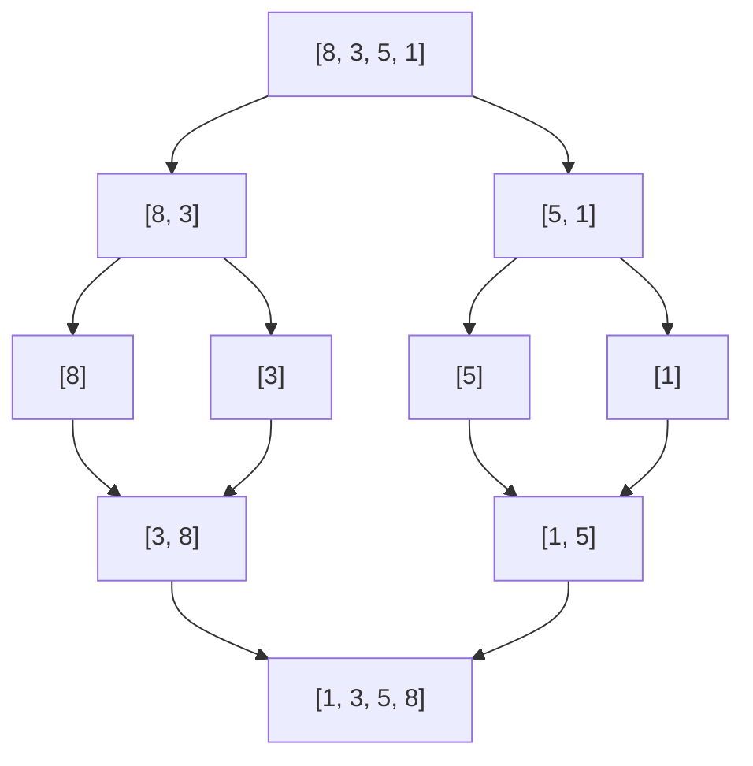

## The idea

Sorting puts items **in order**: smallest to biggest, A to Z, earliest to latest.

Think of a teacher sorting **100 exam papers** by name. Alone, it's slow. So she splits the pile in half and gives one half to a helper. Each of them sorts their half (and can split it again with more helpers). At the end, they **merge** the two sorted piles: look at the top paper of each pile, take the one that comes first, repeat. That is **merge sort**.

In interviews, sorting shows up in three ways:

- You call `sort()`, and you must know it costs **O(n log n)** and needs a **compare function**.
- You **sort first**, and then the problem becomes easy.
- You are asked to **write** merge sort or quick sort yourself.

## How it works

### Why simple sorts are slow

Simple sorts like bubble sort, selection sort and insertion sort compare each item with many other items. That is about n × n steps: **O(n²)**. For 100,000 items, that is 10 billion steps.

Merge sort and quick sort need about n × log n steps: **O(n log n)**. For 100,000 items, that is about 1.7 million steps. Both use the same trick: **split the problem in half**, again and again.

### Merge sort

Merge sort has two steps:

1. **Split** the array in half, again and again, until every piece has one item. One item on its own is already sorted.
2. **Merge** the pieces back together, two at a time, keeping them sorted.

Here is `[8, 3, 5, 1]`, read from top to bottom. The blue boxes are the splits, the teal boxes are single items, and the green boxes are merged and sorted.



#### Step 1: merge two sorted arrays

This is the heart of merge sort. Both arrays are already sorted, so the smallest item of all is at the **front** of one of them. Compare the two front items, take the smaller one, and move forward in that array. When one array runs out, copy the rest of the other.

```js
// Merges two sorted arrays into one sorted array.
function merge(leftPart, rightPart) {
    const merged = [];
    let leftIndex = 0;
    let rightIndex = 0;

    // Take the smaller front item until one side runs out.
    while (leftIndex < leftPart.length && rightIndex < rightPart.length) {
        if (leftPart[leftIndex] <= rightPart[rightIndex]) {
            merged.push(leftPart[leftIndex]);
            leftIndex++;
        } else {
            merged.push(rightPart[rightIndex]);
            rightIndex++;
        }
    }

    // One side is empty. Copy what is left of the other side.
    while (leftIndex < leftPart.length) {
        merged.push(leftPart[leftIndex]);
        leftIndex++;
    }

    while (rightIndex < rightPart.length) {
        merged.push(rightPart[rightIndex]);
        rightIndex++;
    }

    return merged;
}

console.log(merge([3, 8], [1, 5])); // [ 1, 3, 5, 8 ]
```

How `merge([3, 8], [1, 5])` runs:

| Step | Front of left | Front of right | Take | merged |
| --- | --- | --- | --- | --- |
| 1 | 3 | 1 | 1 | [1] |
| 2 | 3 | 5 | 3 | [1, 3] |
| 3 | 8 | 5 | 5 | [1, 3, 5] |
| 4 | 8 | (empty) | 8 | [1, 3, 5, 8] |

On a tie, `<=` takes the item from the left part first. So equal items keep their original order. A sort that does this is called **stable**.

#### Step 2: split, sort each half, merge

Now the recursion (see [Recursion](../foundations/recursion.mdx)). Cut the array in half, sort each half with the same function, then merge the two sorted halves.

```js
function mergeSort(numbers) {
    // Base case: 0 or 1 item is already sorted.
    if (numbers.length <= 1) {
        return numbers;
    }

    const middle = Math.floor(numbers.length / 2);
    const leftPart = numbers.slice(0, middle);
    const rightPart = numbers.slice(middle);

    // Sort each half, then merge them.
    const sortedLeft = mergeSort(leftPart);
    const sortedRight = mergeSort(rightPart);

    return merge(sortedLeft, sortedRight);
}

console.log(mergeSort([8, 3, 5, 1])); // [ 1, 3, 5, 8 ]
console.log(mergeSort([5, 2, 9, 1, 5, 6])); // [ 1, 2, 5, 5, 6, 9 ]
```

**Time:** O(n log n), always. Halving the array again and again makes about **log n levels**, like in the diagram. On each level, merging touches all **n items** once. **Space:** O(n), for the new arrays made by `slice` and `merge`.

### Quick sort

Quick sort also splits the work, but in a different way:

1. Pick one item as the **pivot**. Here, the last item.
2. **Partition:** put the items smaller than the pivot on its left, and the bigger ones on its right. Now the pivot is in its **final place**.
3. Do the same for the left part and for the right part.

Think of lining people up by height. Pick one person. Everyone shorter stands on their left, everyone taller on their right. That person is now in the right spot. Then repeat inside each group.

#### The easy version

This version builds two new arrays. It is the easiest way to see the idea.

```js
function quickSort(numbers) {
    // Base case: 0 or 1 item is already sorted.
    if (numbers.length <= 1) {
        return numbers;
    }

    const pivot = numbers[numbers.length - 1];
    const smaller = [];
    const bigger = [];

    // Put every item except the pivot into one of the two groups.
    for (let i = 0; i < numbers.length - 1; i++) {
        if (numbers[i] < pivot) {
            smaller.push(numbers[i]);
        } else {
            bigger.push(numbers[i]);
        }
    }

    const sortedSmaller = quickSort(smaller);
    const sortedBigger = quickSort(bigger);

    // "..." spreads the items of an array into the new array.
    return [...sortedSmaller, pivot, ...sortedBigger];
}

console.log(quickSort([7, 2, 9, 1, 5])); // [ 1, 2, 5, 7, 9 ]
```

#### The in-place version

Interviewers often ask for quick sort **in place**: no new arrays, only swaps inside the same array.

**Step A: partition.** Walk from `low` to `high - 1`. `nextSmallSpot` is where the next item smaller than the pivot should go. Each time you find a small item, swap it into that spot and move the spot forward. At the end, swap the pivot in right after the small items.

```js
function swap(numbers, first, second) {
    const temp = numbers[first];
    numbers[first] = numbers[second];
    numbers[second] = temp;
}

// Puts the pivot (the last item) in its final place,
// with smaller items on its left. Returns the pivot's index.
function partition(numbers, low, high) {
    const pivot = numbers[high];
    let nextSmallSpot = low;

    for (let i = low; i < high; i++) {
        if (numbers[i] < pivot) {
            swap(numbers, i, nextSmallSpot);
            nextSmallSpot++;
        }
    }

    // The pivot goes right after the smaller items.
    swap(numbers, nextSmallSpot, high);

    return nextSmallSpot;
}
```

How it partitions `[7, 2, 9, 1, 5]` with pivot 5:

| i | numbers[i] | Smaller than 5? | What happens | Array after | nextSmallSpot |
| --- | --- | --- | --- | --- | --- |
| start | | | | [7, 2, 9, 1, 5] | 0 |
| 0 | 7 | no | nothing | [7, 2, 9, 1, 5] | 0 |
| 1 | 2 | yes | swap index 1 and 0 | [2, 7, 9, 1, 5] | 1 |
| 2 | 9 | no | nothing | [2, 7, 9, 1, 5] | 1 |
| 3 | 1 | yes | swap index 3 and 1 | [2, 1, 9, 7, 5] | 2 |
| end | | | swap the pivot into index 2 | [2, 1, 5, 7, 9] | returns 2 |

5 is now at index 2, its final place. Everything on its left is smaller, everything on its right is bigger.

**Step B: sort both sides.**

```js
function quickSortInPlace(numbers, low, high) {
    // Base case: this part has 0 or 1 item.
    if (low >= high) {
        return;
    }

    const pivotIndex = partition(numbers, low, high);

    // The pivot is in place. Sort the two sides.
    quickSortInPlace(numbers, low, pivotIndex - 1);
    quickSortInPlace(numbers, pivotIndex + 1, high);
}

const scores = [7, 2, 9, 1, 5];
quickSortInPlace(scores, 0, scores.length - 1);

console.log(scores); // [ 1, 2, 5, 7, 9 ]
```

**Time:** O(n log n) on average. The pivot usually lands somewhere near the middle, so there are about log n levels with n work each. **Worst case O(n²):** if the pivot is always the smallest or biggest item, each partition removes just one item. That happens on an **already sorted** array when you always pick the last item. **Space:** O(log n) on average, for the call stack.

**The fix for the worst case:** pick a random pivot. Swap a random item to the end, then partition as before.

```js
function randomPartition(numbers, low, high) {
    // A random index from low to high.
    const randomIndex = low + Math.floor(Math.random() * (high - low + 1));
    swap(numbers, randomIndex, high);

    return partition(numbers, low, high);
}
```

Then call `randomPartition` instead of `partition` inside `quickSortInPlace`. A bad pivot every time becomes very unlikely.

### Merge sort vs quick sort

| | Merge sort | Quick sort |
| --- | --- | --- |
| Idea | split in half, sort the halves, merge | pick a pivot, partition, sort the sides |
| Time (usual) | O(n log n) | O(n log n) |
| Time (worst) | O(n log n) | O(n²), rare with a random pivot |
| Extra space | O(n) | O(log n) |
| Stable? | yes | no |
| Good for | guaranteed speed, linked lists, stable order | arrays in memory, fast in practice |

### What JavaScript's sort() uses

Chrome and Node (the V8 engine) use **Timsort**: a mix of merge sort and insertion sort. It is **O(n log n)**, and it is **stable**. Since 2019 the JavaScript standard says every engine's `sort()` must be stable. In an interview, call `sort()` unless you're asked to write your own, and say "sorting costs O(n log n)".

## Sorting with a compare function in JavaScript

Without a compare function, `sort()` compares items **as text**, so `[10, 9, 1].sort()` gives `[1, 10, 9]`. Always pass a compare function for numbers. The full story is in [Arrays](../js-toolkit/arrays.mdx).

The compare function gets two items, `a` and `b`, and returns a number:

| It returns | Meaning |
| --- | --- |
| a negative number | `a` goes first |
| a positive number | `b` goes first |
| 0 | keep them in the order they came |

**Numbers.** `a - b` is negative when `a` is smaller, so smaller numbers go first.

```js
const numbers = [40, 5, 100, 1];

numbers.sort((a, b) => a - b);
console.log(numbers); // [ 1, 5, 40, 100 ]

// Biggest first: swap a and b.
numbers.sort((a, b) => b - a);
console.log(numbers); // [ 100, 40, 5, 1 ]
```

**Objects and strings.** Sort by a field. `localeCompare` compares two strings in A to Z order.

```js
const people = [
    { name: "Sara", age: 31 },
    { name: "Ali", age: 25 },
    { name: "Ben", age: 31 },
];

// Youngest first.
people.sort((personA, personB) => personA.age - personB.age);
console.log(people.map((person) => person.name)); // [ 'Ali', 'Sara', 'Ben' ]

// Names from A to Z.
people.sort((personA, personB) => personA.name.localeCompare(personB.name));
console.log(people.map((person) => person.name)); // [ 'Ali', 'Ben', 'Sara' ]
```

Sara and Ben are both 31. In the age sort, they stay in the order they came in. That is the stable sort at work.

**Two rules: sort by one thing, then break ties with another.** Compare the first thing. Only if it's equal, compare the second.

```js
// Longest word first. Same length? A to Z.
function byLengthThenAlphabet(wordA, wordB) {
    if (wordA.length !== wordB.length) {
        return wordB.length - wordA.length;
    }

    return wordA.localeCompare(wordB);
}

const words = ["kiwi", "fig", "apple", "pear", "plum"];
words.sort(byLengthThenAlphabet);

console.log(words); // [ 'apple', 'kiwi', 'pear', 'plum', 'fig' ]
```

**Sorting letters.** Plain `sort()` is fine here, because letters should be sorted as text. Two words are **anagrams** when their sorted letters match.

```js
function sortLetters(word) {
    const letters = word.split("");
    letters.sort();
    return letters.join("");
}

console.log(sortLetters("listen")); // eilnst
console.log(sortLetters("silent")); // eilnst
```

**Don't return true or false.** A compare function must return a number that can be negative.

```js
// Wrong: a > b is true or false, never negative.
const wrong = [3, 1, 2].sort((a, b) => a > b);
console.log(wrong); // [ 3, 1, 2 ]
```

In Node and Chrome, that array doesn't get sorted at all. Other browsers may happen to sort it, which is worse: a bug that only shows up sometimes.

Also remember: `sort()` **changes the original array**. Use `toSorted()` when you need to keep the original.

## Problems that get easy after sorting

After sorting:

- **Equal or close items sit next to each other.** Compare each item with its neighbor.
- **The smallest item is at the start and the biggest at the end.** Walk in from both ends with [two pointers](../two-pointers/two-pointers.mdx).
- **You can [binary search](./binary-search.mdx)** for anything.
- **Overlapping intervals sit next to each other** once you sort them by start time.

| Problem | Why sorting helps | More |
| --- | --- | --- |
| Merge Intervals, Meeting Rooms | sorted by start, overlapping meetings are neighbors | [Intervals](../greedy-intervals/intervals.mdx) |
| 3Sum, Two Sum on a sorted array | two pointers from both ends | [Two Pointers](../two-pointers/two-pointers.mdx) |
| Valid Anagram, Group Anagrams | anagrams have the same sorted letters | [Hash Maps and Sets](../arrays-hashing/hash-maps-and-sets.mdx) |
| Assign Cookies, Boats to Save People | greedy: handle the smallest first | [Greedy](../greedy-intervals/greedy.mdx) |
| Kth Largest Element | it sits at index n - k (a heap is faster) | [Top K](../heaps/top-k.mdx) |

Sorting costs O(n log n), so the whole solution is at least O(n log n). That is usually much better than comparing every pair, which is O(n²).

## Classic problems

### 1. Minimum Absolute Difference

**Problem:** given an array of different whole numbers, return every pair with the smallest difference, smallest pair first. `[4, 2, 1, 3]` gives `[[1, 2], [2, 3], [3, 4]]`.

**Idea:** without sorting, you'd compare every pair: O(n²). After sorting, **the closest pair is always two neighbors**: if `a < b < c`, then `b` is closer to `a` than `c` is. So one pass finds the smallest gap, and a second pass collects the pairs with that gap.

```js
function minimumAbsDifference(numbers) {
    const sorted = numbers.toSorted((a, b) => a - b);

    // Pass 1: the smallest gap between two neighbors.
    let smallestGap = Infinity;
    for (let i = 1; i < sorted.length; i++) {
        const gap = sorted[i] - sorted[i - 1];
        smallestGap = Math.min(smallestGap, gap);
    }

    // Pass 2: every pair of neighbors with that gap.
    const pairs = [];
    for (let i = 1; i < sorted.length; i++) {
        const gap = sorted[i] - sorted[i - 1];
        if (gap === smallestGap) {
            pairs.push([sorted[i - 1], sorted[i]]);
        }
    }

    return pairs;
}

console.log(minimumAbsDifference([4, 2, 1, 3])); // [ [ 1, 2 ], [ 2, 3 ], [ 3, 4 ] ]
console.log(minimumAbsDifference([1, 3, 6, 10, 15])); // [ [ 1, 3 ] ]
```

**Time:** O(n log n) · **Space:** O(n). The sort is the slow part; the two passes are only O(n). The sorted copy takes O(n) space (`toSorted` keeps the input as it was).

### 2. Largest Number

**Problem:** given non-negative whole numbers, arrange them to make the **largest** number, and return it as a string. `[10, 2]` gives `"210"`. `[3, 30, 34, 5, 9]` gives `"9534330"`.

**Idea:** it's a sort with a special compare function. To decide whether `a` or `b` goes first, glue them together both ways and see which is bigger:

| a | b | a + b | b + a | Goes first |
| --- | --- | --- | --- | --- |
| 3 | 30 | 330 | 303 | 3 |
| 34 | 3 | 343 | 334 | 34 |
| 9 | 5 | 95 | 59 | 9 |

Both glued strings have the same length, so comparing them as text gives the same answer as comparing them as numbers.

**Step 1: the compare function.**

```js
// Which of two numbers (as text) should go first?
function compareForLargest(textA, textB) {
    const aFirst = textA + textB;
    const bFirst = textB + textA;

    if (aFirst > bFirst) {
        // Negative: textA goes first.
        return -1;
    }

    if (aFirst < bFirst) {
        return 1;
    }

    return 0;
}
```

**Step 2: sort and join.** One edge case: `[0, 0]` would give `"00"`, but the answer should be `"0"`.

```js
function largestNumber(numbers) {
    const texts = numbers.map((number) => String(number));
    texts.sort(compareForLargest);

    // If the biggest piece is "0", every piece is "0".
    if (texts[0] === "0") {
        return "0";
    }

    return texts.join("");
}

console.log(largestNumber([10, 2])); // 210
console.log(largestNumber([3, 30, 34, 5, 9])); // 9534330
console.log(largestNumber([0, 0])); // 0
```

**Time:** O(n log n) · **Space:** O(n). The sort makes O(n log n) comparisons. Each one glues two short strings, which is quick because a number has at most about 10 digits. The strings take O(n) space.

## How to spot it

- The **order of the input doesn't matter** for the answer, so you are free to reorder it.
- Words like **closest**, **smallest difference**, **overlapping**, **meetings**, **schedule**, or "pairs / triplets that add up to".
- Your first idea compares **every pair** (O(n²)). Sorting first often brings it down to O(n log n).
- You need **duplicates or groups** next to each other.
- The problem asks you to **implement** a sort, or to sort a **linked list** (use merge sort: it doesn't need to jump to an index).

**When not to sort:** when the answer needs the **original positions** (Two Sum returns indexes, so use a hash map), or when it's about **subarrays** (items next to each other in the original order). Sorting destroys both.

## Common mistakes

- **`sort()` with no compare function on numbers.** It sorts as text: `[10, 9, 1]` becomes `[1, 10, 9]`.
- **A compare function that returns `true` or `false`.** Return a number: `a - b`.
- **Forgetting that `sort()` changes the input.** The caller's array changes, and the old indexes are lost. Use `toSorted()` or copy first.
- **Leaving out the sort in Big O.** If you sort, the time is at least O(n log n).
- **Merge sort: forgetting the leftovers.** After the main loop, one side still has items. Copy them.
- **Quick sort: always picking the last item as the pivot** on sorted input. That's the O(n²) worst case. Use a random pivot.

## In the interview

- Ask first: "Can I sort the input in place, or should I keep the original?"
- Say the cost: "Sorting is O(n log n), then one pass is O(n), so O(n log n) in total."
- Use the built-in `sort()` unless you are asked to write one.

> "The order doesn't matter here, so I'll sort first. That's O(n log n). After sorting, the closest numbers are neighbors, so one pass over the array finds the smallest gap. In total it's O(n log n) time and O(n) space for the sorted copy."

**Likely follow-up:** "When would you pick merge sort over quick sort?"

**Answer:** "When I need a guaranteed O(n log n), a stable sort, or I'm sorting a linked list. Merge sort also works for data too big for memory: sort chunks, then merge them. Quick sort is in place and usually faster on arrays, but its worst case is O(n²) unless I pick a random pivot."

<Callout title="Remember this" type="success">
  - **Good sorts are O(n log n):** about log n levels of halving, with n work on each level. Simple sorts are O(n²).
  - **Merge sort:** split in half, sort each half, merge with two pointers. Always O(n log n), O(n) space, stable.
  - **Quick sort:** pick a pivot, put smaller items left and bigger items right, repeat. O(n log n) usually, **O(n²) worst**; a random pivot fixes it.
  - In JavaScript: **`sort((a, b) => a - b)`** for numbers. Negative means `a` first. It changes the array and is stable.
  - **Sort first** when the order doesn't matter: neighbors, two pointers, intervals, binary search. Always count the O(n log n).
</Callout>
