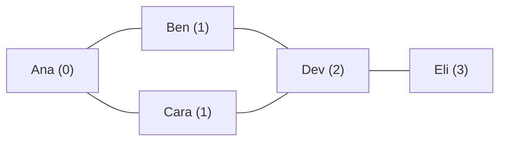

## The idea

A **queue** is a line. Items join at the **back** and leave from the **front**. The first one in is the first one out. This is called **FIFO**: First In, First Out.

Think of the **line at a coffee shop**. New people join at the back. The barista serves whoever is at the front. Nobody cuts in.

A **deque** (say "deck", short for **d**ouble-**e**nded **que**ue) is a line that is open at **both ends**. You can add or remove at the front, and at the back.

You meet queues all the time:

- A **printer** prints documents in the order they were sent.
- JavaScript's **event loop** keeps waiting callbacks (from `setTimeout`, for example) in a queue and runs them in order.
- **Message queues** like Kafka, RabbitMQ and SQS pass jobs between servers in order.
- **BFS**, the search that finds the fewest steps, visits things in the order it found them (more below).

## How it works

### The operations

| Operation | What it does |
| --- | --- |
| enqueue | add an item to the back |
| dequeue | remove the front item and give it back |
| peek | look at the front item without removing it |
| isEmpty | is the queue empty? |

### A queue with a JavaScript array

The easy way: `push` to join at the back, `shift` to leave from the front.

```js
const queue = [];

// Join at the back.
queue.push("Ana");
queue.push("Ben");
queue.push("Cara");
console.log(queue); // [ 'Ana', 'Ben', 'Cara' ]

// Serve the front.
console.log(queue.shift()); // Ana
console.log(queue); // [ 'Ben', 'Cara' ]

// Peek at the front.
console.log(queue[0]); // Ben
```

This works, and it's fine for a few items. But `shift()` is slow.

### Why array.shift() is O(n)

An array keeps its items side by side, with indexes starting at 0 (see [How Arrays Work in Memory](../foundations/how-memory-works.mdx)). When `shift()` removes the first item, **every other item moves one place to the left**, so the indexes start at 0 again.

| | index 0 | index 1 | index 2 | index 3 |
| --- | --- | --- | --- | --- |
| Before `shift()` | Ana | Ben | Cara | Dev |
| After `shift()` | Ben | Cara | Dev | |

Here is what `shift()` has to do, written out by hand. It counts the moves.

```js
// Does what shift() does, and returns how many items had to move.
function shiftByHand(items) {
    let moves = 0;

    // Move every item after the first one place to the left.
    for (let i = 1; i < items.length; i++) {
        items[i - 1] = items[i];
        moves++;
    }

    // Remove the last spot, which is now a leftover copy.
    items.length = items.length - 1;

    return moves;
}

const line = ["Ana", "Ben", "Cara", "Dev"];
console.log(shiftByHand(line)); // 3
console.log(line); // [ 'Ben', 'Cara', 'Dev' ]

const bigLine = new Array(1000000).fill("someone");
console.log(shiftByHand(bigLine)); // 999999
```

One `shift()` on a million items moves 999,999 items: **O(n)**. Emptying a whole queue of `n` items with `shift()` moves about n²/2 items in total: **O(n²)**.

You can feel it. In one test with Node 24, emptying a 100,000-item array with `shift()` took about **8 seconds**, and 200,000 items took about **32 seconds**: twice the items, four times the time. The fast queue below emptied 100,000 items in **under a millisecond**. Engines sometimes have tricks that make `shift()` faster, but you can't count on them. In an interview, treat it as O(n).

### A fast queue: keep a head index

Don't remove the front item at all. Just **remember where the front is**. `head` is the index of the front item. To dequeue, read `items[head]` and move `head` one step forward. Nothing else moves, so it's **O(1)**.

| Step | Operation | items | head | The queue (head to end) | Gives back |
| --- | --- | --- | --- | --- | --- |
| 1 | enqueue("Ana") | [Ana] | 0 | Ana | |
| 2 | enqueue("Ben") | [Ana, Ben] | 0 | Ana, Ben | |
| 3 | dequeue | [Ana, Ben] | 1 | Ben | Ana |
| 4 | enqueue("Cara") | [Ana, Ben, Cara] | 1 | Ben, Cara | |
| 5 | dequeue | [Ana, Ben, Cara] | 2 | Cara | Ben |

Ana and Ben are still in the array, but they sit before `head`, so they don't count anymore.

```js
class Queue {
    constructor() {
        this.items = [];
        // The index of the front item.
        this.head = 0;
    }

    // Join at the back.
    enqueue(value) {
        this.items.push(value);
    }

    // Leave from the front. Nothing moves: head just steps forward.
    dequeue() {
        if (this.isEmpty()) {
            return undefined;
        }

        const value = this.items[this.head];
        this.head++;
        return value;
    }

    peek() {
        return this.items[this.head];
    }

    isEmpty() {
        return this.head === this.items.length;
    }

    size() {
        return this.items.length - this.head;
    }
}
```

The same steps as the table:

```js
const queue = new Queue();

queue.enqueue("Ana");
queue.enqueue("Ben");
console.log(queue.dequeue()); // Ana

queue.enqueue("Cara");
console.log(queue.dequeue()); // Ben
console.log(queue.peek()); // Cara
console.log(queue.size()); // 1
```

Every operation is **O(1)**. The catch: old items stay in the array until the whole queue is thrown away. In an interview that's fine. In a program that runs for days, you'd clean up now and then, for example with `this.items = this.items.slice(this.head)` and `this.head = 0` once `head` gets big.

### A queue made of linked nodes

Another fast queue: a [linked list](../linked-lists/linked-lists.mdx). Each item is a node that points to the next one. Keep a pointer to the `first` node (the front) and the `last` node (the back). Nodes are dropped as they leave, so the memory is freed too.

**Step 1: a node.**

```js
class Node {
    constructor(value) {
        this.value = value;
        this.next = null;
    }
}
```

**Step 2: the queue.** Enqueue links a new node after `last`. Dequeue takes `first` and moves `first` to the next node.

```js
class LinkedQueue {
    constructor() {
        this.first = null;
        this.last = null;
    }

    enqueue(value) {
        const node = new Node(value);

        if (this.last === null) {
            // Empty queue: the new node is both first and last.
            this.first = node;
            this.last = node;
        } else {
            // Link it after the current last node.
            this.last.next = node;
            this.last = node;
        }
    }

    dequeue() {
        if (this.first === null) {
            return undefined;
        }

        const node = this.first;
        this.first = node.next;

        // We took the only node: the queue is empty now.
        if (this.first === null) {
            this.last = null;
        }

        return node.value;
    }
}
```

**Step 3: use it.**

```js
const waitingList = new LinkedQueue();

waitingList.enqueue("Ana");
waitingList.enqueue("Ben");

console.log(waitingList.dequeue()); // Ana
console.log(waitingList.dequeue()); // Ben
console.log(waitingList.dequeue()); // undefined
```

| Queue made with | enqueue | dequeue | Good to know |
| --- | --- | --- | --- |
| array + `shift()` | O(1) | **O(n)** | fine for a handful of items |
| array + head index | O(1) | O(1) | the simplest fast queue; old items stay in memory |
| linked list | O(1) | O(1) | frees memory as items leave; a bit more code |

### Deques: a queue open at both ends

A deque can add and remove at **both** ends. JavaScript has no built-in deque, and an array is only fast at one end:

| | At the front | At the back |
| --- | --- | --- |
| add | `unshift`: O(n) | `push`: O(1) |
| remove | `shift`: O(n) | `pop`: O(1) |

Luckily, most interview problems only need three moves: **add at the back**, **remove from the back**, and **remove from the front**. That's an array plus a head index again: `push`, `pop`, and `head++`. Just never `pop` when the deque is empty (`head === deque.length`), or you'd remove an item that was already dequeued. Sliding Window Maximum (below) uses exactly this.

If you truly need to add at the front too, use a doubly linked list. That is rare in interviews.

## Where queues show up: BFS

**BFS** (breadth-first search) explores in **rings**: first everything 1 step away from the start, then everything 2 steps away, and so on. A queue makes this happen, because the things found first are visited first.

Here is a small network of friends. The number in each box is how many handshakes away from Ana that person is.



In JavaScript, each person maps to a list of their friends:

```js
const friends = {
    Ana: ["Ben", "Cara"],
    Ben: ["Ana", "Dev"],
    Cara: ["Ana", "Dev"],
    Dev: ["Ben", "Cara", "Eli"],
    Eli: ["Dev"],
};
```

BFS with an array and a head index. A person gets their step count the first time we see them, and joins the back of the queue.

```js
function stepsFrom(graph, start) {
    const steps = new Map();
    steps.set(start, 0);

    const queue = [start];
    let head = 0;

    while (head < queue.length) {
        // Dequeue the front person. Nothing moves.
        const person = queue[head];
        head++;

        for (const friend of graph[person]) {
            // Not seen yet: one step further than person.
            if (!steps.has(friend)) {
                steps.set(friend, steps.get(person) + 1);
                queue.push(friend);
            }
        }
    }

    return steps;
}

const steps = stepsFrom(friends, "Ana");
console.log(steps.get("Dev")); // 2
console.log(steps.get("Eli")); // 3
```

| Dequeue | Add to the back | Queue after (head to end) |
| --- | --- | --- |
| Ana | Ben, Cara | Ben, Cara |
| Ben | Dev | Cara, Dev |
| Cara | (Dev was already seen) | Dev |
| Dev | Eli | Eli |
| Eli | | (empty) |

The queue always holds the people of one ring, followed by the people of the next ring. So we finish one ring before starting the next, and the first time we reach someone is by the **fewest steps**. With a stack instead of a queue, you'd go deep first (DFS) and lose that.

**Time:** O(V + E), where V is the number of people and E the number of friendships. Each person is dequeued once, and each friend list is read once. **Space:** O(V), for the queue and the step counts.

More on this in [Tree BFS](../trees/tree-bfs.mdx) and [Graph BFS and DFS](../graphs/graph-bfs-dfs.mdx).

## Classic problems

### 1. Implement Queue using Stacks

**Problem:** build a queue with `push` (to the back), `pop` (from the front), `peek` and `empty`, using only stack moves: push to the top, pop from the top, look at the top.

**Idea:** use two stacks, `inbox` and `outbox`.

- `push` always goes onto `inbox`.
- To `pop` or `peek`: if `outbox` is empty, **pour** everything from `inbox` into `outbox`. Pouring flips the order, so the **oldest** item ends up on top of `outbox`. Then use the top of `outbox`.

| Operation | inbox | outbox | Gives back |
| --- | --- | --- | --- |
| push(1) | [1] | [] | |
| push(2) | [1, 2] | [] | |
| pop(): outbox is empty, so pour | [] | [2, 1] | |
| ...then pop the top of outbox | [] | [2] | 1 |
| push(3) | [3] | [2] | |
| pop(): outbox has items, no pour | [3] | [] | 2 |

```js
class MyQueue {
    constructor() {
        // New items go here.
        this.inbox = [];
        // Items leave from here, oldest on top.
        this.outbox = [];
    }

    push(value) {
        this.inbox.push(value);
    }

    pop() {
        this.fillOutbox();
        return this.outbox.pop();
    }

    peek() {
        this.fillOutbox();
        return this.outbox[this.outbox.length - 1];
    }

    empty() {
        return this.inbox.length === 0 && this.outbox.length === 0;
    }

    // Pour inbox into outbox, but only when outbox is empty.
    fillOutbox() {
        if (this.outbox.length > 0) {
            return;
        }

        while (this.inbox.length > 0) {
            this.outbox.push(this.inbox.pop());
        }
    }
}
```

The same steps as the table:

```js
const myQueue = new MyQueue();

myQueue.push(1);
myQueue.push(2);
console.log(myQueue.pop()); // 1

myQueue.push(3);
console.log(myQueue.pop()); // 2
console.log(myQueue.pop()); // 3
console.log(myQueue.empty()); // true
```

Why pour only when `outbox` is empty? If `outbox` still has old items and you pour new ones on top, the new items would come out first: the wrong order.

**Time:** `push` is O(1). `pop` and `peek` are **O(1) on average**: one pour can move many items, but each item is poured only once in its life, so the cost spreads out over all the pops. **Space:** O(n) for the items.

### 2. Sliding Window Maximum

**Problem:** given an array and a window size `k`, slide a window of `k` items from left to right, one step at a time. Return the biggest number in each window. For `[1, 3, -1, -3, 5, 3, 6, 7]` and `k = 3`, the answer is `[3, 3, 5, 5, 6, 7]`.

| Window (indexes) | Items | Max |
| --- | --- | --- |
| 0 to 2 | 1, 3, -1 | 3 |
| 1 to 3 | 3, -1, -3 | 3 |
| 2 to 4 | -1, -3, 5 | 5 |
| 3 to 5 | -3, 5, 3 | 5 |
| 4 to 6 | 5, 3, 6 | 6 |
| 5 to 7 | 3, 6, 7 | 7 |

**Slow idea:** look at all `k` items in every window: O(n × k).

**Idea:** keep a deque of **indexes** whose values **go down** from front to back. Then the front is always the biggest item in the window. For each new index `i`:

1. **Drop from the front** the index that just left the window (it is `<= i - k`).
2. **Drop from the back** every index whose value is smaller than or equal to the new value. They can never be the max again: the new item is at least as big, and it stays in the window longer.
3. **Add** `i` at the back.
4. Once the first window is full (`i >= k - 1`), the **front is the max**.

Steps 2 and 3 are the [monotonic stack](./monotonic-stack.mdx). Step 1 removes from the other end, which is why we need a deque.

How it runs (the deque holds indexes; the table shows their values):

| i | Value | Drop from front | Drop from back | Deque after (values) | Max |
| --- | --- | --- | --- | --- | --- |
| 0 | 1 | | | [1] | |
| 1 | 3 | | 1 | [3] | |
| 2 | -1 | | | [3, -1] | 3 |
| 3 | -3 | | | [3, -1, -3] | 3 |
| 4 | 5 | 3 (index 1 left the window) | -3, -1 | [5] | 5 |
| 5 | 3 | | | [5, 3] | 5 |
| 6 | 6 | | 3, 5 | [6] | 6 |
| 7 | 7 | | 6 | [7] | 7 |

```js
function maxSlidingWindow(numbers, k) {
    // Indexes, with values going down from head to the end.
    const deque = [];
    let head = 0;
    const maxes = [];

    for (let i = 0; i < numbers.length; i++) {
        // 1. The front index left the window? Drop it.
        if (head < deque.length && deque[head] <= i - k) {
            head++;
        }

        // 2. Drop smaller or equal values from the back.
        while (head < deque.length) {
            const backIndex = deque[deque.length - 1];

            if (numbers[backIndex] > numbers[i]) {
                break;
            }

            deque.pop();
        }

        // 3. Add the new index at the back.
        deque.push(i);

        // 4. Once the window is full, the front is its max.
        if (i >= k - 1) {
            maxes.push(numbers[deque[head]]);
        }
    }

    return maxes;
}
```

At most one index leaves the window per step, and it can only be the front (the oldest), so step 1 is an `if`, not a loop.

```js
const numbers = [1, 3, -1, -3, 5, 3, 6, 7];

console.log(maxSlidingWindow(numbers, 3)); // [ 3, 3, 5, 5, 6, 7 ]
console.log(maxSlidingWindow([9, 8, 7], 1)); // [ 9, 8, 7 ]
console.log(maxSlidingWindow([4, 2, 12, 3], 4)); // [ 12 ]
```

**Time:** O(n). Each index is added once and removed at most once, from the front or the back. **Space:** O(n): the answer holds n - k + 1 numbers. The live part of the deque (from `head` to the end) never holds more than `k` indexes.

For more window problems, see [Sliding Window](../two-pointers/sliding-window.mdx).

## How to spot it

- "**In the order** they arrived", "first come, first served", handle tasks in order.
- "Count the requests in the **last 3000 ms**" (Number of Recent Calls): new times join the back, old ones leave the front.
- **Fewest steps**, shortest path in a grid or unweighted graph, **level by level**: BFS with a queue.
- "The **max or min of every window** of size k": a deque of indexes.
- "Implement a queue using stacks" (or a stack using queues).

## Common mistakes

- **`shift()` inside a loop**, like in BFS. Each call is O(n), so the loop becomes O(n²). Use a head index.
- **Checking `queue.length === 0` for a head-index queue.** The array never shrinks. The queue is empty when `head === queue.length`.
- **BFS: marking a node as seen when you take it out, not when you put it in.** The same node gets added to the queue many times. Mark it when you add it.
- **Sliding window: storing values in the deque.** Then you can't tell when an item has left the window. Store indexes.
- **Reading a window max too early.** The first full window ends at `i = k - 1`.
- **Two-stack queue: pouring while `outbox` still has items.** The new items jump ahead of the old ones.

## In the interview

- Say why a queue fits: "I need to handle things in the order I found them."
- Say why not `shift()`: it's O(n), so you'll use a head index.
- For Sliding Window Maximum, say what the deque holds: "indexes, with values going down, so the front is the max".

> "This is BFS, so I need first in, first out. In JavaScript, `shift()` moves every other item, so it's O(n). I'll keep an array and a head index instead: dequeue is just reading `queue[head]` and moving `head` forward, which is O(1). That keeps the whole BFS at O(V + E)."

**Likely follow-up:** "What is the space of your head-index queue?"

**Answer:** "Items before `head` aren't removed from the array, so it holds every item ever added, not just the live ones. For one BFS that's still O(V), because each node is added once. For a long-running queue, I'd cut off the used part now and then, or use a linked list."

<Callout title="Remember this" type="success">
  - **Queue = First In, First Out:** join at the back, leave from the front. A **deque** is open at both ends.
  - **`shift()` is O(n):** every other item moves. Emptying a queue with it is O(n²).
  - **A fast queue in JavaScript:** an array plus a **head index** (dequeue = read `items[head]`, then `head++`), or a linked list.
  - **BFS uses a queue:** it visits in rings, so the first time you reach something is by the fewest steps.
  - **Sliding Window Maximum:** a deque of indexes with values going down. Drop old ones from the front, smaller ones from the back; the front is the max. O(n).
  - **Queue from two stacks:** pour `inbox` into `outbox` only when `outbox` is empty.
</Callout>
