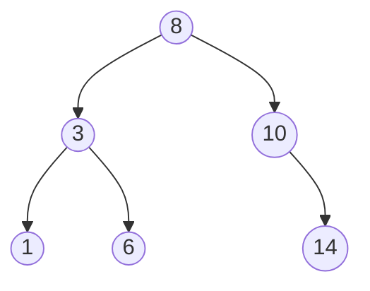
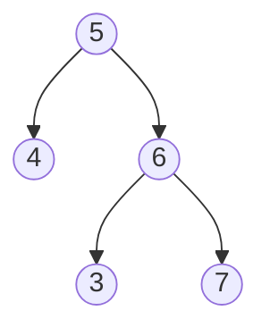
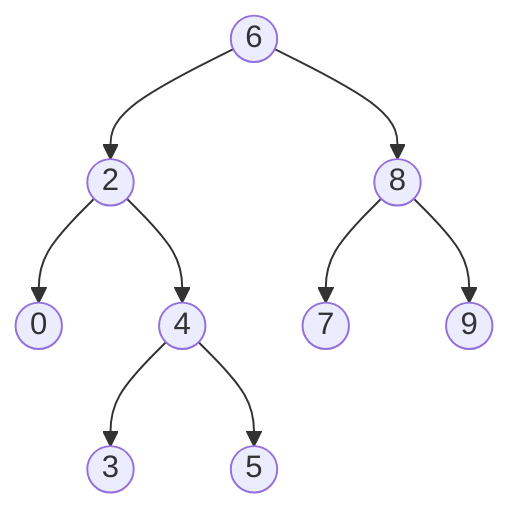

## The idea

A **binary search tree (BST)** is a binary tree with one rule: at every node, **everything on the left is smaller** and **everything on the right is bigger**.

Think of the **"guess my number" game**. You guess 50, and your friend says "lower". Now you know the answer is not anywhere from 50 to 100, and you never look there again. A BST works the same way: at each node you compare once, and you can skip the whole other side of the tree.

It is [binary search](../searching-sorting/binary-search.mdx) in the shape of a tree. And unlike a sorted array, you can add a new value without moving everything else.

## Setup

The code on this page uses these two blocks, the same `TreeNode` class and test helper as in [Tree Basics](./tree-basics.mdx). **Run** on any block below runs them first.

```js
class TreeNode {
    constructor(val) {
        this.val = val;
        this.left = null;
        this.right = null;
    }
}

// null (or a value past the end of the list) means "no node here".
function makeNode(value) {
    if (value === null || value === undefined) {
        return null;
    }

    return new TreeNode(value);
}
```

`buildTree` turns a LeetCode-style list like `[8, 3, 10, 1, 6, null, 14]` into a tree.

```js
function buildTree(values) {
    const root = makeNode(values[0]);

    // Nodes that are still waiting for their children, oldest first.
    const waiting = [root];
    let i = 1;

    while (i < values.length) {
        const node = waiting.shift();

        // The next two values are this node's left and right child.
        node.left = makeNode(values[i]);
        node.right = makeNode(values[i + 1]);
        i = i + 2;

        if (node.left !== null) {
            waiting.push(node.left);
        }

        if (node.right !== null) {
            waiting.push(node.right);
        }
    }

    return root;
}
```

## How it works

### The rule

Here is a BST, `[8, 3, 10, 1, 6, null, 14]`:



Check the rule at the root: everything on the left (3, 1, 6) is smaller than 8, and everything on the right (10, 14) is bigger. The same is true at node 3 and at node 10.

The rule is about the **whole subtree**, not just the two children. 6 is the right child of 3, so it must be bigger than 3. But 6 is also in the **left subtree of 8**, so it must be smaller than 8 too. This detail is the trap in "Validate BST" below.

Most BST problems say all values are different. If duplicates are allowed, ask which side they go on.

### Inorder gives sorted order

Inorder visits **left, node, right**. In a BST, that means smaller values, then this value, then bigger values. So an inorder walk gives every value **in sorted order**. This is the most useful fact about BSTs. (Inorder is explained in [Binary Trees and DFS](./binary-trees.mdx).)

```js
// Order: left, node, right.
function inorder(root) {
    const result = [];

    function visit(node) {
        if (node === null) {
            return;
        }

        visit(node.left);
        result.push(node.val);
        visit(node.right);
    }

    visit(root);
    return result;
}

const bst = buildTree([8, 3, 10, 1, 6, null, 14]);
console.log(inorder(bst)); // [ 1, 3, 6, 8, 10, 14 ]
```

### Search

Start at the root. If the value is smaller than the node, go left. If it's bigger, go right. Stop when you find it or fall off the tree. A simple loop is enough; no recursion needed.

```js
// Returns the node with this value, or null if it isn't in the tree.
function searchBST(root, target) {
    let node = root;

    while (node !== null) {
        if (target === node.val) {
            return node;
        }

        // Smaller values live on the left, bigger ones on the right.
        if (target < node.val) {
            node = node.left;
        } else {
            node = node.right;
        }
    }

    return null;
}

console.log(searchBST(bst, 6).val); // 6
console.log(searchBST(bst, 7)); // null
```

Searching for 6, then for 7:

| Step | Node | Looking for 6 | Looking for 7 |
| --- | --- | --- | --- |
| 1 | 8 | 6 < 8, go left | 7 < 8, go left |
| 2 | 3 | 6 > 3, go right | 7 > 3, go right |
| 3 | 6 | **Found it** | 7 > 6, go right |
| 4 | `null` | | Fell off the tree: **not found** |

**Time:** O(h) · **Space:** O(1). You go down one level per step, so at most h + 1 steps, and you only keep one pointer.

### Insert

To insert, search for the value. Where the search falls off the tree is exactly the spot where the new value belongs. New values are always added as **leaves**.

This version uses recursion and the [return value idea](./binary-trees.mdx#thinking-in-return-values). **Each call returns:** the root of its subtree, with the new value added. For an empty spot, that is a brand-new node.

```js
// Returns: the root of this subtree, with the new value added.
function insertIntoBST(node, value) {
    // The empty spot where the value belongs.
    if (node === null) {
        return new TreeNode(value);
    }

    // Insert into the correct side, and re-attach that side.
    if (value < node.val) {
        node.left = insertIntoBST(node.left, value);
    } else {
        node.right = insertIntoBST(node.right, value);
    }

    return node;
}

insertIntoBST(bst, 7);

console.log(searchBST(bst, 7).val); // 7
console.log(inorder(bst).join(" ")); // 1 3 6 7 8 10 14
```

7 went: smaller than 8 (left), bigger than 3 (right), bigger than 6 (right), and landed as the right child of 6. The inorder is still sorted. (`join(" ")` just prints the list on one line.)

The line `node.left = insertIntoBST(node.left, value)` looks odd at first. Most of the time it re-attaches the same child that was already there. It only really changes something at the empty spot, where the new node gets hooked on.

**Time:** O(h) · **Space:** O(h) for the call stack (a loop version uses O(1)).

### Min and max

The smallest value is as far **left** as you can go. The biggest is as far **right** as you can go.

```js
function minValue(root) {
    if (root === null) {
        return null;
    }

    let node = root;

    // Keep going left until there is no left child.
    while (node.left !== null) {
        node = node.left;
    }

    return node.val;
}
```

`maxValue` is the same walk, going right.

```js
function maxValue(root) {
    if (root === null) {
        return null;
    }

    let node = root;

    // Keep going right until there is no right child.
    while (node.right !== null) {
        node = node.right;
    }

    return node.val;
}

console.log(minValue(bst)); // 1
console.log(maxValue(bst)); // 14
```

**Time:** O(h) · **Space:** O(1).

### Why it's only fast when balanced

Every operation above walks down **one path**, so it costs **O(h)**. In a balanced tree, h is about log n: about 20 steps for a million values. But a BST does not balance itself. Insert values in sorted order, and each new value goes to the right of the last one:

```js
let sortedInserts = null;

for (const value of [1, 2, 3, 4, 5]) {
    sortedInserts = insertIntoBST(sortedInserts, value);
}

console.log(sortedInserts.left); // null
console.log(sortedInserts.right.right.right.right.val); // 5
```

To reach 5 you go right four times. The tree has become a chain, which is really a linked list, and every operation is O(n). See [Tree Basics](./tree-basics.mdx#why-balanced-trees-matter-for-speed) for more.

| Operation | How | Time |
| --- | --- | --- |
| Search | Go left or right at each node | O(h) |
| Insert | Search for the empty spot, put a new leaf there | O(h) |
| Min / max | Go all the way left / right | O(h) |
| All values in sorted order | Inorder walk | O(n) |

O(h) means O(log n) if the tree is balanced and O(n) if it is a chain. Say both in the interview.

## Classic problems

### 1. Validate Binary Search Tree

**Problem:** return `true` if the tree follows the BST rule. `[2, 1, 3]` → `true`. `[5, 4, 6, null, null, 3, 7]` → `false`.

The second one is the trap. Look at node 3:



3 is smaller than its parent 6, so as a left child it looks fine. But 3 is in the **right subtree of 5**, so it must be bigger than 5. It isn't. The tree is not a BST.

**The wrong way:** compare each node only with its own children.

```js
// Wrong: only compares each node with its own two children.
function isValidBSTWrong(node) {
    if (node === null) {
        return true;
    }

    if (node.left !== null && node.left.val >= node.val) {
        return false;
    }

    if (node.right !== null && node.right.val <= node.val) {
        return false;
    }

    return isValidBSTWrong(node.left) && isValidBSTWrong(node.right);
}

const trapTree = buildTree([5, 4, 6, null, null, 3, 7]);
console.log(isValidBSTWrong(trapTree)); // true
```

**Each call returns:** `true` if its subtree is a valid BST **and** all its values fit inside an allowed range, `low` to `high`.

**Idea:** pass the allowed range **down**. The root can be anything: the range is `-Infinity` to `Infinity`. When you go **left**, everything must be smaller than this node, so the node's value becomes the new `high`. When you go **right**, the node's value becomes the new `low`.

```js
// Returns: true if this subtree is a valid BST
// and all its values are between low and high.
function isInRange(node, low, high) {
    if (node === null) {
        return true;
    }

    if (node.val <= low || node.val >= high) {
        return false;
    }

    // Left side: everything must be smaller than this node.
    const leftValid = isInRange(node.left, low, node.val);

    // Right side: everything must be bigger than this node.
    const rightValid = isInRange(node.right, node.val, high);

    return leftValid && rightValid;
}
```

The main function starts with a range that allows anything.

```js
function isValidBST(root) {
    return isInRange(root, -Infinity, Infinity);
}

const goodTree = buildTree([2, 1, 3]);

console.log(isValidBST(goodTree)); // true
console.log(isValidBST(trapTree)); // false
```

How it catches node 3:

| Node | Allowed range | Fits? |
| --- | --- | --- |
| 5 | -Infinity to Infinity | Yes |
| 4 | -Infinity to 5 | Yes |
| 6 | 5 to Infinity | Yes |
| 3 | 5 to 6 | **No: 3 is not bigger than 5** |

**Time:** O(n) · **Space:** O(h). Each node is checked once.

Another correct way: do an inorder walk and check that every value is **bigger than the one before it**. Inorder of a BST must be strictly increasing.

### 2. Kth Smallest Element in a BST

**Problem:** return the k-th smallest value (k starts at 1). `[3, 1, 4, null, 2]` with k = 1 → `1`. `[5, 3, 6, 2, 4, null, null, 1]` with k = 3 → `3`.

**Simple idea:** inorder gives the values sorted, so the answer is `inorder(root)[k - 1]`. That works, but it walks the whole tree and stores every value: O(n) time and space.

**Better idea:** do the inorder walk **without recursion** (as in [Binary Trees and DFS](./binary-trees.mdx#inorder-without-recursion)), count the nodes as you visit them, and **stop at the k-th one**.

```js
function kthSmallest(root, k) {
    const stack = [];
    let current = root;
    let count = 0;

    while (current !== null || stack.length > 0) {
        // Go left as far as you can.
        while (current !== null) {
            stack.push(current);
            current = current.left;
        }

        // Visit the next smallest value.
        current = stack.pop();
        count = count + 1;

        if (count === k) {
            return current.val;
        }

        current = current.right;
    }

    // k is bigger than the number of nodes.
    return null;
}
```

```js
const smallTree = buildTree([3, 1, 4, null, 2]);
const biggerTree = buildTree([5, 3, 6, 2, 4, null, null, 1]);

console.log(kthSmallest(smallTree, 1)); // 1
console.log(kthSmallest(biggerTree, 3)); // 3
```

**Time:** O(h + k) · **Space:** O(h). Walking down to the smallest value takes up to h steps, then you visit k nodes and stop. The stack holds at most one path.

### 3. Lowest Common Ancestor of a BST

**Problem:** given two nodes `p` and `q`, return their **lowest common ancestor**: the deepest node that has both of them in its subtree. A node counts as its own ancestor.



In this tree, `[6, 2, 8, 0, 4, 7, 9, null, null, 3, 5]`:

- The LCA of 2 and 8 is **6**: they are on different sides of 6.
- The LCA of 2 and 4 is **2**: 4 is inside 2's subtree, and 2 is its own ancestor.
- The LCA of 3 and 5 is **4**.

**Idea:** start at the root and use the BST rule.

- If **both** values are smaller than the node, the answer is on the left. Go left.
- If **both** are bigger, go right.
- Otherwise they **split** here (one on each side), or one of them **is** this node. Either way, this node is the answer.

```js
function lowestCommonAncestor(root, p, q) {
    let node = root;

    while (node !== null) {
        if (p.val < node.val && q.val < node.val) {
            // Both are on the left.
            node = node.left;
        } else if (p.val > node.val && q.val > node.val) {
            // Both are on the right.
            node = node.right;
        } else {
            // They split here, or one of them is this node.
            return node;
        }
    }

    return null;
}
```

LeetCode passes in the nodes themselves, so we find them first with `searchBST`.

```js
const lcaTree = buildTree([6, 2, 8, 0, 4, 7, 9, null, null, 3, 5]);

const node2 = searchBST(lcaTree, 2);
const node8 = searchBST(lcaTree, 8);
const node4 = searchBST(lcaTree, 4);

console.log(lowestCommonAncestor(lcaTree, node2, node8).val); // 6
console.log(lowestCommonAncestor(lcaTree, node2, node4).val); // 2
```

**Time:** O(h) · **Space:** O(1). You walk down one path and keep one pointer.

This trick needs the BST rule. In a **plain** binary tree (LeetCode 236), you can't tell which side to go, so you search both sides with DFS instead: each call returns `p` or `q` if it found one in its subtree, and the node where both sides return something is the answer. The code is in [Binary Trees and DFS](./binary-trees.mdx#8-lowest-common-ancestor-of-a-binary-tree).

### 4. Delete Node in a BST

**Problem:** delete the node with the value `key`, and return the root of the tree. The tree must still follow the BST rule. If `key` isn't in the tree, return it unchanged. `[5, 3, 6, 2, 4, null, 7]` with key 3 → `[5, 4, 6, 2, null, null, 7]`.

**Each call returns:** the root of its subtree, after `key` has been deleted from it. This is the same idea as [Insert](#insert).

**Idea:** search for the node as usual. When you find it, there are three cases:

| The node has... | What to do |
| --- | --- |
| No children (a leaf) | Remove it: return `null` |
| One child | The child takes its place: return the child |
| Two children | Copy the **next bigger value** into it: the smallest value in its right subtree. Then delete that value from the right subtree |

Why the next bigger value? It is bigger than everything on the left and smaller than everything else on the right, so the BST rule still holds. And the node it came from has no left child (it's the leftmost on that side), so deleting it is one of the easy cases.

```js
// Returns: the root of this subtree, after key is deleted from it.
function deleteNode(node, key) {
    // Not found: nothing to delete.
    if (node === null) {
        return null;
    }

    // Not this node: delete from the correct side, and re-attach that side.
    if (key < node.val) {
        node.left = deleteNode(node.left, key);
        return node;
    }

    if (key > node.val) {
        node.right = deleteNode(node.right, key);
        return node;
    }

    // This is the node. No left child (a leaf, too): the right side moves up.
    if (node.left === null) {
        return node.right;
    }

    // No right child: the left side moves up.
    if (node.right === null) {
        return node.left;
    }

    // Two children: copy in the next bigger value, then delete it on the right.
    const nextBigger = minValue(node.right);
    node.val = nextBigger;
    node.right = deleteNode(node.right, nextBigger);

    return node;
}
```

Each delete below shows one case. Always save the root that comes back: deleting the root can change it.

```js
let deleteTree = buildTree([5, 3, 6, 2, 4, null, 7]);

// Two children: 3 becomes 4, the smallest value on its right.
deleteTree = deleteNode(deleteTree, 3);
console.log(deleteTree.left.val); // 4
console.log(inorder(deleteTree).join(" ")); // 2 4 5 6 7

// One child: 7 takes the place of 6.
deleteTree = deleteNode(deleteTree, 6);
console.log(deleteTree.right.val); // 7

// A leaf: 7 is just removed.
deleteTree = deleteNode(deleteTree, 7);
console.log(inorder(deleteTree).join(" ")); // 2 4 5

// The root, with one child: the root changes.
deleteTree = deleteNode(deleteTree, 5);
console.log(deleteTree.val); // 4
```

**Time:** O(h) · **Space:** O(h) for the call stack. The search goes down one path, and finding and deleting the next bigger value goes down the rest of that path once more.

## How to spot it

- The problem says **"binary search tree"** or "BST". Use the order rule: it lets you skip half the tree at each step.
- It asks for something **sorted**: the k-th smallest or largest, the next bigger value, values in a range. Think **inorder**.
- It asks you to **check** whether a tree is a BST. Think **allowed range passed down**.
- It asks for the **closest value** to a target. Walk down like a search and remember the closest node you passed.
- It asks you to **delete** a value. Three cases: a leaf, one child, two children.

## Common mistakes

- **Checking each node only against its children** in Validate BST. The rule covers the whole subtree. Pass a range down.
- **Starting the range with made-up numbers** like 0 or 1000. Use `-Infinity` and `Infinity`.
- **Getting `<` and `<=` wrong.** With the usual "values are different" rule, an equal value is not valid. Ask how duplicates work.
- **Losing nodes in insert or delete.** Forgetting `node.left = ...` or forgetting `return node` cuts off part of the tree. Deleting the root can change it, so write `root = deleteNode(root, key)`.
- **Off by one in Kth Smallest.** k starts at 1, so the answer is `sorted[k - 1]`.
- **Saying O(log n) without "if balanced".** A BST built from sorted input is a chain: O(n).
- **Using the BST trick on a plain binary tree.** Going left or right only works when the order rule holds.

## In the interview

> "Since it's a BST, at each node I can compare once and drop half of the tree. Both values are smaller than this node, so I go left; both bigger, so I go right; otherwise they split here, so this is the answer. That's O(h) time and O(1) space, which is O(log n) on a balanced tree and O(n) on a chain."

**Likely follow-up:** "What if the inserts come in sorted order?"

**Answer:** "Then a plain BST turns into a chain, and every operation is O(n). A self-balancing tree, like an AVL tree or a red-black tree, moves nodes around after each insert or delete to keep the height O(log n). I wouldn't write one in an interview, but that's the fix. Java's `TreeMap` is a red-black tree; JavaScript has no built-in sorted tree."

<Callout title="Remember this" type="success">
  - **BST rule:** everything in the left subtree is smaller, everything in the right subtree is bigger, at **every** node.
  - **Inorder of a BST is sorted.** Kth smallest = stop the inorder walk at the k-th node.
  - Search, insert, min and max walk **one path**: O(h). That's O(log n) only if the tree is balanced.
  - **Validate:** pass an allowed range (`low`, `high`) down. Going left, `high` becomes the node's value; going right, `low` does.
  - **LCA in a BST:** both smaller, go left; both bigger, go right; otherwise this node is the answer.
  - Min = go left until you can't. Max = go right until you can't.
  - **Delete:** a leaf is removed; one child takes the node's place; two children → copy in the smallest value from the right subtree, then delete that one.
</Callout>
