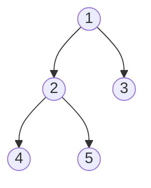
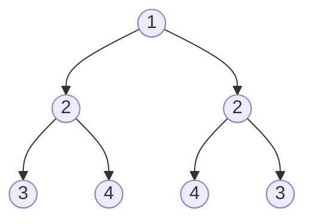
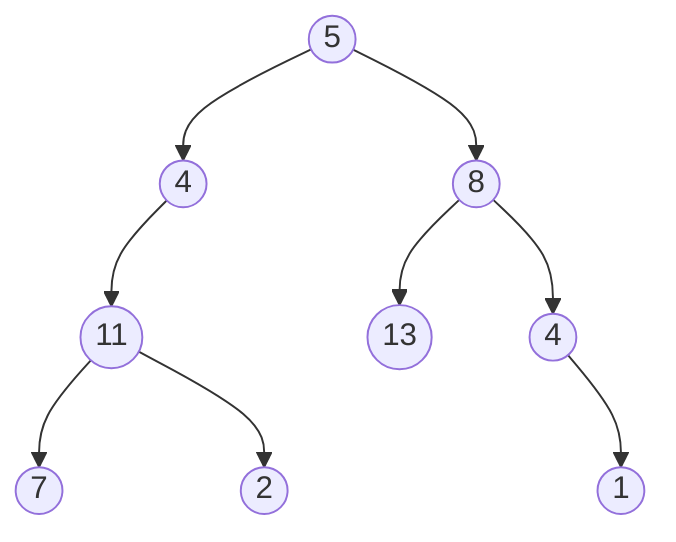
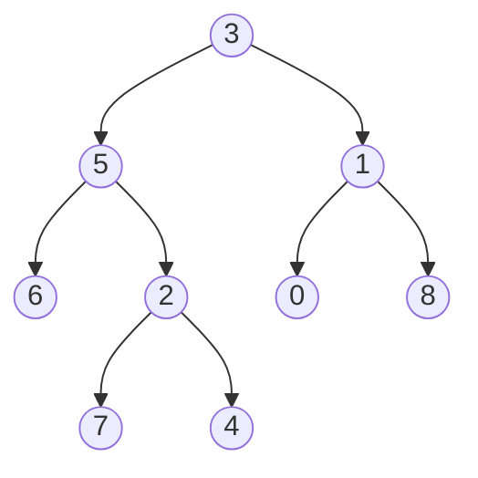

## The idea

**Depth-first search (DFS)** visits a tree by going **as deep as it can down one path**, then backing up and trying the next path.

Think of exploring the **folders on your computer** to find a file. You open the first folder, then the first folder inside it, and keep going down. When a folder has nothing more inside, you go back up one step and open the next folder there. You finish one whole branch before you start the next.

Trees and recursion fit together perfectly, because **every subtree is a tree too**. The left child of a node is the root of a smaller tree. So to solve a problem for a tree, you solve it for the left subtree, solve it for the right subtree, and combine the two answers. If recursion is new to you, read [Recursion](../foundations/recursion.mdx) first.

## Setup

The code on this page uses these two blocks, the same `TreeNode` class and test helper as in [Tree Basics](./tree-basics.mdx). **Run** on any block below runs them first.

```js
class TreeNode {
    constructor(val) {
        this.val = val;
        this.left = null;
        this.right = null;
    }
}

// null (or a value past the end of the list) means "no node here".
function makeNode(value) {
    if (value === null || value === undefined) {
        return null;
    }

    return new TreeNode(value);
}
```

`buildTree` turns a LeetCode-style list like `[1, 2, 3, 4, 5]` into a tree.

```js
function buildTree(values) {
    const root = makeNode(values[0]);

    // Nodes that are still waiting for their children, oldest first.
    const waiting = [root];
    let i = 1;

    while (i < values.length) {
        const node = waiting.shift();

        // The next two values are this node's left and right child.
        node.left = makeNode(values[i]);
        node.right = makeNode(values[i + 1]);
        i = i + 2;

        if (node.left !== null) {
            waiting.push(node.left);
        }

        if (node.right !== null) {
            waiting.push(node.right);
        }
    }

    return root;
}
```

## How it works

### The three DFS orders

Every DFS does the same three jobs at each node: **visit the node** (for example, save its value), **go left**, and **go right**. The only question is **when** you visit the node. That gives three orders:

| Order | Steps at each node | Easy way to remember |
| --- | --- | --- |
| **Preorder** | node, left, right | The node comes **pre** (before) its children |
| **Inorder** | left, node, right | The node comes **in** between its children |
| **Postorder** | left, right, node | The node comes **post** (after) its children |

We will use this tree, `buildTree([1, 2, 3, 4, 5])`:



- Preorder: **1, 2, 4, 5, 3**
- Inorder: **4, 2, 5, 1, 3**
- Postorder: **4, 5, 2, 3, 1**

### Preorder in code

The outer function makes an empty `result` list. The inner function `visit` walks the tree and adds to that one list.

```js
// Order: node, left, right.
function preorder(root) {
    const result = [];

    function visit(node) {
        // An empty spot: nothing to do.
        if (node === null) {
            return;
        }

        result.push(node.val);
        visit(node.left);
        visit(node.right);
    }

    visit(root);
    return result;
}

const tree = buildTree([1, 2, 3, 4, 5]);
console.log(preorder(tree)); // [ 1, 2, 4, 5, 3 ]
```

Here is how it runs. Each `visit` call pushes its node, then goes left, and only comes back to go right when the whole left side is done.

| Step | Call | What happens | result |
| --- | --- | --- | --- |
| 1 | `visit(1)` | Push 1, then go left | 1 |
| 2 | `visit(2)` | Push 2, then go left | 1, 2 |
| 3 | `visit(4)` | Push 4. Both children are `null`, so go back up | 1, 2, 4 |
| 4 | `visit(5)` | Back in `visit(2)`, now go right. Push 5 | 1, 2, 4, 5 |
| 5 | `visit(3)` | `visit(2)` is done. Back in `visit(1)`, go right. Push 3 | 1, 2, 4, 5, 3 |

### Inorder and postorder

The code is the same. Only the line `result.push(node.val)` moves.

```js
// Order: left, node, right.
function inorder(root) {
    const result = [];

    function visit(node) {
        if (node === null) {
            return;
        }

        visit(node.left);
        result.push(node.val);
        visit(node.right);
    }

    visit(root);
    return result;
}

console.log(inorder(tree)); // [ 4, 2, 5, 1, 3 ]
```

```js
// Order: left, right, node.
function postorder(root) {
    const result = [];

    function visit(node) {
        if (node === null) {
            return;
        }

        visit(node.left);
        visit(node.right);
        result.push(node.val);
    }

    visit(root);
    return result;
}

console.log(postorder(tree)); // [ 4, 5, 2, 3, 1 ]
```

When each order is useful:

- **Preorder:** you need the parent before its children. For example, copying a tree, or writing it out as text.
- **Inorder:** on a [binary search tree](./binary-search-trees.mdx), inorder gives the values **in sorted order**.
- **Postorder:** you need the children's answers before you can answer for the parent. Height, size, diameter. **Most tree problems are postorder.**

**Time:** O(n), because each node is visited once. **Space:** O(h) for the call stack, where h is the height of the tree, plus the result list.

### Inorder without recursion

Interviewers sometimes ask: "Can you do it without recursion?" A very deep tree can overflow the call stack, so you keep your own [stack](../stacks-queues/stacks.mdx) in an array.

The idea: **go left as far as you can**, putting each node on the stack. When you can't go left any more, take the top node off the stack, visit it, and then **move to its right child** and repeat.

```js
function inorderIterative(root) {
    const result = [];
    const stack = [];
    let current = root;

    while (current !== null || stack.length > 0) {
        // Go left as far as you can, saving each node on the way.
        while (current !== null) {
            stack.push(current);
            current = current.left;
        }

        // The top node has nothing left on its left side. Visit it.
        current = stack.pop();
        result.push(current.val);

        // Now do the same for its right subtree.
        current = current.right;
    }

    return result;
}

console.log(inorderIterative(tree)); // [ 4, 2, 5, 1, 3 ]
```

How it runs on our tree:

| Step | What happens | stack (bottom → top) | result |
| --- | --- | --- | --- |
| 1 | Go left from 1: push 1, 2, 4 | 1, 2, 4 | |
| 2 | Pop 4 and visit it. It has no right child | 1, 2 | 4 |
| 3 | Pop 2 and visit it. Move to its right child, 5 | 1 | 4, 2 |
| 4 | Go left from 5: push 5 | 1, 5 | 4, 2 |
| 5 | Pop 5 and visit it. No right child | 1 | 4, 2, 5 |
| 6 | Pop 1 and visit it. Move to its right child, 3 | (empty) | 4, 2, 5, 1 |
| 7 | Go left from 3: push 3 | 3 | 4, 2, 5, 1 |
| 8 | Pop 3 and visit it. No right child, stack empty: done | (empty) | 4, 2, 5, 1, 3 |

**Time:** O(n) · **Space:** O(h). Each node is pushed and popped once, and the stack holds at most one path from the root down.

### Thinking in return values

This is the most useful idea for tree problems. Instead of following every call in your head, decide **what one call returns**, and trust it.

Ask three questions:

1. **What does my function return for one subtree?** Say it in one sentence. "`countNodes(node)` returns how many nodes are in the subtree under `node`."
2. **What does it return for an empty tree (`null`)?** That is the base case. An empty tree has 0 nodes.
3. **If the left and right calls already gave me correct answers, how do I build my answer?** Me, plus everyone on my left, plus everyone on my right: `1 + leftCount + rightCount`.

```js
// Returns: how many nodes are in the subtree under node.
function countNodes(node) {
    // An empty tree has 0 nodes.
    if (node === null) {
        return 0;
    }

    // Trust these two calls to be right for the smaller trees.
    const leftCount = countNodes(node.left);
    const rightCount = countNodes(node.right);

    return 1 + leftCount + rightCount;
}

console.log(countNodes(tree)); // 5
```

Here is what each call returns on our tree. The answers travel **up** from the leaves:

| Node | Left call returns | Right call returns | This call returns |
| --- | --- | --- | --- |
| 4 | 0 | 0 | 1 + 0 + 0 = **1** |
| 5 | 0 | 0 | **1** |
| 2 | 1 | 1 | 1 + 1 + 1 = **3** |
| 3 | 0 | 0 | **1** |
| 1 | 3 | 1 | 1 + 3 + 1 = **5** |

Notice the order the calls finish: 4, 5, 2, 3, 1. That is postorder. Children answer first, then the parent.

Information can move in two directions:

- **Up, through the return value** ("bottom-up"). Each call returns an answer about its subtree: its size, its height, whether it is balanced.
- **Down, through the arguments** ("top-down"). Each call passes something to its children: the depth so far, or how much of a sum is still needed. Path Sum below works this way.

And sometimes the value a call returns is not the final answer. Then the call returns what its **parent** needs, and updates the best answer in a variable outside. Diameter below works this way.

## Classic problems

Each problem below starts with the same line: **what one call returns**. Once that is clear, the code is short.

### 1. Maximum Depth of Binary Tree

**Problem:** return the number of nodes on the longest path from the root down to a leaf. `[3, 9, 20, null, null, 15, 7]` → `3`.

**Each call returns:** the max depth of its subtree.

**Idea:** an empty tree has depth 0. Otherwise, my depth is 1 (me) plus the deeper of my two sides.

```js
// Returns: the number of nodes on the longest path down from node.
function maxDepth(node) {
    if (node === null) {
        return 0;
    }

    const leftDepth = maxDepth(node.left);
    const rightDepth = maxDepth(node.right);

    return 1 + Math.max(leftDepth, rightDepth);
}

const tallTree = buildTree([3, 9, 20, null, null, 15, 7]);

console.log(maxDepth(tallTree)); // 3
console.log(maxDepth(null)); // 0
```

**Time:** O(n) · **Space:** O(h). Each node is visited once, and the call stack holds one path at a time.

### 2. Invert Binary Tree

**Problem:** flip the tree like a mirror: at every node, swap the left and right children. `[4, 2, 7, 1, 3, 6, 9]` → `[4, 7, 2, 9, 6, 3, 1]`.

**Each call returns:** the root of its subtree, after the subtree has been flipped.

**Idea:** flip the left subtree, flip the right subtree, then swap them.

```js
// Returns: the root of the subtree, after it has been flipped.
function invertTree(node) {
    if (node === null) {
        return null;
    }

    // Flip both subtrees first.
    const flippedLeft = invertTree(node.left);
    const flippedRight = invertTree(node.right);

    // Then swap them.
    node.left = flippedRight;
    node.right = flippedLeft;

    return node;
}
```

An easy way to check it: a flipped tree gives its inorder **backwards**. (`join(" ")` just prints the list on one line.)

```js
const flipTree = buildTree([4, 2, 7, 1, 3, 6, 9]);
console.log(inorder(flipTree).join(" ")); // 1 2 3 4 6 7 9

invertTree(flipTree);
console.log(inorder(flipTree).join(" ")); // 9 7 6 4 3 2 1
```

This changes the tree in place. Mention that to the interviewer. If they want the original kept, build new nodes instead of moving the old ones.

**Time:** O(n) · **Space:** O(h). One swap per node, and the stack holds one path.

### 3. Same Tree

**Problem:** given two trees, return `true` if they have the same shape and the same values. `[1, 2, 3]` and `[1, 2, 3]` → `true`. `[1, 2]` and `[1, null, 2]` → `false`.

**Each call returns:** `true` if these two subtrees are the same.

**Idea:** walk both trees **at the same time**. Two empty spots match. One empty spot and one node don't. Two nodes match if their values are equal and both their left and right subtrees match.

```js
// Returns: true if the two subtrees have the same shape and values.
function isSameTree(nodeA, nodeB) {
    // Both empty: the same.
    if (nodeA === null && nodeB === null) {
        return true;
    }

    // Only one is empty: different.
    if (nodeA === null || nodeB === null) {
        return false;
    }

    if (nodeA.val !== nodeB.val) {
        return false;
    }

    const leftSame = isSameTree(nodeA.left, nodeB.left);
    const rightSame = isSameTree(nodeA.right, nodeB.right);

    return leftSame && rightSame;
}
```

The order of the checks matters: check for `null` **before** reading `.val`.

```js
const treeA = buildTree([1, 2, 3]);
const treeB = buildTree([1, 2, 3]);
const treeC = buildTree([1, null, 2]);
const treeD = buildTree([1, 2]);

console.log(isSameTree(treeA, treeB)); // true
console.log(isSameTree(treeC, treeD)); // false
```

**Time:** O(n) · **Space:** O(h). Each pair of nodes is compared once.

### 4. Symmetric Tree

**Problem:** return `true` if the tree is a mirror image of itself. `[1, 2, 2, 3, 4, 4, 3]` → `true`. `[1, 2, 2, null, 3, null, 3]` → `false`.



The two green nodes are the **outer pair**. The two amber nodes are the **inner pair**. Mirror pairs must match.

**Each call returns:** `true` if two subtrees are **mirror images** of each other.

**Idea:** this is Same Tree, but crossed over. Compare the left subtree with the right subtree. For two nodes to mirror each other, their values must match, the **outer** children must mirror each other, and the **inner** children must too.

```js
// Returns: true if the two subtrees are mirror images.
function isMirror(leftNode, rightNode) {
    if (leftNode === null && rightNode === null) {
        return true;
    }

    if (leftNode === null || rightNode === null) {
        return false;
    }

    if (leftNode.val !== rightNode.val) {
        return false;
    }

    // Outer pair: left's left with right's right.
    const outerMatch = isMirror(leftNode.left, rightNode.right);

    // Inner pair: left's right with right's left.
    const innerMatch = isMirror(leftNode.right, rightNode.left);

    return outerMatch && innerMatch;
}
```

The main function just compares the root's two sides.

```js
function isSymmetric(root) {
    if (root === null) {
        return true;
    }

    return isMirror(root.left, root.right);
}

const mirrorTree = buildTree([1, 2, 2, 3, 4, 4, 3]);
const notMirrorTree = buildTree([1, 2, 2, null, 3, null, 3]);

console.log(isSymmetric(mirrorTree)); // true
console.log(isSymmetric(notMirrorTree)); // false
```

**Time:** O(n) · **Space:** O(h). Each node is compared once with its mirror partner.

### 5. Path Sum

**Problem:** return `true` if some path from the root down to a **leaf** adds up to `target`. In the tree below, with `target = 22`, the answer is `true`: 5 + 4 + 11 + 2 = 22.



**Each call returns:** `true` if a path from this node down to a leaf adds up to the target it was given.

**Idea:** pass the amount that is **still needed** down to the children (top-down). Each node takes its own value off. When you reach a leaf, check whether nothing is left.

```js
// Returns: true if a path from node down to a leaf adds up to target.
function hasPathSum(node, target) {
    // An empty tree has no paths at all.
    if (node === null) {
        return false;
    }

    // What the rest of the path must add up to.
    const remaining = target - node.val;

    // A leaf ends the path. Did we use up the target exactly?
    if (node.left === null && node.right === null) {
        return remaining === 0;
    }

    const leftHasPath = hasPathSum(node.left, remaining);
    const rightHasPath = hasPathSum(node.right, remaining);

    return leftHasPath || rightHasPath;
}
```

The path must end at a **leaf**. 5 + 4 = 9, but 4 is not a leaf, so 9 gives `false`.

```js
const pathValues = [5, 4, 8, 11, null, 13, 4, 7, 2, null, null, null, 1];
const pathTree = buildTree(pathValues);

console.log(hasPathSum(pathTree, 22)); // true
console.log(hasPathSum(pathTree, 26)); // true
console.log(hasPathSum(pathTree, 9)); // false
console.log(hasPathSum(null, 0)); // false
```

26 is the path 5 + 8 + 13. An empty tree has no path, so even a target of 0 gives `false`.

**Time:** O(n) · **Space:** O(h). Each node is visited at most once.

If the problem asks for **all** such paths (Path Sum II), keep the current path in an array, add each node on the way down, and remove it on the way back up. That is [backtracking](../backtracking/backtracking.mdx).

### 6. Diameter of Binary Tree

**Problem:** return the length of the longest path between **any** two nodes, counted in edges. The path does not have to go through the root. `[1, 2, 3, 4, 5]` → `3` (the path 4 → 2 → 1 → 3).

**Each call returns:** the max depth of its subtree, just like Maximum Depth. The diameter is tracked **outside**, in a variable.

**Idea:** any path has one highest node, where it bends. The longest path that bends at a node goes down its left side as far as it can and down its right side as far as it can. Its length in edges is `leftDepth + rightDepth`, because each node on the way down adds one edge. Try every node as the bending point and keep the biggest.

The parent needs my **depth**, not my diameter. That's why each call returns its depth and saves the diameter on the side.

```js
function diameterOfBinaryTree(root) {
    let longest = 0;

    // Returns: the number of nodes on the longest path down from node.
    // On the way, it updates longest.
    function depth(node) {
        if (node === null) {
            return 0;
        }

        const leftDepth = depth(node.left);
        const rightDepth = depth(node.right);

        // The longest path that bends at this node, in edges.
        const pathThroughNode = leftDepth + rightDepth;
        longest = Math.max(longest, pathThroughNode);

        return 1 + Math.max(leftDepth, rightDepth);
    }

    depth(root);
    return longest;
}
```

How it runs on `[1, 2, 3, 4, 5]`:

| Node | leftDepth | rightDepth | Path through node | Returns | longest |
| --- | --- | --- | --- | --- | --- |
| 4 | 0 | 0 | 0 | 1 | 0 |
| 5 | 0 | 0 | 0 | 1 | 0 |
| 2 | 1 | 1 | 2 | 2 | 2 |
| 3 | 0 | 0 | 0 | 1 | 2 |
| 1 | 2 | 1 | **3** | 3 | **3** |

In the second tree below, the longest path is 5 → 3 → 2 → 4 → 6. It bends at node 2 and never touches the root.

```js
console.log(diameterOfBinaryTree(tree)); // 3

const sideTree = buildTree([1, 2, null, 3, 4, 5, null, null, 6]);
console.log(diameterOfBinaryTree(sideTree)); // 4
```

**Time:** O(n) · **Space:** O(h). One pass over the tree; the depth of each node is worked out once.

### 7. Balanced Binary Tree

**Problem:** return `true` if, at **every** node, the heights of the left and right subtrees differ by at most 1. `[3, 9, 20, null, null, 15, 7]` → `true`. `[1, 2, 2, 3, 3, null, null, 4, 4]` → `false`.

**The slow way:** at every node, call `maxDepth` on both sides and compare. But `maxDepth` walks the whole subtree, and you call it again and again for the same nodes. On a balanced tree that is O(n log n). On a long chain, checking every node is O(n²).

**Each call returns:** the height of its subtree, **or -1** if something inside it is not balanced.

**Idea:** one postorder pass. Get the height of each side. If either side already said -1, pass the -1 straight up. If the two heights differ by more than 1, return -1. Otherwise return the height as usual.

```js
// Returns: the height of the subtree (in nodes),
// or -1 if some node inside it is not balanced.
function checkHeight(node) {
    if (node === null) {
        return 0;
    }

    const leftHeight = checkHeight(node.left);
    if (leftHeight === -1) {
        return -1;
    }

    const rightHeight = checkHeight(node.right);
    if (rightHeight === -1) {
        return -1;
    }

    const difference = Math.abs(leftHeight - rightHeight);
    if (difference > 1) {
        return -1;
    }

    return 1 + Math.max(leftHeight, rightHeight);
}
```

The tree is balanced if the root's answer is not -1.

```js
function isBalanced(root) {
    return checkHeight(root) !== -1;
}

const lopsidedTree = buildTree([1, 2, 2, 3, 3, null, null, 4, 4]);

console.log(isBalanced(tallTree)); // true
console.log(isBalanced(lopsidedTree)); // false
```

The check must happen at every node, not only at the root. In this next tree, the root's two sides both have height 3 (counting nodes, like `checkHeight`), but node 2 has height 2 on its left and nothing on its right.

```js
const crookedTree = buildTree([1, 2, 3, 4, null, null, 5, 6, null, null, 7]);
console.log(isBalanced(crookedTree)); // false
```

**Time:** O(n) · **Space:** O(h). Each node is visited once, and its height is worked out once.

### 8. Lowest Common Ancestor of a Binary Tree

**Problem:** given two nodes `p` and `q` of a binary tree, return their **lowest common ancestor**: the deepest node that has both of them in its subtree. A node counts as its own ancestor. Both nodes are always in the tree.



In this tree, `[3, 5, 1, 6, 2, 0, 8, null, null, 7, 4]`, the two green nodes, 5 and 1, are on different sides of 3, so their LCA is **3**. The LCA of 5 and 4 is **5**: 4 is inside 5's subtree.

**Each call returns:** `p` or `q` if it found one of them in its subtree, the answer once both are found, or `null` if neither is there.

**Idea:** a plain binary tree has no "smaller on the left" rule, so you can't tell which side to go. Search **both** sides. If the left side found something **and** the right side found something, `p` and `q` are on different sides, so this node is where their paths meet. If only one side found something, pass it up.

```js
// Returns: p or q if one of them is in this subtree,
// this subtree's answer if both are, or null if neither is.
function lowestCommonAncestor(node, p, q) {
    if (node === null) {
        return null;
    }

    // This node is p or q. Anything below it can't be a lower answer.
    if (node === p || node === q) {
        return node;
    }

    const leftFound = lowestCommonAncestor(node.left, p, q);
    const rightFound = lowestCommonAncestor(node.right, p, q);

    // One on each side: they meet at this node.
    if (leftFound !== null && rightFound !== null) {
        return node;
    }

    // Otherwise pass up what one side found (or null).
    if (leftFound !== null) {
        return leftFound;
    }

    return rightFound;
}
```

LeetCode passes in the nodes themselves, so we reach them by following the links.

```js
const lcaTree = buildTree([3, 5, 1, 6, 2, 0, 8, null, null, 7, 4]);

const node5 = lcaTree.left;
const node1 = lcaTree.right;
const node4 = lcaTree.left.right.right;

console.log(lowestCommonAncestor(lcaTree, node5, node1).val); // 3
console.log(lowestCommonAncestor(lcaTree, node5, node4).val); // 5
```

For 5 and 4, the call on node 5 returns 5 straight away without looking below it. That is fine: the other node is either below 5 (then 5 is the answer) or somewhere else (then a higher node sees both).

**Time:** O(n) · **Space:** O(h). Each node is visited at most once.

This trusts the promise that both nodes are in the tree. If one might be missing, the function would wrongly return the other one, so you would also have to check that both were really found. In a [binary search tree](./binary-search-trees.mdx#3-lowest-common-ancestor-of-a-bst) there is a faster way: the order rule tells you which side to go.

## How to spot it

- The problem asks about **depth, height, size or paths** from the root to a leaf.
- It asks you to **compare** two trees, or a tree with its mirror.
- It asks you to **change every node** (invert, add a value, prune).
- The answer for a node can be **built from its children's answers**.
- It asks where two nodes **meet**: their lowest common ancestor.
- If the problem talks about **levels** or rows, or "the closest leaf", use [Tree BFS](./tree-bfs.mdx) instead.

## Common mistakes

- **No `null` check, or the check comes too late.** Reading `node.val` before checking `node === null` crashes on empty spots.
- **Checking "leaf" with only one side.** A leaf has **both** children `null`. In Path Sum, a node with one child is not the end of a path.
- **Forgetting `return`.** Writing `maxDepth(node.left);` without saving or returning the answer throws it away.
- **Calling the same helper twice per node.** The slow balanced check calls `maxDepth` at every node, so it walks the same nodes again and again (up to O(n²)). Return everything the parent needs in **one** pass.
- **Mixing up edges and nodes.** Diameter counts edges, Maximum Depth counts nodes. Check the example.
- **Building the result with spread** (`[node.val, ...preorder(node.left), ...preorder(node.right)]`). It copies lists at every level. Push into one shared array instead.
- **Changing the input by accident.** Invert Tree changes the tree. Say so, or copy it first.

## In the interview

- Say **what your function returns** in one sentence before you write it.
- Say the **base case** for an empty tree.
- Give the space as **O(h)**, and say it is O(n) for a chain.

> "I'll write a helper that returns the height of a subtree. For an empty tree it returns 0. For any other node, it's 1 plus the bigger of the two child heights. While I'm at each node, I also check the path that bends there, `left + right`, and keep the biggest. That's one pass, so O(n) time and O(h) space."

**Likely follow-up:** "What if the tree is 100,000 levels deep?"

**Answer:** "Recursion would overflow the call stack, which in JavaScript runs out after about 10,000 calls. I'd use my own stack in an array, like the iterative inorder, or use BFS with a queue if the problem allows it."

<Callout title="Remember this" type="success">
  - **Preorder** = node, left, right. **Inorder** = left, node, right (sorted on a BST). **Postorder** = left, right, node.
  - For any tree problem, decide **what one call returns** for its subtree, what it returns for `null`, and how to build it from the two children's answers. Then **trust the calls**.
  - Answers go **up** through return values (height, size) or **down** through arguments (remaining sum, depth so far).
  - When the parent needs something different from the final answer (Diameter), **return what the parent needs** and track the answer in an outer variable.
  - Iterative inorder: **go left and push, pop and visit, then go right**.
  - Tree DFS is **O(n) time** and **O(h) space**: O(log n) if balanced, O(n) for a chain.
</Callout>
