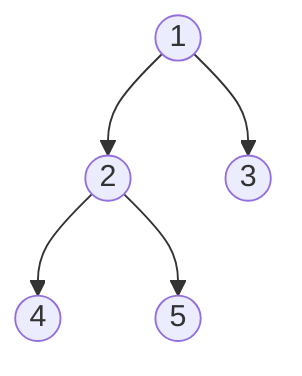
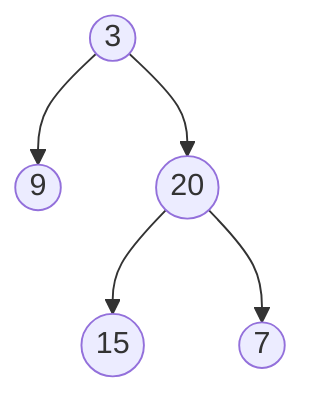
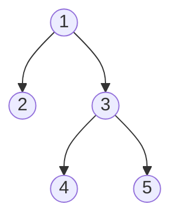
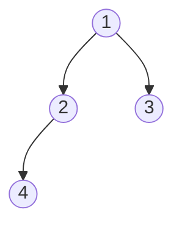
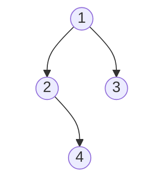
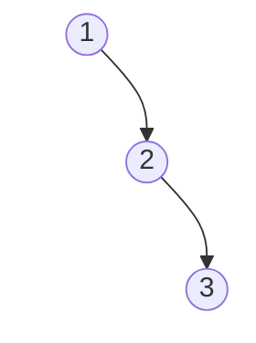

## The idea

A **tree** is a set of **nodes** joined by links, where each node can point **down** to a few other nodes. There is one node at the top, and every other node has exactly **one parent** above it. You never go round in a circle.

Think of the **folders on your computer**. `Documents` holds `Work` and `Photos`. `Work` holds more folders and files. To reach a file, you start at the top and go down one folder at a time. Each folder sits inside exactly one other folder. That is a tree.

A **binary tree** is a tree where each node has **at most two children**: a **left** child and a **right** child. Almost every tree problem in interviews uses binary trees, so that is what this section is about.

## The words

Here is a small binary tree. We will use it for every word below.



The amber node is the **root**. The green nodes are **leaves**.

| Word | What it means | In the picture |
| --- | --- | --- |
| **Node** | One item: a value plus links to its children | Each circle |
| **Root** | The node at the top. It has no parent | 1 |
| **Edge** | The link from a parent to a child | The 4 arrows |
| **Parent / child** | A node right above / right below another | 2 is the parent of 4 and 5 |
| **Siblings** | Nodes with the same parent | 4 and 5. Also 2 and 3 |
| **Leaf** | A node with no children | 4, 5 and 3 |
| **Subtree** | A node plus everything below it | 2, 4 and 5 form the left subtree of 1 |
| **Depth** of a node | Number of edges from the root **down** to it | 1 is at depth 0, 2 at depth 1, 4 at depth 2 |
| **Level** | All nodes at the same depth | Level 1 holds 2 and 3 |
| **Height** of a node | Number of edges on the longest path from it **down** to a leaf | 4 has height 0, 2 has height 1 |
| **Height** of the tree | The height of the root | 2 |

Two tips to keep them apart:

- **Depth is measured from the top**, like how deep you dive into water. The root has depth 0.
- **Height is measured from the bottom**, like the height of a building. A leaf has height 0.

<Callout title="Edges or nodes?" type="warn">
  Some problems count **nodes** instead of edges. LeetCode's "Maximum Depth of Binary Tree" counts nodes, so the tree above has a maximum depth of **3** there, not 2. Look at the example in the problem, or ask.
</Callout>

One more useful fact: a tree with `n` nodes always has `n - 1` edges. Every node except the root has exactly one edge coming down into it from its parent.

## What a tree node looks like in JavaScript

A node is a small object with three fields: its value, its left child and its right child. LeetCode calls the value `val`, so we do too.

```js
class TreeNode {
    constructor(val) {
        this.val = val;
        this.left = null;
        this.right = null;
    }
}
```

A missing child is `null`. A new node has no children yet, so both links start as `null`.

Now build the tree from the picture by hand. Make the root, then hang children on it.

```js
const root = new TreeNode(1);

root.left = new TreeNode(2);
root.right = new TreeNode(3);

root.left.left = new TreeNode(4);
root.left.right = new TreeNode(5);

console.log(root.val); // 1
console.log(root.left.val); // 2
console.log(root.left.right.val); // 5
console.log(root.right.left); // null
```

To reach a node, you **follow the links** from the root: `root.left.right` means "go left, then go right". You are only ever given the root. Every other node is reached by walking down from it.

If you print the root, you can see that a tree is just objects inside objects:

```js
console.log(root);
```

Node prints:

```text
TreeNode {
  val: 1,
  left: TreeNode {
    val: 2,
    left: TreeNode { val: 4, left: null, right: null },
    right: TreeNode { val: 5, left: null, right: null }
  },
  right: TreeNode { val: 3, left: null, right: null }
}
```

If this looks like a [linked list](../linked-lists/linked-lists.mdx), it is close: a linked list node has one `next` link, and a binary tree node has two links, `left` and `right`.

### The most common tree bug

Node 3 has no left child. Reading a field from a missing child crashes the program:

```js
try {
    console.log(root.right.left.val);
} catch (error) {
    console.log(error.message); // Cannot read properties of null (reading 'val')
}
```

That is why almost every tree function starts with the same check: **"if the node is `null`, stop"**.

### Trees with more than two children

Some trees let a node have any number of children, like folders. Then the node keeps its children in an array instead of `left` and `right`.

```js
class FolderNode {
    constructor(name) {
        this.name = name;
        this.children = [];
    }
}

const documents = new FolderNode("Documents");
documents.children.push(new FolderNode("Work"));
documents.children.push(new FolderNode("Photos"));

console.log(documents.children.length); // 2
console.log(documents.children[1].name); // Photos
```

You will meet this shape again in [Tries](./tries.mdx), where each node has one child per letter.

## How LeetCode writes a tree

LeetCode shows a tree as a list, read **level by level, from left to right**. `null` means "no node in this spot".

For example, `[3, 9, 20, null, null, 15, 7]` is this tree:



Read the list two values at a time, giving each node its left and right child in turn:

| Step | Node | Next two values | What happens |
| --- | --- | --- | --- |
| 1 | 3 (the root) | 9, 20 | 3 gets left child 9 and right child 20 |
| 2 | 9 | null, null | 9 has no children |
| 3 | 20 | 15, 7 | 20 gets left child 15 and right child 7 |

The `null` spots are only written for nodes that exist. Children of a missing node are not written at all.

### A helper to build test trees

Building trees by hand gets long. This helper turns a LeetCode list into a real tree, so you can test your code in the playground. You never write it in an interview: LeetCode builds the tree for you. Every tree lesson on this site starts with the `TreeNode` class and this helper, so each page's code runs on its own.

First, a tiny function that turns one value from the list into a node:

```js
// null (or a value past the end of the list) means "no node here".
function makeNode(value) {
    if (value === null || value === undefined) {
        return null;
    }

    return new TreeNode(value);
}
```

Then the helper itself. It does exactly what the table above shows: take the next node that is waiting, give it the next two values as children.

```js
function buildTree(values) {
    const root = makeNode(values[0]);

    // Nodes that are still waiting for their children, oldest first.
    const waiting = [root];
    let i = 1;

    while (i < values.length) {
        const node = waiting.shift();

        // The next two values are this node's left and right child.
        node.left = makeNode(values[i]);
        node.right = makeNode(values[i + 1]);
        i = i + 2;

        // Real children will get their own children later.
        if (node.left !== null) {
            waiting.push(node.left);
        }

        if (node.right !== null) {
            waiting.push(node.right);
        }
    }

    return root;
}
```

Use it like this:

```js
const example = buildTree([3, 9, 20, null, null, 15, 7]);

console.log(example.val); // 3
console.log(example.left.val); // 9
console.log(example.right.left.val); // 15
console.log(example.left.left); // null

console.log(buildTree([])); // null
```

The helper reads the tree **level by level**, using a list of nodes that wait their turn. That is the same idea as [Tree BFS](./tree-bfs.mdx).

## Tree shapes: full, complete, perfect, balanced

Interviewers use these four words to describe the shape of a tree.

| Shape | The rule | Why it matters |
| --- | --- | --- |
| **Full** | Every node has **0 or 2** children, never just 1 | Shows up in a few problems as a given rule |
| **Complete** | Every level is full, except maybe the last one, and the last level is filled **from the left** | A [heap](../heaps/heaps.mdx) is a complete tree, so it fits in an array with no gaps |
| **Perfect** | **Every** level is completely full | Each level holds twice as many nodes as the one above: 1, 2, 4, 8... |
| **Balanced** | At **every** node, the heights of the left and right subtrees differ by **at most 1** | The tree stays short, so walking down it is fast |

**Full vs complete.** These two are easy to mix up.

This tree is **full** (no node has just one child) but **not complete**: node 2 has no children while node 3 does, so the last level is not filled from the left.



This tree is the opposite: **complete** (the last level is filled from the left, with no gaps) but **not full** (node 2 has only one child).



**Balanced vs not balanced.** This tree is **balanced**: at every node, the two sides differ in height by at most 1. Node 2 has nothing on its left and one level on its right, which is fine.



This one is **not balanced**. It is a chain: node 1 has nothing on its left and two levels on its right.



"Balanced" must hold at **every** node, not only at the root. A tree can have two sides of equal height at the root and still be lopsided further down. You will write the full check in [Binary Trees and DFS](./binary-trees.mdx).

## Why balanced trees matter for speed

Most tree operations walk **from the root down one path**: finding a value in a search tree, adding a value, or a recursive call going down to a leaf. So the cost is the **height** of the tree, called `h`.

How tall a tree is depends on its shape:

- In a **balanced** tree, each level holds about twice as many nodes as the one above. So the height is about **log₂ n**. Twenty levels hold over a million nodes.
- In a **chain**, each node has one child. The height is **n - 1**. The tree is really a linked list.

| Nodes | Height if balanced | Height if a chain |
| --- | --- | --- |
| 7 | 2 | 6 |
| 1,000 | 9 | 999 |
| 1,000,000 | 19 | 999,999 |

So a walk down a balanced tree with a million nodes takes about 20 steps. The same walk down a chain takes up to a million.

This is why you say **"O(h)"** for a tree operation, and then explain: **O(log n) if the tree is balanced, O(n) in the worst case**. A chain happens easily. For example, if you add 1, 2, 3, 4, 5 in order to a [binary search tree](./binary-search-trees.mdx), every new number goes to the right, and you get a chain.

The same goes for memory. A recursive function on a tree uses one stack frame per level it goes down, so it needs **O(h) extra space**: about log n for a balanced tree, but n for a chain. (See [Recursion](../foundations/recursion.mdx) for how the call stack works.)

Real libraries avoid chains with **self-balancing trees** (AVL trees, red-black trees), which reshape themselves after every insert. Java's `TreeMap` and C++'s `std::map` are red-black trees. JavaScript has no built-in balanced tree. You won't be asked to code one, but it is good to know they exist.

## Two ways to walk a tree

Every tree problem visits the nodes in one of two orders:

| Way | How it moves | Tool | Visits the tree above as |
| --- | --- | --- | --- |
| **DFS** (depth-first search) | Goes all the way down one path, then backs up and tries the next | Recursion, or your own stack | 1, 2, 4, 5, 3 |
| **BFS** (breadth-first search) | Visits the tree level by level | A queue | 1, 2, 3, 4, 5 |

DFS is in [Binary Trees and DFS](./binary-trees.mdx). BFS is in [Tree BFS](./tree-bfs.mdx).

## Common mistakes

- **Reading a field of a missing child.** `node.left.val` crashes when `node.left` is `null`. Check for `null` first.
- **Mixing up depth and height.** Depth counts down from the root. Height counts up from the leaves.
- **Counting edges when the problem counts nodes** (or the other way round). Check the example output.
- **Thinking every binary tree is sorted.** Only a binary **search** tree has the "left is smaller, right is bigger" rule. A plain binary tree can hold values in any order.
- **Saying "trees are O(log n)" without saying "if balanced".** A chain makes the same operations O(n).
- **Mixing up full, complete and balanced.** A tree can be any one of them without the others.

## In the interview

Before you write any tree code, ask a few quick questions:

- "Is this a plain binary tree, or a binary search tree?"
- "Can the tree be empty, so `root` is `null`?"
- "Can values be negative, or repeat?"
- "Is the tree balanced, or could it be a long chain?"

> "Every operation I do walks down one path, so it's O(h), where h is the height. That's O(log n) if the tree is balanced, but O(n) if it's a chain, so I'll give O(n) as the worst case."

**Likely follow-up:** "What is the space complexity of your recursive solution?"

**Answer:** "O(h) for the call stack, because there is one waiting call per level on the current path. That's O(log n) for a balanced tree and O(n) for a chain."

<Callout title="Remember this" type="success">
  - A tree node in JavaScript is `{ val, left, right }`. A missing child is `null`, so **check for `null` before reading a child**.
  - **Depth** counts edges down from the root (root = 0). **Height** counts edges up from the leaves (leaf = 0). LeetCode's "max depth" counts **nodes**.
  - **Full:** 0 or 2 children. **Complete:** filled level by level from the left (heaps). **Balanced:** left and right heights differ by at most 1 at **every** node.
  - Tree operations cost **O(h)**: about **log n** when balanced, **n** when the tree is a chain.
  - Recursion on a tree uses **O(h) stack space**.
  - Two ways to walk a tree: **DFS** (recursion or a stack) and **BFS** (level by level with a queue).
</Callout>
