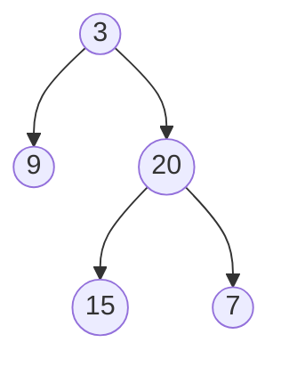
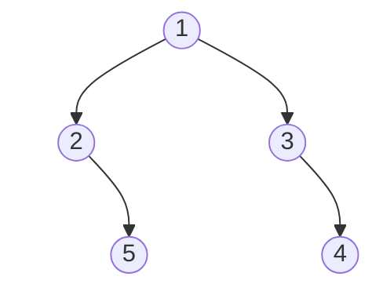

## The idea

**Breadth-first search (BFS)** visits a tree **level by level**: first the root, then all of its children, then all of their children, and so on. Inside each level it goes from left to right.

Think of **ripples in a pond**. Drop a stone and the first ring forms close to it, then a wider ring, then a wider one. BFS spreads out from the root the same way, one ring (one level) at a time.

To do this, BFS keeps the nodes that are waiting their turn in a **queue**: a line where the first one in is the first one out, like the line at a ticket counter.

## Setup

Paste these two blocks first. They are the same `TreeNode` class and test helper as in [Tree Basics](./tree-basics.mdx), so the code on this page runs on its own.

```js
class TreeNode {
    constructor(val) {
        this.val = val;
        this.left = null;
        this.right = null;
    }
}

// null (or a value past the end of the list) means "no node here".
function makeNode(value) {
    if (value === null || value === undefined) {
        return null;
    }

    return new TreeNode(value);
}
```

`buildTree` turns a LeetCode-style list like `[3, 9, 20, null, null, 15, 7]` into a tree.

```js
function buildTree(values) {
    const root = makeNode(values[0]);

    // Nodes that are still waiting for their children, oldest first.
    const waiting = [root];
    let i = 1;

    while (i < values.length) {
        const node = waiting.shift();

        // The next two values are this node's left and right child.
        node.left = makeNode(values[i]);
        node.right = makeNode(values[i + 1]);
        i = i + 2;

        if (node.left !== null) {
            waiting.push(node.left);
        }

        if (node.right !== null) {
            waiting.push(node.right);
        }
    }

    return root;
}
```

## How it works

### A queue in JavaScript

A plain array works as a queue. `push` adds to the **back** of the line, and `shift` takes from the **front**.

```js
const line = [];

// Join at the back.
line.push("Asha");
line.push("Ben");
line.push("Chen");

// Leave from the front.
const first = line.shift();

console.log(first); // Asha
console.log(line); // [ 'Ben', 'Chen' ]
```

### BFS step by step

The plan:

1. Put the root in the queue.
2. Take the node at the front. Visit it.
3. Put its children (if any) at the back.
4. Repeat until the queue is empty.

Because children always join at the **back**, every node of one level is taken out before any node of the next level.

Step 3 happens in every BFS, so here it is as a small helper:

```js
// Put a node's children at the back of the queue. Skip empty spots.
function addChildren(queue, node) {
    if (node.left !== null) {
        queue.push(node.left);
    }

    if (node.right !== null) {
        queue.push(node.right);
    }
}
```

Now the BFS itself. It returns the values in the order it visits them.

```js
function bfs(root) {
    const result = [];

    // An empty tree: nothing to visit.
    if (root === null) {
        return result;
    }

    const queue = [root];

    while (queue.length > 0) {
        // Take the node at the front of the line.
        const node = queue.shift();
        result.push(node.val);

        // Its children join the back of the line.
        addChildren(queue, node);
    }

    return result;
}

const tree = buildTree([3, 9, 20, null, null, 15, 7]);
console.log(bfs(tree)); // [ 3, 9, 20, 15, 7 ]
```

Here is the tree, and how the queue changes:



| Step | Take out | Add to the back | Queue after | result |
| --- | --- | --- | --- | --- |
| 1 | 3 | 9, 20 | 9, 20 | 3 |
| 2 | 9 | (no children) | 20 | 3, 9 |
| 3 | 20 | 15, 7 | 15, 7 | 3, 9, 20 |
| 4 | 15 | (no children) | 7 | 3, 9, 20, 15 |
| 5 | 7 | (no children) | (empty) | 3, 9, 20, 15, 7 |

**Time:** O(n), because each node joins the queue once and leaves once. **Space:** O(w), where w is the **width** of the widest level, because that is the most nodes the queue holds at one time. In a perfect tree (every level full) the last level holds about half of all nodes, so in the worst case that is O(n).

### A faster queue

`shift()` has a hidden cost: after taking out the first item, JavaScript moves **every other item** one spot to the left. That is O(n) for each `shift`. For interview-size trees it is usually fine, but it is good to say so.

The fix: don't remove anything. Keep an index, `front`, that points at the next node to take, and move it forward. (See [Queues and Deques](../stacks-queues/queues-and-deques.mdx) for more on fast queues.)

```js
function bfsFast(root) {
    const result = [];

    if (root === null) {
        return result;
    }

    const queue = [root];

    // The index of the next node to take. Moving it is O(1).
    let front = 0;

    while (front < queue.length) {
        const node = queue[front];
        front = front + 1;

        result.push(node.val);
        addChildren(queue, node);
    }

    return result;
}

console.log(bfsFast(tree)); // [ 3, 9, 20, 15, 7 ]
```

The rest of this page uses `shift()` because it is easier to read. To switch any of them to the fast version, use `front` like above, and work out the level size as `queue.length - front`.

## Classic problems

### 1. Binary Tree Level Order Traversal

**Problem:** return the values level by level, each level in its own list. `[3, 9, 20, null, null, 15, 7]` → `[[3], [9, 20], [15, 7]]`.

**Idea:** plain BFS mixes all the levels into one list. To keep them apart, notice this: **at the start of each round, the queue holds exactly one whole level**. So save the queue's length first, as `levelSize`. Then take out exactly that many nodes. Their children go to the back of the queue, but you don't touch them in this round.

```js
function levelOrder(root) {
    const levels = [];

    if (root === null) {
        return levels;
    }

    const queue = [root];

    while (queue.length > 0) {
        // Right now the queue holds exactly one level.
        const levelSize = queue.length;
        const level = [];

        for (let i = 0; i < levelSize; i++) {
            const node = queue.shift();
            level.push(node.val);
            addChildren(queue, node);
        }

        levels.push(level);
    }

    return levels;
}

console.log(levelOrder(tree)); // [ [ 3 ], [ 9, 20 ], [ 15, 7 ] ]
console.log(levelOrder(null)); // []
```

How the rounds go:

| Round | Queue at the start | levelSize | Level saved | Queue at the end |
| --- | --- | --- | --- | --- |
| 1 | 3 | 1 | [3] | 9, 20 |
| 2 | 9, 20 | 2 | [9, 20] | 15, 7 |
| 3 | 15, 7 | 2 | [15, 7] | (empty) |

**Time:** O(n) · **Space:** O(w). Each node goes in and out of the queue once; the queue holds at most one level plus the start of the next.

This `levelSize` loop is the **template** for almost every tree BFS problem. The next two problems only change what happens inside it.

### 2. Binary Tree Right Side View

**Problem:** imagine standing on the right side of the tree. Return the values you can see, from top to bottom. `[1, 2, 3, null, 5, null, 4]` → `[1, 3, 4]`.



The green nodes are the ones you see: the **last node of each level**.

**Idea:** run the level template. When `i` is the last index of the level, save that node's value.

```js
function rightSideView(root) {
    const visible = [];

    if (root === null) {
        return visible;
    }

    const queue = [root];

    while (queue.length > 0) {
        const levelSize = queue.length;

        for (let i = 0; i < levelSize; i++) {
            const node = queue.shift();

            // The last node of each level is the one you see.
            if (i === levelSize - 1) {
                visible.push(node.val);
            }

            addChildren(queue, node);
        }
    }

    return visible;
}
```

The trap: the node you see is **not always a right child**. In `[1, 2, 3, 4]`, node 4 is the **left** child of 2, but nothing is to its right on that level, so you see it.

```js
const viewTree = buildTree([1, 2, 3, null, 5, null, 4]);
const leftLeafTree = buildTree([1, 2, 3, 4]);

console.log(rightSideView(viewTree)); // [ 1, 3, 4 ]
console.log(rightSideView(leftLeafTree)); // [ 1, 3, 4 ]
```

**Time:** O(n) · **Space:** O(w). Every node is visited once.

For the **left** side view, save the node when `i === 0` instead.

### 3. Minimum Depth of Binary Tree

**Problem:** return the number of nodes on the **shortest** path from the root down to a **leaf**. `[3, 9, 20, null, null, 15, 7]` → `2` (the path 3 → 9).

**Idea:** BFS meets the nodes level by level, so the **first leaf it takes out is the closest one**. Count the levels as you go, and stop right there. You don't need to look at the rest of the tree.

```js
function minDepth(root) {
    if (root === null) {
        return 0;
    }

    const queue = [root];
    let depth = 0;

    while (queue.length > 0) {
        depth = depth + 1;
        const levelSize = queue.length;

        for (let i = 0; i < levelSize; i++) {
            const node = queue.shift();

            // The first leaf we meet is the closest one.
            if (node.left === null && node.right === null) {
                return depth;
            }

            addChildren(queue, node);
        }
    }

    return depth;
}
```

The second tree below is a chain: each node has only a right child. Its only leaf is 6, five levels down.

```js
const chainTree = buildTree([2, null, 3, null, 4, null, 5, null, 6]);

console.log(minDepth(tree)); // 2
console.log(minDepth(chainTree)); // 5
```

**Time:** O(n) in the worst case, but often much less, because BFS stops at the first leaf. **Space:** O(w).

**The DFS trap.** You might try the Maximum Depth code from [Binary Trees and DFS](./binary-trees.mdx) with `Math.min` instead of `Math.max`:

```js
// Wrong: a missing child counts as a path of length 0.
function minDepthWrong(node) {
    if (node === null) {
        return 0;
    }

    const leftDepth = minDepthWrong(node.left);
    const rightDepth = minDepthWrong(node.right);

    return 1 + Math.min(leftDepth, rightDepth);
}

console.log(minDepthWrong(chainTree)); // 1
```

On the chain, the root has no left child, so the left side returns 0, and the answer comes out as 1. But the root is not a leaf. An empty side is **not** a path to a leaf. The fix: if one side is missing, the path must go down the other side.

```js
function minDepthDfs(node) {
    if (node === null) {
        return 0;
    }

    // Only one side exists: the path must go down that side.
    if (node.left === null) {
        return 1 + minDepthDfs(node.right);
    }

    if (node.right === null) {
        return 1 + minDepthDfs(node.left);
    }

    const leftDepth = minDepthDfs(node.left);
    const rightDepth = minDepthDfs(node.right);

    return 1 + Math.min(leftDepth, rightDepth);
}

console.log(minDepthDfs(chainTree)); // 5
```

Both are correct now, but BFS is the better pick here: DFS always visits every node, while BFS stops at the first leaf.

### Same template, other problems

These are all the `levelSize` loop with one small change:

| Problem | What changes |
| --- | --- |
| Average of Levels | Add up the level's values, then divide by `levelSize` |
| Largest Value in Each Row | Keep the biggest value seen in the level |
| Zigzag Level Order | Build each level as usual, then reverse every second level before saving it |
| Maximum Depth (BFS version) | Count the rounds. The number of rounds is the depth |

## BFS or DFS?

|  | BFS | DFS |
| --- | --- | --- |
| Order | Level by level | One path all the way down first |
| Tool | A queue | Recursion, or your own stack |
| Extra space | O(w), the widest level | O(h), the height |
| Best for | Levels, rows, views, the **closest** or **shallowest** node | Paths, heights, answers built from subtrees, comparing trees |

Many problems can be solved both ways. Pick BFS when the problem talks about **levels** or **the nearest** something.

## How to spot it

- The problem says **level**, **row**, **layer** or "each depth".
- It asks what you see from the **left** or **right** side.
- It asks for the **minimum depth**, the **closest leaf**, or anything "nearest to the root".
- It asks for something **per level**: average, largest value, zigzag order, connecting nodes on the same level.

## Common mistakes

- **Using `queue.length` in the loop condition.** `for (let i = 0; i < queue.length; i++)` keeps growing as you add children, so the levels get mixed. Save `levelSize` **before** the loop.
- **Pushing `null` children.** Later you read `node.val` on `null` and crash. Only add children that exist.
- **Forgetting the empty tree.** `const queue = [root]` with `root === null` puts `null` in the queue. Return early.
- **Thinking the right side view is "all right children".** It is the last node of each level, which can be a left child.
- **Using `Math.min` of both sides for minimum depth with DFS.** A missing child is not a leaf.
- **Calling `shift()` on a huge queue without saying anything.** Mention the O(n) cost and the `front` index fix.

## In the interview

> "I'll do a BFS with a queue. At the start of each round, the queue holds exactly one level, so I save its length and take out that many nodes, adding their children to the back. Each node goes in and out once, so it's O(n) time, and the queue holds at most about one level, so O(w) space, which is O(n) in the worst case."

**Likely follow-up:** "Can you do the right side view with DFS?"

**Answer:** "Yes. I'd do a DFS that visits the **right** child before the left, and pass the depth down. The first node I reach at each depth is the rightmost one, so when `depth` equals the length of my result list, I push that node. That's O(n) time and O(h) space."

<Callout title="Remember this" type="success">
  - **BFS = level by level, with a queue.** Take from the front, add children to the back.
  - The level template: **save `levelSize = queue.length` first**, then take out exactly that many nodes.
  - Right side view = **the last node of each level** (it can be a left child).
  - Minimum depth: BFS **stops at the first leaf**. With DFS, a missing child is not a leaf.
  - BFS is O(n) time and **O(w) space** (widest level). DFS is O(h) space.
  - `shift()` is O(n). For big trees, keep a **`front` index** instead.
</Callout>
