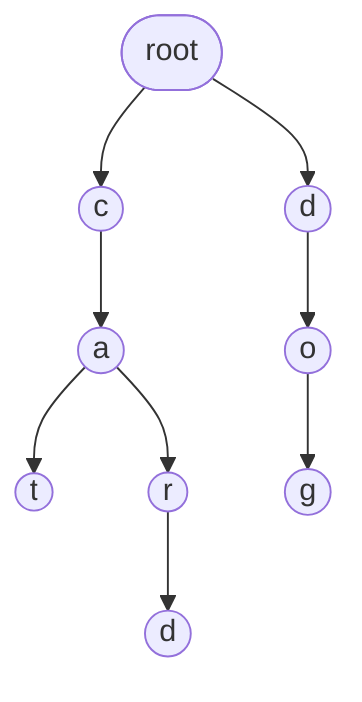

## The idea

A **trie** (say "try", from re**trie**val) is a tree that stores words **one letter per step**. Words that start the same way **share the same path**. "car" and "card" share the path c → a → r, and "card" just goes one step further.

Think of the **autocomplete on your phone**. You type "ca" and it suggests "car", "card" and "cat". It does not check every word it knows. It goes to the spot for "c", then "a", and everything below that spot starts with "ca".

That is what a trie is good at: questions about **prefixes** (the start of a word), answered in time that depends only on the length of the prefix, not on how many words are stored.

## How it works

### The picture

Here is a trie holding four words: **cat**, **car**, **card** and **dog**.



- The **root** is empty. Each step down adds one letter.
- Read a word by following the letters from the root: c → a → t is "cat".
- The **green** nodes are where a word **ends**. That mark matters: "car" is a word, so its "r" is green. But "ca" is not a word, so its "a" is not green, even though the path exists.

### What a node looks like in JavaScript

Each node has two fields: its **children**, one per next letter, and an **isEnd** flag that says "a word ends here".

```js
class TrieNode {
    constructor() {
        // One child per next letter, like { a: TrieNode, o: TrieNode }.
        this.children = {};

        // True if a word ends at this node.
        this.isEnd = false;
    }
}
```

A trie node can have many children, not just two. It is a tree like the folder tree in [Tree Basics](./tree-basics.mdx#trees-with-more-than-two-children), with letters as the keys.

Here is the shape of the trie above, written out as objects (only the "c" side):

```text
root: { children: { c, d }, isEnd: false }
  c: { children: { a }, isEnd: false }
    a: { children: { t, r }, isEnd: false }
      t: { children: {}, isEnd: true }        "cat" ends here
      r: { children: { d }, isEnd: true }     "car" ends here
        d: { children: {}, isEnd: true }      "card" ends here
```

A plain object works well for `children`. A `Map` works too. In Java or C++ you often see an array of 26 slots, one per letter, but in JavaScript an object is simpler and works for any character.

### Insert a word

Start at the root. For each letter: if there is no child for it yet, make one. Then step down to that child. After the last letter, mark the node as the end of a word.

```js
function insertWord(root, word) {
    let node = root;

    for (const letter of word) {
        // No path for this letter yet: make one.
        if (node.children[letter] === undefined) {
            node.children[letter] = new TrieNode();
        }

        // Step down to the letter's node.
        node = node.children[letter];
    }

    // The node of the last letter marks the end of a word.
    node.isEnd = true;
}
```

Now build the trie from the picture:

```js
const root = new TrieNode();

insertWord(root, "cat");
insertWord(root, "car");
insertWord(root, "card");
insertWord(root, "dog");

const nodeC = root.children["c"];
const nodeCA = nodeC.children["a"];

console.log(Object.keys(root.children)); // [ 'c', 'd' ]
console.log(Object.keys(nodeCA.children)); // [ 't', 'r' ]
```

Here is what happens when "card" is inserted, after "cat" and "car" are already in:

| Letter | Child already there? | What happens |
| --- | --- | --- |
| c | Yes | Step down |
| a | Yes | Step down |
| r | Yes | Step down |
| d | No | Make a new node, then step down |
| (end) | | Mark this node: `isEnd = true` |

Only one new node was made. The first three letters were shared with "car".

### Walk down a path

Search and prefix checks both start the same way: follow the letters down from the root. If a letter is missing, the path breaks.

```js
// Follow the letters of text down from the root.
// Returns the node of the last letter, or null if the path breaks.
function findNode(root, text) {
    let node = root;

    for (const letter of text) {
        if (node.children[letter] === undefined) {
            return null;
        }

        node = node.children[letter];
    }

    return node;
}
```

### Search and starts with

The two are almost the same. The only difference is the last check:

- **search(word):** the path must exist **and** a word must end there (`isEnd`).
- **startsWith(prefix):** the path just has to exist.

```js
// Is this exact word in the trie?
function searchWord(root, word) {
    const node = findNode(root, word);

    if (node === null) {
        return false;
    }

    // The path exists, but does a word end here?
    return node.isEnd;
}

// Does any word in the trie start with this prefix?
function hasPrefix(root, prefix) {
    const node = findNode(root, prefix);
    return node !== null;
}
```

"ca" shows the difference: the path is there, but no word ends at its "a".

```js
console.log(searchWord(root, "car")); // true
console.log(searchWord(root, "ca")); // false
console.log(hasPrefix(root, "ca")); // true
console.log(searchWord(root, "cow")); // false
console.log(hasPrefix(root, "do")); // true
```

### How fast is it?

Let **L** be the length of the word or prefix.

| Operation | Time | Why |
| --- | --- | --- |
| Insert | O(L) | One step down per letter |
| Search | O(L) | One step down per letter |
| Starts with | O(L) | One step down per letter |

None of them depend on **how many words** are stored. A trie with a million words answers "does any word start with `ca`?" in two steps.

**Space:** at most one node per letter of all the words together. Shared prefixes are stored only once, so in practice it is less.

### Trie or Set?

A `Set` of words can also tell you if a word exists. So when is a trie worth it?

| Question | Set of words | Trie |
| --- | --- | --- |
| Is "car" a word? | O(L) with `set.has("car")` | O(L) |
| Does any word start with "ca"? | Check every word: O(n × L) | O(L) |
| List the words that start with "ca" | Check every word | Walk to "ca", collect what's below |

If you only need exact lookups, a `Set` is simpler. Use a trie when the problem is about **prefixes**.

## Classic problems

### 1. Implement Trie

**Problem:** build a class `Trie` with `insert(word)`, `search(word)` and `startsWith(prefix)`.

**Idea:** you have already written all three. The class just holds the root and calls them.

```js
class Trie {
    constructor() {
        this.root = new TrieNode();
    }

    insert(word) {
        insertWord(this.root, word);
    }

    search(word) {
        return searchWord(this.root, word);
    }

    startsWith(prefix) {
        return hasPrefix(this.root, prefix);
    }
}
```

In an interview, you can write it like this, or put each function's body straight into the method, using `this.root` instead of `root`. It's the same code.

```js
const trie = new Trie();
trie.insert("apple");

console.log(trie.search("apple")); // true
console.log(trie.search("app")); // false
console.log(trie.startsWith("app")); // true

trie.insert("app");
console.log(trie.search("app")); // true
```

**Time:** O(L) for each call · **Space:** O(L) for each insert, at most one new node per letter.

### 2. Design Add and Search Words (wildcard search)

**Problem:** build a word dictionary with `addWord(word)` and `search(word)`. In `search`, a `.` matches **any one letter**. After adding "bad", "dad" and "mad": `search("pad")` → `false`, `search(".ad")` → `true`, `search("b..")` → `true`.

**Idea:** a normal letter has only one path to follow. But a `.` could be **any** child, so you must **try every child** and see if any of them works. "Try each choice, and go deeper" is a job for recursion (DFS).

**Each call returns:** `true` if the letters of `word` from position `index` onward can be matched, starting at `node`.

```js
function matchFrom(node, word, index) {
    // Every letter is matched: a word must end right here.
    if (index === word.length) {
        return node.isEnd;
    }

    const letter = word[index];

    if (letter === ".") {
        // "." can be any letter: try every child.
        for (const child of Object.values(node.children)) {
            if (matchFrom(child, word, index + 1)) {
                return true;
            }
        }

        return false;
    }

    const next = node.children[letter];

    if (next === undefined) {
        return false;
    }

    return matchFrom(next, word, index + 1);
}
```

Inside the loop, only `return true` early. If one child fails, the next child might still work, so return `false` only **after** trying them all.

The class adds words the normal way and searches with `matchFrom`.

```js
class WordDictionary {
    constructor() {
        this.root = new TrieNode();
    }

    addWord(word) {
        insertWord(this.root, word);
    }

    search(word) {
        return matchFrom(this.root, word, 0);
    }
}
```

```js
const dictionary = new WordDictionary();

dictionary.addWord("bad");
dictionary.addWord("dad");
dictionary.addWord("mad");

console.log(dictionary.search("pad")); // false
console.log(dictionary.search("bad")); // true
console.log(dictionary.search(".ad")); // true
console.log(dictionary.search("b..")); // true
```

How `search(".ad")` runs:

| index | Letter | At node | What happens |
| --- | --- | --- | --- |
| 0 | `.` | root | Try every child. The first one is "b" |
| 1 | `a` | b | "b" has an "a" child: step down |
| 2 | `d` | a | "a" has a "d" child: step down |
| 3 | (done) | d | All letters matched, and `isEnd` is true: **found** |

**Time:** O(L) for a word with no dots. Each dot can branch into many children, and a search full of dots may visit every node in the trie once: O(N), where N is the number of nodes. **Space:** O(L) for the call stack.

### 3. Autocomplete: all words with a prefix

**Problem:** return every stored word that starts with a given prefix. This is the core of LeetCode 1268, "Search Suggestions System". With our first trie, `"ca"` → `car`, `card`, `cat`.

**Idea:** walk down to the prefix's node with `findNode`. Every word **below** that node starts with the prefix. Visit everything below it with DFS, building up the letters as you go, and save the path whenever a node has `isEnd`.

```js
// Returns every word in the trie that starts with prefix, A to Z.
function wordsWithPrefix(root, prefix) {
    const words = [];
    const start = findNode(root, prefix);

    if (start === null) {
        return words;
    }

    // Visit everything below start. path holds the letters so far.
    function collect(node, path) {
        if (node.isEnd) {
            words.push(path);
        }

        // Sorted letters give the words in A to Z order.
        const letters = Object.keys(node.children).sort();

        for (const letter of letters) {
            collect(node.children[letter], path + letter);
        }
    }

    collect(start, prefix);
    return words;
}
```

```js
console.log(wordsWithPrefix(root, "ca")); // [ 'car', 'card', 'cat' ]
console.log(wordsWithPrefix(root, "d")); // [ 'dog' ]
console.log(wordsWithPrefix(root, "x")); // []
```

**Time:** O(P + S + K), where P is the length of the prefix, S is the number of letters stored below it, and K is the total length of the words returned (building each word costs its length). **Space:** O(depth of the trie) for the call stack, plus the result.

### Word Search II (a quick look)

**Problem:** you get a grid of letters and a list of words. Find every word that can be spelled by moving between neighbouring cells (up, down, left, right), without using a cell twice.

The one-word version, Word Search, is plain [grid backtracking](../backtracking/grid-backtracking.mdx): start a DFS from every cell. With many words, running that once per word is far too slow.

**Idea with a trie:**

1. Put **all** the words in a trie.
2. Start a DFS from every cell. As you step from cell to cell, step down the trie with the same letter.
3. If the trie has **no child** for the next letter, stop. No word starts with this path, so going further is pointless. This cuts the search down a lot.
4. When you reach a node where a word ends, save that word.

One DFS now looks for **every** word at once. Two small tricks help: store the whole word in its end node (for example `node.word = "oath"`) so you don't have to rebuild it, and clear it after you find it so the same word isn't added twice.

## How to spot it

- The problem talks about **prefixes**: "starts with", "autocomplete", "suggestions", "longest common prefix".
- It stores a **dictionary of words** and asks many questions about them.
- It has a **wildcard** like `.` that matches any letter.
- It asks you to find **many words** in a grid at once.

## Common mistakes

- **Forgetting `isEnd`.** Without it, `search("ca")` says `true` just because "car" is stored.
- **Returning `isEnd` in `startsWith`.** A prefix only needs the path to exist.
- **Making a new node without checking first.** `node.children[letter] = new TrieNode()` every time wipes out words that were already stored below that letter.
- **Wildcard: returning the first child's answer.** `return matchFrom(child, ...)` inside the loop gives up after one child. Only return early on `true`.
- **Off by one with the index.** In `matchFrom`, the word is fully matched when `index === word.length`, not `word.length - 1`.
- **Using a trie when a `Set` is enough.** If nothing asks about prefixes, a `Set` is simpler.

## In the interview

> "I'll store the words in a trie. Each node has a children object, keyed by letter, and an isEnd flag. Insert and search walk one letter at a time, so they're O(L), no matter how many words there are. Search checks isEnd at the end; startsWith only needs the path to exist."

**Likely follow-up:** "How much memory does a trie use, and how could you cut it down?"

**Answer:** "At most one node per letter of all the words together, but shared prefixes are stored only once. To save more, I could merge long chains of single-child nodes into one node that holds a whole string. That's called a compressed trie, or radix tree."

<Callout title="Remember this" type="success">
  - **Trie = a tree of letters.** Words with the same start share the same path.
  - A node is `{ children: {}, isEnd: false }`. **`isEnd` marks where a word ends.**
  - Insert, search and startsWith are all **O(L)**, the length of the word, not the number of words.
  - **search** needs the path **and** `isEnd`. **startsWith** only needs the path.
  - Wildcard `.`: **try every child** with DFS, and return `false` only after all of them fail.
  - Use a trie for **prefixes**. For exact lookups only, a `Set` is simpler.
</Callout>
