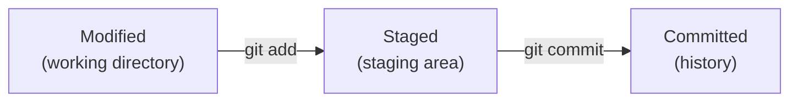

## The idea

**Git** is a **version control system**. It tracks every change in your project and keeps a history of it. You can see what changed and when, and go back to an older version when something breaks.

**GitHub** is a **website that hosts Git repositories** online, so a team can share them. GitLab and Bitbucket do the same job.

Think of **save points in a video game**. Git is the save system: each time you reach a good point, you save, and if something goes wrong later, you load an older save. GitHub is like cloud saves: your saves are kept online, where your team can get them too.

So Git does the tracking, on your computer. GitHub keeps a copy online. You can use Git without GitHub, but not GitHub without Git.

A **repository** (repo) is a project folder that Git tracks. Git keeps the whole history in a hidden `.git` folder inside it.

## How it works

### The three stages

Every change goes through three stages:

- **Modified:** you changed files (added, edited or deleted them), but you haven't told Git to save the changes yet. They are only in your **working directory**, which is your project folder.
- **Staged:** you added the changes to the **staging area** with `git add`. It's a **draft** of your next commit: you decide which changes go in.
- **Committed:** `git commit` saves the staged changes as a **commit**, a save point. Each commit is a snapshot of the project, with an ID, a message, an author and a date. Later you can look at any commit, or go back to it.

Why have a staging area? So that one commit holds one change. Say you fixed a bug and also started a new feature. You can stage only the bug fix and commit it on its own.

### Branches and HEAD

A **branch** is a separate line of work. When you start a repository, there is only **one branch**. Git calls it `master` by default. GitHub and most teams now call it `main`.

**HEAD** means "where you are now". It points to the branch you're on, and so to that branch's latest commit. You will see it in commands like `git reset --soft HEAD~1`, where `HEAD~1` means "one commit before where I am".

<Callout title="Remember this" type="success">
  - **Git** is the version control system on your computer. **GitHub** is a website that hosts Git repositories.
  - Three stages: **modified** (working directory) → `git add` → **staged** (staging area) → `git commit` → **committed**.
  - The staging area is a **draft** of the next commit, so you choose what goes in.
  - A new repository has one branch: `master` by default, `main` on GitHub.
  - **HEAD** = where you are now: your current branch and its latest commit.
</Callout>
