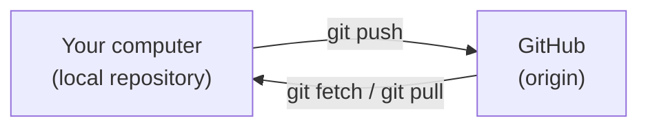

## The idea

Your computer has its own copy of the repository, and GitHub has another. They don't sync by themselves. `git push` sends your commits up. `git fetch` and `git pull` bring other people's commits down.



## How it works

### git fetch

```bash
git fetch
```

Downloads the latest **commits, branches and other updates** from the remote. **It doesn't change your current branch or your files.** So it's always safe: you can see what changed first, and decide later.

### git pull

```bash
git pull
```

Downloads the latest changes, and then **merges them into your current branch**. By default, `git pull` is `git fetch` followed by `git merge`.

```bash
# Get the latest rohit branch from origin, and merge it into the branch you're on.
git pull origin rohit
```

It merges into your **current** branch, whatever its name is. If you're on `main`, this merges `rohit` into `main`.

### git push

```bash
# Send your local commits to the remote.
git push

# Send your local rohit branch to the rohit branch on origin.
git push origin rohit
```

### Use case: working on another developer's branch

```bash
# 1. Download the latest branches from GitHub.
git fetch

# 2. Switch to their branch. Git makes a local copy of it for you.
git checkout their-branch-name

# 3. Later, get their new commits.
git pull
```

Step 1 is needed because Git only knows about the branches that were on GitHub at your last fetch.

<Callout title="Remember this" type="success">
  - `git push` sends your commits **up**. `git fetch` and `git pull` bring commits **down**.
  - `git fetch` only downloads. It **doesn't change** your branch or files.
  - `git pull` = `git fetch` + `git merge` into your **current** branch.
  - `git pull origin rohit` merges origin's `rohit` into the branch you're on. `git push origin rohit` sends your `rohit` to origin's `rohit`.
  - Another dev's branch: `git fetch` → `git checkout <their-branch>` → `git pull` for new commits.
</Callout>
