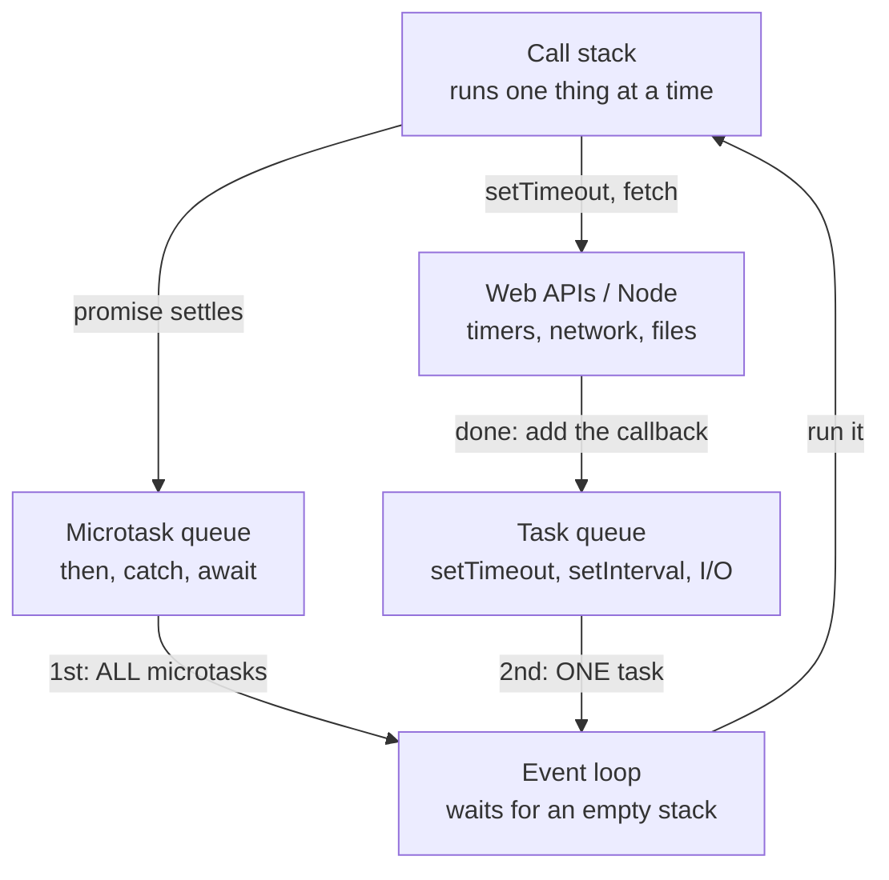

## The idea

JavaScript runs your code on **one thread**, so it does **one thing at a time**. Yet a web page can wait for a server, and a Node server can wait for a database, without freezing. The **event loop** is how.

Slow work (a timer, a network call, reading a file) is handed to the browser or to Node, outside your code. When that work is done, its callback waits in a **queue**. When JavaScript is free, the **event loop** takes the next callback from a queue and runs it.

Think of a **café with one barista**. The barista makes one drink at a time. The oven bakes on its own, so the barista doesn't stand and watch it. When the oven beeps, the order goes on a counter. The barista picks it up only after finishing the current drink. There are two counters: an **urgent** one, always cleared first, and a **normal** one. In JavaScript, these are the **microtask queue** and the **task queue**.

## How it works

### The call stack, Web APIs and the queues

There are five parts:

| Part | What it is | Examples |
| --- | --- | --- |
| **Call stack** | The functions running right now. Only the one on top runs. | your script, a function call |
| **Web APIs** (in Node: Node's runtime) | Work done outside JavaScript, in the background. | timers, network calls, reading files |
| **Task queue** (also called the **macrotask** queue) | Callbacks that are ready to run. | the `setTimeout` and `setInterval` callbacks, a finished file read |
| **Microtask queue** | Small, urgent callbacks. | `.then`, `.catch` and `.finally` callbacks, the code after `await`, `queueMicrotask` |
| **Event loop** | The rule that picks what runs next, once the call stack is empty. | |

"Web APIs" is the browser's name for this background work. Node does the same job outside JavaScript, with a C library called libuv. The idea is the same in both.



How to read it:

- Your code runs on the **call stack**. When it calls `setTimeout`, the timer is handed to the **Web APIs**. Your code doesn't wait. It goes on to the next line.
- When the timer is up, its callback joins the **task queue**.
- When a promise settles (it gets a value or an error), its `.then` callback joins the **microtask queue**.
- When the call stack is empty, the **event loop** first runs **all** microtasks, then **one** task, then all microtasks again, and so on.

### Microtasks vs macrotasks

| | Microtasks | Tasks (macrotasks) |
| --- | --- | --- |
| Come from | `.then`, `.catch`, `.finally`, the code after `await`, `queueMicrotask(fn)` | `setTimeout`, `setInterval`, finished I/O (network, files), clicks and other events |
| How many run per round | **All** of them, until the queue is empty | **One** |
| When | Right after the current code ends | Only when the microtask queue is empty |

The loop, written as pseudo-code (not real code you can run):

```js noRun
while (true) {
    // 1. Run one task. The very first task is your whole script.
    const task = taskQueue.shift();
    run(task);

    // 2. Empty the microtask queue, fully.
    // A microtask that adds a new microtask: that one runs here too.
    while (microtaskQueue.length > 0) {
        const microtask = microtaskQueue.shift();
        run(microtask);
    }

    // 3. In a browser, when it's time for a new frame (often 60 times a
    // second), requestAnimationFrame callbacks run, then the screen is redrawn.
}
```

Here you can see "all microtasks after each task". The promise made inside the first timer runs **before** the second timer, because the microtask queue is emptied after every task.

```js
setTimeout(() => {
    console.log("timeout 1");

    Promise.resolve().then(() => {
        console.log("promise inside timeout 1");
    });
}, 0);

setTimeout(() => {
    console.log("timeout 2");
}, 0);
// timeout 1
// promise inside timeout 1
// timeout 2
```

And a microtask that adds another microtask: the new one still runs before the waiting timer.

```js
setTimeout(() => {
    console.log("timeout");
}, 0);

let count = 0;

function addMicrotask() {
    count = count + 1;
    console.log("microtask", count);

    // Add one more microtask, three times in total.
    if (count < 3) {
        queueMicrotask(addMicrotask);
    }
}

queueMicrotask(addMicrotask);
// microtask 1
// microtask 2
// microtask 3
// timeout
```

If that `if` were missing, the microtasks would never end. The timer would never get its turn, and in a browser the page would freeze. This is called **starving** the event loop.

### Why `setTimeout(fn, 0)` is not instant

`setTimeout(fn, 0)` does **not** mean "run now". It means "put `fn` in the task queue after at least 0 ms". Then `fn` still has to wait for:

1. The current code to finish (the call stack must be empty).
2. Every microtask.
3. Every task that is already ahead of it in the queue.

So the delay is the **shortest** wait, never an exact time. Here, a busy loop keeps the only thread busy for 200 ms. The 0 ms timer can't run until the loop ends.

```js
const start = Date.now();

setTimeout(() => {
    const waited = Date.now() - start;
    console.log("the 0 ms timer waited", waited, "ms");
}, 0);

// Keep the thread busy for 200 ms.
while (Date.now() - start < 200) {
    // Nothing else can run while this loop runs.
}

console.log("loop done");
// loop done
// the 0 ms timer waited 202 ms   (about 200: it changes a little)
```

In the real world, this is why a page "freezes" while it parses a huge JSON file or sorts a giant list: timers, clicks and the screen all wait for that one long piece of code. In Node, one slow loop makes **every** request to the server wait.

### Order of logs, step by step

This is the classic interview question: "In what order do these lines print?"

The rule to remember: **normal code first, then microtasks (promises), then tasks (timers).**

```js
console.log("start");

setTimeout(() => {
    console.log("timeout");
}, 0);

Promise.resolve().then(() => {
    console.log("promise");
});

console.log("end");
// start
// end
// promise
// timeout
```

| Step | What happens | Microtask queue | Task queue | Printed |
| --- | --- | --- | --- | --- |
| 1 | `console.log("start")` runs | (empty) | (empty) | start |
| 2 | `setTimeout` hands the timer to the browser or Node. When 0 ms are up, its callback joins the task queue. | (empty) | timeout | |
| 3 | `Promise.resolve()` is already fulfilled, so `.then` puts its callback in the microtask queue | promise | timeout | |
| 4 | `console.log("end")` runs. The script is done, so the call stack is empty. | promise | timeout | end |
| 5 | The event loop runs **all** microtasks first | (empty) | timeout | promise |
| 6 | Then **one** task | (empty) | (empty) | timeout |

Now a harder one, with `async`/`await` and a chain of two `.then` calls. Try to guess the order before reading the answer.

```js
console.log("script start");

setTimeout(() => {
    console.log("timeout");
}, 0);

async function run() {
    console.log("run: before await");
    await null;
    console.log("run: after await");
}

run();

Promise.resolve()
    .then(() => {
        console.log("then 1");
    })
    .then(() => {
        console.log("then 2");
    });

console.log("script end");
// script start
// run: before await
// script end
// run: after await
// then 1
// then 2
// timeout
```

| Step | What happens | Microtask queue | Task queue | Printed |
| --- | --- | --- | --- | --- |
| 1 | The first line runs | (empty) | (empty) | script start |
| 2 | `setTimeout`: its callback joins the task queue | (empty) | timeout | |
| 3 | `run()` is called. The code **before** `await` runs right away, like any normal function. | (empty) | timeout | run: before await |
| 4 | `await null` pauses `run`. The rest of `run` becomes a microtask. | rest of run | timeout | |
| 5 | The promise is already fulfilled, so `then 1` is queued. `then 2` is not queued yet: it waits for `then 1` to finish. | rest of run, then 1 | timeout | |
| 6 | The last line runs. The script is done. | rest of run, then 1 | timeout | script end |
| 7 | Microtask: the rest of `run` | then 1 | timeout | run: after await |
| 8 | Microtask: `then 1`. When it finishes, `then 2` joins the queue. | then 2 | timeout | then 1 |
| 9 | Microtask: `then 2`. The microtask queue is now empty. | (empty) | timeout | then 2 |
| 10 | Only now, one task: the timer | (empty) | (empty) | timeout |

Two things to notice:

- The code in an `async` function **before** the first `await` runs right away. Only the code **after** `await` waits. See [async and await](./async-await.mdx).
- A chained `.then` is queued only when the one before it finishes. At step 5, only `then 1` is in the queue. `then 2` joins it later, at step 8.

For more puzzles like these, see [Output: Event Loop](../guess-the-output/output-event-loop.mdx).

**Node only (a side note):** Node has two extra queues that browsers don't have. `process.nextTick(fn)` callbacks run even before promise microtasks. `setImmediate(fn)` callbacks run in their own step of Node's loop, after finished I/O. The rule above (promises before timers) is the same in browsers and in Node.

## Common mistakes

- **"`setTimeout(fn, 0)` runs right away."** It runs after the current code, after every microtask, and after the tasks ahead of it.
- **"The delay is exact."** It is the **shortest** wait. A busy thread makes it later.
- **"Async code runs on other threads."** The waiting (for a timer or a server) happens outside. But your callbacks run **one at a time, on one thread**. Two callbacks never run at the same moment.
- **"Everything about a promise is async."** The function you pass to `new Promise(...)` runs **right away**. So does the code in an `async` function before its first `await`. Only `.then` callbacks and the code after `await` wait. See [Callbacks and Promises](./promises.mdx).
- **Thinking all `.then` calls are queued at once.** In a chain, each `.then` is queued only after the one before it finishes.
- **Blocking the thread.** A long loop freezes everything: timers, clicks, the screen, and in Node every request.
- **Endless microtasks.** A microtask that always adds another one starves the task queue. Timers never fire.

## In the interview

Draw the call stack, the two queues and the loop on the whiteboard while you talk.

> "JavaScript runs on one thread, with one call stack. Slow work like timers and network calls is handed to the browser or to Node. When it's done, its callback goes into a queue. There are two queues. Microtasks are promise callbacks and the code after `await`. Tasks, or macrotasks, are things like `setTimeout` and I/O. When the call stack is empty, the event loop runs all the microtasks, then one task, then all the microtasks again, and so on. That's why normal code prints first, then promises, then timers, even a `setTimeout` with 0 ms."

**Likely follow-up:** "Can microtasks block the page?"

**Answer:** "Yes. The microtask queue must be completely empty before the next task can run. If every microtask adds another one, timers and clicks never get a turn, and the browser can't redraw the screen. It's like an infinite loop, just split into many small callbacks."

<Callout title="Remember this" type="success">
  - JavaScript has **one thread**: one call stack, one thing at a time.
  - Slow work runs **outside** (Web APIs, or Node). When it's done, its callback waits in a **queue**.
  - **Microtasks:** `.then`, `.catch`, `.finally`, code after `await`, `queueMicrotask`. **Tasks:** `setTimeout`, `setInterval`, I/O.
  - The loop: run the script, then **all** microtasks, then **one** task, then all microtasks again.
  - So the order is: **normal code, then promises, then timers**. `setTimeout(fn, 0)` is never instant.
  - A long loop or endless microtasks **block** everything.
</Callout>
