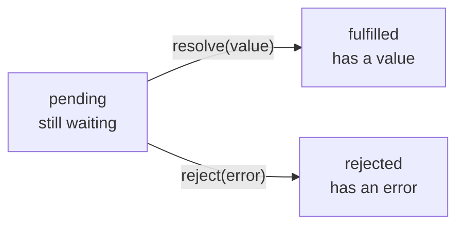

## The idea

A **callback** is a function you give to other code, so that code can "call you back" later. A **promise** is an object that stands for a value you will get **later**, like a user from a server. Or an error, if things go wrong.

Think of the **buzzer at a food court**. You order and get a buzzer: that's the promise. You don't stand at the counter. When the food is ready, the buzzer goes off: the promise is **fulfilled**. If they ran out of burgers, they tell you: the promise is **rejected**. Either way, you get exactly **one** answer.

## How it works

### Callbacks and callback hell

Before promises, async code used callbacks. Here `setTimeout` stands in for a slow network call. When the "call" is done, `getUser` calls the function you gave it.

```js
function getUser(id, callback) {
    // Pretend this is a slow network call.
    setTimeout(() => {
        const user = { id: id, name: "Asha" };
        callback(null, user);
    }, 100);
}

getUser(1, (error, user) => {
    if (error) {
        console.log("Failed:", error.message);
        return;
    }

    console.log("Got user:", user.name);
});
// Got user: Asha
```

This is an **error-first callback**, the style Node's older functions use (like `fs.readFile`). The first argument is the error, or `null` if all went well. The second is the result.

The trouble starts when each step needs the result of the step before it. Get the user, then their orders, then the price of the first order:

```js
function getUser(id, callback) {
    setTimeout(() => {
        callback({ id: id, name: "Asha" });
    }, 100);
}

function getOrders(user, callback) {
    setTimeout(() => {
        callback(["book", "pen"]);
    }, 100);
}

function getPrice(item, callback) {
    setTimeout(() => {
        callback(250);
    }, 100);
}

// Each step lives inside the step before it.
getUser(1, (user) => {
    getOrders(user, (orders) => {
        getPrice(orders[0], (price) => {
            console.log(user.name, "paid", price, "for a", orders[0]);
        });
    });
});
// Asha paid 250 for a book
```

This is **callback hell**. Three problems:

- **The pyramid.** Each step goes one level deeper. With five steps, the code drifts far to the right and is hard to follow.
- **Error checks everywhere.** Every level needs its own `if (error)`. The example above skips them, and that is exactly how bugs slip in.
- **You give away control.** You hand your function to someone else's code. It might call it twice, never, or too early, and you can't stop it. This is called **inversion of control**.

Promises fix all three.

### Promise states: pending, fulfilled, rejected

A promise is always in one of three states:



- **pending:** not done yet.
- **fulfilled:** done, with a **value**.
- **rejected:** failed, with a **reason** (usually an `Error`).

Fulfilled or rejected is called **settled**. A promise settles **only once**. After that, it never changes.

You make a promise with `new Promise(...)`. You pass it a function, called the **executor**. The executor gets two functions: call `resolve(value)` when the work succeeds, or `reject(error)` when it fails.

```js
const promise = new Promise((resolve, reject) => {
    // The executor runs right away, not later.
    console.log("executor runs now");

    setTimeout(() => {
        resolve("done");

        // A promise settles only once. These two do nothing.
        resolve("again");
        reject(new Error("too late"));
    }, 100);
});

console.log("after new Promise");

promise.then((value) => {
    console.log("value:", value);
});
// executor runs now
// after new Promise
// value: done
```

Two shortcuts make a promise that is already settled: `Promise.resolve(value)` (fulfilled) and `Promise.reject(error)` (rejected). One exception: if you pass a promise to `Promise.resolve`, it gives back that same promise.

And if the executor **throws**, the promise is rejected with that error:

```js
const promise = new Promise(() => {
    throw new Error("broken");
});

promise.catch((error) => {
    console.log("caught:", error.message);
});
// caught: broken
```

### Chaining with then, catch and finally

You react to a promise with three methods:

| Method | Runs when | Gets |
| --- | --- | --- |
| `.then(fn)` | the promise is fulfilled | the value |
| `.catch(fn)` | the promise is rejected | the error |
| `.finally(fn)` | either way | nothing. The value (or error) passes through to the next step. Good for clean-up, like hiding a loading spinner. |

A `.then` callback always runs **later**, as a microtask, even when the promise is already fulfilled. See [The Event Loop](./event-loop.mdx).

```js
Promise.resolve("ready").then((value) => {
    console.log(value);
});

console.log("this prints first");
// this prints first
// ready
```

The key fact: **every `.then` returns a new promise**. So you can hang the next `.then` on it, and build a flat chain. What the next step gets depends on what you do inside the callback:

| Inside the callback, you... | The next `.then` gets... |
| --- | --- |
| return a value | that value |
| return a promise | that promise's value, after it settles (the chain **waits**) |
| return nothing | `undefined` |
| throw an error | nothing: the chain skips to the next `.catch` |

Here is the callback hell from above, with promises. Each function now **returns a promise** instead of taking a callback.

```js
// A fake slow task: gives back `value` after 100 ms.
function later(value) {
    return new Promise((resolve) => {
        setTimeout(() => resolve(value), 100);
    });
}

function getUser(id) {
    return later({ id: id, name: "Asha" });
}

function getOrders(user) {
    return later(["book", "pen"]);
}

function getPrice(item) {
    return later(250);
}

// Flat: each step returns a promise, and the next step waits for it.
getUser(1)
    .then((user) => {
        return getOrders(user);
    })
    .then((orders) => {
        return getPrice(orders[0]);
    })
    .then((price) => {
        console.log("price:", price);
    })
    .catch((error) => {
        console.log("something failed:", error.message);
    });
// price: 250
```

No pyramid, and **one** `.catch` at the end handles an error from **any** step.

Here is how an error moves down a chain. After `.catch` handles it, the chain goes on as normal, with whatever `.catch` returned.

```js
Promise.resolve(1)
    .then((value) => {
        console.log("step 1 got", value);
        throw new Error("step 1 failed");
    })
    .then(() => {
        // Skipped: the promise before it was rejected.
        console.log("step 2");
    })
    .catch((error) => {
        console.log("caught:", error.message);
        return "a fallback value";
    })
    .then((value) => {
        console.log("after catch got", value);
    })
    .finally(() => {
        console.log("finally runs either way");
    });
// step 1 got 1
// caught: step 1 failed
// after catch got a fallback value
// finally runs either way
```

### Writing your own promise-based function

To turn any callback-style code into a promise: return `new Promise(...)`, and call `resolve` or `reject` from inside the callback.

The simplest one, and a common interview warm-up: a `wait` (or `sleep`) function.

```js
function wait(ms) {
    return new Promise((resolve) => {
        setTimeout(resolve, ms);
    });
}

console.log("waiting...");

wait(500).then(() => {
    console.log("half a second later");
});
// waiting...
// half a second later
```

Now wrap an old error-first function. `readSetting` is callback-style, and say we can't change it. `readSettingAsync` gives the same result as a promise.

```js
// An old callback-style function.
function readSetting(name, callback) {
    setTimeout(() => {
        if (name === "theme") {
            callback(null, "light");
        } else {
            callback(new Error("No setting called " + name));
        }
    }, 100);
}

// The same thing, as a promise.
function readSettingAsync(name) {
    return new Promise((resolve, reject) => {
        readSetting(name, (error, value) => {
            if (error) {
                reject(error);
            } else {
                resolve(value);
            }
        });
    });
}

readSettingAsync("theme").then((value) => {
    console.log("theme:", value);
});

readSettingAsync("font").catch((error) => {
    console.log("error:", error.message);
});
// theme: light
// error: No setting called font
```

Interviewers often ask for the general version: **`promisify`**. It takes any error-first function and gives back a new function that returns a promise.

```js
function promisify(callbackFunction) {
    return function (...args) {
        return new Promise((resolve, reject) => {
            // Call the old function, with our own callback added at the end.
            callbackFunction(...args, (error, result) => {
                if (error) {
                    reject(error);
                } else {
                    resolve(result);
                }
            });
        });
    };
}

// An old callback-style function: adds two numbers, slowly.
function addLater(first, second, callback) {
    setTimeout(() => {
        callback(null, first + second);
    }, 100);
}

const addAsync = promisify(addLater);

addAsync(2, 3).then((sum) => {
    console.log("sum:", sum);
});
// sum: 5
```

Node has this built in as `util.promisify`, and most Node functions now have promise versions too, like `fs.promises.readFile`.

To write `Promise.all` and friends yourself, see [Promise.all and Friends](../write-your-own/promise-polyfills.mdx).

## Common mistakes

- **Forgetting `return` inside `.then`.** The chain doesn't wait for your promise, and the next step gets `undefined`:

```js
function wait(ms) {
    return new Promise((resolve) => {
        setTimeout(resolve, ms);
    });
}

Promise.resolve()
    .then(() => {
        // Bug: no return, so the chain does not wait for this.
        wait(300).then(() => {
            console.log("step 1 done");
        });
    })
    .then(() => {
        console.log("step 2 starts");
    });
// step 2 starts
// step 1 done
```

- **Nesting `.then` inside `.then`.** That is callback hell again. Return the promise and chain the next `.then` outside.
- **No `.catch` at the end.** A rejection nobody handles is an **unhandled rejection**. Since Node 15, it stops the whole process. See [Error Handling](../memory-errors/error-handling.mdx).
- **Calling the function instead of passing it.** `.then(showUser())` calls `showUser` right away. Write `.then(showUser)` or `.then((user) => showUser(user))`.
- **Thinking the executor runs later.** The function inside `new Promise(...)` runs right away. Only the `.then` callbacks wait.
- **Wrapping a promise in `new Promise` for no reason.** If a function already returns a promise, just return it.

## In the interview

> "A promise is an object for a value that will come later. It starts **pending**, and settles only once: **fulfilled** with a value, or **rejected** with an error. After that it never changes. I react with `.then`, `.catch` and `.finally`. Each `.then` returns a new promise, so I can chain steps flat instead of nesting callbacks, and one `.catch` at the end handles an error from any step. Promises fixed the problems of callback hell: the pyramid, the error check at every level, and handing control of my function to someone else's code."

**Likely follow-up:** "What's the difference between `.then(onSuccess, onError)` and `.then(onSuccess).catch(onError)`?"

**Answer:** "With `.then(onSuccess, onError)`, an error thrown inside `onSuccess` is **not** caught by `onError`, because `onError` only watches the promise before it. With `.catch` at the end, it catches errors from the first promise **and** from `onSuccess`. So the `.catch` version is usually what you want."

<Callout title="Remember this" type="success">
  - A **callback** is a function you pass in, to be called later. Nested callbacks become **callback hell**.
  - A promise is **pending**, then settles **once**: **fulfilled** (a value) or **rejected** (an error).
  - The executor in `new Promise(...)` runs **right away**. `.then` callbacks always run later.
  - Each `.then` returns a **new** promise. **Return** inside `.then` so the chain waits.
  - One `.catch` at the end handles errors from any step. `.finally` runs either way.
  - To promisify: return `new Promise((resolve, reject) => ...)`, and call `resolve` or `reject` from the callback.
</Callout>
