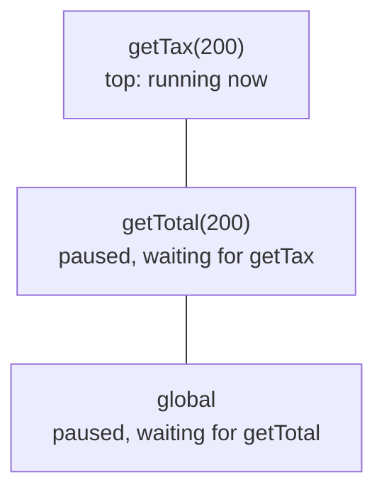

## The idea

Before JavaScript runs your code, it **reads it once** and makes room for every variable and function it finds. Only then does it run the code, line by line. Because of this first pass, you can sometimes use a name **above** the line that declares it. This is called **hoisting**.

Think of a **teacher with a class register**. Before the lesson starts, the teacher reads the list, so every name is already known. But who is actually present is only filled in once the lesson starts. Hoisting is the same: the names are known early, the values come later.

Nothing actually moves in your file. "Hoisting" is just a way to describe that first pass.

## Execution context

### What an execution context is

An **execution context** is the box JavaScript creates to run a piece of code. It holds:

- the **variables and functions** of that code,
- a link to the **outer scope** (the scope chain, see [var, let, const and Scope](./variables-and-scope.mdx)),
- the value of **`this`** (see [The this Keyword](../functions/this-keyword.mdx)).

There are two main kinds:

- The **global execution context**: made once, when the program starts.
- A **function execution context**: made **every time a function is called**, and thrown away when the function returns.

### The creation phase and the run phase

Every execution context is set up in two phases.

**1. The creation phase** (the first pass, before any line runs):

- `var` variables are created and set to **`undefined`**.
- Function declarations are created **in full**, so they can already be called.
- `let`, `const` and `class` names are created but **not set**. Touching them is an error (the temporal dead zone, below).
- `this` and the link to the outer scope are set.

**2. The run phase** (also called the execution phase):

- The code runs line by line. A variable gets its value when its line runs.

Let's trace a small program:

```js
console.log(price);
console.log(add(2, 3));

var price = 100;

function add(first, second) {
    return first + second;
}

console.log(price);
// Prints:
// undefined
// 5
// 100
```

| Step | What happens | `price` | `add` |
| --- | --- | --- | --- |
| Creation phase | memory is set up | `undefined` | the whole function |
| Line 1 runs | logs `price` | `undefined` | |
| Line 2 runs | calls `add(2, 3)`, logs 5 | `undefined` | |
| `var price = 100` runs | `price` gets its value | `100` | |
| Last line runs | logs `price` | `100` | |

## Hoisting, one by one

### var: hoisted as undefined

A `var` used above its line gives `undefined`, not an error.

```js
console.log(city); // undefined

var city = "Pune";

console.log(city); // Pune
```

JavaScript treats it as if the line were split in two: the declaration `var city;` goes to the top, and the assignment `city = "Pune";` stays where you wrote it.

```js
var city;

console.log(city); // undefined

city = "Pune";

console.log(city); // Pune
```

### Function declarations: hoisted in full

You can call a function declaration before the line where it's written. This is why many files put helper functions at the bottom.

```js
console.log(greet("Asha")); // Hello, Asha

function greet(name) {
    return "Hello, " + name;
}
```

### Function expressions and arrow functions: they follow their variable

A function stored in a variable is hoisted like the **variable**, not like a function. With `var`, the variable is `undefined` at that moment, and you can't call `undefined`:

```js
sayHi(); // TypeError: sayHi is not a function

var sayHi = function () {
    console.log("Hi");
};
```

With `let` or `const`, the variable is still locked:

```js
sayBye(); // ReferenceError: Cannot access 'sayBye' before initialization

const sayBye = () => {
    console.log("Bye");
};
```

### let and const: hoisted, but locked

```js
console.log(score); // ReferenceError: Cannot access 'score' before initialization

let score = 10;
```

Compare that with a name that doesn't exist at all:

```js
console.log(points); // ReferenceError: points is not defined
```

Read the two messages closely. **"Cannot access ... before initialization"** means JavaScript **knows** the name (it was hoisted), but it's locked for now. **"is not defined"** means the name doesn't exist anywhere.

### Classes: hoisted, but locked

Classes behave like `let`:

```js
const pet = new Dog(); // ReferenceError: Cannot access 'Dog' before initialization

class Dog {
    bark() {
        return "Woof";
    }
}
```

### Summary table

| What you write | Hoisted? | Its value before its line | Using it early gives |
| --- | --- | --- | --- |
| `var x = 1` | yes | `undefined` | `undefined`, no error |
| `let x = 1` / `const x = 1` | yes | not set (TDZ) | ReferenceError |
| `function x() {}` | yes, in full | the whole function | it works |
| `var x = function () {}` | only the variable | `undefined` | TypeError: x is not a function |
| `const x = () => {}` | yes | not set (TDZ) | ReferenceError |
| `class X {}` | yes | not set (TDZ) | ReferenceError |

## The temporal dead zone (TDZ)

### What the TDZ is

The **temporal dead zone** is the time between the start of a scope and the line where a `let`, `const` or `class` is declared. During that time, the name exists but is locked. Any use of it throws a ReferenceError.

"Temporal" means it's about **time** (when the code runs), not about where the line is in the file.

### It's about time, not position

A function can use a `let` variable that is written below it. That's fine, as long as the function is **called** after the variable's line has run.

```js
function showLimit() {
    console.log(limit);
}

let limit = 5;

// By now, the "let limit" line has run, so the TDZ is over.
showLimit(); // 5
```

Call it too early, and the same function fails:

```js
function showLimit() {
    console.log(limit);
}

showLimit(); // ReferenceError: Cannot access 'limit' before initialization

let limit = 5;
```

### typeof is not safe in the TDZ

`typeof` on a name that doesn't exist gives `"undefined"`, with no error. But in the TDZ, even `typeof` throws.

```js
console.log(typeof notDeclaredAnywhere); // undefined

console.log(typeof total); // ReferenceError: Cannot access 'total' before initialization

let total = 0;
```

### The shadowing trap

Interviewers love this one. What does it print?

```js
let message = "outer";

function show() {
    console.log(message);
    let message = "inner";
}

show(); // ReferenceError: Cannot access 'message' before initialization
```

Many people expect `"outer"`. But `show` has its **own** `message`, declared with `let` inside it. That inner `message` is hoisted to the top of the function, and it shadows the outer one from the very first line. On the `console.log` line, the inner `message` is still in its TDZ, so it throws.

With `var` instead of `let`, it prints `undefined`, not `"outer"`, for the same reason: the inner `var` is hoisted to the top of the function.

```js
var message = "outer";

function show() {
    console.log(message);
    var message = "inner";
}

show(); // undefined
```

### Why the TDZ exists

It catches bugs. Using a variable before it has a value is almost always a mistake. With `var`, you get a quiet `undefined` and the bug hides. With `let` and `const`, you get a loud error on the exact line. The TDZ also means a `const` is never seen with one value first and another value later.

## The call stack

### How JavaScript keeps track of function calls

JavaScript runs one thing at a time. To remember which function is running, it keeps a **call stack**: a stack of execution contexts. Like a stack of plates, the last one put on is the first one taken off.

- When the program starts, the **global** execution context goes on the stack.
- Each function **call** pushes a new execution context on top.
- When a function **returns**, its context is popped off, and the one below carries on from where it stopped.

```js
function getTax(price) {
    return price / 10;
}

function getTotal(price) {
    const tax = getTax(price);
    return price + tax;
}

const total = getTotal(200);
console.log(total); // 220
```

| Step | What happens | Call stack (bottom → top) |
| --- | --- | --- |
| 1 | The program starts | global |
| 2 | `getTotal(200)` is called | global, getTotal |
| 3 | `getTotal` calls `getTax(200)` | global, getTotal, getTax |
| 4 | `getTax` returns 20 | global, getTotal |
| 5 | `getTotal` returns 220 | global |

Here is the stack at step 3, its tallest moment. Only the top box is running. The boxes below it are paused, waiting for an answer.



### Stack overflow

The stack has a size limit. A function that calls itself with no way to stop keeps pushing until the stack is full:

```js
function countDown(number) {
    // Bug: no stop condition, so it never returns.
    countDown(number - 1);
}

countDown(10); // RangeError: Maximum call stack size exceeded
```

The fix is a **base case**: a condition where the function returns instead of calling itself again.

```js
function countDown(number) {
    if (number === 0) {
        console.log("Done");
        return;
    }

    countDown(number - 1);
}

countDown(3); // Done
```

### The stack trace

When an error is thrown, Node prints a **stack trace** under the message. It's a snapshot of the call stack at that moment, newest call first. It tells you which function called which.

```js
function getTax(order) {
    return order.price.amount;
}

function getTotal(order) {
    return getTax(order);
}

getTotal({}); // TypeError: Cannot read properties of undefined (reading 'amount')
```

Node prints something like this. Read it from the top: the error happened in `getTax`, which was called by `getTotal`.

```text
TypeError: Cannot read properties of undefined (reading 'amount')
    at getTax (app.js:2:24)
    at getTotal (app.js:6:12)
    ...
```

The call stack is also where async code starts: `setTimeout` callbacks and promises wait in queues until the stack is empty. See [The Event Loop](../async/event-loop.mdx).

## Common mistakes

- **"let and const are not hoisted."** They are. They're just locked in the TDZ until their line runs. The message proves it: "Cannot access 'x' before initialization", not "x is not defined".
- **"Hoisting moves code to the top."** Nothing moves. JavaScript sets up memory in a first pass.
- **Calling a function expression or an arrow function above its line.** Only function **declarations** are hoisted in full.
- **Thinking `typeof` is always safe.** In the TDZ, it throws too.
- **Expecting the outer value when an inner `let` has the same name.** The inner one is hoisted to the top of its scope and shadows the outer one from the first line.
- **Recursion without a base case.** It ends in "Maximum call stack size exceeded".

## In the interview

> "Before running code, JavaScript creates an execution context in two phases. In the creation phase it sets up memory: `var` variables get `undefined`, function declarations are stored in full, and `let`, `const` and classes are created but left uninitialized. Then the run phase executes the code line by line. So using a `var` early gives `undefined`, calling a function declaration early works, and touching a `let`, `const` or class early throws a ReferenceError, because it's in the temporal dead zone."

**Likely follow-up:** "Are `let` and `const` hoisted?"

**Answer:** "Yes, but they stay uninitialized until their line runs. The error message shows it: 'Cannot access x before initialization' means the name is known. And if a function has an inner `let message` and logs `message` above it, you get a TDZ error even when an outer `message` exists. If `let` weren't hoisted, it would just print the outer value."

**Likely follow-up:** "What is the call stack?"

**Answer:** "It's how JavaScript tracks which function is running. The global context is at the bottom. Every call pushes a new execution context, and every return pops it. Only the top one runs. If recursion never stops, the stack fills up and you get 'Maximum call stack size exceeded'."

<Callout title="Remember this" type="success">
  - Every execution context has a **creation phase** (set up memory) and a **run phase** (run line by line).
  - **`var`** is hoisted as `undefined`. **Function declarations** are hoisted in full, so you can call them early.
  - **`let`, `const` and `class`** are hoisted but locked in the **temporal dead zone**: "Cannot access 'x' before initialization".
  - A function in a `var` gives **"x is not a function"** if called early. In a `const`, it's a TDZ error.
  - In the TDZ, even **`typeof` throws**.
  - The **call stack** pushes a context on every call and pops it on return. Endless recursion: **"Maximum call stack size exceeded"**.
</Callout>
