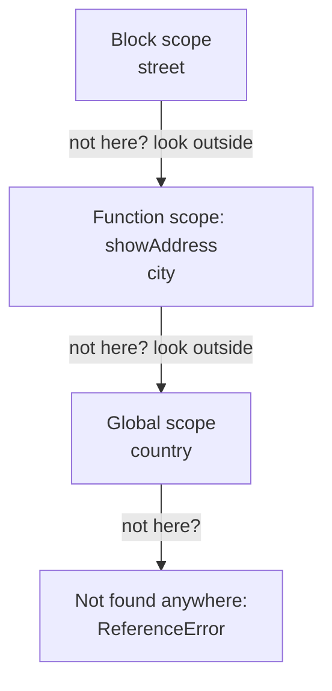

## The idea

A **variable** is a name for a value. **Scope** is the part of the code where that name can be seen and used.

Think of an **office building**. A note on your desk is seen only by you. A notice on your floor's board is seen by everyone on that floor. A poster in the lobby is seen by everyone in the building. People can only look **outward**: from your desk you can read the lobby poster, but people in the lobby can't read the note on your desk.

JavaScript works the same way. A **block** (your desk) sits inside a **function** (your floor), which sits inside the **global** scope (the lobby).

## var, let and const

### Three ways to make a variable

`let` and `var` can get a new value later. `const` can't.

```js
var city = "Pune";
let score = 10;
const country = "India";

city = "Delhi";
score = 20;

console.log(city); // Delhi
console.log(score); // 20
console.log(country); // India
```

Giving a `const` a new value is an error:

```js
const country = "India";

country = "Japan"; // TypeError: Assignment to constant variable.
```

Here is the full comparison:

| | `var` | `let` | `const` |
| --- | --- | --- | --- |
| Scope | function | block | block |
| Give it a new value | yes | yes | **no** |
| Declare the same name again | yes, silently | no: SyntaxError | no: SyntaxError |
| Use it above its line | gives `undefined` | ReferenceError | ReferenceError |
| Must get a value right away | no | no | **yes** |

The "use it above its line" row is called **hoisting**. It has its own page: [Hoisting and Execution Context](./hoisting-and-execution-context.mdx).

Two mistakes that are caught before the code even runs (so this block has no Run button):

```js noRun
let score = 10;
let score = 20; // SyntaxError: Identifier 'score' has already been declared

const country; // SyntaxError: Missing initializer in const declaration
```

`var` lets you declare the same name twice, with no warning. In a long file, that is a bug waiting to happen:

```js
var total = 100;

// Much later in the file, someone reuses the name by accident.
var total = 0;

console.log(total); // 0
```

### const does not mean "frozen"

`const` locks the **name**, not the **value**. If the value is an array or an object, you can still change what is inside it. You just can't point the name at a different array or object.

```js
const cart = ["apple"];

// Allowed: we change the array that cart points to.
cart.push("bread");
console.log(cart); // [ 'apple', 'bread' ]

// Not allowed: we try to point cart at a new array.
cart = []; // TypeError: Assignment to constant variable.
```

Why? A variable that holds an object really holds a **reference** to it (see [Value vs Reference](./value-vs-reference.mdx)). `const` only stops the reference from changing. To stop the object itself from changing, use `Object.freeze` (see [Objects in Depth](../objects-arrays/objects.mdx)).

### Which one to use

- **`const` by default.** Most values never need a new value, and `const` tells the reader that.
- **`let`** when the value has to change: a counter, a running total.
- **`var`**: not in new code. You still need to know how it works, because old code and interview questions are full of it.

## The three kinds of scope

### Global scope

A variable declared outside every function and block is **global**. All the code can see it.

```js
const appName = "Shop";

function showTitle() {
    // The function can see the global variable.
    console.log(appName);
}

showTitle(); // Shop
```

Too many globals cause bugs: any code can change them, and two files can pick the same name by accident.

One more difference: in a normal script, a global `var` also becomes a property of the global object (`window` in a browser). A global `let` or `const` doesn't. So `var appName = "Shop"` makes `window.appName` too.

### Function scope

A variable declared inside a function lives only inside that function. This is true for `var`, `let` and `const`.

```js
function makeOrder() {
    const orderId = 42;
    console.log(orderId);
}

makeOrder(); // 42

// Outside the function, orderId doesn't exist.
console.log(orderId); // ReferenceError: orderId is not defined
```

### Block scope

A **block** is any code between `{` and `}`: the body of an `if`, a loop, or just a pair of braces. `let` and `const` live only inside their block. `var` **ignores blocks**: it belongs to the whole function.

```js
function checkAge(age) {
    if (age >= 18) {
        var message = "adult";
        let note = "can vote";
    }

    // var leaked out of the if block.
    console.log(message);

    // let stayed inside it.
    console.log(note);
}

checkAge(20);
// Prints:
// adult
// ReferenceError: note is not defined
```

Loop variables work the same way:

```js
for (var i = 0; i < 3; i++) {
    // do some work
}

// var leaked out of the loop.
console.log(i); // 3

for (let count = 0; count < 3; count++) {
    // do some work
}

console.log(count); // ReferenceError: count is not defined
```

This difference causes a famous interview question. With `let`, every round of the loop gets its **own** `i`. With `var`, there is only **one** `i`, shared by every round.

```js
for (var i = 0; i < 3; i++) {
    setTimeout(() => {
        console.log("var:", i);
    }, 0);
}

for (let i = 0; i < 3; i++) {
    setTimeout(() => {
        console.log("let:", i);
    }, 0);
}
// Prints:
// var: 3
// var: 3
// var: 3
// let: 0
// let: 1
// let: 2
```

The timers run after both loops have finished. By then, the one shared `var i` is 3. Each `let i` kept its own value. The full story is in [Closures](../functions/closures.mdx).

### Forgetting to declare a variable

If you assign to a name you never declared, JavaScript quietly creates a **global** variable for you. A typo can create a global by accident:

```js
function setScore() {
    // Typo: we never declared "scroe".
    scroe = 10;
}

setScore();
console.log(scroe); // 10
```

**Strict mode** turns this into an error. Add `"use strict"` at the top of a file or function. Modules and classes are always in strict mode.

```js
function setScore() {
    "use strict";
    scroe = 10;
}

setScore(); // ReferenceError: scroe is not defined
```

## The scope chain

When code uses a name, JavaScript looks for it in the **current** scope first. If it's not there, it looks in the scope **outside** that one, then the next one out, all the way to the global scope. If the name isn't anywhere, you get a ReferenceError. This list of scopes is the **scope chain**.

```js
const country = "India";

function showAddress() {
    const city = "Pune";

    if (true) {
        const street = "MG Road";

        // street is found in the block.
        // city is not in the block, so it's found in the function.
        // country is found in the global scope.
        console.log(street, city, country);
    }
}

showAddress(); // MG Road Pune India
```



The search only goes **outward**, never inward. Code in the global scope can't see `city` or `street`.

## Shadowing

When an inner scope declares a variable with the **same name** as an outer one, the inner one **shadows** (hides) the outer one. Inside the inner scope, the name means the inner variable. The outer one doesn't change.

```js
const color = "red";

function paint() {
    const color = "blue";
    console.log(color);
}

paint(); // blue
console.log(color); // red
```

Shadowing is allowed, but it can hide bugs. Here, the code meant to update the outer `total`, but `let` created a new one:

```js
let total = 0;

function addToTotal(amount) {
    // Bug: "let" makes a NEW total that shadows the outer one.
    let total = amount;
}

addToTotal(50);
console.log(total); // 0
```

The fix is to drop the `let`: `total = amount;` then updates the outer variable.

One kind of shadowing is not allowed. A `var` inside a block can't shadow a `let` from outside it, because `var` tries to move up to the function scope, where the `let` already lives:

```js noRun
let level = 1;

{
    var level = 2; // SyntaxError: Identifier 'level' has already been declared
}
```

## Lexical scope

**Lexical** means "about where the code is written". A function's scope chain is decided by **where the function is written**, not by **where it is called** from.

```js
const city = "Delhi";

function showCity() {
    console.log(city);
}

function visitMumbai() {
    const city = "Mumbai";
    showCity();
}

visitMumbai(); // Delhi
```

Step by step:

| Step | What JavaScript does |
| --- | --- |
| 1 | `showCity` looks for `city` in its own scope. Not found. |
| 2 | It looks in its outer scope. `showCity` is **written** at the top level, so that's the global scope. |
| 3 | It finds `city = "Delhi"` there. |
| - | The `city` inside `visitMumbai` is never checked. |

To see Mumbai, the function has to be **written** inside `visitMumbai`:

```js
function visitMumbai() {
    const city = "Mumbai";

    // Written inside visitMumbai, so it can see visitMumbai's city.
    function showCity() {
        console.log(city);
    }

    showCity();
}

visitMumbai(); // Mumbai
```

Lexical scope is the base of **closures**: an inner function keeps access to the outer function's variables, even after the outer function has finished. See [Closures](../functions/closures.mdx).

## In the real world

- Most teams turn on the ESLint rules **`no-var`** and **`prefer-const`**. The editor then flags every `var`, and every `let` that is never given a new value.
- The ESLint rule **`no-shadow`** flags shadowed names, to catch bugs like the `addToTotal` one above.

## Common mistakes

- **Thinking `const` makes an object read-only.** It only stops reassignment. `cart.push(...)` still works.
- **Expecting `var` to stay inside an `if` or a loop.** It leaks out to the whole function.
- **The `var` loop with `setTimeout`.** All the callbacks share one `i` and print its final value. Use `let`.
- **Shadowing by accident.** `let total = ...` inside a function makes a new variable instead of updating the outer one.
- **Assigning to a name you never declared.** Outside strict mode, it quietly creates a global.
- **Thinking scope depends on where a function is called.** It depends on where the function is **written**.

## In the interview

> "`var` is function-scoped, and `let` and `const` are block-scoped. `var` can be declared twice and is `undefined` before its line. `let` and `const` throw a ReferenceError before their line, because of the temporal dead zone. `const` can't be reassigned, but if it holds an object, the object itself can still change. I use `const` by default, `let` when the value has to change, and never `var`."

**Likely follow-up:** "What does this print, and how do you fix it? `for (var i = 0; i < 3; i++) { setTimeout(() => console.log(i)); }`"

**Answer:** "It prints 3 three times. `var` makes one `i` for the whole function. The callbacks run after the loop has finished, and by then `i` is 3. Changing `var` to `let` fixes it: `let` makes a new `i` for every round of the loop, so the callbacks print 0, 1 and 2."

**Likely follow-up:** "What is lexical scope?"

**Answer:** "It means a function's scope is decided by where it's written in the code, not where it's called from. A function looks up names in its own scope, then in the scope it was written inside, and so on out to global. That's also why closures work."

<Callout title="Remember this" type="success">
  - **`var`** is function-scoped. **`let`** and **`const`** are block-scoped (they stay inside `{ }`).
  - **`const`** can't be reassigned, but an object or array in a `const` can still be changed.
  - Use **`const` by default**, `let` when the value changes, and never `var`.
  - **Scope chain:** JavaScript looks for a name in the current scope, then outward to global. Not found means **ReferenceError**.
  - **Shadowing:** an inner variable with the same name hides the outer one. The outer one doesn't change.
  - **Lexical scope:** where a function is **written** decides what it can see, not where it is called.
</Callout>
