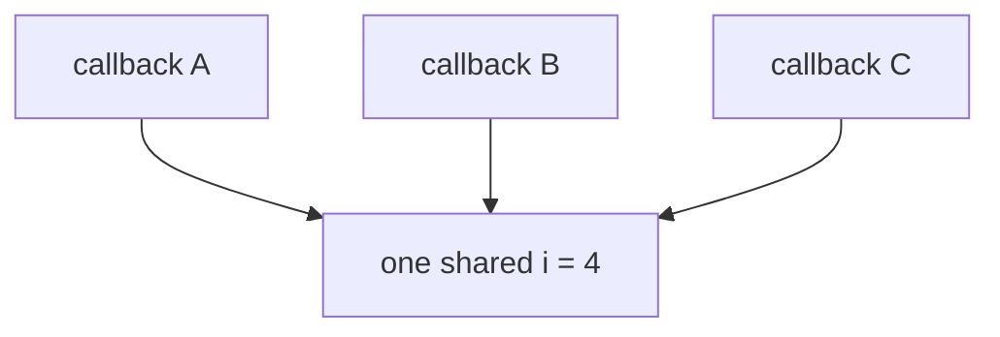
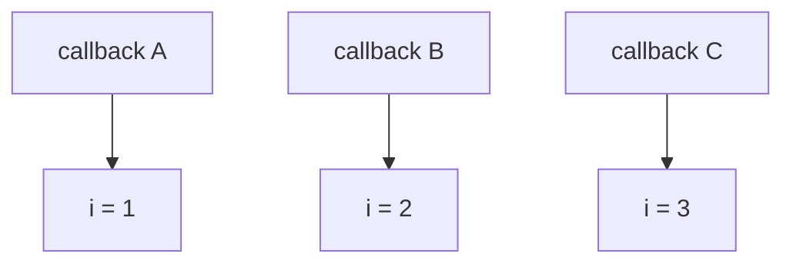

## The idea

A **closure** is a function plus the variables around the place where it was created. The function **remembers** those variables and can still use them later, even after the outer function has finished running.

Think of a **backpack**. When a function is created, it packs the variables around it into a backpack. Wherever the function goes later, it carries the backpack, and it can open it at any time.

You use closures all the time, often without noticing: every callback that reads a variable from outside itself is one. [Debounce](../write-your-own/debounce-and-throttle.mdx) keeps its `timer` in a closure. React's hooks, like `useState`, also depend on closures.

## What a closure is, step by step

### Step 1: an inner function can read outer variables

A function can use the variables of the function it's written inside. This is **lexical scope**: what a function can see is decided by **where it is written** in the code. See [var, let, const and Scope](../core-basics/variables-and-scope.mdx).

```js
function outer() {
    const message = "Hello";

    function inner() {
        // inner can see message, because it is written inside outer.
        console.log(message);
    }

    inner();
}

outer(); // Hello
```

### Step 2: the inner function still works after the outer one has finished

Now `makeGreeter` **returns** the inner function instead of calling it.

```js
function makeGreeter() {
    const message = "Hello";

    function greet() {
        console.log(message);
    }

    return greet;
}

const sayHello = makeGreeter();

// makeGreeter has finished, but greet still remembers message.
sayHello(); // Hello
```

Here is what happens:

| Step | What happens |
| --- | --- |
| 1 | `makeGreeter()` runs and creates the variable `message`. |
| 2 | It creates `greet`. `greet` keeps a link to `message`. |
| 3 | `makeGreeter` returns `greet` and finishes. |
| 4 | Normally `message` would be thrown away now. But `greet` still links to it, so it stays alive. |
| 5 | `sayHello()` runs `greet`, which reads `message` from its backpack. |

That link from `greet` to `message` is the closure.

### Step 3: a closure links to the variable, not a copy of its value

The closure doesn't take a photo of the value. It keeps a link to the **variable itself**. If the variable changes, the function sees the new value.

```js
function makeFruitLogger() {
    let fruit = "apple";

    function showFruit() {
        console.log(fruit);
    }

    // Change the variable after showFruit was created.
    fruit = "mango";

    return showFruit;
}

const logFruit = makeFruitLogger();
logFruit(); // mango
```

Keep this in mind. It's the reason for the loop bug below.

## Private variables and counters

A closure lets you hide data. The only way to reach the variable is through the functions you return. Nobody can change it directly.

```js
function createCounter() {
    // count is private: only the functions below can see it.
    let count = 0;

    return {
        increment() {
            count = count + 1;
            return count;
        },

        getCount() {
            return count;
        },
    };
}

const counter = createCounter();

console.log(counter.increment()); // 1
console.log(counter.increment()); // 2
console.log(counter.getCount()); // 2
console.log(counter.count); // undefined
```

`counter.count` is `undefined` because `count` is not a property of the object. It lives only in the closure.

Each call to `createCounter` runs the function again, so it makes a **new, separate** `count`:

```js
function createCounter() {
    let count = 0;

    return function () {
        count = count + 1;
        return count;
    };
}

const counterA = createCounter();
const counterB = createCounter();

console.log(counterA()); // 1
console.log(counterA()); // 2
console.log(counterB()); // 1
```

### A real-world example: a bank account

The balance can only change through `deposit` and `withdraw`, and they can check the amount first.

```js
function createAccount(startBalance) {
    let balance = startBalance;

    return {
        deposit(amount) {
            balance = balance + amount;
            return balance;
        },

        withdraw(amount) {
            // The rule lives here, and nobody can skip it.
            if (amount > balance) {
                return "Not enough money";
            }

            balance = balance - amount;
            return balance;
        },
    };
}

const account = createAccount(100);

console.log(account.deposit(50)); // 150
console.log(account.withdraw(500)); // Not enough money
console.log(account.withdraw(30)); // 120
```

### Another classic: a function that runs only once

Interviewers like this one. The closure remembers whether the function already ran, and its result.

```js
function once(func) {
    let hasRun = false;
    let result;

    return function (...args) {
        if (!hasRun) {
            hasRun = true;
            result = func(...args);
        }

        return result;
    };
}

const initialize = once(() => {
    console.log("Setting up...");
    return "ready";
});

console.log(initialize());
// Setting up...
// ready

console.log(initialize()); // ready
```

The second call skips the setup and just gives back the saved result.

## The classic loop-with-var bug

This is one of the most asked JavaScript questions. What does this print?

```js
for (var i = 1; i <= 3; i++) {
    setTimeout(function () {
        console.log(i);
    }, 100);
}
// 4
// 4
// 4
```

Most people expect `1 2 3`. It prints `4 4 4`. Two facts explain it:

1. `var` is **function-scoped**, not block-scoped. The whole loop has **one** `i`, shared by every round.
2. The callbacks run **later**, after the loop has finished. By then, `i` is `4`.

All three callbacks have a link to the **same** `i` (remember Step 3: a link, not a copy).



| When | `i` | What happens |
| --- | --- | --- |
| Round 1 | 1 | Schedule callback A. It links to `i`, not to the value 1. |
| Round 2 | 2 | Schedule callback B, linked to the same `i`. |
| Round 3 | 3 | Schedule callback C, linked to the same `i`. |
| Loop ends | 4 | `i++` made it 4, and `4 <= 3` is false, so the loop stops. |
| 100 ms later | 4 | A, B and C run. Each one reads `i` and gets 4. |

It isn't only about timers. Any function that runs after the loop has the same problem:

```js
var functions = [];

for (var i = 0; i < 3; i++) {
    functions.push(function () {
        return i;
    });
}

// The loop has finished, so the shared i is 3.
console.log(functions[0]()); // 3
console.log(functions[1]()); // 3
```

### Fix 1: use let

`let` is **block-scoped**. In a `for` loop, it gives **each round its own new `i`**. So each callback links to a different variable.

```js
for (let i = 1; i <= 3; i++) {
    setTimeout(function () {
        console.log(i);
    }, 100);
}
// 1
// 2
// 3
```

With `let`, each callback has its own `i`:



### Fix 2: an IIFE

This was the fix before `let` existed. An [IIFE](./functions.mdx) is a function that runs right away. We pass it the **current value** of `i` as a parameter. Each call makes its own parameter, so each callback gets its own copy.

```js
for (var i = 1; i <= 3; i++) {
    // Runs right now, with the value i has in this round.
    (function (current) {
        setTimeout(function () {
            console.log(current);
        }, 100);
    })(i);
}
// 1
// 2
// 3
```

### Fix 3: pass the value to setTimeout

`setTimeout` passes any extra arguments to the callback. The value is read **now**, during the loop.

```js
for (var i = 1; i <= 3; i++) {
    setTimeout(function (current) {
        console.log(current);
    }, 100, i);
}
// 1
// 2
// 3
```

In real code, just use `let`. Know the IIFE fix because interviewers ask "how would you fix it without `let`?".

## Closures and memory

A variable normally disappears when its function finishes. But if a closure still links to it, it **stays in memory** for as long as that closure can still be used.

This is usually what you want. It becomes a problem when a closure holds **something big** and the closure itself lives **forever**.

```js
function createReport() {
    // A big array: one million items.
    const bigData = new Array(1000000).fill("row");

    return function () {
        return bigData.length;
    };
}

let getSize = createReport();
console.log(getSize()); // 1000000

// While getSize exists, bigData can't be freed.
// Remove the last link, and the garbage collector can free it.
getSize = null;
```

Common ways this goes wrong:

- **A timer that is never cleared.** A `setInterval` callback lives until `clearInterval`, and so does everything it links to.
- **Listeners that are never removed.** The callback, and its backpack, stay alive.
- **Caches that only grow.** A memoize cache kept in a closure never forgets anything.

Modern engines usually keep only the outer variables an inner function actually uses, not every variable around it. See [Memory and Garbage Collection](../memory-errors/memory-and-garbage-collection.mdx).

## Common mistakes

- **Thinking a closure copies the value.** It links to the variable. If the variable changes, the closure sees the change.
- **`var` in a loop with callbacks that run later.** Every callback shares one `i`. Use `let`.
- **Thinking closures only happen when you return a function.** Any function that uses an outer variable has a closure, including callbacks you pass to `setTimeout` or `map`.
- **Expecting `counter.count` to work.** A variable in a closure is not a property of the returned object.
- **Keeping big data alive by accident** through a timer, listener or cache that is never cleaned up.

## In the interview

- Define it in one sentence, then show the counter.
- Expect the `var` loop question. Explain **why** (one shared variable, callbacks run after the loop), then give the fixes.

> "A closure is a function together with the variables from the scope where it was created. The function keeps a link to those variables, so it can still use them after the outer function has returned. For example, `createCounter` has a local `count` and returns a function that increments it. Each call to that function sees the same `count`, but nobody outside can touch it. That's how closures give us private state."

**Likely follow-up:** "Why does a `for` loop with `var` and `setTimeout` print `4 4 4`, and how do you fix it?"

**Answer:** "`var` is function-scoped, so the whole loop shares one `i`. The callbacks run after the loop has finished, when `i` is already 4, and they all link to that same variable. The fix is `let`, which creates a new `i` for each round. Without `let`, I can wrap the body in an IIFE that takes `i` as a parameter, so each callback gets its own copy."

<Callout title="Remember this" type="success">
  - A **closure** = a function + the variables from where it was **created**. It works even after the outer function returns.
  - It keeps a **link to the variable**, not a copy of the value.
  - Use it for **private state**: counters, bank accounts, `once`.
  - **`var` loop bug:** one shared `i`, callbacks run later, so `4 4 4`. Fix with **`let`** (a new `i` each round) or an **IIFE**.
  - Linked variables **stay in memory**. Clear timers and listeners so big data can be freed.
</Callout>
