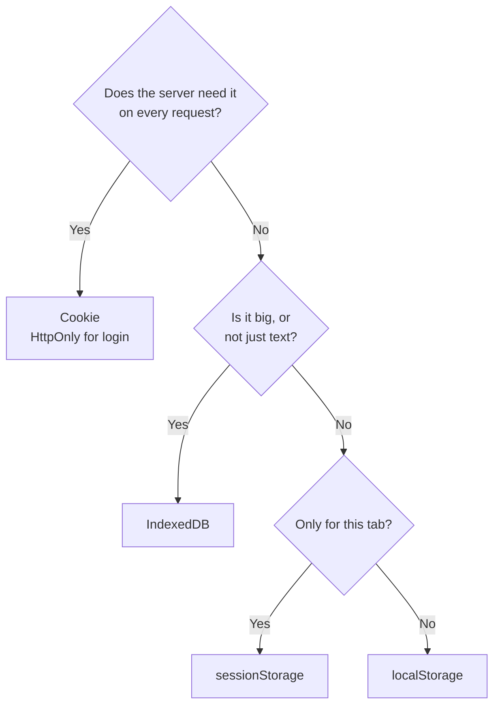

## The idea

A browser can save data **on the user's device**, so it's still there after a page reload. There are four main places, and each one fits a different job:

- **localStorage:** a notebook left on your desk. It stays until someone erases it.
- **sessionStorage:** a sticky note on one browser tab. It's thrown away when the tab closes.
- **Cookies:** a stamp on your hand at a club. You show it at the door **every time** you go in: the browser sends cookies to the server with every request.
- **IndexedDB:** a filing cabinet. It holds a lot of data, neatly organized, and you can search it.

These features (`localStorage`, `document.cookie`, `indexedDB`) exist only in browsers, not in Node.js. To try the code, paste it into your browser's DevTools console.

## setItem, getItem, removeItem and clear

### The four methods

`localStorage` and `sessionStorage` have the **same** methods. Data is saved as **key → value** pairs, per website.

```js noRun
localStorage.setItem("theme", "dark");

console.log(localStorage.getItem("theme")); // dark

// A key that doesn't exist gives null (not undefined).
console.log(localStorage.getItem("language")); // null

localStorage.removeItem("theme");
console.log(localStorage.getItem("theme")); // null

// Remove every key for this website.
localStorage.clear();
console.log(localStorage.length); // 0
```

| Method | What it does |
| --- | --- |
| `setItem(key, value)` | Save a value (or replace the old one) |
| `getItem(key)` | Read a value. `null` if the key isn't there |
| `removeItem(key)` | Delete one key |
| `clear()` | Delete all keys for this website |
| `length` | How many keys there are |
| `key(index)` | The name of the key at that position |

You can see and edit all of it in the browser's DevTools, under **Application → Storage** (in Chrome and Edge).

### Values are always strings

Storage only keeps **strings**. Anything else is turned into a string first. A number comes back as a string, and an object turns into the useless text `"[object Object]"`:

```js noRun
localStorage.setItem("count", 5);
const count = localStorage.getItem("count");

console.log(typeof count); // string
console.log(count + 1); // 51

localStorage.setItem("user", { name: "Asha" });
console.log(localStorage.getItem("user")); // [object Object]
```

The fix is [JSON](./json.mdx): `JSON.stringify` when you save, `JSON.parse` when you read.

```js noRun
const user = { name: "Asha", theme: "dark" };

localStorage.setItem("user", JSON.stringify(user));

const savedUser = JSON.parse(localStorage.getItem("user"));
console.log(savedUser.name); // Asha
```

### Two small helpers

In a real app, wrap this in two helpers. Reading needs care: the key may be missing (`null`), or the value may be broken text that `JSON.parse` can't read.

```js noRun
function saveJSON(key, value) {
    try {
        localStorage.setItem(key, JSON.stringify(value));
    } catch (error) {
        // setItem throws when storage is full, or blocked by the browser.
        console.log("Could not save " + key);
    }
}

function loadJSON(key, fallback) {
    const text = localStorage.getItem(key);

    if (text === null) {
        return fallback;
    }

    try {
        return JSON.parse(text);
    } catch (error) {
        return fallback;
    }
}

saveJSON("cart", [{ id: 1, quantity: 2 }]);

console.log(loadJSON("cart", [])); // [ { id: 1, quantity: 2 } ]
console.log(loadJSON("wishlist", [])); // []
```

A few more facts worth knowing:

- **Size:** about **5 MB** per website. The exact limit depends on the browser. When it's full, `setItem` throws an error.
- **It's synchronous:** every call blocks the page until it's done. Fine for small values, bad for big ones.
- **Per website:** each origin (protocol + domain + port, like `https://shop.com`) has its own storage. Other websites can't read it.
- **Tabs can listen:** when one tab changes `localStorage`, the **other** tabs of the same website get a `storage` event. Apps use this to log a user out in every tab at once.

```js noRun
// Runs in the OTHER tabs when this website's localStorage changes.
window.addEventListener("storage", (event) => {
    if (event.key === "token" && event.newValue === null) {
        console.log("Logged out in another tab");
    }
});
```

## localStorage vs sessionStorage

Same methods, different lifetime and sharing:

| | localStorage | sessionStorage |
| --- | --- | --- |
| How long it lasts | Until your code or the user clears it | Until the **tab is closed** |
| Survives a page reload | Yes | Yes |
| Shared between tabs | Yes: every tab of the same website | **No**: each tab has its own |
| Size | About 5 MB | About 5 MB |
| Sent to the server | No | No |
| Good for | Theme, language, a draft message, "remember my choice" | One tab's progress: the steps of a form, a one-time flow |

```js noRun
// A multi-step form keeps its progress only for this tab.
sessionStorage.setItem("checkoutStep", "2");

// Reload the page: still "2". Close the tab: gone.
console.log(sessionStorage.getItem("checkoutStep")); // 2
```

If the user opens the same site in two tabs, each tab has its **own** sessionStorage. So two checkouts in two tabs don't mix.

## Cookies and their flags

### What cookies are

A **cookie** is a small piece of text (about **4 KB** at most) that the browser stores for a website and **sends to the server with every request** to that website. That is the big difference: localStorage stays in the browser, but cookies travel to the server.

Their main job is **login sessions**. The server sets a cookie with a session ID, and the browser sends it back on every request, so the server knows who you are.

A server sets a cookie with a `Set-Cookie` header in its response:

```text
Set-Cookie: sessionId=abc123; HttpOnly; Secure; SameSite=Lax; Max-Age=3600; Path=/
```

### Cookies in JavaScript: document.cookie

JavaScript can also read and write cookies through `document.cookie`, which is a strange API. Writing to it **adds or updates one cookie**. It does not replace all the cookies.

```js noRun
// Each line adds ONE cookie. max-age is in seconds: 86400 = 1 day.
document.cookie = "theme=dark; max-age=86400; path=/";
document.cookie = "language=en; path=/";

// Reading gives ALL the cookies in one string.
console.log(document.cookie); // theme=dark; language=en

// To delete a cookie, set it again with max-age=0.
document.cookie = "theme=; max-age=0; path=/";
```

Reading gives you one long string, like `"theme=dark; language=en"`. To get one cookie, you split it yourself. Here is a small function that turns that string into an object:

```js
function parseCookies(cookieText) {
    const cookies = {};

    if (cookieText === "") {
        return cookies;
    }

    // Each cookie is separated by "; ".
    const pairs = cookieText.split("; ");

    for (const pair of pairs) {
        // Split at the FIRST "=" only: a value may contain "=" too.
        const separatorIndex = pair.indexOf("=");
        const name = pair.slice(0, separatorIndex);
        const value = pair.slice(separatorIndex + 1);

        cookies[name] = decodeURIComponent(value);
    }

    return cookies;
}

const cookies = parseCookies("theme=dark; language=en; token=a=b");

console.log(cookies.theme); // dark
console.log(cookies.token); // a=b
console.log(parseCookies("")); // {}
```

In the browser, you'd call it as `parseCookies(document.cookie)`. (`decodeURIComponent` turns codes like `%20` back into normal characters, such as a space.)

### The flags

Everything after the first `name=value` is a **flag** (also called an attribute). Flags control how long a cookie lives, and who gets to see it:

| Flag | What it does | Why it matters |
| --- | --- | --- |
| `Expires` / `Max-Age` | When the cookie expires | Without one, it's a **session cookie**: gone when the browser closes |
| `HttpOnly` | JavaScript **can't read it**: it's not in `document.cookie` | If a bad script gets into your page (XSS), it can't steal the session |
| `Secure` | Only sent over **HTTPS** | The cookie can't leak over a plain HTTP connection |
| `SameSite` | Whether it's sent with requests that come **from other websites** | Protects against CSRF (another site making requests as you) |
| `Domain` | Which domains get it (for example, also `api.shop.com`) | Without it, only the exact domain that set it |
| `Path` | Which paths get it, like `/admin` | Limits where it's sent |

`SameSite` has three values:

- **`Strict`:** never sent when the request comes from another site. Even clicking a link to your site from Google arrives without the cookie.
- **`Lax`:** sent when the user clicks a normal link to your site, but not with form posts, `fetch` calls or images from other sites. Chrome and Edge use `Lax` when a cookie doesn't say.
- **`None`:** always sent, even from other sites. It **must** also have `Secure`.

`HttpOnly` can only be set by the **server**, in the `Set-Cookie` header. If JavaScript writes a cookie with `HttpOnly` through `document.cookie`, the browser ignores it.

## IndexedDB for big data

**IndexedDB** is a real **database inside the browser**. Use it when localStorage is too small or too simple:

- It holds **much more** data: often hundreds of megabytes or more, depending on the browser and free disk space.
- It stores **real objects**, not just strings: numbers, arrays, Dates, even files and images.
- It's **asynchronous**, so big reads and writes don't freeze the page.
- It has **indexes**, so you can look things up by a field, like "all notes with this tag".

The built-in API is old-fashioned: it uses events instead of promises. Here is how to open a database and save one note:

```js noRun
// Open (or create) the "notes-app" database, version 1.
const request = indexedDB.open("notes-app", 1);

// Runs the first time, and whenever the version number goes up.
// This is the only place where you can create stores (like tables).
request.onupgradeneeded = () => {
    const database = request.result;
    database.createObjectStore("notes", { keyPath: "id" });
};

request.onsuccess = () => {
    const database = request.result;

    // Every read or write happens inside a transaction.
    const transaction = database.transaction("notes", "readwrite");
    const notes = transaction.objectStore("notes");

    notes.put({ id: 1, text: "Buy milk", createdAt: new Date() });
};
```

Reading it back works the same way: a request, then a `success` event.

```js noRun
// Inside onsuccess, after opening the database:
const transaction = database.transaction("notes", "readonly");
const notes = transaction.objectStore("notes");
const getRequest = notes.get(1);

getRequest.onsuccess = () => {
    console.log(getRequest.result.text); // Buy milk
};
```

Because the raw API is clumsy, most apps use a small library that wraps it in promises, like **idb** or **Dexie.js**. Then saving looks like `await db.put("notes", note)`.

**In the real world:** web apps that work **offline** keep their data in IndexedDB: email, notes and document apps save your data there, and sync with the server when you're back online.

## What to store where, and what never to store

### What to store where

| | localStorage | sessionStorage | Cookies | IndexedDB |
| --- | --- | --- | --- | --- |
| Size | About 5 MB | About 5 MB | About 4 KB each | Large: hundreds of MB or more |
| Lasts | Until cleared | Until the tab closes | Until it expires | Until cleared |
| Sent to the server | No | No | **Yes, every request** | No |
| JavaScript can read it | Yes | Yes | Yes, unless `HttpOnly` | Yes |
| API | Simple, sync, strings only | Simple, sync, strings only | One clumsy string | Async, real objects |
| Good for | Theme, language, small preferences, drafts | One tab's temporary state | The login session (HttpOnly) | Offline data, big lists, files |

A quick way to choose:



### What never to store

- **Passwords, card numbers or other secrets.** Not in any browser storage. It's saved on the disk without encryption, and anyone using that computer can open DevTools and read it.
- **Login tokens in localStorage (with care).** Any JavaScript on the page can read localStorage. If a bad script gets in (XSS), it can read the token and send it anywhere. An **`HttpOnly` + `Secure` + `SameSite`** cookie is safer, because scripts can't read it at all. (Cookies need their own protection against CSRF, which `SameSite` mostly gives.)
- **Anything you trust without checking.** Users can change every value in DevTools. Never save `isAdmin: true` in storage and believe it. The **server** must check who the user is and what they may do.
- **Big data in localStorage.** It's small and synchronous, so large values slow the page down. Use IndexedDB.

## Common mistakes

- **Saving an object without `JSON.stringify`.** You get `"[object Object]"` back, and the data is gone.
- **Forgetting values come back as strings.** `"5" + 1` is `"51"`. Convert with `Number(value)` or `JSON.parse`.
- **Not handling `null`.** `getItem` gives `null` for a missing key. `JSON.parse(null)` is `null`, and then `savedUser.name` throws a TypeError.
- **Thinking sessionStorage is shared between tabs.** Each tab has its own.
- **Using localStorage during server-side rendering.** In Next.js, code that runs on the server throws `ReferenceError: localStorage is not defined`. Read storage only in code that runs in the browser, like inside `useEffect`.
- **Expecting `document.cookie = "..."` to replace all cookies.** It sets one cookie. To delete one, set it with `max-age=0`.
- **Keeping a login token where any script can read it**, and trusting values a user can edit.

## In the interview

> "localStorage and sessionStorage are simple key-value stores, about 5 MB, strings only, so I save objects with `JSON.stringify` and read them with `JSON.parse`. localStorage stays until it's cleared and is shared by all tabs of the site. sessionStorage is per tab and is gone when the tab closes. Cookies are tiny, about 4 KB, and they're sent to the server with every request, which is why they're used for login sessions. Flags like `HttpOnly`, `Secure` and `SameSite` keep them safe. For large or structured data, or offline apps, I'd use IndexedDB, which is an async database in the browser."

**Likely follow-up:** "Where would you store a login token, like a JWT?"

**Answer:** "Ideally in a cookie with `HttpOnly`, `Secure` and `SameSite=Lax` or `Strict`. `HttpOnly` means no JavaScript can read it, so an XSS attack can't steal it, and `SameSite` stops most CSRF attacks. In localStorage, any script on the page can read the token. If a team still uses localStorage, the token should be short-lived, and preventing XSS becomes even more important."

<Callout title="Remember this" type="success">
  - `setItem`, `getItem` (gives `null` if missing), `removeItem`, `clear`. Values are **strings only**: use `JSON.stringify` and `JSON.parse`.
  - **localStorage** stays until cleared and is shared by all tabs. **sessionStorage** is per tab and is gone when the tab closes. Both are about 5 MB.
  - **Cookies** are about 4 KB and are **sent to the server with every request**. `HttpOnly` = JavaScript can't read it, `Secure` = HTTPS only, `SameSite` = protection against CSRF.
  - **IndexedDB:** a large, async database in the browser, for offline data and big or structured data.
  - **Never** store passwords or secrets. Login tokens are safest in an `HttpOnly` cookie. Users can edit all storage, so the server must check.
</Callout>
