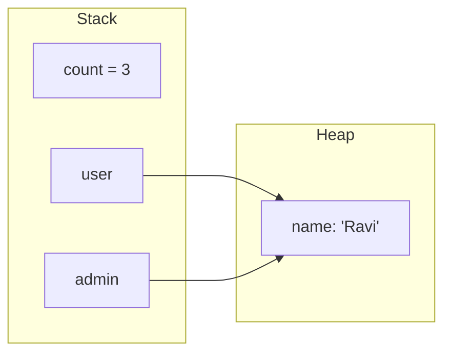
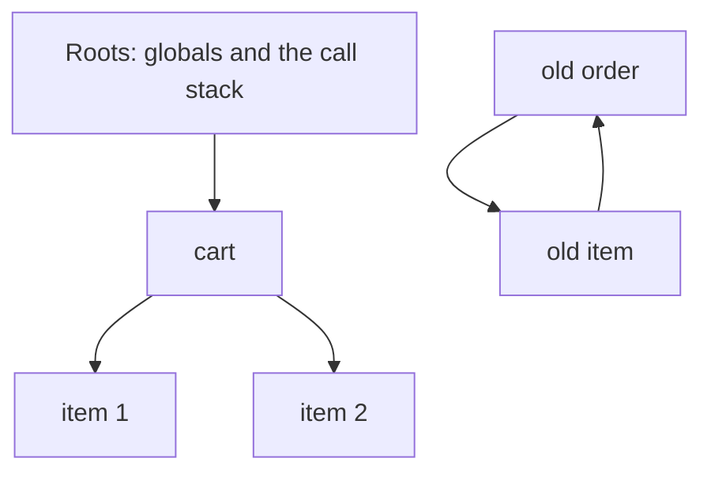

## The idea

In JavaScript you never free memory yourself. You create values, and the engine finds room for them. Later, a **garbage collector** (GC) frees every value your code **can no longer reach**.

Think of a **coat check**. You hand in your coat and get a ticket. As long as someone holds a ticket, the coat stays. When no ticket points to a coat any more, the staff can clear it away. A **memory leak** is a pocket full of old tickets for coats you will never pick up: the coats can't be cleared, and the room fills up.

## How it works

### Stack vs heap

JavaScript keeps values in two places.

- The **stack** is small, fast and tidy. Each function call gets a **frame** on it, holding the call's simple values: numbers, booleans and the like. When the function returns, its frame is thrown away at once.
- The **heap** is big and has no order. **Objects, arrays and functions** live here. A variable doesn't hold the object itself, only a **reference** (an address) to it.

```js
let count = 3;
let copy = count;
copy = 10;
console.log(count); // 3

const user = { name: "Asha" };
const admin = user;
admin.name = "Ravi";
console.log(user.name); // Ravi
```

`copy` got its own copy of the number. But `user` and `admin` hold the **same reference**, so they point to one object in the heap:



| | Stack | Heap |
| --- | --- | --- |
| Holds | function frames, simple values, references | objects, arrays, functions |
| Size | small | large |
| Freed | right away, when the function returns | later, by the garbage collector |
| When it is full | `RangeError: Maximum call stack size exceeded` | "JavaScript heap out of memory" (the app crashes) |

This is the simple model interviewers expect. Real engines are a bit more clever (for example, a variable used by a closure moves to the heap), but you don't need that detail. For how copying works, see [Value vs Reference](../core-basics/value-vs-reference.mdx).

The stack fills up fastest with a function that calls itself forever:

```js
function countDown(number) {
    // No stopping point, so the calls never end.
    return countDown(number - 1);
}

try {
    countDown(10);
} catch (error) {
    console.log(error.name); // RangeError
    console.log(error.message); // Maximum call stack size exceeded
}
```

### Mark-and-sweep garbage collection

The garbage collector asks one question about each value: **can the program still reach it?**

It starts from the **roots**: the global variables, and the local variables of every function still running on the stack. Then it works in two steps:

1. **Mark:** start at the roots and follow every reference, then every reference inside those, and so on. Mark every value you reach.
2. **Sweep:** free every value that was **not** marked.



The solid boxes can be reached from the roots, so they stay. The dashed boxes point to **each other**, but nothing from the roots reaches them, so both are freed.

When you remove the last reference to an object, it becomes garbage:

```js
let user = { name: "Asha" };

// Now nothing points to the object. The GC can free it later.
user = null;

console.log(user); // null
```

Objects that point to each other (a **cycle**) are no problem either:

```js
function makePair() {
    const first = { name: "first" };
    const second = { name: "second" };

    // They point to each other: a cycle.
    first.partner = second;
    second.partner = first;

    console.log(first.partner.partner.name); // first
}

makePair();
// The function has returned. Nothing reaches the pair now, so both are freed.
```

Old browsers like Internet Explorer 6 and 7 used **reference counting** for some objects: free an object when nothing points to it. A cycle always has something pointing to it, so it was never freed. Mark-and-sweep only cares about reaching the object **from the roots**, so cycles are freed fine.

A few more facts worth knowing:

- Your code **can't** start the GC (only debugging tools can, like the trash icon in DevTools), and you can't know exactly when it runs. `user = null` only removes **one** reference.
- Engines like **V8** (Chrome and Node.js) split the heap in two. New objects go to a small **young** area that is cleaned often and fast, because most objects are needed only for a moment. Objects that survive a few cleanings move to the **old** area, which is cleaned less often.
- While the GC works, your code can pause. V8 does much of the work in small steps or on other threads, so these pauses stay short.

### Common memory leaks

A **memory leak** is memory you no longer need that is **still reachable**. The GC can't free it, because as far as it can see, you might still use it. Here are the usual causes in plain JavaScript.

#### 1. Timers you never stop

A `setInterval` keeps its callback alive until you clear it. Everything the callback uses stays alive too.

```js
function startPolling() {
    // A big array: one million numbers.
    const bigData = new Array(1000000).fill(0);

    const timerId = setInterval(() => {
        console.log("Items:", bigData.length);
    }, 1000);

    return timerId;
}

const timerId = startPolling();

// The fix: stop the timer when you no longer need it.
// Then the callback, and bigData with it, can be freed.
setTimeout(() => {
    clearInterval(timerId);
    console.log("Stopped");
}, 3500);

// Items: 1000000
// Items: 1000000
// Items: 1000000
// Stopped
```

Without the `clearInterval`, the timer runs forever, and `bigData` can never be freed.

#### 2. Closures that hold more than they need

A [closure](../functions/closures.mdx) keeps the outer variables it **uses** alive, for as long as the closure itself lives. If it uses a huge array only to read one number, the whole array stays.

```js
function createReporterLeaky() {
    const hugeLog = new Array(1000000).fill("log line");

    // Uses hugeLog, so the whole array stays alive with this function.
    return function report() {
        return "Lines: " + hugeLog.length;
    };
}

function createReporter() {
    const hugeLog = new Array(1000000).fill("log line");
    const lineCount = hugeLog.length;

    // Uses only the number, so hugeLog can be freed.
    return function report() {
        return "Lines: " + lineCount;
    };
}

console.log(createReporterLeaky()()); // Lines: 1000000
console.log(createReporter()()); // Lines: 1000000
```

Both print the same thing. But if you keep `report` around for a long time, the first one also keeps a million strings around.

#### 3. A cache that only grows

A `Map` used as a cache keeps **every** key and value forever, unless you remove them.

```js
const cache = new Map();

function getProfile(userId) {
    if (cache.has(userId)) {
        return cache.get(userId);
    }

    const profile = { id: userId, bio: "Some long text" };
    cache.set(userId, profile);
    return profile;
}

for (let id = 1; id <= 10000; id++) {
    getProfile(id);
}

// It never shrinks.
console.log(cache.size); // 10000
```

The fix is a **size limit**. When the cache is full, remove the oldest entry first. (An LRU cache goes further and removes the entry used least recently.)

```js
const MAX_ENTRIES = 100;
const cache = new Map();

function remember(key, value) {
    if (cache.size >= MAX_ENTRIES) {
        // A Map keeps keys in the order they were added,
        // so the first key is the oldest one.
        const oldestKey = cache.keys().next().value;
        cache.delete(oldestKey);
    }

    cache.set(key, value);
}

for (let id = 1; id <= 10000; id++) {
    remember(id, { id: id });
}

console.log(cache.size); // 100
```

When the key is an **object**, and the data should live only as long as that object, use a **WeakMap**. A WeakMap doesn't keep its keys alive: when nothing else points to the key object, the GC frees it, and its entry disappears too. See [Map, Set and WeakMap](../modern-js/map-set-weakmap.mdx).

```js
const lastSeen = new WeakMap();

let user = { name: "Asha" };
lastSeen.set(user, "today");
console.log(lastSeen.get(user)); // today

// The only reference to the user is gone.
// The GC can free the object, and its WeakMap entry goes with it.
user = null;
```

#### 4. Listeners you never remove

An event emitter (like Node's `EventEmitter`) keeps a list of listener functions. A listener stays in that list until you remove it, and so does everything the listener uses. Here a long-lived `priceStore` gets a new listener every time a screen opens, and no screen ever removes its listener.

```js
// A tiny emitter: it keeps a set of listener functions.
class Emitter {
    constructor() {
        this.listeners = new Set();
    }

    on(listener) {
        this.listeners.add(listener);
    }
}

// This store lives as long as the whole app.
const priceStore = new Emitter();

function openPriceScreen() {
    const chartData = new Array(100000).fill(0);

    // The listener uses chartData, so the store now keeps chartData alive.
    priceStore.on((price) => chartData.push(price));
}

openPriceScreen();
openPriceScreen();
openPriceScreen();

// Every old screen is still in memory.
console.log(priceStore.listeners.size); // 3
```

The fix: make `on()` return a function that removes the listener. The screen keeps it, and calls it when the screen closes.

```js
class Emitter {
    constructor() {
        this.listeners = new Set();
    }

    // Adds a listener, and returns a function that removes it again.
    on(listener) {
        this.listeners.add(listener);

        return () => {
            this.listeners.delete(listener);
        };
    }
}

const priceStore = new Emitter();

function openPriceScreen() {
    const chartData = new Array(100000).fill(0);
    const stopListening = priceStore.on((price) => chartData.push(price));

    return stopListening;
}

const closeFirst = openPriceScreen();
const closeSecond = openPriceScreen();
console.log(priceStore.listeners.size); // 2

closeFirst();
closeSecond();
// Nothing holds the screens now.
console.log(priceStore.listeners.size); // 0
```

Many libraries work exactly like this. Redux's `store.subscribe(listener)` returns an unsubscribe function, for the same reason.

#### 5. Accidental global variables

In non-strict code, assigning to a name you never declared creates a **global** variable. A global is a root, so it lives until the page or the process ends.

```js
function addToTotal(price) {
    // Oops: no let or const. This creates a global variable.
    total = price;
}

addToTotal(5);
console.log(globalThis.total); // 5
```

The fix: always declare with `let` or `const`. In **strict mode** and in modules (which are strict by default), this line throws a `ReferenceError` instead, so you find the bug at once.

#### 6. Detached DOM elements (in the browser)

You remove an element from the page, but your code still keeps it in a variable, an array or a Map. The element is now **detached**: it is gone from the screen, but it stays in memory, with everything inside it. The fix: when you remove the element, drop your own reference to it too (remove it from the array, or set the variable to `null`).

### Finding leaks

**The signs:** memory keeps going **up** and never comes back down. The app gets slower over time. A Node.js server crashes with "JavaScript heap out of memory" after running for hours. A browser tab crashes.

**The tool:** the **Memory** tab in Chrome DevTools. It also works for Node.js: start Node with `node --inspect`, open `chrome://inspect` in Chrome, and click your process.

The usual steps:

1. Take a **heap snapshot**. It is a list of every object in memory right now.
2. Do the action you suspect several times. For example, open and close a screen five times.
3. Click the **trash icon** to run the GC, then take a second snapshot.
4. Compare the two snapshots. Objects whose count keeps **growing** are the suspects.
5. Click one, and look at its **Retainers**: the chain of references that keeps it alive, back to a root. That chain points straight at the bug: a timer, a listener, a cache.

In Node.js you can also print the heap size from your code, to watch it over time:

```js noRun
function logMemory(label) {
    const usage = process.memoryUsage();
    const megabytes = Math.round(usage.heapUsed / 1024 / 1024);

    console.log(label, megabytes, "MB");
}

logMemory("Before");
// ... run the suspected code many times ...
logMemory("After");
```

If the number keeps climbing every time you repeat the same work, something is holding on to memory.

## Common mistakes

- **Thinking `obj = null` or `delete obj.key` frees memory right away.** It only removes one reference. The GC frees the object later, and only if nothing else points to it.
- **Thinking cycles leak.** Mark-and-sweep frees objects that point to each other, as long as the roots can't reach them.
- **Thinking every closure leaks.** A closure keeps only what it uses, and only while the closure itself is alive.
- **A cache with no limit.** It grows until the process runs out of memory.
- **Forgetting `clearInterval`, or forgetting to remove a listener.** The callback and everything it uses stay alive.
- **Expecting a WeakMap to have `.size` or a loop.** It has neither, because its entries can disappear at any time.

## In the interview

> "JavaScript frees memory automatically with a garbage collector. Simple values sit in the call stack and are dropped when the function returns. Objects live in the heap. The collector uses mark-and-sweep: it starts from the roots, which are the globals and the current call stack, marks everything it can reach, and frees the rest. So what matters is **reachability**, and that's why cycles are fine. A leak is memory that's still reachable but no longer needed: a timer that's never cleared, a listener that's never removed, a cache that only grows, or an accidental global."

**Likely follow-up:** "How would you find a memory leak?"

**Answer:** "I'd first confirm memory keeps growing, with `process.memoryUsage()` in Node or the Performance monitor in Chrome. Then I'd use heap snapshots in the DevTools Memory tab: take one, repeat the suspected action several times, force a GC, take another, and compare. The objects that keep growing are the suspects, and their Retainers show me which reference keeps them alive."

**Likely follow-up:** "When would you use a WeakMap?"

**Answer:** "When I want to attach data to an object without keeping that object alive. A WeakMap doesn't hold its keys strongly, so when the object is gone, its entry goes too. That makes it good for caches keyed by objects."

<Callout title="Remember this" type="success">
  - **Stack:** function frames and simple values, freed when the function returns. **Heap:** objects, freed by the GC.
  - **Mark-and-sweep:** start from the roots (globals and the call stack), mark what you can reach, free the rest.
  - What matters is **reachability**. Cycles that can't be reached are freed too.
  - A **leak** is memory you don't need but can still reach: timers, listeners, growing caches, closures, accidental globals.
  - Fix leaks with `clearInterval`, removing listeners, a cache size limit, and **WeakMap** for data tied to an object.
  - Find leaks with **heap snapshots**: compare before and after, then follow the **Retainers**.
</Callout>
