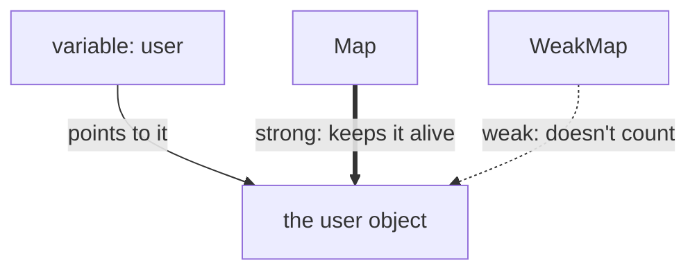

## The idea

A **Map** stores **key → value** pairs, and the key can be **anything**, even an object. A **Set** stores a list of **unique** values: each value appears only once. **WeakMap** and **WeakSet** are like Map and Set, but they hold their keys **weakly**: they don't stop an object from being cleaned out of memory.

Everyday examples:

- **Map:** a coat check. You hand over a ticket (the key) and get your coat (the value).
- **Set:** a guest list. Each name is on it once. Writing a name twice changes nothing.
- **WeakMap:** a sticky note on a box. When the box is thrown away, the note goes with it.

## Map vs object, Set vs array

### Map: key-value pairs

A Map has a small, clear set of methods:

```js
const prices = new Map();

prices.set("apple", 30);
prices.set("mango", 80);

console.log(prices.get("apple")); // 30
console.log(prices.has("mango")); // true
console.log(prices.size); // 2

prices.delete("apple");
console.log(prices); // Map(1) { 'mango' => 80 }
```

| Method | What it does |
| --- | --- |
| `map.set(key, value)` | Add or update a pair |
| `map.get(key)` | Get the value, or `undefined` if the key isn't there |
| `map.has(key)` | `true` or `false` |
| `map.delete(key)` | Remove a pair |
| `map.size` | How many pairs (a property, not a method) |
| `map.clear()` | Remove everything |

The big difference from an object: **any value can be a key**, even an object. An object turns every key into a **string**.

```js
const asha = { name: "Asha" };
const ravi = { name: "Ravi" };

const visits = new Map();
visits.set(asha, 3);
visits.set(ravi, 5);

console.log(visits.get(asha)); // 3
console.log(visits.get(ravi)); // 5
```

Try the same with a plain object. Both objects become the same string key, `"[object Object]"`, so Ravi overwrites Asha:

```js
const asha = { name: "Asha" };
const ravi = { name: "Ravi" };

const visits = {};
visits[asha] = 3;
visits[ravi] = 5;

console.log(Object.keys(visits)); // [ '[object Object]' ]
console.log(visits[asha]); // 5
```

A Map remembers the **order** you added the keys, and you can loop over it directly. Each item is a `[key, value]` pair:

```js
// You can also fill a Map from a list of [key, value] pairs.
const prices = new Map([
    ["apple", 30],
    ["mango", 80],
]);

for (const [fruit, price] of prices) {
    console.log(fruit, price);
}
// apple 30
// mango 80
```

To switch between the two: `new Map(Object.entries(object))` turns an object into a Map, and `Object.fromEntries(map)` turns a Map back into an object.

### Map vs object

| | Object | Map |
| --- | --- | --- |
| Key types | Strings and symbols only. Others become strings | **Anything**: objects, functions, numbers |
| Order of keys | Number-like keys first (sorted), then the rest in insertion order | Always **insertion order** |
| Size | `Object.keys(object).length` | `map.size` |
| Looping | Through `Object.entries(object)` | `for...of` directly |
| Keys you didn't add | Inherits keys like `toString` and `constructor` | None: it starts empty |
| Adding and removing often | Fine, but not what it's built for | Built for it |
| JSON | `JSON.stringify` works | Becomes `{}`. Convert it first |
| Best for | Fixed records: a user, settings, a config | Lookups that grow and shrink, non-string keys |

The order rule surprises people. Keys that look like whole numbers always come first:

```js
const scores = { b: 1, 2: "two", a: 3, 1: "one" };

console.log(Object.keys(scores)); // [ '1', '2', 'b', 'a' ]
```

And an object comes with keys you never added, inherited from `Object.prototype`. That can break a word counter:

```js
const counts = {};

// "constructor" is already there: it's a function every object inherits.
console.log(counts["constructor"]); // [Function: Object]

const countMap = new Map();
console.log(countMap.get("constructor")); // undefined
```

A rule of thumb: use an **object** for a record with known fields, like `user.name` and `user.age`. Use a **Map** for a dictionary where keys come from data, like word counts or "user id → user".

### Set: unique values

A Set keeps each value **once**. Adding a value that is already there does nothing.

```js
const tags = new Set();

tags.add("js");
tags.add("css");
tags.add("js");

console.log(tags); // Set(2) { 'js', 'css' }
console.log(tags.has("css")); // true
console.log(tags.size); // 2

tags.delete("css");
console.log(tags); // Set(1) { 'js' }
```

The most famous one-liner in interviews: **remove duplicates** from an array. Put the items in a Set, then spread it back into an array:

```js
const numbers = [3, 1, 3, 2, 1];

const unique = [...new Set(numbers)];

console.log(unique); // [ 3, 1, 2 ]
```

How a Set decides "same value": primitives by value (`NaN` counts as equal to `NaN`), objects by **reference**. Two objects that look the same are still two different objects:

```js
const users = new Set();

users.add({ id: 1 });
users.add({ id: 1 });

console.log(users.size); // 2
```

To find the values two Sets share, check each value of one Set against the other:

```js
const frontend = new Set(["js", "css", "react"]);
const backend = new Set(["js", "node", "sql"]);

const shared = [];
for (const skill of frontend) {
    if (backend.has(skill)) {
        shared.push(skill);
    }
}

console.log(shared); // [ 'js' ]
```

Since ES2025, Sets also have built-in methods for this (Node.js 22+ and current browsers). `frontend.intersection(backend)` gives back a new Set: `Set(1) { 'js' }`. There are also `union`, `difference`, `symmetricDifference` and `isSubsetOf`.

### Set vs array

| | Array | Set |
| --- | --- | --- |
| Duplicates | Allowed | Never |
| Order | By index | Insertion order, but no index |
| "Is this value in it?" | `array.includes(value)`: **O(n)**, checks each item | `set.has(value)`: **O(1)** on average |
| Get by position | `array[0]` | Not possible. Spread it into an array first |
| Remove a value | `splice` or `filter`: O(n) | `set.delete(value)`: O(1) |
| Methods | Many: `map`, `filter`, `sort`... | Few. Spread into an array to use `map` or `filter` |

Use a **Set** for "have I seen this before?" checks and for unique values. Use an **array** when order, positions or duplicates matter. In a loop, `set.has` instead of `array.includes` can turn an O(n²) solution into O(n).

## WeakMap and WeakSet

### WeakMap

A **WeakMap** is a Map with three rules:

1. Keys **must be objects**. A string or number key throws a TypeError. (Since 2023, a symbol can be a key too, unless it was made with `Symbol.for`.)
2. It holds its keys **weakly**: if nothing else in the program uses a key object, the object can be removed from memory, and its entry disappears with it.
3. It has only `set`, `get`, `has` and `delete`. There's **no** `size`, no `clear`, and you **can't loop** over it.

```js
const lastSeen = new WeakMap();

const user = { name: "Asha" };
lastSeen.set(user, "today");

console.log(lastSeen.get(user)); // today
console.log(lastSeen.has(user)); // true

try {
    lastSeen.set("Asha", "today");
} catch (error) {
    console.log(error.message); // Invalid value used as weak map key
}
```

### WeakSet

A **WeakSet** is the same idea for a Set: it holds **objects only**, weakly, with just `add`, `has` and `delete`. It's good for **marking** objects ("I've already handled this one") without keeping them alive.

```js
const handled = new WeakSet();

function handleOrder(order) {
    if (handled.has(order)) {
        console.log("Already handled order " + order.id);
        return;
    }

    handled.add(order);
    console.log("Handling order " + order.id);
}

const order = { id: 7 };

handleOrder(order); // Handling order 7
handleOrder(order); // Already handled order 7
```

| | Map / Set | WeakMap / WeakSet |
| --- | --- | --- |
| Keys (or values) | Anything | Objects only |
| Keeps the object in memory | Yes (a strong reference) | No (a weak reference) |
| `size`, looping, `clear` | Yes | No |
| Use for | Normal lookups and lists | Extra data or marks on objects, which should vanish with the object |

## Garbage collection and weak references

### Why a normal Map can leak memory

JavaScript frees memory for you. The **garbage collector** (GC) looks for objects that nothing can reach anymore, and removes them. (More in [Memory and Garbage Collection](../memory-errors/memory-and-garbage-collection.mdx).)

A key in a Map is a **strong reference**: as long as the Map is alive, its keys stay alive. Even when the rest of your code is done with an object, the Map still holds it:

```js
let user = { name: "Asha" };

const cache = new Map();
cache.set(user, "some data");

// We are done with the user...
user = null;

// ...but the Map still holds the object, so it can never be freed.
console.log(cache.size); // 1
```

A key in a WeakMap is a **weak reference**: it **doesn't count** when the GC checks if an object is still used.



- With a **Map**: after `user = null`, the Map's arrow still points at the object. It stays in memory forever (a **memory leak**), unless you `delete` it yourself.
- With a **WeakMap**: after `user = null`, only the weak arrow is left. The GC can free the object, and the WeakMap entry goes away by itself.

### Why you can't loop over a WeakMap

The GC runs **whenever the engine decides**, not at a moment you control. So the content of a WeakMap could change at any time. If you could loop over it or read its `size`, the result would depend on when the GC last ran. To keep programs predictable, JavaScript doesn't allow it. You can only ask about a key you already hold.

For the same reason, you can't see an entry being removed. You set `user = null`, and at some later point the memory is freed.

## Real uses: caches and private data

### A cache attached to objects (WeakMap)

Say working out a cart's total is slow, and you want to remember the answer for each cart. A WeakMap keyed by the cart object is a good fit: when a cart is thrown away, its cached total goes too.

```js
const totalCache = new WeakMap();

function getTotal(cart) {
    if (totalCache.has(cart)) {
        console.log("from cache");
        return totalCache.get(cart);
    }

    console.log("calculating");
    let total = 0;
    for (const item of cart.items) {
        total = total + item.price;
    }

    totalCache.set(cart, total);
    return total;
}

const cart = { items: [{ price: 100 }, { price: 50 }] };

console.log(getTotal(cart));
// calculating
// 150
console.log(getTotal(cart));
// from cache
// 150
```

One catch: if someone adds an item to the cart, the cached total is now wrong. A cache like this suits objects that don't change.

Real libraries do this. For example, Vue 3 keeps track of which code depends on which reactive object in a WeakMap, keyed by the object.

### A size-limited cache (Map): LRU

When the keys are strings, like URLs or user ids, a WeakMap can't be used. A Map works, but a cache that only grows is a memory leak. A common fix, and a common interview question, is an **LRU cache** (Least Recently Used): when it's full, throw out the item that was used longest ago.

A Map makes this easy, because it **keeps insertion order**. The first key is always the oldest. To mark a key as "just used", delete it and set it again, which moves it to the end.

```js
class LRUCache {
    constructor(limit) {
        this.limit = limit;
        this.items = new Map();
    }

    get(key) {
        if (!this.items.has(key)) {
            return undefined;
        }

        // Move the key to the end: it is now the most recently used.
        const value = this.items.get(key);
        this.items.delete(key);
        this.items.set(key, value);
        return value;
    }

    set(key, value) {
        this.items.delete(key);
        this.items.set(key, value);

        if (this.items.size > this.limit) {
            // The first key in a Map is the oldest one.
            const oldestKey = this.items.keys().next().value;
            this.items.delete(oldestKey);
        }
    }
}

const cache = new LRUCache(2);
cache.set("a", 1);
cache.set("b", 2);
cache.get("a");
cache.set("c", 3);

console.log([...cache.items.keys()]); // [ 'a', 'c' ]
```

`get("a")` made `"a"` the most recent, so when `"c"` arrived, `"b"` was the oldest and was thrown out. `this.items.keys().next().value` asks the Map's key [iterator](./iterators-and-generators.mdx) for its first key. This shortcut is fine for small caches. On a very big one it slows down, because in V8 each deleted key leaves an empty slot that `keys().next()` must step over. The always-fast version, with a linked list, is in [Design an LRU Cache](../../low-level-design/problems/lru-cache.mdx).

### Private data (WeakMap)

Before classes had `#private` fields, a WeakMap was the way to hide data. The data lives in a WeakMap outside the object, keyed by the object itself, so outside code can't see it:

```js
// Holds each account's balance, keyed by the account object.
const balances = new WeakMap();

class BankAccount {
    constructor(owner, startBalance) {
        this.owner = owner;
        balances.set(this, startBalance);
    }

    deposit(amount) {
        const current = balances.get(this);
        balances.set(this, current + amount);
    }

    getBalance() {
        return balances.get(this);
    }
}

const account = new BankAccount("Asha", 100);
account.deposit(50);

console.log(account.getBalance()); // 150
console.log(account.balance); // undefined
console.log(account); // BankAccount { owner: 'Asha' }
```

Because it's a WeakMap, an account's balance is freed together with the account. Today you'd write `#balance` instead (see [Encapsulation](../oop/encapsulation.mdx)). But tools like TypeScript and Babel still turn `#private` fields into WeakMaps like this one when they compile for older JavaScript versions.

## Common mistakes

The most common Map bug is using square brackets. `map[key] = value` sets a normal property on the Map object, not an entry in the Map:

```js
const settings = new Map();

settings["theme"] = "dark";

console.log(settings.get("theme")); // undefined
console.log(settings.size); // 0
```

- **Using `map[key]` instead of `map.set` and `map.get`.** Always use the methods.
- **Expecting two look-alike objects to be the same key.** `map.get({ id: 1 })` won't find an entry set with a different `{ id: 1 }` object. Keys are compared by reference.
- **`JSON.stringify(map)` gives `"{}"`.** Convert first: `Object.fromEntries(map)` for a Map, `[...set]` for a Set.
- **Trying `weakMap.size` or `for...of` on a WeakMap.** It has neither. Only `get`, `set`, `has` and `delete`.
- **Using a string or number as a WeakMap key.** It throws a TypeError. Keys must be objects.
- **Thinking `user = null` removes the WeakMap entry right away.** The object is freed when the GC runs, which you don't control.
- **A Map cache with no limit.** It grows forever. Use a limit (like LRU), or a WeakMap when the keys are objects.

## In the interview

> "A Map is a key-value store where the key can be any type, even an object. It keeps insertion order, has a `size`, and is built for adding and removing often. An object only has string keys and inherits keys like `constructor`, so I use objects for fixed records and Maps for dynamic lookups. A Set holds unique values with O(1) `has`, and `[...new Set(array)]` removes duplicates. WeakMap and WeakSet take only objects as keys and hold them weakly, so they don't stop garbage collection. That makes them good for caches and private data attached to objects, without memory leaks."

**Likely follow-up:** "Why can't you get the size of a WeakMap, or loop over it?"

**Answer:** "Because its entries can disappear whenever the garbage collector runs, and the engine decides when that is. If you could read the size or loop over it, you'd get different results depending on GC timing. So a WeakMap only lets you look up a key you already hold, with `get`, `has`, `set` and `delete`."

<Callout title="Remember this" type="success">
  - **Map:** any type of key, keeps insertion order, has `size`, loop with `for...of`. Use an **object** for fixed records, a **Map** for dynamic lookups.
  - **Set:** unique values, `has` is O(1). `[...new Set(array)]` removes duplicates. Objects are compared by **reference**.
  - **WeakMap / WeakSet:** object keys only, held **weakly**, so the object can still be garbage collected. No `size`, no looping.
  - A normal Map holds its keys **strongly**: a Map used as a cache can leak memory.
  - Real uses: **WeakMap** for caches and private data attached to objects. **Map** for an **LRU cache** (the first key is the oldest).
  - `map[key] = value` is a bug: use `map.set(key, value)`.
</Callout>
