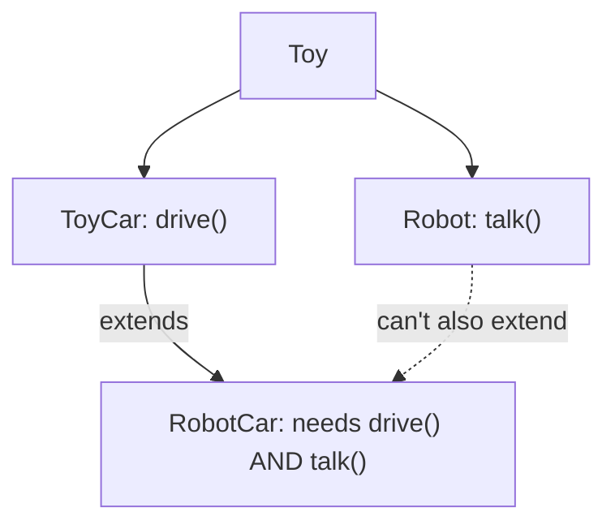

## The idea

[Inheritance](./inheritance.mdx) describes what something **is**: a Dog **is an** Animal. **Composition** describes what something **has** or **can do**: a car **has an** engine, a robot **can** talk. Instead of a tall family tree of classes, you build each object from small parts.

Think of **LEGO**. You don't need a special "robot car" brick. You take wheels, a motor and a talking head, and click them together. Need a boat that talks? Reuse the talking head.

## Composition vs inheritance

### The problem with class trees

Say you have toys. A `ToyCar` can drive. A `Robot` can talk. Both extend `Toy`.

Now you want a `RobotCar` that can **drive and talk**. In JavaScript, a class can extend **only one** parent. So you pick one, and copy the other one's code:

```js
class Toy {
    constructor(name) {
        this.name = name;
    }
}

class ToyCar extends Toy {
    drive() {
        console.log(`${this.name} drives`);
    }
}

// RobotCar can only extend ONE class, so talk() is copied from Robot.
class RobotCar extends ToyCar {
    talk() {
        console.log(`${this.name} says hello`);
    }
}

const robo = new RobotCar("Robo");
robo.drive(); // Robo drives
robo.talk(); // Robo says hello
```



The other "fix" is to move `drive()` and `talk()` up into `Toy`. But then **every** toy can drive and talk, even a teddy bear. Trees like this get harder to change as they grow: a change in a parent reaches every child. Joe Armstrong, who created the Erlang language, put it like this: you wanted a banana, but you got a gorilla holding the banana, and the whole jungle with it.

### Composition: an object "has" parts

With composition, the car **holds** an engine object in a property, and asks it to do its job.

```js
class Engine {
    start() {
        console.log("Engine starts");
    }
}

class ToyCar {
    constructor(color, engine) {
        this.color = color;

        // The car HAS an engine. It doesn't extend one.
        this.engine = engine;
    }

    drive() {
        this.engine.start();
        console.log(`The ${this.color} car drives`);
    }
}

const car = new ToyCar("red", new Engine());
car.drive();
// Engine starts
// The red car drives
```

The big win: you can **swap the part** without touching `ToyCar`. Any object with a `start()` method works.

```js
class ElectricMotor {
    start() {
        console.log("Motor hums quietly");
    }
}

class ToyCar {
    constructor(color, engine) {
        this.color = color;
        this.engine = engine;
    }

    drive() {
        this.engine.start();
        console.log(`The ${this.color} car drives`);
    }
}

// The same ToyCar class, with a different part.
const quietCar = new ToyCar("blue", new ElectricMotor());
quietCar.drive();
// Motor hums quietly
// The blue car drives
```

| | Inheritance | Composition |
| --- | --- | --- |
| Relationship | "is a": a Dog **is an** Animal | "has a" or "can do": a car **has an** engine |
| How | `class Dog extends Animal` | keep parts in properties, or mix in abilities |
| How many | one parent class | as many parts as you like |
| Changing it later | hard: a parent change reaches every child | easy: swap or add a part |
| Risk | deep trees, children get methods they don't need | more small pieces to wire together |

## Mixins with Object.assign

`Object.assign(target, source1, source2)` copies the sources' own properties **onto** the target, in order, and gives back the target. It skips inherited properties and hidden (non-enumerable) ones, like class methods. So a mixin is a plain object, not a class.

```js
const toy = {
    name: "Robo",
};

Object.assign(toy, { color: "red" }, { wheels: 4 });

console.log(toy); // { name: 'Robo', color: 'red', wheels: 4 }
```

A **mixin** is a small object full of methods that you copy into a class. Copy them onto the **prototype**, so every object made from the class shares them (see [Prototypes](./prototypes.mdx)).

```js
const canDrive = {
    drive() {
        console.log(`${this.name} drives`);
    },
};

const canTalk = {
    talk() {
        console.log(`${this.name} says hello`);
    },
};

class RobotCar {
    constructor(name) {
        this.name = name;
    }
}

// Copy both sets of methods onto the shared prototype.
Object.assign(RobotCar.prototype, canDrive, canTalk);

const robo = new RobotCar("Robo");
robo.drive(); // Robo drives
robo.talk(); // Robo says hello
```

Now a `TeddyBear` class could reuse `canTalk` too, without being a car. Mixins use normal functions, not arrow functions, so that `this` is the object.

Mixins have two traps.

**1. Name clashes.** `Object.assign` copies in order. If two mixins have a method with the same name, the **last one silently wins**.

```js
const canBeep = {
    sound() {
        console.log("Beep");
    },
};

const canHonk = {
    sound() {
        console.log("Honk");
    },
};

const toy = {};
Object.assign(toy, canBeep, canHonk);

// canHonk was copied last, so its sound() replaced canBeep's.
toy.sound(); // Honk
```

**2. Shared data.** `Object.assign` copies only the first level. An array inside a mixin is not copied: every object gets a reference to **the same** array (see [Value vs Reference](../core-basics/value-vs-reference.mdx)).

```js
const withTags = {
    tags: [],

    addTag(tag) {
        this.tags.push(tag);
    },
};

const toy1 = Object.assign({}, withTags);
const toy2 = Object.assign({}, withTags);

toy1.addTag("red");

// toy2 never added a tag, but it shares toy1's array.
console.log(toy2.tags); // [ 'red' ]
```

So keep mixins to **methods only**. Set up data like `tags` in the constructor, so each object gets its own.

## Factory functions

A **factory function** is a plain function that builds an object and returns it. No class, no `new`.

```js
function createToyCar(color) {
    return {
        color: color,

        drive() {
            console.log(`The ${this.color} car drives`);
        },
    };
}

const car = createToyCar("red");
car.drive(); // The red car drives
```

A factory can keep data **truly private**, with a [closure](../functions/closures.mdx). `count` is a local variable. Only the methods made inside the factory can see it.

```js
function createCounter() {
    let count = 0;

    return {
        increment() {
            count = count + 1;
        },

        getCount() {
            return count;
        },
    };
}

const counter = createCounter();
counter.increment();
counter.increment();

console.log(counter.getCount()); // 2
console.log(counter.count); // undefined
```

Factories and composition fit together well. Each ability is a small function that gets the toy and returns some methods. The factory clicks them together. There is no `this` anywhere, so it can never get lost.

```js
function canDrive(toy) {
    return {
        drive() {
            console.log(`${toy.name} drives`);
        },
    };
}

function canTalk(toy) {
    return {
        talk() {
            console.log(`${toy.name} says hello`);
        },
    };
}

function createRobotCar(name) {
    const toy = { name: name };

    // Click the abilities onto the toy.
    return Object.assign(toy, canDrive(toy), canTalk(toy));
}

const robo = createRobotCar("Robo");
robo.drive(); // Robo drives
robo.talk(); // Robo says hello
```

| | Class | Factory function |
| --- | --- | --- |
| Create with | `new ToyCar()` | `createToyCar()` |
| Private data | `#` fields | closure variables |
| Methods | one shared copy, on the prototype | a new copy for every object |
| `instanceof` | works | doesn't work |
| `this` | needed, and can get lost in callbacks | not needed |

## When to use which

| Situation | Use |
| --- | --- |
| A true "is a", and only one or two levels deep | inheritance |
| An object "has" a part, or you may want to swap a part | composition |
| A few unrelated classes need the same few methods | a mixin |
| You want private data, and no `new` or `this` | a factory function |

A common rule, from the 1994 *Design Patterns* book: **"favor composition over inheritance."** Reach for composition first, and use inheritance when the "is a" is real.

A good example of inheritance done right is a **custom error**. A `ValidationError` really **is an** `Error`, and the tree is only one level deep. See [Error Handling](../memory-errors/error-handling.mdx).

```js
class ValidationError extends Error {
    constructor(message) {
        super(message);
        this.name = "ValidationError";
    }
}

const error = new ValidationError("Email is missing");

console.log(error instanceof Error); // true
console.log(error.name); // ValidationError
console.log(error.message); // Email is missing
```

In the real world, React went through this exact change. Its old `createClass` API had mixins. In 2016 the React team wrote a blog post called "Mixins Considered Harmful", about name clashes and methods that came from nowhere. Today React shares logic with hooks: plain functions that you combine, which is composition.

## Common mistakes

- **Using inheritance only to reuse code.** If it's not a real "is a", use composition.
- **Deep class trees.** Each level makes the code harder to change. Keep trees one or two levels deep.
- **Mixins with the same method names.** `Object.assign` lets the last one win, with no warning.
- **Arrays or objects inside a mixin.** Every object ends up sharing them. Keep mixins to methods.
- **Arrow functions inside a mixin.** `this` won't be the object.
- **Expecting `instanceof` to work for factory objects.** There's no class or prototype to check. Check for the method instead.
- **Making thousands of objects with a factory.** Each one gets its own copy of every method. For many objects, a class (shared methods on the prototype) uses less memory.

## In the interview

A classic question is "Composition or inheritance: which do you prefer, and why?"

> "Inheritance models 'is a': a Dog is an Animal. Composition models 'has a' or 'can do': a car has an engine. I prefer composition by default. A class can only have one parent, and deep trees get hard to change: a change in the parent reaches every child, and children get methods they don't need. With composition, I build an object from small parts, and I can swap or add a part later. I still use inheritance for a real, shallow 'is a', like a custom error that extends `Error`."

**Likely follow-up:** "What problems do mixins have?"

**Answer:** "Three main ones. Name clashes: `Object.assign` copies in order, so if two mixins have a method with the same name, the last one silently wins. Hidden origins: it's hard to tell which mixin a method came from. And shared data: `Object.assign` is shallow, so an array inside a mixin is shared by every object that uses it. So I keep mixins small, with methods only, and set up data in the constructor."

<Callout title="Remember this" type="success">
  - **Inheritance = "is a"** (`extends`, one parent). **Composition = "has a" / "can do"** (an object holds parts).
  - **Favor composition:** you can swap parts, and you avoid deep, rigid class trees.
  - A **mixin** is an object of methods copied in with **`Object.assign(Class.prototype, mixin)`**.
  - Mixin traps: **name clashes** (the last one wins) and **shared data** (`Object.assign` is shallow).
  - A **factory function** returns a new object without `new`. Closures give it **private data**, but each object gets its own copy of the methods.
</Callout>
