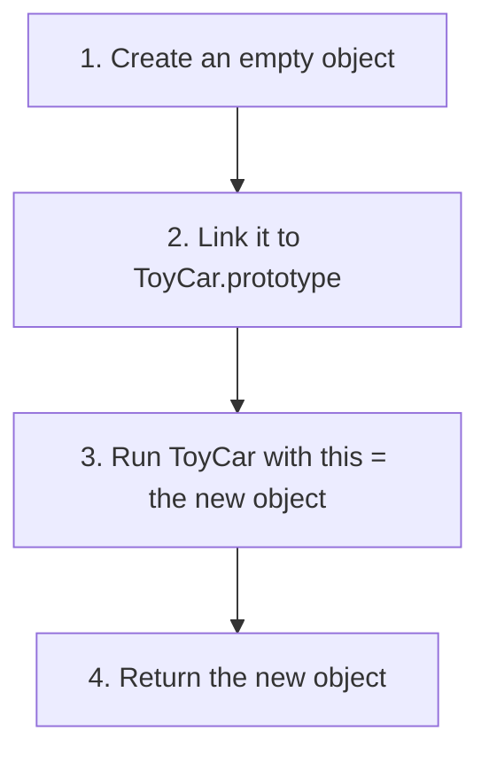
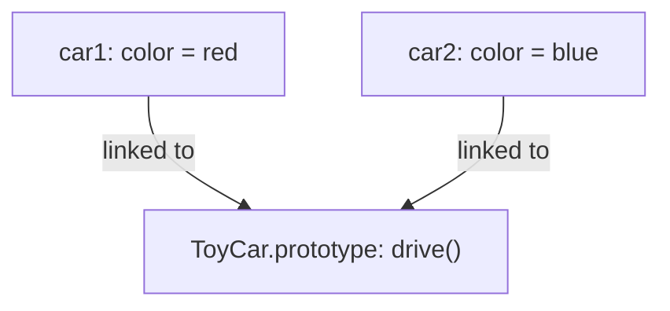

## The idea

**Object-Oriented Programming (OOP)** means keeping data and the functions that work on that data **together, in one object**. A toy car object holds its color (data), and it knows how to drive (a method).

To make many objects with the same shape, you need a blueprint. Before classes arrived in 2015 (ES6), JavaScript used a normal function called with the **`new`** keyword. That function is called a **constructor function**. Classes still work this way underneath, so this page explains what `class` and `new` really do.

Think of a **cookie cutter**. The cutter is the constructor function. Every cookie it cuts is a new object: the same shape, but its own piece of dough.

## What OOP is

An object holds **data** (properties) and **methods** (functions that use that data):

```js
const toyCar = {
    // data
    color: "red",
    wheels: 4,

    // a method: it works on this object's own data
    drive() {
        console.log(`The ${this.color} car drives.`);
    },
};

toyCar.drive(); // The red car drives.
```

Inside a method, `this` is the object before the dot: here, `toyCar`. See [The this Keyword](../functions/this-keyword.mdx).

Now you want 100 toy cars. Copying this object 100 times is slow and easy to get wrong. You want to write the shape **once**, and stamp out cars from it.

## Constructor functions

A constructor function is a normal function that fills in `this`. You call it with `new`.

```js
function ToyCar(color, wheels) {
    this.color = color;
    this.wheels = wheels;
}

const car1 = new ToyCar("red", 4);
const car2 = new ToyCar("blue", 3);

console.log(car1); // ToyCar { color: 'red', wheels: 4 }
console.log(car2); // ToyCar { color: 'blue', wheels: 3 }
```

- **A capital first letter** is a habit that says "call me with `new`". JavaScript doesn't check it.
- **`this`** is the new object being built.
- **No `return`** is needed. `new` gives back the new object for you.

## The 4 steps new does

When you write `new ToyCar("red", 4)`, JavaScript does four things:

1. **Create** a new, empty object: `{}`.
2. **Link** it to `ToyCar.prototype`. This gives the object access to shared methods (see the next section).
3. **Run** `ToyCar` with `this` set to the new object. So `this.color = color` writes onto the new object.
4. **Return** the new object. (If the function returns an object of its own, that one is returned instead.)



### Write new yourself

"Write your own `new`" is a classic interview question. Each step is one line. `...args` collects the other arguments into an array, and `apply` calls a function with a chosen `this` (see [call, apply and bind](../functions/call-apply-bind.mdx)).

```js
function myNew(Constructor, ...args) {
    // Steps 1 and 2: an empty object, linked to Constructor.prototype.
    const newObject = Object.create(Constructor.prototype);

    // Step 3: run the function, with this set to newObject.
    const result = Constructor.apply(newObject, args);

    // Step 4: if the function returned its own object, use that one.
    // A function counts too, because functions are objects.
    const returnedObject = typeof result === "object" && result !== null;
    const returnedFunction = typeof result === "function";

    if (returnedObject || returnedFunction) {
        return result;
    }

    return newObject;
}

function ToyCar(color) {
    this.color = color;
}

const car = myNew(ToyCar, "red");
console.log(car); // ToyCar { color: 'red' }
console.log(car instanceof ToyCar); // true
```

### When the constructor returns something

Step 4 has a twist. If the constructor returns an **object**, `new` gives you that object, and the one it built is thrown away. If it returns a **primitive** (a number, a string), the return is ignored.

```js
function ReturnsNumber() {
    this.kind = "car";
    return 42;
}

function ReturnsObject() {
    this.kind = "car";
    return { kind: "robot" };
}

console.log(new ReturnsNumber()); // ReturnsNumber { kind: 'car' }
console.log(new ReturnsObject()); // { kind: 'robot' }
```

### Forgetting new

Without `new`, it's just a normal function call. None of the 4 steps happen. Nothing is returned, and `this` is the **global object**, so `color` leaks out as a global variable.

```js
function ToyCar(color) {
    this.color = color;
}

const car = ToyCar("red");

console.log(car); // undefined
console.log(globalThis.color); // red
```

In strict mode, `this` is `undefined` in a normal call, so you get an error straight away. That's better: the bug can't hide.

```js
"use strict";

function ToyCar(color) {
    this.color = color;
}

try {
    ToyCar("red");
} catch (error) {
    console.log(error.message);
    // Cannot set properties of undefined (setting 'color')
}
```

Classes protect you from this mistake: calling a class without `new` always throws `TypeError: Class constructor ToyCar cannot be invoked without 'new'`.

## Methods on the prototype vs on each object

You could put a method inside the constructor. But then **every object gets its own copy** of the function.

```js
function ToyCar(color) {
    this.color = color;

    // A new copy of this function is made for EVERY car.
    this.drive = function () {
        console.log(`The ${this.color} car drives.`);
    };
}

const car1 = new ToyCar("red");
const car2 = new ToyCar("blue");

console.log(car1.drive === car2.drive); // false
```

Instead, put the method on **`ToyCar.prototype`**. Every function has a `prototype` object. Every object made with `new ToyCar()` is linked to it (step 2), so all the cars **share one copy**.

```js
function ToyCar(color) {
    this.color = color;
}

// One shared copy, stored on ToyCar.prototype.
ToyCar.prototype.drive = function () {
    console.log(`The ${this.color} car drives.`);
};

const car1 = new ToyCar("red");
const car2 = new ToyCar("blue");

car1.drive(); // The red car drives.
car2.drive(); // The blue car drives.

console.log(car1.drive === car2.drive); // true
console.log(Object.hasOwn(car1, "drive")); // false
console.log(car1); // ToyCar { color: 'red' }
```

How does `car1.drive()` work if `car1` has no `drive`? JavaScript looks at `car1`, doesn't find it, follows the link to `ToyCar.prototype`, and finds it there. And `this` is still `car1`, because `car1` is before the dot.



| | Method inside the constructor | Method on the prototype |
| --- | --- | --- |
| Copies for 1,000 cars | 1,000 functions | 1 function |
| `car1.drive === car2.drive` | `false` | `true` |
| Can use the constructor's local variables | yes (a [closure](../functions/closures.mdx)) | no |
| When to use it | rarely, for private data | almost always |

**Don't use an arrow function** for a prototype method. Arrow functions have no `this` of their own, so `this` is not the car.

```js
function ToyCar(color) {
    this.color = color;
}

// Arrow function: this is NOT the car here.
ToyCar.prototype.drive = () => {
    console.log(`The ${this.color} car drives.`);
};

const car = new ToyCar("red");
car.drive(); // The undefined car drives.
```

## instanceof

`instanceof` tells you whether an object was made from a constructor.

```js
function ToyCar(color) {
    this.color = color;
}

const car = new ToyCar("red");

console.log(car instanceof ToyCar); // true
console.log(car instanceof Object); // true
console.log(car instanceof Array); // false
```

`car instanceof Object` is `true` because almost every object is linked, in the end, to `Object.prototype`.

What `instanceof` **really** checks: "is `ToyCar.prototype` somewhere on `car`'s chain of links?" It does **not** remember which function made the object. You can prove it by replacing the prototype after the car is made:

```js
function ToyCar(color) {
    this.color = color;
}

const car = new ToyCar("red");

// Point ToyCar.prototype at a brand-new object.
ToyCar.prototype = {};

// car is still linked to the OLD prototype object.
console.log(car instanceof ToyCar); // false
```

Two more things to know:

- It doesn't work for primitives: `"hello" instanceof String` is `false`. Use `typeof` for those.
- For arrays, `Array.isArray(value)` is the safer check.

The chain of links is the topic of the next page, which also shows how to write `instanceof` yourself: [Prototypes and the Prototype Chain](./prototypes.mdx).

## Constructor functions vs classes

A [class](./classes.mdx) is a neater way to write the same thing. The class below makes the same objects as `ToyCar` with `ToyCar.prototype.drive` above. A class is still a function, and its methods still live on the prototype.

```js
class ToyCar {
    constructor(color) {
        this.color = color;
    }

    drive() {
        console.log(`The ${this.color} car drives.`);
    }
}

const car = new ToyCar("red");
car.drive(); // The red car drives.

console.log(typeof ToyCar); // function
console.log(Object.hasOwn(ToyCar.prototype, "drive")); // true
```

## Common mistakes

- **Forgetting `new`.** You get `undefined` back and properties leak onto the global object (or a `TypeError` in strict mode).
- **Putting methods inside the constructor.** Every object gets its own copy. Put them on the prototype.
- **Using an arrow function as a prototype method.** `this` won't be the object.
- **Using an arrow function as a constructor.** Arrow functions can't be used with `new`: `TypeError: ToyCar is not a constructor`.
- **Returning an object from a constructor by accident.** `new` then gives you that object, not the new one.
- **Thinking `instanceof` checks which function made the object.** It checks the prototype chain.

## In the interview

You'll often be asked "What happens when you call a function with `new`?"

> "`new` does four things. First, it creates a new empty object. Second, it links that object to the function's `prototype`, so the object can use the shared methods. Third, it runs the function with `this` set to the new object, which fills in the properties. Fourth, it returns the new object, unless the function returns an object of its own. If you forget `new`, none of that happens: `this` is the global object, or `undefined` in strict mode."

**Likely follow-up:** "Why put methods on the prototype instead of inside the constructor?"

**Answer:** "Inside the constructor, every object gets its own copy of the function, so 1,000 objects means 1,000 copies. On the prototype there's only one copy, and every object finds it through its prototype link. `this` is still the right object, because it's whatever is before the dot. The only reason to put a method inside the constructor is when it needs a private local variable through a closure."

<Callout title="Remember this" type="success">
  - **OOP** = data and the methods that work on it, together in one object.
  - A **constructor function** fills in `this` and is called with **`new`**. Capital first letter by habit.
  - **`new` does 4 steps:** create `{}` → link it to `Fn.prototype` → run `Fn` with `this` = the new object → return it.
  - Put methods on **`Fn.prototype`**: one shared copy instead of one per object. No arrow functions there.
  - **`instanceof`** checks whether `Fn.prototype` is on the object's prototype chain.
  - Forgetting `new` gives `undefined` and leaks globals. A class always throws instead.
</Callout>
