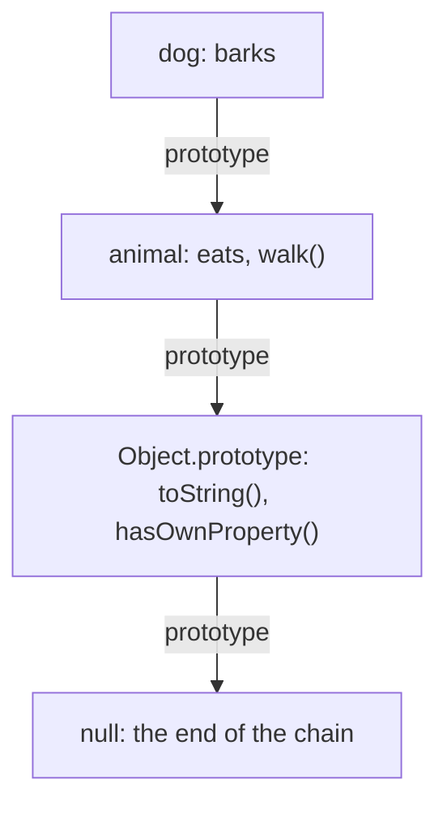
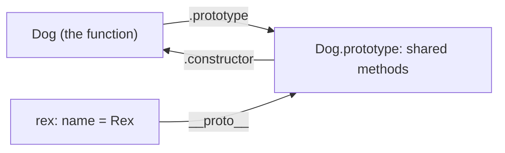
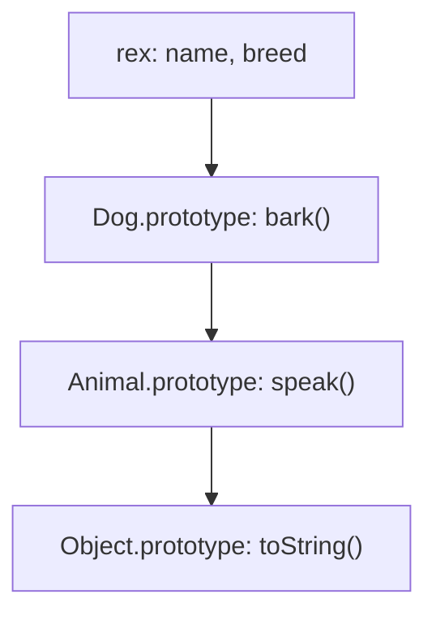

## The idea

Every object in JavaScript has a hidden link to another object, called its **prototype**. When you read a property the object doesn't have, JavaScript follows the link and looks in the prototype. If it's not there either, it follows **that** object's link, and so on. This line of links is the **prototype chain**.

Think of a **family recipe**. You want grandma's cake recipe. First you check your own notebook. Not there? You ask your mom. She doesn't have it? She asks grandma. You stop as soon as someone has it, or when there is nobody left to ask.

## The prototype chain, step by step

`Object.create(animal)` makes a new, empty object whose prototype is `animal` (more on it below).

```js
const animal = {
    eats: true,

    walk() {
        console.log("Animal walks");
    },
};

// dog is a new, empty object, linked to animal.
const dog = Object.create(animal);
dog.barks = true;

console.log(dog); // { barks: true }
console.log(dog.barks); // true
console.log(dog.eats); // true
console.log(dog.flies); // undefined

dog.walk(); // Animal walks
```

`dog` only has `barks` of its own. Everything else is found further up the chain:

| You read | Look in `dog` | Look in `animal` | Look in `Object.prototype` | Result |
| --- | --- | --- | --- | --- |
| `dog.barks` | found | | | `true` |
| `dog.eats` | not here | found | | `true` |
| `dog.toString` | not here | not here | found | the built-in function |
| `dog.flies` | not here | not here | not here, and the next link is `null` | `undefined` |



`Object.prototype` sits at the top of almost every chain. That's where methods like `toString` and `hasOwnProperty` come from.

**`this` is the object before the dot**, even when the method lives on the prototype. That's what lets one shared method work on each object's own data.

```js
const animal = {
    describe() {
        console.log(`${this.name} is an animal`);
    },
};

const dog = Object.create(animal);
dog.name = "Rex";

// describe lives on animal, but this is dog.
dog.describe(); // Rex is an animal
```

**Reading walks up the chain. Writing does not.** Writing a property puts it on the object itself. The new property then **hides** (shadows) the one on the prototype. (One exception: if the prototype has a **setter** with that name, like a class's `set name()`, the write runs the setter instead.)

```js
const animal = {
    eats: true,
};

const dog = Object.create(animal);

// This creates a NEW eats on dog. animal is not touched.
dog.eats = false;

console.log(dog.eats); // false
console.log(animal.eats); // true
console.log(dog); // { eats: false }
```

**But changing a shared object is different.** `push` doesn't write a new property: it **reads** `tags`, finds the array on the prototype, and changes that one array. Every object linked to `base` sees the change.

```js
const base = {
    tags: [],
};

const first = Object.create(base);
const second = Object.create(base);

// Reads tags (found on base), then changes that shared array.
first.tags.push("new");

console.log(second.tags); // [ 'new' ]
```

So keep **methods** on the prototype, and **data** on each object.

## `__proto__` vs `prototype`

These two names cause a lot of confusion. They are linked, but they are different things.

- **`prototype`** is a property of a **function** (or class). It's the object that **will become** the prototype of every object made with `new`.
- **`__proto__`** is on **every object**. It's the link to **that object's own** prototype.

```js
function Dog(name) {
    this.name = name;
}

const rex = new Dog("Rex");

// rex's link points at the function's prototype object.
console.log(rex.__proto__ === Dog.prototype); // true

// The modern way to read the same link.
console.log(Object.getPrototypeOf(rex) === Dog.prototype); // true

// rex is not a function, so it has no prototype property.
console.log(rex.prototype); // undefined

// The prototype object points back to the function.
console.log(Dog.prototype.constructor === Dog); // true
```



| | `prototype` | `__proto__` |
| --- | --- | --- |
| Who has it | functions and classes | every object |
| What it is | the prototype that objects made with `new` **will get** | the link to **this** object's prototype |
| Example | `Dog.prototype` | `rex.__proto__` (the same object as `Dog.prototype`) |
| Use it in real code? | yes, it's where shared methods live | no, use `Object.getPrototypeOf` |

`__proto__` is an old feature that still works, so you'll see it in interview questions. It comes from `Object.prototype`, so an object made with `Object.create(null)` doesn't have it. In real code, use `Object.getPrototypeOf` and `Object.create`.

## Object.create and Object.getPrototypeOf

These are the modern tools for working with prototypes:

| Tool | What it does |
| --- | --- |
| `Object.create(proto)` | Makes a new, empty object, linked to `proto` |
| `Object.create(null)` | Makes an object with **no** prototype: no `toString`, nothing inherited |
| `Object.getPrototypeOf(obj)` | Gives back `obj`'s prototype (the object it's linked to) |
| `Object.setPrototypeOf(obj, proto)` | Changes the link of an existing object. It works, but it's slow: set the link when you create the object instead |
| `Object.hasOwn(obj, key)` | `true` only if the key is on `obj` itself, not inherited |

With `Object.getPrototypeOf` you can climb the whole chain, one link at a time:

```js
function Dog(name) {
    this.name = name;
}

const rex = new Dog("Rex");

const first = Object.getPrototypeOf(rex);
const second = Object.getPrototypeOf(first);
const third = Object.getPrototypeOf(second);

console.log(first === Dog.prototype); // true
console.log(second === Object.prototype); // true
console.log(third); // null
```

That climb is exactly how `instanceof` works. "Write your own `instanceof`" is a common interview question:

```js
function myInstanceOf(value, Constructor) {
    // instanceof is always false for primitives like 5 or "hi".
    // Functions are objects, so they are checked like objects.
    const isObject = typeof value === "object" && value !== null;
    const isFunction = typeof value === "function";

    if (!isObject && !isFunction) {
        return false;
    }

    let current = Object.getPrototypeOf(value);

    // Climb one link at a time, until the end of the chain (null).
    while (current !== null) {
        if (current === Constructor.prototype) {
            return true;
        }

        current = Object.getPrototypeOf(current);
    }

    return false;
}

console.log(myInstanceOf([], Array)); // true
console.log(myInstanceOf([], Object)); // true
console.log(myInstanceOf({}, Array)); // false
console.log(myInstanceOf("hi", String)); // false
console.log(myInstanceOf(Math.max, Function)); // true
```

## Why classes are built on prototypes

A class is a nicer way to write a constructor function plus its prototype. Underneath, it's the same thing.

### Step 1: A class

```js
class Animal {
    constructor(name) {
        this.name = name;
    }

    speak() {
        console.log(`${this.name} makes a sound`);
    }
}

const pet = new Animal("Rex");
pet.speak(); // Rex makes a sound

// Underneath: a function, with its methods on its prototype.
console.log(typeof Animal); // function
console.log(Object.getOwnPropertyNames(Animal.prototype)); // [ 'constructor', 'speak' ]
console.log(Object.getPrototypeOf(pet) === Animal.prototype); // true
```

### Step 2: The same thing, as a constructor function

The `constructor` becomes the function. Each method goes on `Animal.prototype`. See [Constructor Functions and new](./constructor-functions-and-new.mdx).

```js
function Animal(name) {
    this.name = name;
}

Animal.prototype.speak = function () {
    console.log(`${this.name} makes a sound`);
};

const pet = new Animal("Rex");
pet.speak(); // Rex makes a sound
```

### Step 3: A child class with extends

This is the `Dog extends Animal` you know from [Inheritance](./inheritance.mdx).

```js
class Animal {
    constructor(name) {
        this.name = name;
    }

    speak() {
        console.log(`${this.name} makes a sound`);
    }
}

class Dog extends Animal {
    constructor(name, breed) {
        super(name);
        this.breed = breed;
    }

    bark() {
        console.log(`${this.name} the ${this.breed} barks`);
    }
}

const rex = new Dog("Rex", "Labrador");
rex.speak(); // Rex makes a sound
rex.bark(); // Rex the Labrador barks
```

### Step 4: The same child, the old way

`extends` links `Dog.prototype` to `Animal.prototype`, so every dog can use Animal's methods. And `super(name)` runs `Animal`'s constructor to set up the new dog.

```js
function Animal(name) {
    this.name = name;
}

Animal.prototype.speak = function () {
    console.log(`${this.name} makes a sound`);
};

function Dog(name, breed) {
    // Like super(name): run Animal with this = the new dog.
    Animal.call(this, name);
    this.breed = breed;
}

// Like extends: Dog.prototype is linked to Animal.prototype.
Dog.prototype = Object.create(Animal.prototype);

// That line replaced Dog.prototype, so point constructor back to Dog.
Dog.prototype.constructor = Dog;

Dog.prototype.bark = function () {
    console.log(`${this.name} the ${this.breed} barks`);
};

const rex = new Dog("Rex", "Labrador");
rex.speak(); // Rex makes a sound
rex.bark(); // Rex the Labrador barks
```

Both versions build **the same chain**. `rex.speak()` isn't on `rex` or on `Dog.prototype`, so JavaScript climbs one more link and finds it on `Animal.prototype`:



| Class syntax | What it does with prototypes |
| --- | --- |
| `class Animal` with a `constructor(name)` | `function Animal(name)` |
| a method `speak()` | `Animal.prototype.speak = function () ...` |
| `class Dog extends Animal` | `Dog.prototype = Object.create(Animal.prototype)`, plus `Object.setPrototypeOf(Dog, Animal)` so static methods are inherited too |
| `super(name)` | `Animal.call(this, name)` |
| `super.speak()` | `Animal.prototype.speak.call(this)` |
| `static create()` | `Animal.create = function () ...` (on the function, not the prototype) |

### Not 100% the same

People call classes "syntactic sugar": a nicer way to write the same thing. That's mostly true, but a class adds a few real differences:

- It **must** be called with `new`. A constructor function called without `new` just runs.
- Code inside a class is always in **strict mode**.
- Class methods are **non-enumerable**, so `for...in` skips them.
- You can't use a class **before the line** that defines it. Like `let`, its name is hoisted but locked in the temporal dead zone (see [Hoisting](../core-basics/hoisting-and-execution-context.mdx)). A function declaration can be used before its line.
- Classes have **private `#` fields** (see [Encapsulation](./encapsulation.mdx)). Prototypes have nothing like that.

Here is the `for...in` difference. The old-style method shows up in the loop. The class method doesn't.

```js
function OldDog(name) {
    this.name = name;
}

OldDog.prototype.bark = function () {
    console.log("Woof");
};

class NewDog {
    constructor(name) {
        this.name = name;
    }

    bark() {
        console.log("Woof");
    }
}

for (const key in new OldDog("Rex")) {
    console.log("old:", key);
}
// old: name
// old: bark

for (const key in new NewDog("Rex")) {
    console.log("new:", key);
}
// new: name
```

## Common mistakes

- **Mixing up `prototype` and `__proto__`.** `prototype` is on functions. `__proto__` is every object's link. `rex.__proto__ === Dog.prototype`.
- **Thinking a write changes the prototype.** `dog.eats = false` creates a new property on `dog`. The prototype is not touched.
- **Putting data like arrays on the prototype.** Every object shares the same array. Keep data on each object (set it in the constructor).
- **Adding methods to `Dog.prototype`, then replacing it** with `Object.create(...)`. The methods are lost. Link first, add methods after. And reset `Dog.prototype.constructor`.
- **Changing built-in prototypes**, like adding your own `Array.prototype.myMethod`. It can clash with future JavaScript. This really happened: an old library called MooTools added its own `Array.prototype.flatten`, so when JavaScript wanted a built-in `flatten`, it would have broken old websites. It was renamed `flat` instead.
- **Using `Object.setPrototypeOf` on existing objects.** It works, but it slows the code down. Set the prototype when you create the object.

## In the interview

You'll be asked "What is the prototype chain?" or "Explain prototypal inheritance."

> "Every object has a hidden link to another object, its prototype. When I read a property, JavaScript first looks on the object itself. If it's not there, it follows the link to the prototype, then to that object's prototype, and so on, until it finds the property or reaches `null`, which gives `undefined`. That's how objects share methods: a method lives once on the prototype, and `this` is still the object before the dot. Writing a property doesn't walk the chain: it creates the property on the object itself. Classes use exactly this: class methods live on `ClassName.prototype`, and `extends` links the child's prototype to the parent's."

**Likely follow-up:** "Are classes just syntactic sugar?"

**Answer:** "Mostly. A class is a function, its methods live on its prototype, and `extends` builds the same chain you'd build by hand with `Object.create(Parent.prototype)`. But there are real differences: a class must be called with `new`, its body is always in strict mode, its methods are non-enumerable, you can't use it before its line, and it supports private `#` fields, which prototypes can't do."

<Callout title="Remember this" type="success">
  - Every object has a hidden link to its **prototype**. A missing property is looked up **along the chain**, until `null` gives `undefined`.
  - **Reading walks the chain, writing doesn't:** a write creates the property on the object itself.
  - **`prototype`** is on functions (what `new` objects will get). **`__proto__`** is every object's link. `rex.__proto__ === Dog.prototype`.
  - Use **`Object.create(proto)`** to make a linked object and **`Object.getPrototypeOf(obj)`** to read the link.
  - **Classes are built on prototypes:** methods go on `Class.prototype`, and `extends` = `Object.create(Parent.prototype)`.
  - Keep **methods** on the prototype and **data** on each object.
</Callout>
