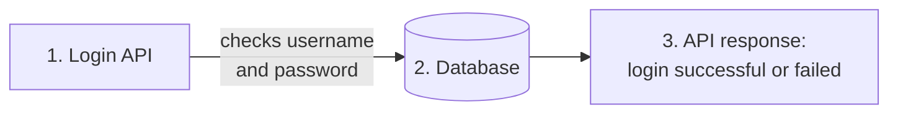
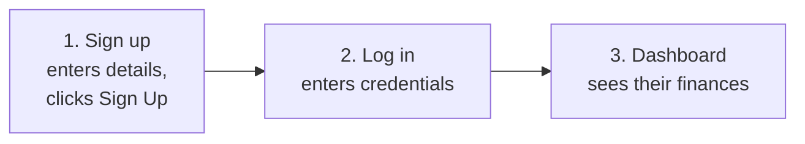

## 1. Unit tests

**Meaning:** test one small piece of code **in isolation**.

Imagine you have a function that calculates the total price of a product:

```js
function calculateTotal(price, quantity) {
    return price * quantity;
}
```

You write a test to check that it works correctly. This one uses **Jest**, a common JavaScript testing tool:

```js noRun
test("calculates total price", () => {
    expect(calculateTotal(100, 3)).toBe(300);
});
```

- `test("name", function)` creates one test: a name, and a function that does the check.
- `expect(value).toBe(expected)` checks that `value` is exactly `expected`, like `===`. To compare two objects or arrays by their contents, use `toEqual`.

What happens:

1. **Input:** price = 100, quantity = 3
2. The function calculates the total.
3. **Expected output:** 300

If the function returns `300`, the test **passes**. If it returns anything else, the test **fails**, and Jest shows what it expected and what it got.

More examples:

- Does a function calculate tax correctly?
- Does a function validate an email address?
- Does a function format a date correctly?

Unit tests focus on a small piece of code, usually **without** a real database or external services.

## 2. Integration tests

**Meaning:** test whether **multiple parts** of your application work correctly **together**.

Imagine a login API. It receives a username and password, checks the user in the database, and returns a response:



An integration test checks that the API and the database work together properly. For example:

1. Create a test user in the database.
2. Send a login request to the API.
3. Check that the API returns a successful response.
4. Check that wrong credentials are rejected.

More examples:

- Does the backend correctly save data to the database?
- Does an API get the correct data from the database?
- Does your service talk correctly to another service?

Integration tests check the **connections** between different parts of your application.

## 3. E2E tests (end-to-end)

**Meaning:** test the **complete application** the way a real user would use it.

Imagine a user visiting your finance website and signing up for an account:



An E2E test checks that this **whole journey** works. It usually uses a **real browser**, controlled by a tool such as **Playwright** or **Cypress**, which clicks and types like a real user.

It might check that:

1. The signup page opens.
2. The user can create an account.
3. The user can log in.
4. The dashboard loads with the correct information.

E2E tests check that the whole application works **from beginning to end**.

## Quick comparison

| | Unit test | Integration test | E2E test |
| --- | --- | --- | --- |
| What is tested? | One function or component | Multiple parts together | The entire user journey |
| Example | Calculate total price | API saves data to the database | User signs up and logs in |
| Speed | Usually fastest | Usually medium | Usually slowest |
| Debugging | Usually easiest | Moderate | Often harder |
| Typical failure | Wrong logic | Parts don't talk to each other properly | The user journey breaks |

## Easy way to remember

Imagine you're building a car:

- **Unit test = testing one car part.** Does the brake sensor work correctly by itself?
- **Integration test = testing connected parts.** Does the brake sensor talk properly to the braking system?
- **E2E test = testing the whole car.** Does the car work correctly when someone drives it?

<Callout title="Remember this" type="success">
  - **Unit test:** one small piece of code, in isolation, usually with no real database. Example: `calculateTotal(100, 3)` should be `300`.
  - **Integration test:** several parts working **together**. Example: the login API and the database.
  - **E2E test:** the **whole app**, like a real user, in a real browser (Playwright, Cypress). Example: sign up → log in → dashboard.
  - Speed: unit is **fastest**, E2E is **slowest**. Debugging: unit is **easiest**, E2E is **hardest**.
  - Car: one part → connected parts → the whole car.
</Callout>
