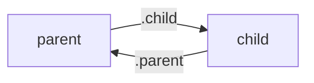

## The idea

Two classic coding questions:

- **"Write `deepClone(value)`."** It returns a full copy. Every nested object and array is new, so changing the copy never changes the original.
- **"Write `deepEqual(a, b)`."** It returns `true` when two values have the **same contents**, even if they are two different objects.

```js noRun
const user = { name: "Asha", address: { city: "Pune" } };

const copy = deepClone(user);
copy.address.city = "Delhi";
console.log(user.address.city); // Pune: the original is safe

console.log(deepEqual(user, { name: "Asha", address: { city: "Pune" } })); // true
```

Think of a **folder of papers**. A deep clone photocopies every paper inside, so you can scribble on the copies. Deep equal is like holding two printouts of the same letter: they are different sheets of paper (`===` says `false`), but the words are the same (`deepEqual` says `true`).

Shallow vs deep copies, the JSON trick and `structuredClone` are explained in [Value vs Reference](../core-basics/value-vs-reference.mdx). This page is about writing your own.

## Deep clone

### Deep clone with recursion

Every value is one of two kinds:

- A **primitive** (number, string, boolean, `null`, `undefined`). It is already copied by value, so return it as it is.
- An **object or array**. Make a new empty one, then deep-clone **each value inside** into it.

The function calls itself for the values inside. That is **recursion**. It stops when it reaches primitives.

```js
function deepClone(value) {
    // Primitives are copied by value, so return them as they are.
    // typeof null is "object" (an old JavaScript bug), so check it here.
    if (typeof value !== "object" || value === null) {
        return value;
    }

    // Start an empty array or object, the same kind as value.
    let copy;
    if (Array.isArray(value)) {
        copy = [];
    } else {
        copy = {};
    }

    // Copy each key. deepClone calls itself for nested values.
    for (const key of Object.keys(value)) {
        copy[key] = deepClone(value[key]);
    }

    return copy;
}

const user = { name: "Asha", address: { city: "Pune" }, tags: ["admin"] };
const copy = deepClone(user);

copy.address.city = "Delhi";
copy.tags.push("owner");

console.log(user.address.city); // Pune
console.log(user.tags); // [ 'admin' ]
console.log(copy.tags); // [ 'admin', 'owner' ]
```

How `deepClone(user)` runs:

| Call | Kind | What happens |
| --- | --- | --- |
| `deepClone(user)` | object | make `{}`, then clone its 3 values |
| `deepClone("Asha")` | primitive | return it |
| `deepClone(address)` | object | make `{}`, then clone `city` |
| `deepClone("Pune")` | primitive | return it |
| `deepClone(["admin"])` | array | make `[]`, then clone index 0 |
| `deepClone("admin")` | primitive | return it |

Why check `Array.isArray`? If every copy started as `{}`, the array `["admin"]` would come back as `{ '0': 'admin' }`: the same keys, but no longer an array.

For a **function**, `typeof` gives `"function"`, not `"object"`. So it takes the first path and is returned as it is. The copy shares the same function. That is fine: functions are rarely changed.

### Dates and cycles

This version still has two gaps.

**Gap 1: Dates.** A Date keeps its time hidden inside. It has no keys of its own, so `Object.keys(date)` is `[]`, and our loop returns an empty `{}`. The fix: make a new Date with the same time.

**Gap 2: cycles.** An object can point back to itself, through another object. A child that knows its parent is a common example:



```js
const parent = { name: "Asha" };
const child = { name: "Ravi", parent: parent };
parent.child = child;

// You can walk round the loop forever.
console.log(parent.child.parent.child.name); // Ravi
```

Our `deepClone(parent)` would clone `parent`, then `child`, then `child.parent` (which is `parent` again), then `child` again, and so on, until JavaScript stops it: `RangeError: Maximum call stack size exceeded`.

**The fix: remember what you already copied.** Keep a `WeakMap` called `seen`. It maps each original object to its copy. Before you copy an object, look in `seen`. If it is there, return the copy you already made, and don't go deeper.

How `deepClone(parent)` runs with `seen`:

| Step | deepClone sees | In `seen`? | What happens |
| --- | --- | --- | --- |
| 1 | `parent` | no | make `parentCopy`, save `parent → parentCopy`, clone its keys |
| 2 | `"Asha"` | (primitive) | return it |
| 3 | `child` | no | make `childCopy`, save `child → childCopy`, clone its keys |
| 4 | `"Ravi"` | (primitive) | return it |
| 5 | `parent` again | **yes** | return `parentCopy`. The loop stops here. |

Here is the full solution, with both fixes:

```js
function deepClone(value, seen = new WeakMap()) {
    if (typeof value !== "object" || value === null) {
        return value;
    }

    // A Date: a new Date with the same time.
    if (value instanceof Date) {
        return new Date(value.getTime());
    }

    // Copied this object before? Return that copy. This stops cycles.
    if (seen.has(value)) {
        return seen.get(value);
    }

    let copy;
    if (Array.isArray(value)) {
        copy = [];
    } else {
        copy = {};
    }

    // Save the copy BEFORE going deeper, so a cycle can find it.
    seen.set(value, copy);

    for (const key of Object.keys(value)) {
        copy[key] = deepClone(value[key], seen);
    }

    return copy;
}

const parent = { name: "Asha", born: new Date("1990-05-01") };
const child = { name: "Ravi", parent: parent };
parent.child = child;

const copy = deepClone(parent);
console.log(copy === parent); // false
console.log(copy.child.parent === copy); // true: the loop points to the copy
console.log(copy.born instanceof Date); // true
console.log(copy.born === parent.born); // false: a new Date
```

- `seen` is created once, by the default value, on the first call. Every nested call gets the **same** `seen`, passed as the second argument.
- `seen.set(value, copy)` happens **before** the loop. When the loop reaches `parent` again, its copy is already waiting in `seen`.
- A plain `Map` would also work. `WeakMap` is the usual choice: its keys can only be objects, and it never stops an object from being freed from memory. See [Map, Set, WeakMap and WeakSet](../modern-js/map-set-weakmap.mdx).
- **Time:** O(n) · **Space:** O(n), where n is the number of values inside. Each object is copied once.

## Deep equal

`===` on two objects only asks: "is this the **same** object?" `deepEqual` asks: "do they have the **same contents**?" We build it in two steps.

**Step 1: primitives.** If `Object.is(a, b)` is `true`, they are equal. `Object.is` works like `===`, with one difference that matters here: it says `NaN` equals `NaN`. (It also says `0` and `-0` are different, which rarely matters.)

```js
function deepEqual(a, b) {
    if (Object.is(a, b)) {
        return true;
    }

    // Objects are handled in step 2.
    return false;
}

console.log(deepEqual(1, 1)); // true
console.log(deepEqual("a", "b")); // false
console.log(deepEqual(NaN, NaN)); // true
console.log(NaN === NaN); // false
console.log(deepEqual({ a: 1 }, { a: 1 })); // false: not done yet
```

**Step 2: objects and arrays.** Two objects are equal when they are the same kind (both arrays, or both not), have the same number of keys, and every key of `a` is also in `b` with a deeply equal value.

```js
function deepEqual(a, b) {
    if (Object.is(a, b)) {
        return true;
    }

    // One of them is a primitive, and they didn't match above.
    const aIsObject = typeof a === "object" && a !== null;
    const bIsObject = typeof b === "object" && b !== null;
    if (!aIsObject || !bIsObject) {
        return false;
    }

    // An array is never equal to a plain object.
    if (Array.isArray(a) !== Array.isArray(b)) {
        return false;
    }

    const aKeys = Object.keys(a);
    const bKeys = Object.keys(b);
    if (aKeys.length !== bKeys.length) {
        return false;
    }

    // Object.hasOwn(b, key): does b have this key itself?
    for (const key of aKeys) {
        if (!Object.hasOwn(b, key) || !deepEqual(a[key], b[key])) {
            return false;
        }
    }

    return true;
}

console.log(deepEqual({ a: [1, { b: 2 }] }, { a: [1, { b: 2 }] })); // true
console.log(deepEqual({ x: 1, y: 2 }, { y: 2, x: 1 })); // true
console.log(deepEqual({ a: 1 }, { a: 1, b: 2 })); // false
console.log(deepEqual({ x: undefined }, { y: undefined })); // false
console.log(deepEqual([1, 2], { 0: 1, 1: 2 })); // false
console.log(deepEqual(null, {})); // false
```

- **Key order doesn't matter.** We look keys up by name, not by position.
- **The key count check** catches extra keys in `b`. Without it, `{ a: 1 }` would equal `{ a: 1, b: 2 }`.
- **`Object.hasOwn`** catches a missing key. `{ x: undefined }` and `{ y: undefined }` both give `undefined` for `x`, but only one of them has the key `x`.
- **Time:** O(n) · **Space:** O(n). Each value is compared once.

## When structuredClone is enough

`structuredClone` is built into browsers and Node.js. It already handles nested objects, arrays, Dates, Maps, Sets and cycles. So in real code, use it, and keep your own `deepClone` for the interview.

It has two limits you should know:

```js
class Point {
    constructor(x) {
        this.x = x;
    }

    show() {
        return "x is " + this.x;
    }
}

// A class object comes back as a plain object: its methods are gone.
const copy = structuredClone(new Point(5));
console.log(copy); // { x: 5 }
console.log(copy instanceof Point); // false

// A function can't be cloned at all.
try {
    structuredClone({ greet: function () {} });
} catch (error) {
    console.log(error.name); // DataCloneError
}
```

| Copy this | `JSON.parse(JSON.stringify(x))` | `structuredClone(x)` | Our `deepClone` |
| --- | --- | --- | --- |
| Nested objects and arrays | yes | yes | yes |
| Dates | becomes a string | yes | yes |
| Maps and Sets | becomes `{}` | yes | no (you can add it) |
| Cycles | throws `TypeError` | yes | yes |
| Functions | dropped | throws `DataCloneError` | shared, not copied |
| Class objects | plain object | plain object | plain object |

So write your own only when you need something special: for example, keeping functions, or keeping class objects as their class.

## Edge cases interviewers check

| Input | What should happen |
| --- | --- |
| `null` | Returned as it is. `typeof null` is `"object"`, so check `value === null` first. |
| An array inside an object | A new **array**, not an object with keys `'0'`, `'1'`. |
| A Date | A new Date with the same time. |
| An object that points back to itself | No crash. The `seen` WeakMap returns the copy. |
| The same object used twice | `seen` also keeps it shared once in the copy: `copy.a === copy.b`. |
| `deepEqual(NaN, NaN)` | `true`, thanks to `Object.is`. |
| `{ x: 1, y: 2 }` and `{ y: 2, x: 1 }` | Equal. Key order doesn't matter. |
| `[1, 2]` and `{ 0: 1, 1: 2 }` | Not equal. One is an array. |

One gap is left in our `deepEqual`: two **Dates** have no own keys, so `deepEqual(new Date(0), new Date(1))` gives `true`. Add these lines after the array check to compare their times:

```js noRun
// Both must be Dates, or both not. Then compare the time.
const aIsDate = a instanceof Date;
const bIsDate = b instanceof Date;
if (aIsDate !== bIsDate) {
    return false;
}
if (aIsDate) {
    return a.getTime() === b.getTime();
}
```

## In the real world

- **Lodash**, a popular helper library, has `_.cloneDeep` and `_.isEqual`. They do the same jobs as this page, for many more types.
- **Test runners** use deep equal all the time. In Jest, `expect(a).toEqual(b)` compares contents deeply, while `toBe` uses `Object.is`. See [Unit, Integration and E2E Tests](../testing/unit-integration-e2e.mdx).
- Node.js has `assert.deepStrictEqual` and `util.isDeepStrictEqual` built in.

## Common mistakes

- **Forgetting `typeof null === "object"`.** Then `Object.keys(null)` throws `TypeError: Cannot convert undefined or null to object`.
- **Always starting the copy with `{}`.** Arrays come back as objects with keys `'0'`, `'1'`.
- **Saving to `seen` after copying the children.** The cycle reaches the object again before it is saved, so it still loops forever. Save first, then go deeper.
- **Making a new `seen` in every call.** Pass the same one down as the second argument, or cycles are never found.
- **Comparing with `JSON.stringify(a) === JSON.stringify(b)`.** Key order changes the text, so `{ x: 1, y: 2 }` and `{ y: 2, x: 1 }` look different. Dates, `undefined` and `NaN` are also lost.
- **Only checking that `a`'s keys are in `b`.** You also need the key count, or `b` can have extra keys.

## In the interview

- Say the two cases first: primitives are returned as they are, objects are rebuilt.
- Ask what types to support: plain objects and arrays only, or Dates, Maps and cycles too.
- Test with: a nested object, an array, a Date, `null`, and an object that points to itself.

> "I'll write it with recursion. A primitive is returned as it is. For an object or array, I make an empty one of the same kind and deep-clone each value into it. A Date gets a new Date with the same time. For cycles, I keep a WeakMap from each original to its copy. I save the copy before going deeper, and if I meet the same object again, I return the saved copy. It's O(n) time and space. In real code I'd just use structuredClone."

**Likely follow-up:** "How would you also copy Maps and Sets?"

**Answer:** "Add a check for each, like the Date one. For a Map, make a `new Map()`, save it in `seen`, then for each entry call `copy.set(key, deepClone(item, seen))`. A Set is the same with `copy.add(deepClone(item, seen))`. I'd keep the Map's keys as they are, because keys are usually used for lookups by identity."

<Callout title="Remember this" type="success">
  - **deepClone:** return primitives as they are. For objects, make a new `[]` or `{}` and deep-clone each value into it.
  - Check **`value === null`** first: `typeof null` is `"object"`.
  - **Dates:** `new Date(value.getTime())`. **Cycles:** a `WeakMap` from original to copy, saved **before** going deeper.
  - **deepEqual:** `Object.is` first (so `NaN` equals `NaN`), then same kind, same key count, and every key equal by recursion.
  - In real code, **`structuredClone`** is enough. It can't copy functions, and class objects lose their methods.
</Callout>
