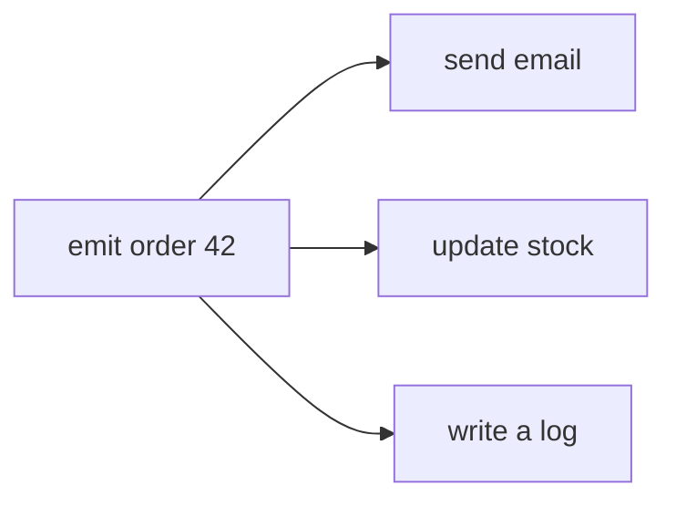

## The idea

The task: **"Build an `EventEmitter` class with `on`, `off`, `emit` and `once`."** One part of your code says "this happened" with `emit`. Every function that signed up for that event with `on` runs.

```js noRun
const shop = new EventEmitter();

shop.on("order", (id) => console.log("Email for order", id));
shop.emit("order", 42); // Email for order 42
```

Think of a **YouTube channel**. You press Subscribe (`on`). When the channel posts a video (`emit`), every subscriber gets a notification. You can unsubscribe (`off`). The channel doesn't know or care what each subscriber does with the news.

This pattern is also called **publish/subscribe** (pub/sub) or the **observer pattern**.



The code that emits `"order"` doesn't import the email, stock or log code. It only says what happened. This keeps the parts of an app separate.

## How it works

### on and emit

The emitter keeps a **list of listeners for each event name**. A listener is just a function. We store them in a `Map`:

| Key (event name) | Value (listeners) |
| --- | --- |
| `"order"` | `[sendEmail, updateStock]` |
| `"logout"` | `[clearCart]` |

- `on(name, listener)` adds the function to that event's array.
- `emit(name, ...args)` calls every function in that array, with the arguments.

```js
class EventEmitter {
    constructor() {
        // Event name -> array of listener functions.
        this.events = new Map();
    }

    // Add a listener for an event.
    on(name, listener) {
        if (!this.events.has(name)) {
            this.events.set(name, []);
        }

        this.events.get(name).push(listener);
    }

    // Call every listener of this event, with the given arguments.
    emit(name, ...args) {
        const listeners = this.events.get(name);
        if (!listeners) {
            return;
        }

        for (const listener of listeners) {
            listener(...args);
        }
    }
}

const shop = new EventEmitter();
shop.on("order", (id) => console.log("Email for order", id));
shop.on("order", (id) => console.log("Stock updated for order", id));

shop.emit("order", 42);
// Email for order 42
// Stock updated for order 42

shop.emit("logout"); // no listeners, so nothing happens
```

- `...args` in `emit` collects all the extra arguments into an array. `listener(...args)` spreads them back out. See [Destructuring and Spread](../modern-js/destructuring-and-spread.mdx).
- Why a `Map` and not a plain object? A plain object already has keys like `toString` from its prototype, so `events["toString"]` would not be empty. A `Map` starts truly empty.

### off

`off(name, listener)` finds the function in the array and removes it. Here is the method on its own:

```js noRun
// Remove one listener from an event.
off(name, listener) {
    const listeners = this.events.get(name);
    if (!listeners) {
        return;
    }

    // indexOf gives -1 when the function isn't in the array.
    const index = listeners.indexOf(listener);
    if (index !== -1) {
        listeners.splice(index, 1);
    }
}
```

`indexOf` compares functions by **reference**, so you must pass the **same function** you gave to `on`. Two arrow functions that look the same are still two different functions. That's why you give a listener a name when you plan to remove it.

### once

`once(name, listener)` adds a listener that runs only the **first** time. The trick: don't add the listener itself. Add a small **wrapper** function. When the wrapper runs, it removes itself with `off`, then calls the real listener.

```js noRun
// Add a listener that runs only the first time.
once(name, listener) {
    const wrapper = (...args) => {
        // Remove the wrapper first, so it can never run again.
        this.off(name, wrapper);
        listener(...args);
    };

    this.on(name, wrapper);
}
```

- The wrapper is an **arrow function**, so `this` inside it is still the emitter. See [The this Keyword](../functions/this-keyword.mdx).
- It calls `off` with `wrapper`, because the wrapper is what is stored in the array, not `listener`.

### The trap: removing a listener during emit

`once` removes a listener **while `emit` is looping** over the array. That can make the loop **skip** the next listener. Here is the bug with a plain array:

```js
const listeners = [];

function first() {
    console.log("first");

    // Remove itself, like a once wrapper does.
    const index = listeners.indexOf(first);
    listeners.splice(index, 1);
}

function second() {
    console.log("second");
}

listeners.push(first);
listeners.push(second);

for (const listener of listeners) {
    listener();
}
// first
// "second" never runs!
```

The loop was at position 0. Removing `first` moves `second` down to position 0. The loop then goes to position 1, finds nothing, and stops.

**The fix:** loop over a **copy** of the array. `listeners.slice()` makes a new array, so removing items from the real one doesn't move anything in the copy.

### The full class

Here are all four methods together, with `emit` looping over a copy:

```js
class EventEmitter {
    constructor() {
        this.events = new Map();
    }

    on(name, listener) {
        if (!this.events.has(name)) {
            this.events.set(name, []);
        }

        this.events.get(name).push(listener);
    }

    off(name, listener) {
        const listeners = this.events.get(name);
        if (!listeners) {
            return;
        }

        const index = listeners.indexOf(listener);
        if (index !== -1) {
            listeners.splice(index, 1);
        }
    }

    emit(name, ...args) {
        const listeners = this.events.get(name);
        if (!listeners) {
            return;
        }

        // Loop over a copy: a listener may remove itself while we loop.
        for (const listener of listeners.slice()) {
            listener(...args);
        }
    }

    once(name, listener) {
        const wrapper = (...args) => {
            this.off(name, wrapper);
            listener(...args);
        };

        this.on(name, wrapper);
    }
}

const shop = new EventEmitter();

function sendEmail(id) {
    console.log("Email for order", id);
}

shop.once("order", (id) => console.log("First order:", id));
shop.on("order", sendEmail);

shop.emit("order", 1);
// First order: 1
// Email for order 1

shop.emit("order", 2);
// Email for order 2

shop.off("order", sendEmail);
shop.emit("order", 3); // nothing: no listeners left
```

**Time:** `on` is O(1). `emit` and `off` are O(k), where k is the number of listeners for that event.

### Order and errors

Three rules about how `emit` behaves. This demo uses just the `emit` loop, with a plain array of listeners:

- Listeners run **in the order they were added**.
- `emit` is **synchronous**. All listeners run right away, inside `emit`, before the next line of your code.
- If a listener **throws**, the loop stops. The listeners after it don't run, and the error comes out of `emit`.

```js
const listeners = [];

function emit() {
    for (const listener of listeners.slice()) {
        listener();
    }
}

listeners.push(() => console.log("listener 1"));
listeners.push(() => {
    throw new Error("listener 2 broke");
});
listeners.push(() => console.log("listener 3"));

console.log("before emit");
try {
    emit();
} catch (error) {
    console.log("caught:", error.message);
}
console.log("after emit");
// before emit
// listener 1
// caught: listener 2 broke
// after emit
```

`"listener 3"` never printed. If one broken listener must not stop the others, wrap each call in `try`/`catch`:

```js
const listeners = [];

function safeEmit() {
    for (const listener of listeners.slice()) {
        try {
            listener();
        } catch (error) {
            // Report the error, then keep calling the other listeners.
            console.log("listener failed:", error.message);
        }
    }
}

listeners.push(() => console.log("listener 1"));
listeners.push(() => {
    throw new Error("listener 2 broke");
});
listeners.push(() => console.log("listener 3"));

safeEmit();
// listener 1
// listener failed: listener 2 broke
// listener 3
```

Node's own `EventEmitter` works like the first version: an error comes out of `emit`. It also has one special event name, `"error"`. If you emit `"error"` and nobody listens to it, `emit` throws the error. See [Error Handling](../memory-errors/error-handling.mdx).

## Edge cases interviewers check

| Case | What should happen |
| --- | --- |
| `emit` an event with no listeners | Nothing. No error. |
| `off` a listener that was never added | Nothing. `indexOf` gives -1. |
| The same listener added twice | It runs twice. One `off` removes one copy. |
| A `once` listener, emitted twice | It runs only the first time. |
| A listener removes itself during `emit` | The next listener still runs, because we loop over a copy. |
| Extra arguments: `emit("order", 42, "Asha")` | Every listener gets `42` and `"Asha"`. |
| `off(name, original)` after `once(name, original)` | Our version can't find it: the array holds the wrapper. |

The last one has a known fix, and Node's `EventEmitter` uses the same idea: store the real listener on the wrapper, and let `off` match either one.

```js noRun
// In once(): remember the real listener on the wrapper.
wrapper.original = listener;

// In off(): match the listener itself, or a wrapper around it.
const index = listeners.findIndex((item) => {
    return item === listener || item.original === listener;
});
```

## Where event emitters are used

- **Node.js** has `EventEmitter` built in, in the `node:events` module. Many core parts are emitters: an HTTP server emits `"request"`, streams emit `"data"` and `"end"`, and `process` emits `"exit"`.
- **Browsers** use the same idea with `addEventListener` and `removeEventListener` for clicks, key presses and more.
- **Real-time apps:** Socket.IO uses `socket.on("message", ...)` and `socket.emit("message", ...)` to send events between the browser and the server.
- **Inside an app:** an orders module emits `"order:placed"`, and the email, stock and analytics modules listen. The orders code never imports them.
- Big systems use the same idea **between servers**, with message brokers like Kafka or RabbitMQ.

Node's built-in version has the same four methods:

```js noRun
import { EventEmitter } from "node:events";

const orders = new EventEmitter();

orders.on("placed", (id) => console.log("Email for order", id));
orders.once("placed", () => console.log("First order ever!"));

orders.emit("placed", 1);
// Email for order 1
// First order ever!

orders.emit("placed", 2);
// Email for order 2
```

## Common mistakes

- **Passing a new arrow function to `off`.** `off("order", (id) => ...)` never matches, because it's a different function from the one given to `on`. Keep the listener in a named function or variable.
- **Never removing listeners.** Each listener stays in memory, with everything its closure uses. This is a classic memory leak. Node prints a `MaxListenersExceededWarning` when one event gets more than 10 listeners. See [Memory and Garbage Collection](../memory-errors/memory-and-garbage-collection.mdx).
- **Looping over the real array in `emit`.** A `once` listener removes itself, and the next listener is skipped. Loop over `listeners.slice()`.
- **Thinking `emit` waits or runs later.** Listeners run right away, in order, inside `emit`. If a listener is an `async` function, `emit` starts it but doesn't wait for it to finish.
- **Calling `off` after the real listener in `once`.** If the listener emits the same event again, it runs twice. Remove the wrapper first.

## In the interview

- Ask first: should `on` allow the same listener twice? What should happen when a listener throws?
- Write `on` and `emit` first, then `off`, then `once`, and say each step out loud.
- Test with: two listeners on one event, `off`, a `once` listener emitted twice, and `emit` with no listeners.

> "I keep a Map from each event name to an array of listener functions. `on` pushes into that array. `off` finds the function with indexOf and splices it out. `emit` calls every listener with the arguments, in the order they were added. For `once`, I add a wrapper that removes itself and then calls the real listener. In `emit` I loop over a copy of the array, so a listener that removes itself doesn't make me skip the next one."

**Likely follow-up:** "Can `on` give back a way to unsubscribe?"

**Answer:** "Yes. At the end of `on`, return a function that calls `off` for this listener: `return () => this.off(name, listener);`. Then the caller writes `const unsubscribe = shop.on("order", sendEmail);` and later just calls `unsubscribe()`. They don't need to keep the event name and the function around. Redux's `store.subscribe` works this way."

<Callout title="Remember this" type="success">
  - Store a **Map** from each event name to an **array of listener functions**.
  - **on** pushes, **off** removes with `indexOf` + `splice` (it needs the **same function**), **emit** calls each listener with `...args`.
  - **once** adds a **wrapper** that calls `off` on itself first, then calls the real listener.
  - In `emit`, loop over **a copy** (`listeners.slice()`), so a listener that removes itself doesn't skip the next one.
  - `emit` is **synchronous**: listeners run right away, in the order they were added. A throwing listener stops the rest.
</Callout>
