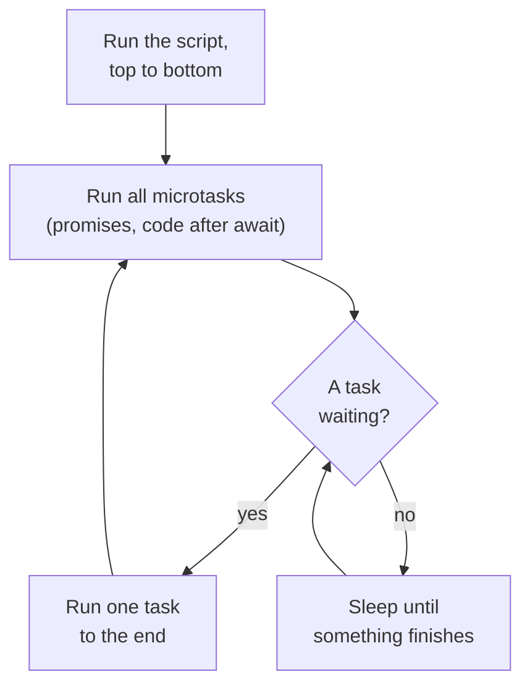
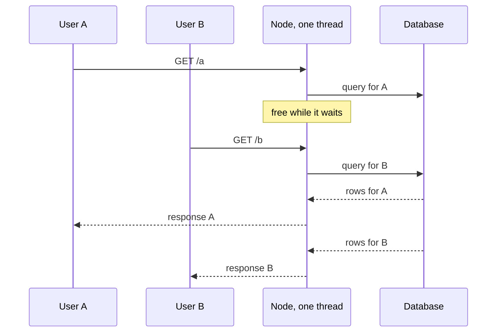

## The idea

Picture a small restaurant with **one waiter**. The waiter takes table 1's order and hands it to the kitchen. They don't stand at the kitchen door waiting for the food. They go to table 2, then table 3. When a dish is ready, the kitchen rings a bell, and the waiter carries it out as soon as they are free. One waiter serves many tables, because most of the time is spent **waiting for the kitchen**, not walking.

JavaScript works like this waiter:

- **One thread** runs your JavaScript. A **thread** is one line of work that the computer runs step by step.
- Slow jobs, like reading a file, a database query or a network call, are handed to the system (the kitchen).
- When a slow job finishes, its callback waits in a queue. The **event loop** runs the next callback whenever the thread is free.

A typical Java server is more like a restaurant with **many waiters** (threads), often one per table. That needs more staff, and the waiters can bump into each other.

## Concurrency vs parallelism

- **Concurrency:** many tasks are **in progress** at the same time, taking turns. One cook making soup and rice: stir the soup, check the rice, stir the soup.
- **Parallelism:** many tasks **run at the very same moment**, on different CPU cores. Two cooks, each making one dish.

| | Concurrency | Parallelism |
| --- | --- | --- |
| Means | Tasks take turns and overlap in time | Tasks run at the same instant |
| Needs | One thread is enough | Several threads and CPU cores |
| Good for | Waiting work: network, disk, database | Heavy CPU work: images, hashing |
| In JavaScript | The event loop, `async` and `await` | Worker threads |

JavaScript on its main thread is **concurrent, but not parallel**.

## The event loop



There are two queues:

- **Tasks** (also called macrotasks): timers (`setTimeout`), finished I/O, incoming requests.
- **Microtasks:** promise callbacks and the code after an `await`. All of them run **before** the next task.

```js
console.log("1. start");

// setTimeout puts this callback in the task queue, even with a 0 ms delay.
setTimeout(() => {
    console.log("4. timer (a task)");
}, 0);

// .then() puts this callback in the microtask queue.
Promise.resolve().then(() => {
    console.log("3. promise (a microtask)");
});

console.log("2. end of the script");

// 1. start
// 2. end of the script
// 3. promise (a microtask)
// 4. timer (a task)
```

The script runs to the end first. Then all microtasks run. Only then does the timer task get its turn.

The key rule: **while a piece of JavaScript runs, nothing else runs.** A task is never stopped halfway for another one. (Node's real loop has named phases, like timers, poll and check, but this picture is enough for interviews.)

## async and await

`await` pauses **only the current function**, not the thread. While it waits, the event loop runs other work.

First, a small `sleep` helper that stands in for slow work, and a `cook` function that uses it:

```js
// Gives back a promise that finishes after "ms" milliseconds.
function sleep(ms) {
    return new Promise((resolve) => {
        setTimeout(resolve, ms);
    });
}

async function cook(dish, ms) {
    console.log(`start ${dish}`);

    // cook() pauses here until the timer ends.
    // The thread is free to run other work meanwhile.
    await sleep(ms);

    console.log(`done ${dish}`);
}
```

Now cook two dishes at once:

```js
const started = Date.now();

// Start both dishes. Each call runs until its first await,
// then gives back a promise right away. Neither waits for the other.
const rice = cook("rice", 300);
const soup = cook("soup", 200);

// Wait here until both dishes are done.
await Promise.all([rice, soup]);

const elapsed = Date.now() - started;
const roundedMs = Math.round(elapsed / 100) * 100;
console.log(`total: about ${roundedMs} ms`);

// start rice
// start soup
// done soup
// done rice
// total: about 300 ms   (not 500: the waits overlap)
```

The most important rule for concurrency bugs: **other code can only run at an `await`** (or between callbacks). The code between two `await`s runs as one block that nothing can cut into. That is why a check-then-write is safe with no `await` in the middle, and can break with one. See [Race Conditions and Locks](./race-conditions-locks.mdx).

## Don't block the event loop

Heavy CPU work holds the one thread, and everything else waits: timers, callbacks, other users' requests.

```js
const started = Date.now();

// How many ms since the start, rounded to the nearest 100.
function elapsed() {
    const ms = Date.now() - started;
    return Math.round(ms / 100) * 100;
}

// Ask for this callback to run after 0 ms.
setTimeout(() => {
    console.log(`timer ran after about ${elapsed()} ms`);
}, 0);

// 500 ms of pure CPU work. The thread is stuck in this loop,
// so the timer callback can't run until the loop ends.
while (Date.now() - started < 500) {
    // Do nothing. Just keep the thread busy.
}

console.log("busy loop done");

// busy loop done
// timer ran after about 500 ms   (it asked for 0 ms)
```

On a server, that loop makes **every user** wait 500 ms. Common causes: big loops, `JSON.parse` on huge data, slow regular expressions, and sync calls like `fs.readFileSync` inside a request handler.

## Worker threads: when you need them

A **worker thread** is a second JavaScript thread, with its own event loop and its own memory. Workers and the main thread talk by sending messages (`postMessage`). They don't share variables, unless you use the special `SharedArrayBuffer`.

Memory in a `SharedArrayBuffer` really is shared. Two workers can change it at the very same instant, so a race can happen at **any line**, just like with Java threads. Four workers that each add 1 to a shared number a million times usually end with less than 4 million. For shared memory, use the `Atomics` functions, like `Atomics.add`, which read and write as one step.

- **Use a worker** for CPU-heavy work: resizing images, hashing or compressing big files, heavy math.
- **Don't use one** for waiting work. A database call already leaves the thread free.

The example below is one file. First, the import and a slow function:

```js noRun
import { Worker, isMainThread, parentPort, workerData } from "node:worker_threads";

// Slow on purpose: for 40, it calls itself hundreds of millions of times.
function fib(number) {
    if (number < 2) {
        return number;
    }

    return fib(number - 1) + fib(number - 2);
}
```

Next, the main thread starts a worker that runs this same file. `isMainThread` tells each copy which side it is on:

```js noRun
if (isMainThread) {
    // Start this same file again, but in a new thread.
    // workerData is the input we hand to the worker.
    const thisFile = new URL(import.meta.url);
    const worker = new Worker(thisFile, { workerData: 40 });

    // Runs later, when the worker sends its answer back.
    worker.on("message", (result) => {
        console.log(`fib(40) = ${result}`);
    });

    // The main thread is not busy, so this timer runs on time.
    setTimeout(() => {
        console.log("main thread is still free");
    }, 10);
} else {
    // This part runs in the worker thread.
    const result = fib(workerData);
    parentPort.postMessage(result);
}

// main thread is still free
// fib(40) = 102334155
```

Node also uses a few background threads for you. A small **thread pool** (4 threads by default) runs file system work, `dns.lookup`, some `crypto` functions and `zlib` compression. Network sockets don't need it: the operating system tells Node when data arrives.

## How a Node server handles many requests at once

While request A waits for the database, the same thread starts request B:



You can see it with a real server. The example is one file, in two parts.

**Part 1: the server.** Every request waits 300 ms, like a slow database call, then answers "ok":

```js noRun
import http from "node:http";

// Gives back a promise that finishes after "ms" milliseconds.
function sleep(ms) {
    return new Promise((resolve) => {
        setTimeout(resolve, ms);
    });
}

const server = http.createServer(async (request, response) => {
    console.log(`start ${request.url}`);

    // Like a slow database call. This request pauses here,
    // and the thread is free to start other requests meanwhile.
    await sleep(300);

    console.log(`end ${request.url}`);
    response.end("ok");
});
```

**Part 2: two users.** User B arrives 100 ms after user A, while A is still waiting:

```js noRun
// Port 0 means "any free port". The callback runs once the server is ready.
server.listen(0, async () => {
    const port = server.address().port;
    const url = `http://localhost:${port}`;

    // User A sends a request. We don't wait for the answer yet.
    const requestA = fetch(`${url}/a`);

    // Wait 100 ms, then user B sends a request.
    await sleep(100);
    const requestB = fetch(`${url}/b`);

    // Wait until both users have their answers, then shut down.
    await Promise.all([requestA, requestB]);
    server.close();
    server.closeAllConnections();
});

// start /a
// start /b   <- B starts while A is still waiting
// end /a
// end /b
```

So one Node process can serve thousands of connections at once, as long as each request mostly **waits** (database, other services) and does little CPU work. To use every CPU core, run one Node process per core (the `cluster` module, or a process manager like PM2) behind a load balancer.

## JavaScript and Java, side by side

Interviewers often think in Java threads. This table translates:

| Java idea | In JavaScript |
| --- | --- |
| Many threads share the same objects | One thread runs your code; workers share nothing by default |
| A thread can be paused at **any line** | Your code can only be paused at an `await` |
| A thread pool (`ExecutorService`) | The event loop, plus Node's thread pool and worker threads |
| `CompletableFuture` | `Promise` |
| `synchronized`, `ReentrantLock` | Rarely needed; an async mutex when a check and a write are split by `await` |
| `AtomicInteger` | `Atomics`, only for workers that share a `SharedArrayBuffer` |
| `BlockingQueue` | An async queue; see [Producer-Consumer](./producer-consumer.mdx) |

Java 21 added **virtual threads**: very cheap threads, so a Java server can again use one thread per request, even with many thousands of waiting requests.

## In the real world

- **Node.js** runs JavaScript on one main thread. Its event loop and thread pool come from a C library called **libuv**.
- **Nginx** uses the same event-driven idea: a few worker processes, each with an event loop that handles thousands of connections.
- **Redis** runs commands one at a time on a single main thread, so each command is atomic, and it is still very fast because each command is short.
- **Browsers:** a long JavaScript loop freezes the page, because the same thread also handles clicks and drawing. Web Workers move heavy work off it.

## In the interview

In LLD rounds, concurrency appears as "what if two users do this at the same time?". Be ready to explain the JavaScript answer to an interviewer who thinks in Java threads.

> "My code runs in Node, so no two lines of my code run at the same instant. But requests interleave at every `await`. So any check-then-write with an `await` in the middle can race, and I protect those with an atomic method or a lock. With several server processes, the real guard has to be in the database."

**Likely follow-up:** "JavaScript is single-threaded, so it has no race conditions, right?"

**Answer:** "No. Plain code can't be interrupted, but async code interleaves at every `await`. And several Node processes can change the same database row at once. Both cause races."

<Callout title="Remember this" type="success">
  - **One waiter, many tables:** one thread plus the event loop. One task runs at a time, to the end.
  - **Concurrency** is taking turns; **parallelism** is the same instant. The main thread is concurrent, not parallel.
  - `await` pauses the function, not the thread. Other code runs **only at an `await`**.
  - CPU-heavy work blocks everyone: move it to a **worker thread**.
  - Java threads can be paused **at any line**, which is why Java talks so much about locks.
</Callout>
