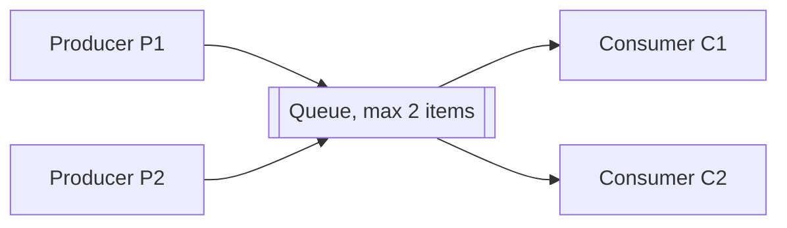

## The idea

Think of a **bakery**. Bakers put trays of bread on a rack. Shop assistants take trays from the rack to the shelves. The rack has room for only 5 trays.

- If the **rack is full**, the bakers wait before putting more on it.
- If the **rack is empty**, the assistants wait for the next tray.
- Neither side has to work at the other's speed. The rack takes up the difference.

That is the **Producer-Consumer** pattern:

- a **producer** makes work items: orders, log lines, emails to send;
- a **consumer** takes items and handles them;
- a **queue** (also called a buffer) sits between them;
- a **bounded** queue has a maximum size.



## Why a queue helps

- **Loose coupling:** producers don't know who consumes, or how many consumers there are.
- **Smoothing bursts:** 100 orders arrive in one second, and the cooks work through them at their own pace.
- **Easy scaling:** consumers too slow? Add another one. Nothing else changes.

## Why the queue must be bounded

If producers are faster than consumers, an unbounded queue grows until the process runs out of memory. A size limit forces you to choose what happens when the queue is full:

| When full | What happens | Good for |
| --- | --- | --- |
| **Wait** | The producer pauses until there is room | Work that must not be lost: orders, payments |
| **Drop** | Throw away the new item, or the oldest one | Data where only the latest matters: live metrics |
| **Reject** | Return an error: "busy, try again later" | Servers under too much load (HTTP 429 or 503) |

Making a fast producer slow down to match its consumers is called **backpressure**.

## An async bounded queue in JavaScript

The rules:

- `put(item)` waits while the queue is full;
- `take()` waits while the queue is empty;
- each side wakes up one waiting task on the other side.

**Step 1: a waiting line.** A small helper that lets a task pause until another task wakes it up:

```js
// A line of paused tasks. Each one waits until someone wakes it up.
class WaitingLine {
    constructor() {
        // One wake-up function per waiting task, oldest first.
        this.wakeUps = [];
    }

    // Gives back a promise that finishes only when wakeOne() is called.
    // A task that awaits it stays paused until then.
    wait() {
        return new Promise((resolve) => {
            // Calling resolve later finishes the promise and wakes the task.
            this.wakeUps.push(resolve);
        });
    }

    // Wakes the task that has waited longest. Does nothing if nobody waits.
    wakeOne() {
        const wakeUp = this.wakeUps.shift();

        if (wakeUp) {
            wakeUp();
        }
    }
}
```

**Step 2: the queue.** It keeps two waiting lines, one for each side:

```js
class BoundedQueue {
    constructor(capacity) {
        this.items = [];
        this.capacity = capacity;
        // Consumers waiting for an item.
        this.waitingTakers = new WaitingLine();
        // Producers waiting for room.
        this.waitingPutters = new WaitingLine();
    }

    isEmpty() {
        return this.items.length === 0;
    }

    isFull() {
        return this.items.length >= this.capacity;
    }

    async put(item) {
        // Full: pause until a consumer makes room. Then check again.
        while (this.isFull()) {
            await this.waitingPutters.wait();
        }

        this.items.push(item);
        // There is an item now: wake one waiting consumer.
        this.waitingTakers.wakeOne();
    }

    async take() {
        // Empty: pause until a producer adds an item. Then check again.
        while (this.isEmpty()) {
            await this.waitingTakers.wait();
        }

        const item = this.items.shift();
        // There is room now: wake one waiting producer.
        this.waitingPutters.wakeOne();
        return item;
    }
}
```

Notice the `while`, not `if`. When a task wakes up, another task may already have taken the free slot (or the item). So it **checks again** before going on. Java code does the same: a thread always calls `wait()` inside a `while` loop.

## Try it: 2 producers and 2 consumers

Two producers take orders quickly (every 10 ms). Two cooks are slow (45 ms per order). The queue holds only 2 orders. The four parts below run together with the two classes above, as one file.

**Part 1: the setup.** A `sleep` helper, a small queue, and a stop signal:

```js
// Gives back a promise that finishes after "ms" milliseconds.
function sleep(ms) {
    return new Promise((resolve) => {
        setTimeout(resolve, ms);
    });
}

// Room for only 2 orders.
const queue = new BoundedQueue(2);

// A special item that means "no more work: stop".
const STOP = "STOP";
```

**Part 2: the producer.** It adds its orders one by one:

```js
async function producer(name, count) {
    for (let i = 1; i <= count; i++) {
        const order = `${name}-order${i}`;

        if (queue.isFull()) {
            console.log(`${name} waits: queue full`);
        }

        // Wait here until the queue has room for this order.
        await queue.put(order);
        console.log(`${name} added ${order}`);

        // Taking the next order is quick: wait 10 ms.
        await sleep(10);
    }
}
```

**Part 3: the consumer.** It takes orders and cooks them until it gets the stop signal:

```js
async function consumer(name) {
    while (true) {
        if (queue.isEmpty()) {
            console.log(`${name} waits: queue empty`);
        }

        // Wait here until there is an order to take.
        const order = await queue.take();

        if (order === STOP) {
            return;
        }

        console.log(`${name} cooks ${order}`);

        // Cooking is slow: wait 45 ms before taking the next order.
        await sleep(45);
    }
}
```

**Part 4: run it.** Start the cooks first, then the producers:

```js
// Start both cooks. They wait in the background for orders.
const cooks = [consumer("C1"), consumer("C2")];

// Start both producers, and wait until all their orders are in the queue.
await Promise.all([producer("P1", 3), producer("P2", 3)]);

// One stop signal per consumer.
// Each put waits if the queue is full.
await queue.put(STOP);
await queue.put(STOP);

// Wait until both cooks have stopped.
await Promise.all(cooks);
console.log("all orders cooked");
```

It prints:

```text
C1 waits: queue empty
C2 waits: queue empty
P1 added P1-order1
P2 added P2-order1
C1 cooks P1-order1
C2 cooks P2-order1
P1 added P1-order2
P2 added P2-order2
P1 waits: queue full
P2 waits: queue full
C1 cooks P1-order2
P1 added P1-order3
C2 cooks P2-order2
P2 added P2-order3
C1 cooks P1-order3
C2 cooks P2-order3
all orders cooked
```

Reading the output:

- At the start, both cooks **wait**, because the queue is empty.
- The producers add orders faster than the cooks finish them, so the queue fills up and **both producers wait**. That is backpressure.
- Each time a cook takes an order, one producer **wakes up** and adds its next order.
- At the end, one `STOP` item per consumer tells the cooks to finish. This is often called a **poison pill**.

Java has this queue built in: `ArrayBlockingQueue` is a bounded queue whose `put()` waits when it is full and whose `take()` waits when it is empty.

## Common mistakes

- **An unbounded queue.** Fine in tests, out of memory in production.
- **`if` instead of `while`** around the wait. A woken task must check again.
- **No way to stop.** Consumers wait forever for work that never comes. Send a stop signal per consumer, or close the queue.
- **Losing work in a crash.** An in-memory queue is gone when the process dies. For work that must survive, use a durable queue: a message broker or a database table.
- **Expecting order.** With two consumers, order 2 can finish before order 1.

## In the real world

- **Node.js streams** use backpressure: `writable.write()` returns `false` when the stream's buffer is full, and the producer should wait for the `'drain'` event before writing more.
- **Message brokers** like RabbitMQ, Amazon SQS and Kafka are producer-consumer across machines: services publish messages, and workers consume them at their own pace. See [Message Queues and Pub/Sub](/learn/system-design/messaging/message-queues-pub-sub).
- **Job queues** like BullMQ (built on Redis) let web servers add jobs, while separate worker processes run them.
- **Java's `BlockingQueue`** with a thread pool (`ExecutorService`) is the standard Java form.

## In the interview

Producer-Consumer fits whenever work arrives faster, or in bigger bursts, than it can be done: a [Logger](../problems/logger.mdx) that writes to disk in the background, sending notifications, order processing, a web crawler's list of URLs to visit, or requests waiting for an [Elevator](../problems/elevator.mdx) controller.

> "Requests arrive in bursts, but sending email is slow. I'll put a bounded queue between them: the API is the producer and only adds a job, and two workers are the consumers. If the queue is full, the producer waits, so memory can't run out. In one process, that's an async queue. Across services, I'd use SQS or Kafka."

**Likely follow-up:** "What if a consumer crashes halfway through an item?"

**Answer:** "With an in-memory queue, the item is lost. For important work, I'd use a durable broker where the consumer acknowledges an item only after it finishes. If it crashes first, the item goes back to the queue. That means an item can be handled twice, so the handler must be idempotent, which means safe to run twice." See [Delivery Guarantees](/learn/system-design/messaging/delivery-guarantees) and [Idempotency](/learn/system-design/messaging/idempotency).

<Callout title="Remember this" type="success">
  - **Producer-Consumer = the bakery rack.** Producers add, consumers take, and a queue sits between them so each side works at its own speed.
  - **Bound the queue**, and decide what happens when it is full: wait (backpressure), drop or reject.
  - In JavaScript: `put` awaits while full, `take` awaits while empty, and each **checks again in a `while`** after waking up.
  - Stop consumers with **one stop signal per consumer**.
  - Across services it becomes a **message broker**: acknowledge after the work, and make handlers idempotent.
</Callout>
