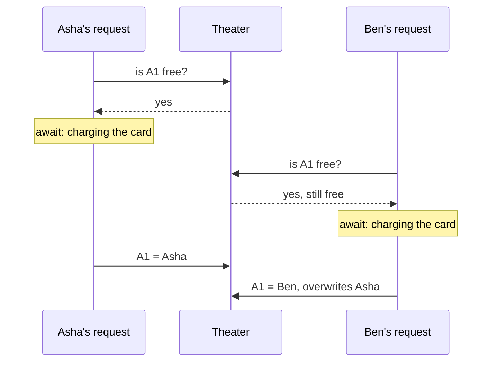
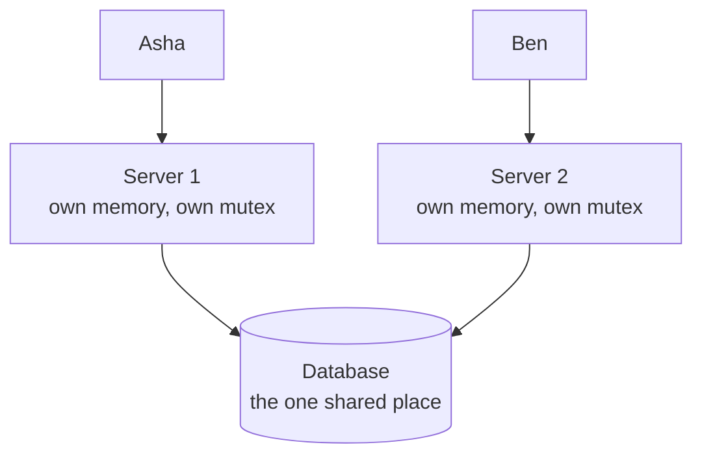

## The idea

A cinema has two ticket counters and one shared seat map. Asha asks clerk 1 for seat A1. At the same moment, Ben asks clerk 2 for seat A1. Both clerks look at the map: A1 is free. Both take the money. Both write a name on A1. Two people now hold a ticket for one seat.

That is a **race condition**: the result depends on the timing of two tasks that use the same data.

- The risky shape is **check-then-act**: read something ("is A1 free?"), then act on it ("book it"), while someone else can change it in between.
- The code that reads and changes the shared data is the **critical section**. Only one task at a time should be inside it.

## "But JavaScript has only one thread"

True: on one thread, two lines of JavaScript never run at the same instant (see [Concurrency in JavaScript](./concurrency-in-javascript.mdx)). But an `await` hands the thread to other requests. If an `await` sits between the check and the write, another request can run its own check in that gap.

Run this, and both bookings succeed.

**Step 1: a helper.** `sleep` stands in for slow work, like charging a card. All the examples on this page use it:

```js
// Gives back a promise that finishes after "ms" milliseconds.
function sleep(ms) {
    return new Promise((resolve) => {
        setTimeout(resolve, ms);
    });
}
```

**Step 2: the theater.** It checks the seat, waits for the payment, then writes:

```js
class Theater {
    constructor() {
        // seat -> who booked it (null means free)
        this.seats = new Map([["A1", null]]);
    }

    async bookSeat(seatId, user) {
        // 1. Check: is the seat free?
        if (this.seats.get(seatId) !== null) {
            return `${user}: sorry, ${seatId} is taken`;
        }

        // 2. Wait, for example to charge the card.
        // bookSeat pauses here, and other requests run now!
        await sleep(50);

        // 3. Write: give the seat to this user.
        this.seats.set(seatId, user);
        return `${user}: booked ${seatId}`;
    }

    ownerOf(seatId) {
        return this.seats.get(seatId);
    }
}
```

**Step 3: two users book at once.** Both ask for seat A1 at the same moment:

```js
const theater = new Theater();

// Two users press "Book" at the same moment.
// Promise.all waits until both bookings have finished.
const results = await Promise.all([
    theater.bookSeat("A1", "Asha"),
    theater.bookSeat("A1", "Ben"),
]);

console.log(results); // [ 'Asha: booked A1', 'Ben: booked A1' ]  <- both "won"
console.log(theater.ownerOf("A1")); // Ben  <- Asha paid, but the seat is Ben's
```

What happened, step by step:



Asha paid but has no seat. Her write was silently replaced: a **lost update**.

In Java the gap can be anywhere: two threads can be paused at any line, not only at an `await`. That is why Java code needs `synchronized` and locks so often.

## Fix 1: make the check and the write atomic

**Atomic** means "all in one go: nothing can cut in". In JavaScript, plain code with **no `await`** is atomic. So check and claim the seat first, and do the slow work after:

```js
// Uses the sleep helper from Step 1 above.
class Theater {
    constructor() {
        this.seats = new Map([["A1", null]]);
    }

    async bookSeat(seatId, user) {
        // Check and write together, with no await between them.
        // Nothing can cut in here.
        if (this.seats.get(seatId) !== null) {
            return `${user}: sorry, ${seatId} is taken`;
        }
        this.seats.set(seatId, user);

        try {
            // The slow part (charge the card) comes after we hold the seat.
            // Other requests run during this wait, but the seat is already ours.
            await sleep(50);
            return `${user}: booked ${seatId}`;
        } catch (error) {
            // Payment failed: give the seat back.
            this.seats.set(seatId, null);
            throw error;
        }
    }
}
```

Two users book at the same moment again:

```js
const theater = new Theater();

// Start both bookings, and wait until both have finished.
const results = await Promise.all([
    theater.bookSeat("A1", "Asha"),
    theater.bookSeat("A1", "Ben"),
]);

console.log(results); // [ 'Asha: booked A1', 'Ben: sorry, A1 is taken' ]
```

This is the simplest fix, and the best one for data in memory. The cost: if the slow step fails, you must **undo** the claim, which the `catch` does.

## Fix 2: a lock (mutex)

Sometimes the check itself needs an `await`, for example when the seat is read from another service. Then use a **lock**, also called a **mutex** (short for "mutual exclusion"): only the task holding the lock may enter the critical section, and the others wait in line.

```js
class Mutex {
    constructor() {
        this.locked = false;
        // Wake-up functions of the tasks waiting in line, oldest first.
        this.waiting = [];
    }

    // Waits until this task holds the lock, then gives back a release function.
    async lock() {
        if (this.locked) {
            // Taken: join the line. "resolve" is our wake-up function.
            // We stay paused here until the holder calls it.
            await new Promise((resolve) => {
                this.waiting.push(resolve);
            });
        } else {
            // Free: take the lock now.
            this.locked = true;
        }

        let released = false;
        const release = () => {
            // Releasing twice does nothing.
            if (released) {
                return;
            }
            released = true;

            const next = this.waiting.shift();
            if (next) {
                // Hand the lock straight to the next task in line.
                next();
            } else {
                // Nobody is waiting: the lock is free again.
                this.locked = false;
            }
        };

        return release;
    }
}
```

How it works:

- `lock()` returns a promise. If the lock is free, the task gets it at once. If not, the task waits in the `waiting` line.
- The promise gives back a **release function**. Calling it hands the lock to the next task in line, first come, first served. The lock never becomes free in between, so nobody can jump the line.

Now the booking from the start is safe, even with the `await` in the middle:

```js
// Runs together with the sleep helper and the Mutex class above, as one file.
class Theater {
    constructor() {
        this.seats = new Map([["A1", null]]);
        this.mutex = new Mutex();
    }

    async bookSeat(seatId, user) {
        // Wait here for our turn. If another booking holds the lock,
        // we stay paused until it calls its release function.
        const release = await this.mutex.lock();

        try {
            if (this.seats.get(seatId) !== null) {
                return `${user}: sorry, ${seatId} is taken`;
            }

            // Charge the card. Safe now: every other booking
            // is still waiting for the lock, so nobody can cut in.
            await sleep(50);

            this.seats.set(seatId, user);
            return `${user}: booked ${seatId}`;
        } finally {
            // "finally" always runs, after a return or an error.
            // Unlock here, so the next booking in line can start.
            release();
        }
    }
}
```

Two users book at the same moment, as before:

```js
const theater = new Theater();

// Start both bookings, and wait until both have finished.
const results = await Promise.all([
    theater.bookSeat("A1", "Asha"),
    theater.bookSeat("A1", "Ben"),
]);

console.log(results); // [ 'Asha: booked A1', 'Ben: sorry, A1 is taken' ]
```

Two things to know:

- **Always release in `finally`.** Otherwise one error leaves the lock held forever, and every later booking waits forever.
- **One lock for the whole theater** makes bookings for different seats wait for each other. One lock per seat is better. See [Making a Design Thread-Safe](./thread-safe-design.mdx).

In real projects, the npm package `async-mutex` gives you a ready-made `Mutex`. Java has the same tool built in: a `synchronized` block, or a `ReentrantLock` with `lock()`, and `unlock()` in a `finally` block.

## Fix 3: many servers? Let the database decide

Fix 1 and Fix 2 live in **one process's memory**. Most real apps run several server processes behind a load balancer, and server 1's mutex knows nothing about server 2's.



So the rule must live where the data is shared: in the database.

**A conditional update** checks and writes in one statement, and the database makes it atomic:

```sql
UPDATE seats SET booked_by = 'asha'
WHERE show_id = 7 AND seat_id = 'A1' AND booked_by IS NULL;
-- 1 row changed: Asha got the seat. 0 rows changed: someone was faster.
```

**A unique index** makes a second booking of the same seat impossible:

```sql
CREATE UNIQUE INDEX one_booking_per_seat ON bookings (show_id, seat_id);
-- A second INSERT for the same show and seat fails with a unique-violation error.
```

For row locks, `SELECT ... FOR UPDATE` and optimistic locking with a version number, see [Locks and Deadlocks](/learn/system-design/databases/locking). When the shared thing is not a database row, see [Distributed Locking](/learn/system-design/distributed-systems/distributed-locking).

## Deadlock

A **deadlock** is two tasks that each hold one lock and wait for the other's. Neither can move, ever. Think of two cars meeting on a one-lane bridge, each waiting for the other to back up.

Example: Asha's booking locks seat A1, then waits for A2. Ben's booking locks A2, then waits for A1. In JavaScript you get no error: both promises just never finish.

How to avoid it:

1. **Lock in the same order** everywhere, for example by sorted seat IDs. Then the circle can't form.
2. **Hold locks briefly**, and take as few as you can.
3. **Use a timeout:** give up and retry if a lock takes too long.

Databases find deadlocks on their own and cancel one of the transactions, so your code should retry it.

## Common mistakes

- **An `await` between the check and the write.** Look for it in every "book", "reserve", "withdraw" or "assign" method.
- **Not releasing the lock** when something throws. Always use `try`/`finally`.
- **One big lock for everything.** It is correct, but everyone waits in one line.
- **Locking the same mutex twice in one task.** This `Mutex` is not reentrant: a task that calls `lock()` again while it holds the lock waits for itself forever. Java's `synchronized` and `ReentrantLock` are reentrant: the same thread may lock again.
- **Trusting an in-memory lock with many servers.** Use a database rule.

## In the real world

- In 2014, **Flexcoin**, a small Bitcoin bank, shut down after an attacker sent many transfer requests at the same moment. The balance checks ran before the balances were updated, so the same coins were moved many times. An atomic update or a lock would have stopped it.
- **`async-mutex`** on npm gives JavaScript a `Mutex` and a `Semaphore` (a lock that lets N tasks in at once).
- **PostgreSQL and MySQL** lock a row during an `UPDATE`, so a second update of the same row waits until the first one commits.

## In the interview

When the interviewer asks "what if two users book the same seat at the same time?":

> "In Node, two requests never run the same line at once, but they interleave at every `await`. My `bookSeat` checks the seat and then awaits payment, so two requests could both see it free. Inside one process, I'd claim the seat before any `await`, or guard it with a per-seat mutex. Since we'll run several servers, the real guarantee is in the database: a conditional `UPDATE ... WHERE booked_by IS NULL`, or a unique index on show and seat."

**Likely follow-up:** "Pessimistic or optimistic locking?"

**Answer:** "Pessimistic, which means lock first, when clashes are common, like the last seats for a hit concert. Optimistic, which means saving a version number and checking it when you save, when clashes are rare, like editing a profile."

<Callout title="Remember this" type="success">
  - A **race** is when the result depends on timing. The danger shape is **check, `await`, write**.
  - **Fix 1:** check and write with **no `await` between** them (atomic).
  - **Fix 2:** a **mutex** around the critical section, released in `finally`.
  - **Fix 3:** many servers? A **database rule**: a conditional update or a unique index.
  - **Deadlock:** lock in the same order, hold locks briefly, use timeouts.
</Callout>
