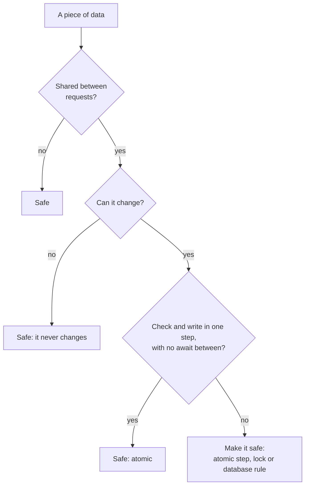

## The idea

Think of a **shared kitchen** with many cooks. Each cook has their own cutting board, and nobody needs rules for that. Rules are only needed for the **shared** things: one fridge, one stove. "One person at the stove at a time." "Write your name on the last egg before you start cooking with it."

**Thread-safe** means an object stays correct even when many requests (or threads) use it at the same time. You get there in three steps:

1. find the **shared state**;
2. find every **check-then-write** on it;
3. make each one **safe**.

## Step 1: find the shared state

**Shared state** is data that more than one request can read or change. Ask three questions about each object:

- Does it **live longer than one request**? A `ParkingLot`, a `Theater`, a cache, a singleton.
- Can it **change** after it is created?
- Can **two requests reach it** at the same time?

If all three answers are "yes", it needs care.

| Data | Shared? | Needs care? |
| --- | --- | --- |
| Local variables inside a method | No, each call has its own | No |
| An object made fresh for each request | No | No |
| Frozen config and enums (`Object.freeze`) | Yes, but it never changes | No |
| The lot's map of spots, the show's map of seats | Yes, and it changes | **Yes** |
| A counter of free spots | Yes, and it changes | **Yes** |



## Step 2: pick a tool, simplest first

1. **Don't share.** Keep data in local variables or in objects made per request.
2. **Don't change.** Make shared data immutable: freeze it, or build a new object instead of editing the old one.
3. **Atomic step.** Do the check and the write with no `await` between them.
4. **Lock.** A mutex around the critical section, when an `await` can't be avoided. See [Race Conditions and Locks](./race-conditions-locks.mdx).
5. **Database rule.** A unique index or a conditional `UPDATE`, when there are many servers.

Three rules for locks:

- **Lock per object, not the whole system.** Lock one seat, not the whole show. One global lock is like one checkout lane for a whole supermarket: correct, but everyone queues.
- **Keep critical sections small.** Hold the lock only around the check and the write. Never hold it while sending an email or waiting on a slow service.
- **Lock in the same order.** When you need several locks, always take them in a fixed order, like sorted IDs. Then two tasks can't deadlock.

Java has ready-made tools for these: `ConcurrentHashMap` for shared maps, `AtomicInteger` for counters, and `synchronized` or `ReentrantLock` for critical sections.

## Example: the parking lot's "assign spot"

The shared state is the lot's map of spots. The unsafe version finds a free spot, awaits something, then takes the spot:

```js
// Unsafe, and not complete code: it only shows the bug.
async assignSpot(plate) {
  const spot = this.#findFreeSpot();  // 1. find
  await this.#printTicket(plate);     // 2. other cars run here and find the same spot
  this.#spots.set(spot, plate);       // 3. take: two cars, one spot
}
```

The safe version **finds and takes** the spot in one synchronous step, then does the slow work:

```js
const sleep = (ms) => new Promise((resolve) => setTimeout(resolve, ms));

class ParkingLot {
  #spots = new Map([['S1', null], ['S2', null]]); // spot -> plate (null = free)

  #takeFreeSpot(plate) { // find AND take, in one synchronous step
    for (const [spot, plateThere] of this.#spots) {
      if (plateThere === null) {
        this.#spots.set(spot, plate);
        return spot;
      }
    }
    return null;
  }

  async assignSpot(plate) {
    const spot = this.#takeFreeSpot(plate); // atomic: no await inside
    if (!spot) return `${plate}: lot is full`;
    try {
      await sleep(30); // print the ticket, open the gate...
      return `${plate}: park at ${spot}`;
    } catch (error) {
      this.#spots.set(spot, null); // something failed: free the spot again
      throw error;
    }
  }
}

const lot = new ParkingLot();
const cars = ['CAR-1', 'CAR-2', 'CAR-3']; // three cars reach two gates at once
console.log(await Promise.all(cars.map((plate) => lot.assignSpot(plate))));
// [ 'CAR-1: park at S1', 'CAR-2: park at S2', 'CAR-3: lot is full' ]
```

No lock is needed here. The check doesn't need an `await`, so an atomic step is enough.

## Example: the booking's "hold seat"

A user picks several seats, and the system **holds** them for a few minutes while the user pays. The shared state is the map of held seats. The hold must be saved to the database (an `await`) before we say yes. We use locks here, so nobody sees a half-saved hold, and we follow all three rules:

- **one lock per seat**, so Chen, who wants B1, never waits for Asha;
- **sorted order**, so Asha asks for A2 and A1 but locks A1 first, the same order as Ben;
- **a small critical section**, released in `finally` right after the write.

**Part 1** is the `Mutex` class from [Race Conditions and Locks](./race-conditions-locks.mdx):

```js
class Mutex {
  #locked = false;
  #waiting = []; // wake-up functions of tasks waiting for the lock

  async lock() {
    if (this.#locked) {
      await new Promise((resolve) => this.#waiting.push(resolve)); // wait in line
    } else {
      this.#locked = true;
    }
    let released = false;
    return () => { // the release function
      if (released) return; // releasing twice does nothing
      released = true;
      const next = this.#waiting.shift();
      if (next) next(); // hand the lock straight to the next task in line
      else this.#locked = false;
    };
  }
}
```

**Part 2** is the booking:

```js
// Runs together with the Mutex class above, as one file.
const sleep = (ms) => new Promise((resolve) => setTimeout(resolve, ms));

class ShowBooking {
  #holds = new Map(); // seatId -> user holding it
  #locks = new Map(); // seatId -> Mutex: one lock per seat, not one for the whole show

  #lockFor(seatId) {
    if (!this.#locks.has(seatId)) this.#locks.set(seatId, new Mutex());
    return this.#locks.get(seatId);
  }

  async holdSeats(user, seatIds) {
    const sorted = [...seatIds].sort(); // everyone locks in the same order: no deadlock
    const releases = [];
    for (const id of sorted) releases.push(await this.#lockFor(id).lock());
    try {
      const taken = sorted.filter((id) => this.#holds.has(id));
      if (taken.length > 0) return `${user}: ${taken.join(', ')} already held`;
      await sleep(30); // save the hold to the database
      for (const id of sorted) this.#holds.set(id, user);
      return `${user}: holding ${sorted.join(', ')}`;
    } finally {
      for (const release of releases) release(); // unlock as soon as we are done
    }
  }
}

const show = new ShowBooking();
console.log(await Promise.all([
  show.holdSeats('Asha', ['A2', 'A1']),
  show.holdSeats('Ben', ['A1', 'A3']), // wants A1 too: waits for Asha, then fails
  show.holdSeats('Chen', ['B1']), // other seats: never waits for Asha
]));
// [ 'Asha: holding A1, A2', 'Ben: A1 already held', 'Chen: holding B1' ]
```

A real system also lets holds **expire** (keep a `holdExpiresAt` time, and treat old holds as free). With many servers, the in-memory locks no longer protect anything, so the database becomes the guard:

```sql
-- Run inside a transaction. If fewer rows change than seats asked for, roll back.
UPDATE seats SET held_by = 'asha', hold_expires_at = now() + interval '10 minutes'
WHERE show_id = 7 AND seat_id IN ('A1', 'A2')
  AND (held_by IS NULL OR hold_expires_at < now());
```

## Answering "is this thread-safe?"

Walk through the same five steps every time:

1. **Name the shared state.** "The shared state is the seat map. Everything else is per request."
2. **Point at the check-then-write.** "`holdSeats` checks the seats, then writes the hold."
3. **Say where they can interleave.** "In Node, only at an `await`. In Java, at any line."
4. **Give the fix and its trade-off.** "Per-seat locks in sorted order: different seats don't block each other, and no deadlock."
5. **Go beyond one server.** "With several servers, the database is the real guard: a conditional update or a unique index."

## Common mistakes

- **One big lock for everything.** Correct, but nobody can book any seat while one payment runs.
- **Holding a lock during slow calls** like payment or email. Everyone waits for the slowest service.
- **Taking locks in a different order** in two places. That is how deadlocks start.
- **Forgetting the many-server case.** An in-memory lock protects only one process.
- **Handing out shared data.** A getter that returns the real `Map` lets callers change it without your locks. Return a copy.

## In the real world

- **Java's `ConcurrentHashMap`** is safe for many threads because it locks small parts of the map, not the whole map: "lock per object" in action.
- **Databases** use row locks for updates, so two updates to different rows don't wait for each other.
- **Redis** runs commands one at a time, so commands like `INCR` and `SET ... NX` are atomic without any lock in your code.

## In the interview

Concurrency usually comes up in step 6 of [The LLD Interview Framework](../interview-framework.mdx), under "two requests at once". Bring it up yourself in a [Parking Lot](../problems/parking-lot.mdx), [Movie Ticket Booking](../problems/movie-ticket-booking.mdx) or [Hotel Booking](../problems/hotel-booking.mdx).

> "The only shared state that changes is the seat map. The risky spot is `holdSeats`: it checks the seats, awaits the database, then writes. I lock each seat it touches, in sorted order so two users can't deadlock, and I release in `finally`. Different seats don't block each other. Across several servers, the in-memory lock isn't enough, so a conditional `UPDATE ... WHERE held_by IS NULL` in the database is the real guard."

**Likely follow-up:** "Why not just lock the whole parking lot?"

**Answer:** "It's correct, and fine for a small lot or a first version. But every car would wait for every other car, even at different gates and floors. Locking per spot, or per floor, lets cars that want different spots go at the same time."

<Callout title="Remember this" type="success">
  - First **find the shared state that changes**; everything else is already safe.
  - Prefer, in order: **don't share, don't change, atomic step, lock, database rule**.
  - Lock rules: **per object**, **small critical sections**, **the same order** everywhere.
  - In Node, the danger is only at an `await`; in Java, it is at **any line**.
  - With many servers, the **database is the real guard**.
</Callout>
