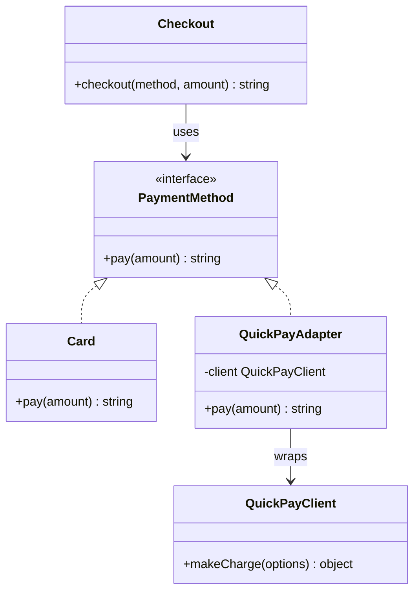

## The idea

You fly from India to London with your laptop charger. The plug doesn't fit the wall socket. You don't rewire the wall, and you don't cut the charger. You put a small **travel adapter** between them.

An **Adapter** does that for code. It wraps a class whose methods don't fit, and makes it look like the interface your code already uses.

- **Intent:** let a class with the "wrong" interface work with your code, by wrapping it in a translator.
- **Group:** Structural (patterns about how objects fit together).

## The problem

Your checkout works with any `PaymentMethod` that has `pay(amount)`. Now the business wants a new provider, QuickPay. Its library, from npm, looks different: `makeCharge({ cents, currency })`, and it returns a status object. You can't change their code.

The quick fix puts their API right inside your checkout:

```js
class Card {
  pay(amount) { return `Paid ${amount} by card`; }
}

// From an npm package. We can't change it.
class QuickPayClient {
  makeCharge({ cents, currency }) {
    return { status: 'ok', ref: `QP-${cents}-${currency}` };
  }
}

function checkout(method, amount) {
  if (method instanceof QuickPayClient) { // special case
    const res = method.makeCharge({ cents: amount * 100, currency: 'USD' });
    return res.status === 'ok' ? `Paid ${amount} by QuickPay` : 'Payment failed';
  }
  return method.pay(amount);
}

console.log(checkout(new QuickPayClient(), 25)); // Paid 25 by QuickPay
```

- Checkout now knows QuickPay's method names, cents and status codes.
- Refunds, reports and receipts will need the same special case.
- Switching to another provider means editing all of them.

## The pattern

| Role | In the example | What it is |
| --- | --- | --- |
| Target | `PaymentMethod` | The interface your code expects |
| Adaptee | `QuickPayClient` | The class that doesn't fit |
| Adapter | `QuickPayAdapter` | Has the target's methods, and calls the adaptee inside |
| Client | `checkout` | Your code, which only knows the target |



```js
class PaymentMethod { // interface
  pay(amount) { throw new Error('not implemented'); }
}

class Card extends PaymentMethod {
  pay(amount) { return `Paid ${amount} by card`; }
}

// From an npm package. We can't change it.
class QuickPayClient {
  makeCharge({ cents, currency }) {
    return { status: 'ok', ref: `QP-${cents}-${currency}` };
  }
}

class QuickPayAdapter extends PaymentMethod {
  #client;
  constructor(client) {
    super();
    this.#client = client;
  }
  pay(amount) { // translate our call into theirs
    const res = this.#client.makeCharge({ cents: Math.round(amount * 100), currency: 'USD' });
    if (res.status !== 'ok') throw new Error('QuickPay payment failed');
    return `Paid ${amount} by QuickPay (${res.ref})`;
  }
}

function checkout(method, amount) {
  return method.pay(amount); // knows only the interface
}

console.log(checkout(new Card(), 40)); // Paid 40 by card
console.log(checkout(new QuickPayAdapter(new QuickPayClient()), 25));
// Paid 25 by QuickPay (QP-2500-USD)
```

Checkout is back to one line. Everything about QuickPay lives in one small class. This is [Dependency Inversion](../design-principles/dependency-inversion.mdx) in practice: your code depends on your own interface, and the adapter bridges to the outside code.

The textbook also shows a **class adapter**, which inherits from the target and the adaptee at once. A JavaScript class can extend only one class, so **wrapping** the object, as above, is the normal choice. That form is called an **object adapter**.

### The JavaScript way: a function adapter

An adapter doesn't have to be a class. Node's `util.promisify` is an adapter for functions: it takes an old **callback-style** function and returns one that gives back a **promise**.

```js
import { promisify } from 'node:util';

// An old API in callback style: callback(error, result)
function findUser(id, callback) {
  setTimeout(() => callback(null, { id, name: 'Asha' }), 10);
}

const findUserAsync = promisify(findUser); // the adapter
const user = await findUserAsync(7);
console.log(user.name); // Asha
```

Thanks to **duck typing** (if it has a `pay` method, it can be used as a payment method), an adapter can also be a plain object with the right methods.

<Callout title="Adapter vs Facade" type="idea">
  An adapter makes **one** existing thing fit an interface you **already have**. A
  [Facade](../design-patterns/facade.mdx) creates a **new, simpler** interface over **many** things.
</Callout>

## When to use it

- **Outside code** you can't change: an SDK, a library, an old part of the system.
- You want to **switch providers** later (payments, SMS, maps) without touching your core code.
- Two parts of your code expect **different shapes** for the same job.

## When not to use it

- You own both sides. Just change one of them to match.
- The shapes already fit. A wrapper that only passes calls through adds nothing.
- You want to hide a whole subsystem behind one simple call. That is a Facade.

## Common mistakes

- **Leaking the adaptee.** If `pay()` returns QuickPay's raw response, callers learn their API anyway. Return your own shape.
- **Not translating errors.** Turn their error codes into your errors, or callers must know both.
- **Business rules in the adapter.** An adapter only translates. Discounts and limits belong elsewhere.
- **One adapter for every provider**, full of `if`s. Write one small adapter per provider.

## In the real world

- **Node.js:** `util.promisify` turns callback-style functions into promise-style ones. Node's `fs` module offers file functions in both shapes: callbacks (`fs.readFile(path, callback)`) and promises (`fs/promises`).
- **Axios:** the HTTP library has a setting literally called `adapter`. It sends requests with `XMLHttpRequest` in the browser and with Node's `http` module on a server, behind the same `axios.get()` call.
- **Payment and messaging code** in real apps: each provider (Stripe, PayPal, Twilio) usually sits behind the app's own interface, with one adapter per provider.

## In the interview

Any time the problem has an **outside system** (a payment gateway, an SMS provider, a maps API), say:

> "Checkout depends on my `PaymentMethod` interface, not on the provider's SDK. For each provider I write a small adapter that turns `pay(amount)` into their call, and their errors into mine. Switching providers means writing a new adapter. Nothing else changes."

**Likely follow-up:** "How is an Adapter different from a Decorator?"

"Both wrap one object. An adapter **changes** the interface, so the object fits. A [Decorator](../design-patterns/decorator.mdx) **keeps** the same interface, and adds behavior."

<Callout title="Remember this" type="success">
  - An Adapter is a **travel plug** for code: it makes the wrong interface fit the one you use.
  - Roles: **target** (your interface), **adaptee** (their class), **adapter** (the translator).
  - Wrap the object (an **object adapter**). In JavaScript it can also be a function, like `util.promisify`.
  - Put every outside system behind **your own interface**, with **one adapter per provider**.
  - Adapter fits **one** thing to an existing interface. Facade makes a **new, simpler** front for many.
</Callout>
