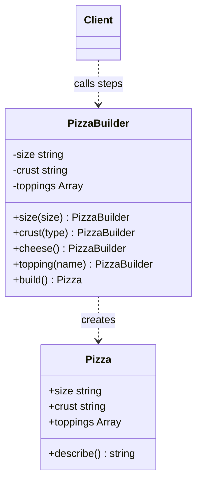

## The idea

At a sandwich shop you don't shout your whole order in one breath. You pick the bread, then the cheese, then the fillings, one step at a time. At the end, the person at the counter checks it ("you forgot to pick a bread") and only then makes the sandwich.

A **Builder** creates an object the same way: step by step, with clear names, and a final `build()` that checks everything and hands you the finished object.

- **Intent:** build a complex object step by step, and check that it is valid before it is made.
- **Group:** Creational (patterns about how objects are created).

## The problem

A pizza has many options. Put them all in the constructor, and you get this:

```js
class Pizza {
    constructor(size, crust, cheese, olives, onions, extraSauce) {
        this.size = size;
        this.crust = crust;
        this.cheese = cheese;
        this.olives = olives;
        this.onions = onions;
        this.extraSauce = extraSauce;
    }
}

const pizza = new Pizza("L", "thin", true, false, true, false);

// Which "true" was onions? You can't tell from the line above.
console.log(pizza.onions); // true
```

- You can't tell what `true, false, true, false` means without opening the class.
- Swap two of them, and you get the wrong pizza with no error.
- Want only onions? You still pass every argument before it.
- Nothing checks the order. `new Pizza()` happily makes a pizza with no size.

This is called a **telescoping constructor**: a constructor whose list of arguments keeps growing as options are added.

## The pattern

There are three roles:

- **Product:** the finished object (`Pizza`).
- **Builder:** collects the choices, one method per step (`PizzaBuilder`).
- **Client:** the code that calls the steps.

Each step returns `this`, so the calls can be chained. This style is called a **fluent** interface.



### Step 1: The finished pizza

`Pizza` is the product. Once it is made, nobody can change it.

```js
const Size = {
    S: "S",
    M: "M",
    L: "L",
};

class Pizza {
    constructor(size, crust, toppings) {
        this.size = size;
        this.crust = crust;
        this.toppings = toppings;

        // Object.freeze locks an object, so nobody can change it later.
        Object.freeze(this.toppings);
        Object.freeze(this);
    }

    describe() {
        const toppingList = this.toppings.join(", ");

        return `${this.size} ${this.crust} pizza with ${toppingList}`;
    }
}
```

### Step 2: The builder

The builder keeps each choice in a private field (`#` in front of a name means only code inside the class can see it). Each step saves one choice and returns the builder itself (`this`), so the calls can chain.

```js
class PizzaBuilder {
    #size = null;
    #crust = "classic";
    #toppings = [];

    size(size) {
        this.#size = size;
        return this;
    }

    crust(type) {
        this.#crust = type;
        return this;
    }

    topping(name) {
        this.#toppings.push(name);
        return this;
    }

    cheese() {
        return this.topping("cheese");
    }

    // All the checks live here, where every choice is known.
    build() {
        if (!Object.values(Size).includes(this.#size)) {
            throw new Error("Pick a size: S, M or L");
        }

        if (this.#crust === "stuffed" && this.#size !== Size.L) {
            throw new Error("Stuffed crust comes only in size L");
        }

        if (this.#toppings.length === 0) {
            throw new Error("Add at least one topping");
        }

        // Copy the array, so a later topping() call can't change this pizza.
        const toppings = [...this.#toppings];
        return new Pizza(this.#size, this.#crust, toppings);
    }
}
```

### Step 3: Build a pizza

Each call adds one choice. `build()` checks the rules and hands over the pizza.

```js
const pizza = new PizzaBuilder()
    .size("L")
    .crust("thin")
    .cheese()
    .topping("olives")
    .build();

console.log(pizza.describe()); // L thin pizza with cheese, olives

// Stuffed crust in size M breaks a rule, so build() throws an error.
try {
    new PizzaBuilder()
        .crust("stuffed")
        .size("M")
        .cheese()
        .build();
} catch (error) {
    console.log(error.message); // Stuffed crust comes only in size L
}
```

**Why check in `build()`, not in each step?** Some rules need several choices at once. `crust('stuffed')` may come before or after `size('M')`. Only at `build()` are all the parts known.

The textbook ("Gang of Four") form is a bit different. It has a **Director**: a class that knows recipes, like `makeMargherita(builder)`, and calls the steps in order. The Director can run the same steps on **different builders** to get different results: a `PizzaBuilder` makes the pizza, and a `RecipeCardBuilder` could write out the recipe card for the same steps. The fluent builder above, with its checks in `build()`, is the later form made popular by Joshua Bloch's book *Effective Java*. Most real code, and most interviewers, mean that one.

**Java in one line:** Java has no named arguments and no default values, which is why builders are everywhere in Java code. The Lombok library's `@Builder` even writes one for you.

### The JavaScript way: an options object

JavaScript already has named, optional arguments: pass **one object** and destructure it with defaults.

```js
// The { } in the parameter list unpacks the options object.
// crust and toppings get these default values when they are left out.
function createPizza({ size, crust = "classic", toppings = ["cheese"] }) {
    const validSizes = ["S", "M", "L"];

    if (!validSizes.includes(size)) {
        throw new Error("Pick a size: S, M or L");
    }

    const pizza = {
        size: size,
        crust: crust,
        toppings: toppings,
    };

    return Object.freeze(pizza);
}

const pizza = createPizza({ size: "L", toppings: ["cheese", "olives"] });
console.log(pizza.crust); // classic
```

This covers most cases. Choose a real builder when:

- the object is built **over time**, across several functions or in a loop;
- a step can be **repeated**, like `.topping('olives').topping('corn')`;
- you want a readable **chain**, like a query builder.

## When to use it

- Many **optional** parts, or many parts of the same kind (toppings, filters, headers).
- **Rules across fields** that can only be checked when everything is known.
- You want the finished object to be **immutable** (it can't change after it is made).

## When not to use it

- Only two or three fields. Use a constructor or an options object.
- Nothing to check. A builder that only copies values is extra code for no gain.

## Common mistakes

- **Forgetting `return this`** in one step. The chain breaks with "Cannot read properties of undefined".
- **No checks in `build()`.** Then it is just a long way to call a constructor.
- **Sharing arrays** between the builder and the product. Copy them in `build()` (`[...this.#toppings]`), or a later `topping()` call changes a pizza that is already built.
- **A builder for every class.** Most classes don't need one.

## In the real world

- **Knex.js**, a SQL query builder for Node: `knex('users').where({ id: 1 }).select('name')` builds a query step by step.
- **Java's `StringBuilder`:** `new StringBuilder().append("Hi ").append(name).toString()`.
- **Java's HTTP client:** `HttpRequest.newBuilder().uri(uri).GET().build()`.
- **Test data:** builders like `aUser().withRole('admin').build()` keep tests short and clear.

## In the interview

When a class has many optional parts (a pizza, a search query, an HTTP request, a car with options), say:

> "A `Pizza` has many optional parts, so I'll use a builder. Each step, like `size()` or `topping()`, returns `this`. Then `build()` checks the rules, like 'stuffed crust only in size L', and returns a frozen `Pizza`. In JavaScript, an options object would also work if there were no rules to check."

**Likely follow-up:** "How is a Builder different from a Factory?"

"A factory decides **which** class to create, in one call. A builder decides **how** to put one object together, over several calls."

<Callout title="Remember this" type="success">
  - Builder creates a complex object **step by step**, then `build()` hands it over.
  - Each step **returns `this`**, so calls chain: `new PizzaBuilder().size('L').cheese().build()`.
  - Put the **checks in `build()`**, where all the parts are known.
  - In JavaScript, an **options object** with defaults often does the job.
  - Factory picks **which** class. Builder decides **how** one object is put together.
</Callout>
