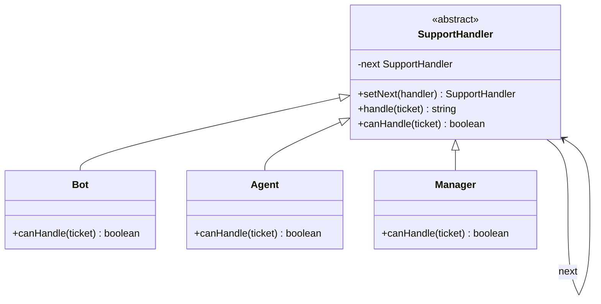
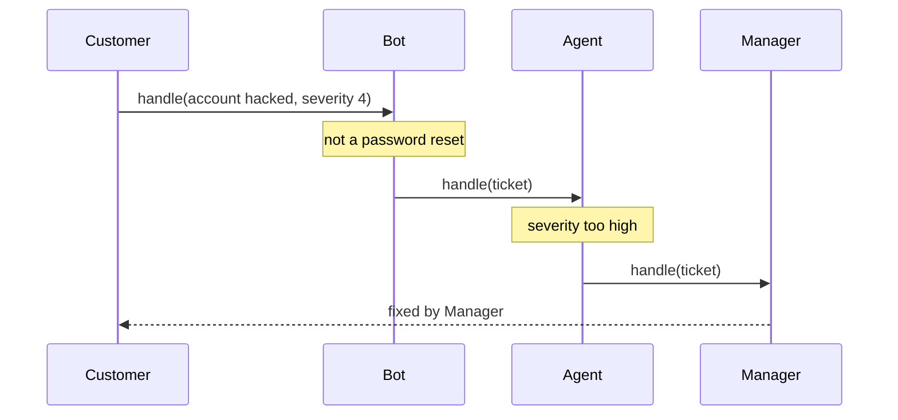

**Intent:** pass a request along a line of handlers; each one either handles it or passes it to the next.
**Group:** Behavioral (patterns about how objects share work).

## The idea

Think of calling **customer support**. A bot answers first. If it can't help, it passes you to a support agent. If the agent can't fix it, they pass you to a manager. You don't pick who helps you. You just call, and your request moves along the line until someone handles it.

An **airport** works in a similar way: ID check, then bag scan, then body scan. Each station can stop you, or let you move on to the next.

So the pattern comes in two forms:

1. **The first one that can, handles it** (the support desk). The request stops at the first handler that takes it.
2. **Every step runs, and any step can stop it** (the airport, web middleware). Each handler does its part, then calls the next one or stops the request.

## The problem

The first version puts every level in one function:

```js
function handleTicket(ticket) {
    if (ticket.issue === "password reset") {
        return "Bot: sent a reset link";
    } else if (ticket.severity <= 2) {
        return `Agent: fixed "${ticket.issue}"`;
    } else if (ticket.severity <= 4) {
        return `Manager: fixed "${ticket.issue}"`;
    }

    return `Nobody could handle "${ticket.issue}"`;
}

console.log(handleTicket({ issue: "double charge", severity: 2 }));
// Agent: fixed "double charge"
```

Why it hurts:

- The sender **knows every handler and the order**.
- A new level, like a specialist between the agent and the manager, means **editing this function**.
- You can't **change the order** for some customers. For example, VIP customers should skip the bot.

## The pattern

Each level becomes a handler object that knows only **the next handler**. The chain is built outside, by linking handlers together.



The code comes in three small steps. Paste them in order into one file to run it.

**Step 1: the base handler.** It holds the "pass it on" logic, so each real handler only says what it can handle.

```js
// The base handler. Don't create it directly: create a Bot, Agent or Manager.
class SupportHandler {
    constructor() {
        this.next = null;
    }

    // It returns the handler it was given, so you can also
    // write bot.setNext(agent).setNext(manager) in one line.
    setNext(handler) {
        this.next = handler;
        return handler;
    }

    handle(ticket) {
        if (this.canHandle(ticket)) {
            // this.constructor.name is the class name, like "Agent".
            const name = this.constructor.name;
            return `${name}: fixed "${ticket.issue}"`;
        }

        // Not mine: pass it on to the next handler.
        if (this.next) {
            return this.next.handle(ticket);
        }

        // End of the chain, and nobody took it.
        return `Nobody could handle "${ticket.issue}"`;
    }

    // Each handler must fill this in.
    canHandle(ticket) {
        throw new Error("not implemented");
    }
}
```

**Step 2: the three handlers.** Each one only answers "can I handle this ticket?".

```js
// The bot only handles password resets.
class Bot extends SupportHandler {
    canHandle(ticket) {
        return ticket.issue === "password reset";
    }
}

// An agent handles easy problems: severity 1 or 2.
class Agent extends SupportHandler {
    canHandle(ticket) {
        return ticket.severity <= 2;
    }
}

// A manager handles anything up to severity 4.
class Manager extends SupportHandler {
    canHandle(ticket) {
        return ticket.severity <= 4;
    }
}
```

**Step 3: build the chain and use it.** Every ticket goes to the first handler, the bot.

```js
const bot = new Bot();
const agent = new Agent();
const manager = new Manager();

// Link them: bot, then agent, then manager.
bot.setNext(agent);
agent.setNext(manager);

console.log(bot.handle({ issue: "password reset", severity: 1 }));
// Bot: fixed "password reset"

console.log(bot.handle({ issue: "double charge", severity: 2 }));
// Agent: fixed "double charge"

console.log(bot.handle({ issue: "account hacked", severity: 4 }));
// Manager: fixed "account hacked"

console.log(bot.handle({ issue: "data center fire", severity: 5 }));
// Nobody could handle "data center fire"
```

How the "account hacked" ticket travels:



What changed:

- Each handler knows only **the next one**, not the whole chain.
- The chain is **built outside**, so you can reorder it, or build a different chain for VIP customers that starts with `new Agent()`.
- The base class has the "pass it on" logic, so each handler only says **what it can handle**.
- The chain always ends with a **clear answer**, even when nobody handles the request.

### The JavaScript way: middleware with next()

Web servers in Node use the second form. Each handler is a function that gets the request and a `next` function. It calls `next()` to pass the request on, or stops by not calling it. Here is a tiny runner, like the one inside Express:

```js
// A tiny middleware runner, like the one inside Express.
// It takes a list of handlers and gives back one function that runs them in order.
function chain(handlers) {
    return function (request) {
        let index = 0;

        // Call the next handler in the list, if there is one.
        function next() {
            if (index >= handlers.length) {
                return;
            }

            const handler = handlers[index];
            index = index + 1;
            handler(request, next);
        }

        next();
    };
}
```

Three handlers. `auth` stops the request by not calling `next()`:

```js
function logger(request, next) {
    console.log(`${request.method} ${request.path}`);
    next();
}

function auth(request, next) {
    // No user: stop here, and don't call next().
    if (!request.user) {
        console.log("401: please log in");
        return;
    }

    next();
}

function profile(request) {
    console.log(`200: hello ${request.user}`);
}
```

Join them into one chain and send two requests through it:

```js
const app = chain([logger, auth, profile]);

app({ method: "GET", path: "/me", user: "asha" });
// GET /me
// 200: hello asha

app({ method: "GET", path: "/me" });
// GET /me
// 401: please log in
```

The same chain in Express. Each Express middleware gets `(req, res, next)`:

```js
// Not run here: it needs the express package. Shown to compare.
// Every request goes through logger, then auth, then the route.
app.use(logger);
app.use(auth);
app.get("/me", profile);
```

Java web apps do the same with servlet filters: each filter calls `chain.doFilter(request, response)` to pass the request on.

## When to use it

- **More than one object might handle** a request, and the sender shouldn't need to know which.
- A request goes through **steps that can each stop it**: logging, login checks, rate limits, input checks.
- The order or the set of handlers **changes**, per customer type or per route.
- **Approval limits:** a team lead approves up to $1,000, a manager up to $10,000, a director anything above.

## When not to use it

- There is **always exactly one** handler. Call it directly.
- A request that falls off the end unhandled would be **dangerous**, and you can't add a safe final handler.
- The chain gets so long that nobody can tell **which handler took the request**. Add logging, or rethink it.

## Common mistakes

- **No end to the chain.** If nobody handles a request, return a clear "not handled" result or throw an error. Never let it vanish quietly.
- **Forgetting `next()`.** In Express, a middleware that neither sends a response nor calls `next()` leaves the request hanging until it times out.
- **The wrong order.** The login check must come before the route it protects.

## In the real world

- **Express and Koa middleware:** `app.use(...)` adds a handler to the chain, and each one calls `next()`.
- **DOM event bubbling:** a click on a button goes to the button, then its parent, then up to the document. Any handler can call `event.stopPropagation()` to end the trip.
- **Java servlet filters:** each filter passes the request on with `FilterChain.doFilter()`.
- **`try`/`catch`:** a thrown error moves up the call stack until some `catch` handles it.

## In the interview

Chain of Responsibility shows up in:

- **[ATM](../problems/atm.mdx) cash dispensing:** the 100-note handler gives as many 100s as it can, then passes the rest to the 50-note handler, then the 20-note handler. Each handler does part of the work and passes on the rest.
- **[Logger](../problems/logger.mdx) levels:** DEBUG, INFO and ERROR handlers, each deciding whether to write the message.
- Support ticket escalation, approval flows, and request filters (login check, rate limit).

> "To dispense cash, I'll chain note handlers from the largest note down. Each one gives as many of its notes as it can and passes the amount that is left to the next one. If anything is still left at the end, the ATM can't make that amount and cancels. A new 200 note is one new handler in the chain, with no change to the others."

**Likely follow-up:** "What happens if no handler can process the request?"

**Answer:** "The end of the chain returns a clear 'not handled' result, or I add a final default handler that rejects and logs the request. A request should never just disappear."

<Callout title="Remember this" type="success">
  - **Chain of Responsibility = the support desk.** Handlers stand in a line; each handles the request or passes it on.
  - The sender knows only the **first handler**; the chain is built outside and easy to reorder.
  - Two forms: **"the first one that can"** (support desk) and **"every step, any can stop"** (middleware).
  - Always **end the chain** with a clear answer, and never forget `next()`.
  - Seen in **Express middleware**, **DOM event bubbling**, ATM cash dispensers and log levels.
</Callout>
