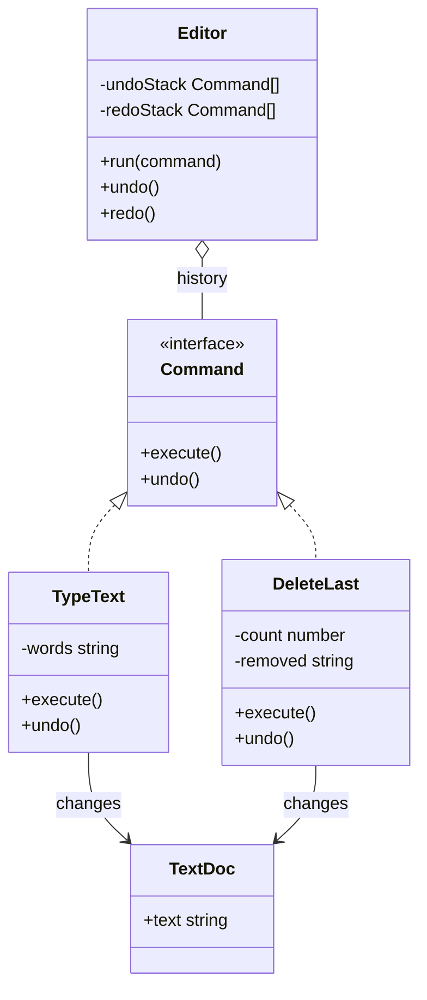
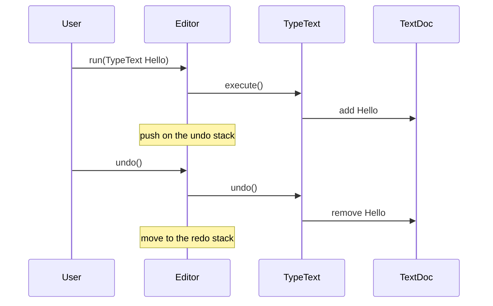

**Intent:** wrap a request in an object, so you can store it, queue it, log it or undo it.
**Group:** Behavioral (patterns about how objects share work).

## The idea

In a restaurant, the waiter doesn't cook. They write your order on a **slip** and pin it on the kitchen rail. The slip is your request, turned into a **thing**. Because it is a thing, the kitchen can line slips up, the cooks can take them one by one, and the manager can read old slips at the end of the day. If you change your mind, the waiter can pull your slip back.

The **Command** pattern turns a request into an object in the same way. The roles:

- **Command** (the slip): an object with `execute()`, and often `undo()`;
- **Receiver** (the cook): the object that really does the work, here a text document;
- **Invoker** (the waiter): runs commands and keeps the history, without knowing what each one does;
- **Client** (you, ordering): creates the commands.

## The problem

A text editor where each button changes the text directly. Then someone asks for **undo**:

```js
// Not complete code: it only shows the problem.
function onUndo() {
    const lastAction = history.pop();

    if (lastAction.type === "type") {
        doc.text = doc.text.slice(0, -lastAction.words.length);
    } else if (lastAction.type === "delete") {
        doc.text += lastAction.removed;
    } else if (lastAction.type === "bold") {
        // ...
    }

    // Every new action adds a branch here, and another one in redo.
}
```

Why it hurts:

- Undo must know the **insides of every action**.
- **Every new action edits undo and redo**, and it is easy to forget one.
- The code for one action is split across the button, undo and redo.

## The pattern

Each action becomes a command object that knows how to **do** and **undo** itself. The editor only keeps two stacks.



The code comes in five small steps. Paste them in order into one file to run it.

**Step 1: the interface and the document.** Every command can do itself and undo itself. The document is the receiver: the thing that really changes.

```js
// The interface: every command has execute() and undo().
class Command {
    execute() {
        throw new Error("not implemented");
    }

    undo() {
        throw new Error("not implemented");
    }
}

// The receiver: the thing that really changes.
class TextDoc {
    constructor() {
        this.text = "";
    }
}
```

**Step 2: the "type text" command.** It adds words to the end, and its undo cuts them off again.

```js
class TypeText extends Command {
    constructor(doc, words) {
        super();
        this.doc = doc;
        this.words = words;
    }

    execute() {
        this.doc.text += this.words;
    }

    undo() {
        // Keep everything except the words this command added.
        const keepLength = this.doc.text.length - this.words.length;
        this.doc.text = this.doc.text.slice(0, keepLength);
    }
}
```

**Step 3: the "delete last" command.** It remembers what it deleted, so undo can put it back.

```js
class DeleteLast extends Command {
    constructor(doc, count) {
        super();
        this.doc = doc;
        this.count = count;
        this.removed = "";
    }

    execute() {
        // Where the deleted part starts. Never below 0.
        const start = Math.max(0, this.doc.text.length - this.count);

        // Remember the deleted text, so undo can put it back.
        this.removed = this.doc.text.slice(start);

        this.doc.text = this.doc.text.slice(0, start);
    }

    undo() {
        // Put the deleted text back.
        this.doc.text += this.removed;
    }
}
```

**Step 4: the editor.** This is the invoker. It runs commands and keeps two stacks, without knowing what any command does.

```js
class Editor {
    constructor() {
        this.undoStack = [];
        this.redoStack = [];
    }

    run(command) {
        command.execute();
        this.undoStack.push(command);

        // A new action clears the redo history.
        this.redoStack = [];
    }

    undo() {
        const command = this.undoStack.pop();

        // The stack was empty: nothing to undo.
        if (!command) {
            return;
        }

        command.undo();
        this.redoStack.push(command);
    }

    redo() {
        const command = this.redoStack.pop();

        // Nothing to redo.
        if (!command) {
            return;
        }

        command.execute();
        this.undoStack.push(command);
    }
}
```

**Step 5: try it.**

```js
const doc = new TextDoc();
const editor = new Editor();

editor.run(new TypeText(doc, "Hello"));
editor.run(new TypeText(doc, " world"));
editor.run(new DeleteLast(doc, 6));
console.log(doc.text); // Hello

editor.undo();
console.log(doc.text); // Hello world

editor.undo();
console.log(doc.text); // Hello

editor.redo();
console.log(doc.text); // Hello world
```

The call order for one action and its undo:



What changed:

- The `Editor` **never looks inside** a command. Undo is "pop, then call `undo()`".
- A new action, like "make bold", is **one new class**. The editor doesn't change.
- Each command **remembers what it needs** to undo itself: `DeleteLast` keeps the text it removed.

### The JavaScript way: plain objects with functions

A command doesn't need a class. Any object with `execute` and `undo` functions will do (duck typing):

```js
const doc = { text: "" };

// A command is any object with execute() and undo(). No classes needed.
// typeText("Hi") gives back a command that types "Hi".
function typeText(words) {
    return {
        execute() {
            doc.text += words;
        },

        undo() {
            const keepLength = doc.text.length - words.length;
            doc.text = doc.text.slice(0, keepLength);
        },
    };
}

const history = [];

function run(command) {
    command.execute();
    history.push(command);
}

run(typeText("Hi"));
run(typeText(" there"));
console.log(doc.text); // Hi there

const lastCommand = history.pop();
lastCommand.undo();
console.log(doc.text); // Hi
```

In Java, the classic command object is a `Runnable`: an object with one `run()` method that you hand to a thread or a thread pool to run later.

## When to use it

- **Undo and redo:** editors, drawing apps, form builders, "take back a move" in a game.
- **Queue or schedule work** to run later, or on another worker.
- **Log actions** so you can replay them after a crash, or see who did what.
- **One action, many triggers:** the same "Save" command from a menu, a button and Ctrl+S.
- **Macros:** a list of commands run as one. That is a "macro command", which is also the [Composite](./composite.mdx) pattern.

## When not to use it

- A simple call with no undo, queue or log. Wrapping `save()` in a `SaveCommand` class just adds a layer.
- The state is tiny. Then it can be simpler to save a **copy of the whole state** before each change, and undo by putting the copy back (that is the **Memento** pattern).

## Common mistakes

- **Undo that doesn't restore exactly.** Save what you need inside `execute()` (like the deleted text), not later.
- **Not clearing redo** after a new action. Type, undo, type something else: redo must now be empty.
- **Unlimited history.** Keep only the last N commands, or memory grows forever.

## In the real world

- **VS Code:** every action is a command with an ID, like `editor.action.formatDocument`. Menus, keyboard shortcuts and the Command Palette all run commands by ID, and extensions add their own with `vscode.commands.registerCommand`.
- **Redis:** with AOF (append-only file) persistence on, Redis writes every command that changes data to a log file, and replays the log on restart to rebuild the data.
- **Job queues** like BullMQ store each job (a name plus its data) in Redis, so a worker can run it later or retry it if it fails.

## In the interview

Command fits when you hear "undo", "history", "replay", "queue the requests" or "log every action": a text editor, a drawing app, taking back a move in [Chess](../problems/chess.mdx), or button presses queued for an [Elevator](../problems/elevator.mdx) controller.

> "Each user action becomes a command object with `execute` and `undo`. The editor runs it and pushes it on an undo stack. Undo pops it and calls `undo`; redo moves it back. The editor never knows what a command does, so adding 'bold' or 'paste' is one new class."

**Likely follow-up:** "How would you add macros, like 'run these five steps as one'?"

**Answer:** "A `MacroCommand` that holds a list of commands. Its `execute` runs them in order, and its `undo` undoes them in reverse order. To the editor, it is just one more command."

<Callout title="Remember this" type="success">
  - **Command = an order slip.** A request turned into an object, usually with `execute()` and `undo()`.
  - The **invoker** (editor, remote, queue) runs commands without knowing what they do.
  - Undo and redo = **two stacks** of commands; a new action clears the redo stack.
  - Each command **saves what it needs** to undo itself.
  - Also great for **queues, logs, retries and macros**.
</Callout>
