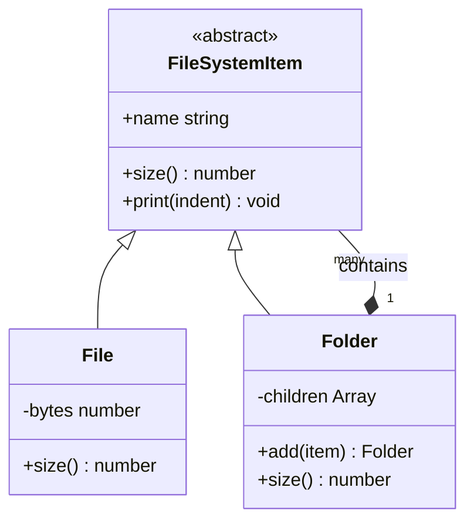
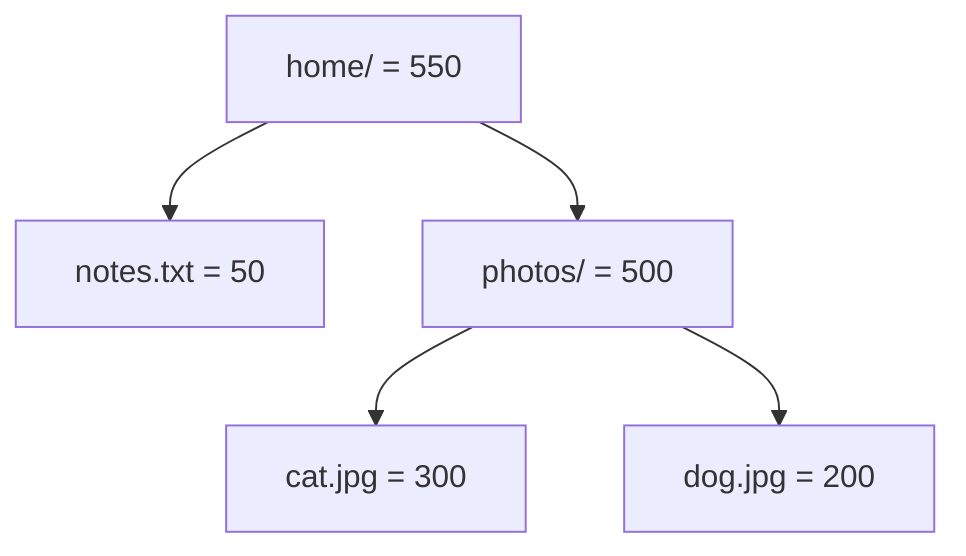

## The idea

A big **toy box** holds toy cars, and also smaller boxes. A small box holds more toys, and maybe an even smaller box. To count every toy, you count the toys in the big box, and you ask each small box to count its own. You never care how deep the boxes go.

A **Composite** lets code treat **one item** and a **group of items** the same way. A group is made of items, and a group can hold other groups. Together they form a **tree**.

- **Intent:** build trees of objects, and let code call the same method on a single item or a whole group.
- **Group:** Structural (patterns about how objects fit together).

## The problem

Files and folders are the classic example. Without the pattern, every function checks "is it a file or a folder?":

```js
// A small tree of plain objects: home holds notes.txt and a photos folder.
const catPhoto = { type: "file", name: "cat.jpg", size: 300 };
const photos = { type: "folder", name: "photos", children: [catPhoto] };
const notes = { type: "file", name: "notes.txt", size: 50 };
const home = { type: "folder", name: "home", children: [notes, photos] };

function totalSize(item) {
    if (item.type === "file") {
        return item.size;
    }

    if (item.type === "folder") {
        let total = 0;

        for (const child of item.children) {
            total = total + totalSize(child);
        }

        return total;
    }

    throw new Error(`Unknown type: ${item.type}`);
}

console.log(totalSize(home)); // 350

// countFiles(), print() and search() each repeat the same file-or-folder check...
```

- The **same check** is copied into every function that walks the tree.
- A new kind of item (a shortcut, a zip file) means editing **every** one of them.
- The knowledge about "how a folder adds up" sits outside the folder.

## The pattern

There are three roles:

- **Component:** the shared interface (`FileSystemItem`), with methods like `size()`.
- **Leaf:** a single item with no children (`File`).
- **Composite:** a group that holds components (`Folder`). Its methods ask each child and combine the answers.



The key line is the last one: a `Folder` **is** a `FileSystemItem`, and it **contains** `FileSystemItem`s. So a folder can hold files and other folders.

### Step 1: The shared interface

Files and folders both have a name, `size()` and `print()`.

```js
// Abstract: we only make a File or a Folder, never a plain FileSystemItem.
class FileSystemItem {
    constructor(name) {
        // this.constructor is the class that "new" was called with.
        if (this.constructor === FileSystemItem) {
            throw new Error("FileSystemItem is abstract");
        }

        this.name = name;
    }

    size() {
        throw new Error("not implemented");
    }

    // indent is the spaces printed before the name. It starts as "" (no spaces).
    print(indent = "") {
        throw new Error("not implemented");
    }
}
```

### Step 2: A file (the leaf)

A file knows its own size, and has no children.

```js
class File extends FileSystemItem {
    constructor(name, bytes) {
        super(name);
        this.bytes = bytes;
    }

    size() {
        return this.bytes;
    }

    print(indent = "") {
        console.log(`${indent}${this.name} (${this.size()} B)`);
    }
}
```

### Step 3: A folder (the composite)

A folder holds a list of children. To answer, it asks each child and combines the answers.

```js
class Folder extends FileSystemItem {
    constructor(name) {
        super(name);
        this.children = [];
    }

    // Returns the folder, so calls can chain: folder.add(file1).add(file2)
    add(item) {
        this.children.push(item);
        return this;
    }

    // Ask each child for its size, and add them up.
    size() {
        let total = 0;

        for (const child of this.children) {
            total = total + child.size();
        }

        return total;
    }

    print(indent = "") {
        console.log(`${indent}${this.name}/ (${this.size()} B)`);

        // Print each child with 2 more spaces in front.
        for (const child of this.children) {
            child.print(indent + "  ");
        }
    }
}
```

### Step 4: Build a tree and use it

A folder can hold files and other folders.

```js
const photos = new Folder("photos");
photos.add(new File("cat.jpg", 300));
photos.add(new File("dog.jpg", 200));

const home = new Folder("home");
home.add(new File("notes.txt", 50));
home.add(photos);

console.log(home.size()); // 550
console.log(photos.size()); // 500

home.print();
// home/ (550 B)
//   notes.txt (50 B)
//   photos/ (500 B)
//     cat.jpg (300 B)
//     dog.jpg (200 B)
```

No `if` checks anywhere. `home.size()` asks each child for its size, and each folder asks its own children. The call flows down the tree, and the answers add up on the way back:



A new kind of item, like a `Shortcut`, is **one new class** with its own `size()`. Nothing else changes.

**Where does `add()` go?** Here only `Folder` has it, so you can't add a child to a file by mistake. The textbook also shows putting `add()` on the base class, so every item looks exactly the same, with leaves throwing an error. Both are fine. Say which one you picked, and why.

In JavaScript, **duck typing** also works: any object with `size()` and `print()` can live in a folder, even if it doesn't extend `FileSystemItem`.

## When to use it

- The data is a **tree**: folders, menus with submenus, an org chart, a UI made of panels.
- You want callers to treat **one item and a group the same way**.
- The answer for a group is **built from** its children's answers (total size, total price, total count).

## When not to use it

- The data is a **flat list**. A plain array is simpler.
- Leaves and groups need very **different** methods. Forcing one interface leads to many "not supported" errors.
- Plain data you only read once. A plain object and one recursive function, as in the problem, are fine for that.

## Common mistakes

- **Type checks in the caller** (`if (item instanceof Folder)`). That brings back the problem the pattern solved.
- **Cycles.** Adding a folder inside itself, or inside its own child, makes `size()` loop forever.
- **Slow sizes on huge trees.** Each `size()` call walks the whole tree. For very big trees, cache the size in each folder and update it when a child changes.

## In the real world

- **The DOM:** every element and every piece of text is a `Node`. `textContent` works on one text node, and on a whole `div` with everything inside it.
- **React:** a component can return plain tags and other components, nested as deep as you like.
- **Java AWT and Swing:** a `Container` is itself a `Component` that holds other `Component`s. So a panel can hold buttons and other panels.
- **Everyday apps:** menus with submenus, an org chart, a shopping-cart bundle whose price is the sum of its items.

## In the interview

The Composite is the heart of the [In-Memory File System](../problems/in-memory-file-system.mdx) problem, and it fits any tree:

> "Files and folders share one interface, `FileSystemItem`, with `size()` and `print()`. A `File` returns its own size. A `Folder` holds a list of `FileSystemItem`s, and returns the sum of its children's sizes. So callers never check whether something is a file or a folder."

**Likely follow-up:** "How do you stop a folder from being moved inside itself?"

"Give each item a link to its parent. Before adding folder `X` into folder `F`, walk up from `F` through its parents. If you reach `X`, refuse the move."

<Callout title="Remember this" type="success">
  - Composite builds **trees** where a group and a single item share **one interface**.
  - Roles: **component** (the interface), **leaf** (`File`), **composite** (`Folder`, which holds components).
  - A composite's method **asks each child and combines** the answers, like `size()` adding up.
  - No "is it a file or a folder?" checks in callers. A new item type is **one new class**.
  - Watch for **cycles**: a folder must never end up inside itself.
</Callout>
