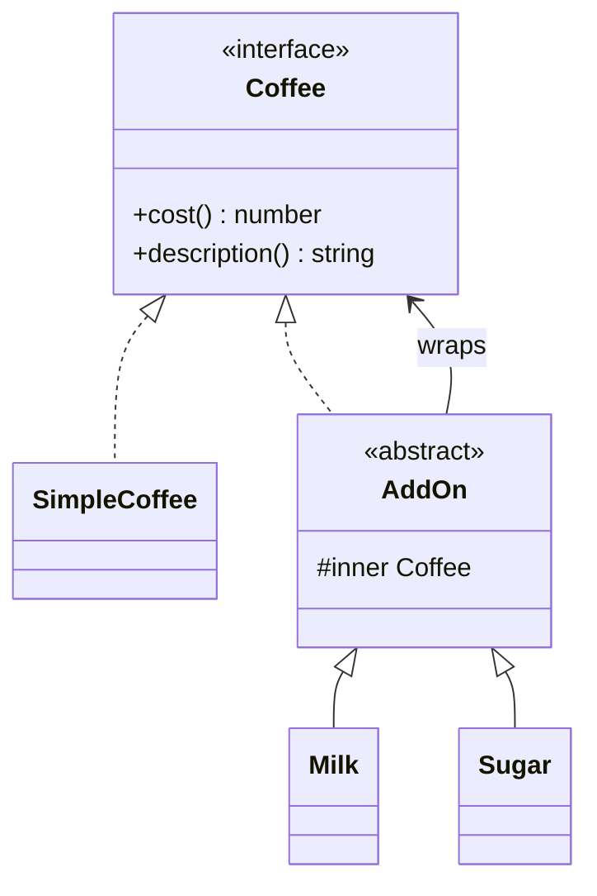
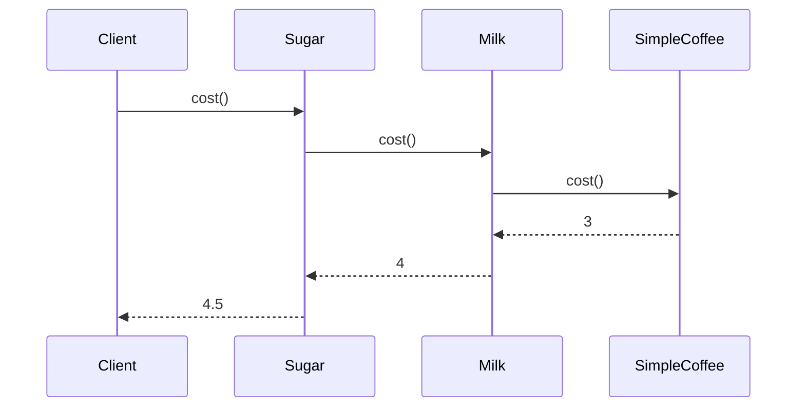

## The idea

At a coffee shop you start with a plain coffee. Add milk, and it costs a bit more. Add sugar, a bit more again. Want double milk? Add milk twice. The shop doesn't have a separate menu item for every mix. Each extra just **wraps** the drink you already have.

A **Decorator** adds behavior to an object by wrapping it in another object with the **same interface**. The wrapper does its extra bit, and passes the rest to the object inside.

- **Intent:** add behavior to one object at run time, by wrapping it, instead of making a subclass for every mix.
- **Group:** Structural (patterns about how objects fit together).

## The problem

Use subclasses for the extras, and the number of classes explodes:

```js
class Coffee { cost() { return 3; } }
class CoffeeWithMilk extends Coffee { cost() { return 4; } }
class CoffeeWithSugar extends Coffee { cost() { return 3.5; } }
class CoffeeWithMilkAndSugar extends Coffee { cost() { return 4.5; } }

console.log(new CoffeeWithMilkAndSugar().cost()); // 4.5
// Add caramel? 8 classes. Add cream too? 16. Double milk? Yet more.
```

- Every new extra **doubles** the number of classes.
- The price of milk is copied into several classes. Change it, and you must find them all.
- You choose the mix when you **write** the code, not when the customer **orders**.

## The pattern

There are four roles:

- **Component:** the shared interface (`Coffee`).
- **Concrete component:** the plain object (`SimpleCoffee`).
- **Decorator:** a base wrapper that holds the object inside (`AddOn`).
- **Concrete decorators:** the extras (`Milk`, `Sugar`).



The key line is the last one: an `AddOn` **is** a `Coffee`, and it also **holds** a `Coffee`. So you can wrap a wrapper, as many times as you like.

```js
class Coffee { // interface
  cost() { throw new Error('not implemented'); }
  description() { throw new Error('not implemented'); }
}

class SimpleCoffee extends Coffee {
  cost() { return 3; }
  description() { return 'Coffee'; }
}

class AddOn extends Coffee { // abstract decorator
  constructor(inner) {
    super();
    if (new.target === AddOn) throw new Error('AddOn is abstract');
    this.inner = inner; // the coffee being wrapped
  }
}

class Milk extends AddOn {
  cost() { return this.inner.cost() + 1; }
  description() { return `${this.inner.description()} + milk`; }
}

class Sugar extends AddOn {
  cost() { return this.inner.cost() + 0.5; }
  description() { return `${this.inner.description()} + sugar`; }
}

let order = new SimpleCoffee();
order = new Milk(order);
order = new Sugar(order);
order = new Milk(order); // double milk: just wrap again

console.log(order.description()); // Coffee + milk + sugar + milk
console.log(order.cost());        // 5.5
```

`inner` would be `protected` in Java (only subclasses can see it). JavaScript has no `protected`, and a `#private` field is not visible in subclasses, so `inner` is a normal field here.

Take a smaller order, `new Sugar(new Milk(new SimpleCoffee()))`. Each call goes **inward** through the layers, and the answer comes back **outward**:



A new extra, like caramel, is **one new class**. No old class changes. That is the [Open-Closed Principle](../design-principles/open-closed.mdx), and it is [composition over inheritance](../oop-basics/composition-vs-inheritance.mdx) at work.

### The JavaScript way: wrap a function

In JavaScript, functions are values, so a decorator is often just a function that takes a function and returns a new one with the **same call shape**:

```js
function withLogging(fn) {
  return function (...args) {
    console.log(`Calling ${fn.name}(${args.join(', ')})`);
    return fn.apply(this, args);
  };
}

function add(a, b) { return a + b; }

const loggedAdd = withLogging(add);
console.log(loggedAdd(2, 3));
// Calling add(2, 3)
// 5
```

You may see `@something` above a class or a method in TypeScript or Angular code. Those language **decorators** use the same wrapping idea, built into the syntax.

<Callout title="Decorator vs Proxy" type="idea">
  Same shape, different purpose. Both wrap an object and keep its interface. A decorator **adds behavior**. A
  [Proxy](../design-patterns/proxy.mdx) **controls access** to the real object.
</Callout>

## When to use it

- Extras that can be **mixed freely**: toppings, add-ons, features.
- You want to add behavior **at run time**, to one object, not to the whole class.
- **Cross-cutting** jobs around a call: logging, timing, retries, caching.

## When not to use it

- There are only one or two fixed mixes. A simple option or a subclass is clearer.
- The extra needs to change the object's **insides**, not just wrap its calls.
- The **order** of wrappers matters a lot, and nobody will remember it.

## Common mistakes

- **Not passing every method through.** If the interface has 5 methods, each wrapper needs all 5. A missing one breaks only when called.
- **Checking the type of a wrapped object.** After `new Sugar(new Milk(coffee))`, the outer object is not a `Milk`. `instanceof` checks stop working.
- **Forgetting that order matters.** "Discount, then tax" and "tax, then discount" give different totals.
- **Too many layers.** Ten wrappers deep, a stack trace is hard to read.

## In the real world

- **Java I/O:** `new BufferedReader(new InputStreamReader(new FileInputStream(file)))`. Each layer wraps the one inside and adds one feature.
- **Lodash:** `debounce(fn, 300)` and `memoize(fn)` return a new function you call the same way, with waiting or caching added.
- **React:** a higher-order component, like `withRouter(Profile)` in React Router 5, wraps a component and gives it extra props.

## In the interview

When a problem has **add-ons** (pizza toppings, car options, extra insurance on a booking), say:

> "Toppings can be mixed in any way, so subclasses would explode. I'll use decorators. A `Topping` is a `Pizza` and also wraps a `Pizza`. Its `cost()` returns the inner cost plus its own price. A new topping is a new class, and old code doesn't change."

**Likely follow-up:** "Does the order of decorators matter?"

"It can. For a price it doesn't, because the extras just add up. But for something like 'discount, then tax', the order changes the total. So the code that builds the stack should own the order, in one place."

<Callout title="Remember this" type="success">
  - A Decorator **wraps** an object with the **same interface**, and adds a bit of behavior.
  - A decorator **is a** component and **has a** component, so wrappers can stack.
  - It replaces a **subclass for every mix** with one small class per extra.
  - In JavaScript, a function that wraps a function (`withLogging(fn)`) is a decorator too.
  - Decorator **adds behavior**. Proxy **controls access**. Same shape, different purpose.
</Callout>
