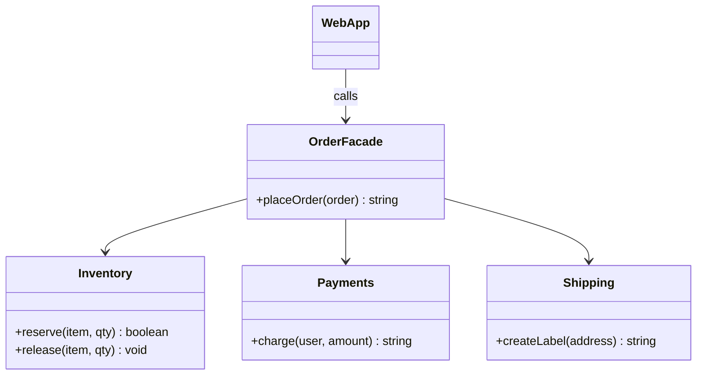
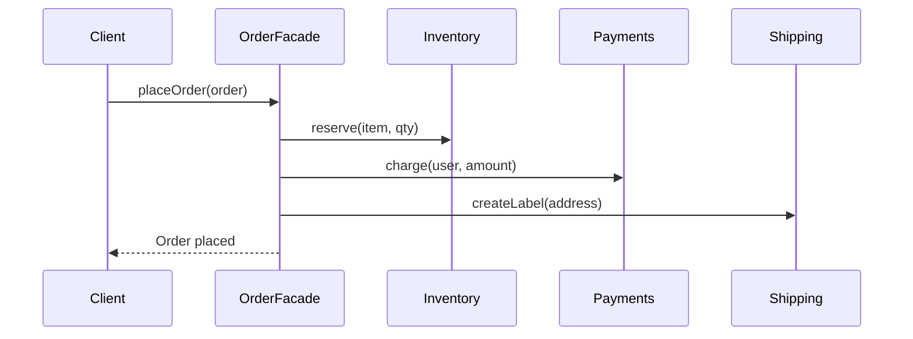

## The idea

At a hotel, you call the **front desk** for everything: a taxi, room service, a late checkout. You don't phone the kitchen, the garage and the billing office yourself. The front desk knows who to call, and in what order.

A **Facade** is that front desk for code. It is one class with a few simple methods. Behind it, many classes do the real work.

- **Intent:** give one simple front door to a group of complex classes.
- **Group:** Structural (patterns about how objects fit together).

## The problem

Placing an order needs four steps in the right order: reserve the stock, charge the card, create a shipping label, and undo the reservation if the payment fails. Without a facade, every caller writes these steps itself:

```js
// Not runnable: a fragment. The same steps are copied into the web app,
// the mobile API and the admin tool.
if (!inventory.reserve(item, qty)) throw new Error('Out of stock');
try {
  payments.charge(user, price * qty);
} catch (err) {
  inventory.release(item, qty); // easy to forget in one of the copies
  throw err;
}
const label = shipping.createLabel(address);
```

- Every caller must know **three classes** and the **right order**.
- Forget the `release` in one copy, and stock goes missing.
- Change a step (say, add a fraud check) and you must edit every copy.

## The pattern

There are three roles:

- **Facade:** the simple front (`OrderFacade`), with one method per task.
- **Subsystem classes:** the classes that do the work (`Inventory`, `Payments`, `Shipping`). They don't know the facade exists.
- **Client:** the code that calls the facade.



```js
class Inventory {
  #stock = { book: 2 };
  reserve(item, qty) {
    if ((this.#stock[item] ?? 0) < qty) return false;
    this.#stock[item] -= qty;
    return true;
  }
  release(item, qty) { this.#stock[item] += qty; }
}

class Payments {
  charge(user, amount) {
    if (amount > 100) throw new Error('card declined');
    return `PAY-${user}`;
  }
}

class Shipping {
  createLabel(address) { return `LABEL-${address}`; }
}

class OrderFacade {
  #inventory = new Inventory();
  #payments = new Payments();
  #shipping = new Shipping();

  placeOrder({ user, item, qty, price, address }) {
    if (!this.#inventory.reserve(item, qty)) return 'Out of stock';
    try {
      this.#payments.charge(user, price * qty);
    } catch (err) {
      this.#inventory.release(item, qty); // undo, in one place only
      return `Payment failed: ${err.message}`;
    }
    return `Order placed, ${this.#shipping.createLabel(address)}`;
  }
}

const shop = new OrderFacade();
console.log(shop.placeOrder({ user: 'asha', item: 'book', qty: 1, price: 20, address: 'Pune' }));
// Order placed, LABEL-Pune
console.log(shop.placeOrder({ user: 'ben', item: 'book', qty: 1, price: 500, address: 'Leeds' }));
// Payment failed: card declined
console.log(shop.placeOrder({ user: 'cara', item: 'book', qty: 3, price: 20, address: 'Oslo' }));
// Out of stock
```

The second order fails at payment, so its book goes back on the shelf. One book is left, so the third order (3 books) is out of stock.

Here is the call order inside `placeOrder()`. The client sees only the first and last arrows:



A facade is a **shortcut, not a wall**. Code that needs something special can still use `Payments` directly.

In JavaScript, a facade is often just a **module** that exports a few functions, like `placeOrder()` and `cancelOrder()`, and hides the rest of the files behind it. In real code you would also pass the three services into the facade, so tests can use fakes (see [Dependency Injection](../design-principles/dependency-injection.mdx)).

<Callout title="Facade vs Adapter" type="idea">
  A facade creates a **new, simpler** interface over **many** classes. An [Adapter](../design-patterns/adapter.mdx)
  makes **one** class fit an interface you **already have**.
</Callout>

## When to use it

- Callers repeat the **same steps** over the same group of classes.
- A subsystem is **hard to use right**: many steps, a strict order, undo on failure.
- You want to **change the insides** later (a new payment provider, a new warehouse) without touching callers.

## When not to use it

- There is only one class behind it. Then the "facade" just copies its methods.
- Callers need fine control over every step. A facade that tries to offer every option stops being simple.

## Common mistakes

- **A God class.** A facade should **coordinate** (call others in order), not hold the business rules itself. If it grows huge, split it by task: `OrderFacade`, `ReturnsFacade`.
- **Blocking all other access.** It is fine for advanced code to skip the facade.
- **Leaking inside objects.** If `placeOrder()` returns the raw `Payments` result, callers start to depend on it.

## In the real world

- **Express:** `app.listen(3000)` is a shortcut. Inside, Express creates a Node `http` server with your app as the handler, and calls `listen` on it.
- **Express again:** `res.json(data)` sets the `Content-Type` header, turns the data into JSON text, and sends it. Three lower-level steps behind one call.
- **jQuery:** `$.ajax()` was a simple front over the browser's clumsy `XMLHttpRequest` API.
- **LLD problems:** the main class, like `ParkingLotSystem` or `BookingService`, is usually a facade over the smaller classes.

## In the interview

In most LLD problems, say early on that one class is the **entry point**:

> "Callers talk only to `BookingService`. Its `book()` method checks the seats, holds them, takes the payment and sends the ticket, by calling the smaller classes in order. It holds no business rules itself. It just coordinates, so each smaller class keeps a single job."

**Likely follow-up:** "Isn't your facade just a God class?"

"Not if it only coordinates. The rules live in `SeatMap`, `Payment` and `Ticket`. The facade only decides the order of calls and undoes steps on failure. If it grows, I split it by task."

<Callout title="Remember this" type="success">
  - A Facade is a **front desk**: one simple class in front of many.
  - It knows **which classes to call, and in what order**, including undo on failure.
  - It **coordinates**. The business rules stay in the classes behind it.
  - It is a **shortcut, not a wall**. Advanced code can still reach the classes inside.
  - Facade makes a **new, simpler** front for many. Adapter makes **one** thing fit an existing interface.
</Callout>
