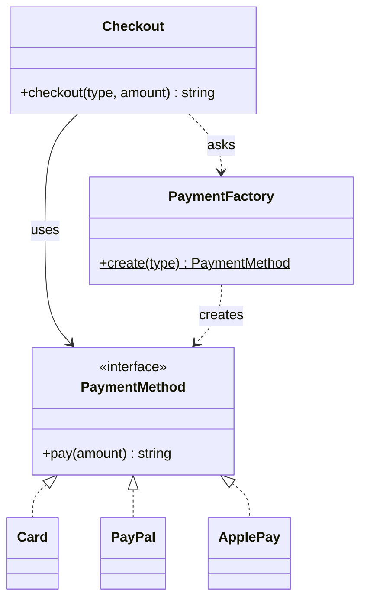
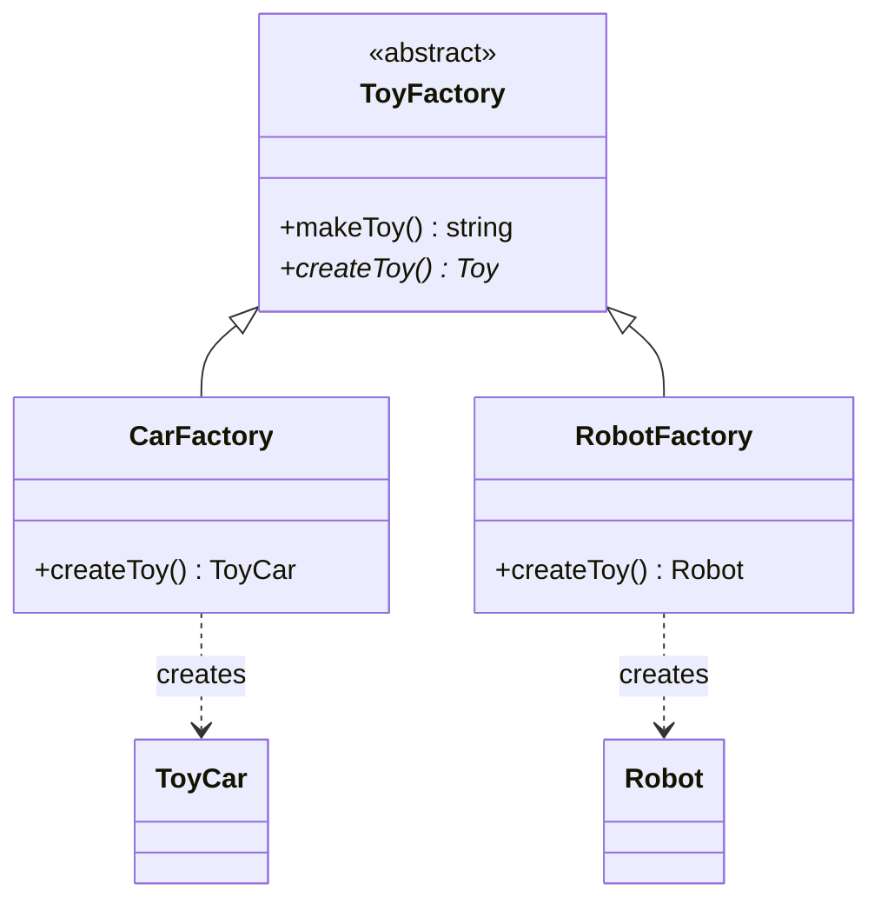

## The idea

At a restaurant you say "one pizza, please". You don't walk into the kitchen, pick the oven and make the dough. The kitchen decides how to make it, and hands you a pizza.

A **Factory** is the kitchen for objects. Your code asks for "a card payment" and gets back an object that can `pay()`. It never writes `new Card()` itself.

- **Intent:** put object creation in one place, so the code that uses an object doesn't need to know its exact class.
- **Group:** Creational (patterns about how objects are created).

## The problem

```js
class Card {
    pay(amount) {
        return `Paid ${amount} by card`;
    }
}

class PayPal {
    pay(amount) {
        return `Paid ${amount} by PayPal`;
    }
}

function checkout(type, amount) {
    // checkout has to know every payment class by name.
    let method;

    if (type === "card") {
        method = new Card();
    } else if (type === "paypal") {
        method = new PayPal();
    } else {
        throw new Error(`Unknown payment type: ${type}`);
    }

    return method.pay(amount);
}

console.log(checkout("card", 50)); // Paid 50 by card

// refund() and subscribe() copy the same if/else...
```

What hurts:

- The same `if/else` is copied into every function that needs a payment method.
- Adding Apple Pay means finding and editing every copy. Miss one, and you have a bug.
- `checkout` should care about **paying**, not about **which classes exist**.

Adding a type means changing old code, which breaks the [Open-Closed Principle](../design-principles/open-closed.mdx).

## The pattern

There are two common forms, and interviewers may ask about both.

### Simple Factory

One function (or class) holds all the creation logic. Callers pass a type and get an object back.



The textbook form is a `PaymentFactory` class with a static `create(type)` method. In JavaScript, a plain **function with a lookup table** does the same job. Here it is in three steps.

#### Step 1: Create the payment classes

Every payment method has the same `pay(amount)` method.

```js
// The shared interface. Every payment method must have pay(amount).
class PaymentMethod {
    pay(amount) {
        throw new Error("not implemented");
    }
}

class Card extends PaymentMethod {
    pay(amount) {
        return `Paid ${amount} by card`;
    }
}

class PayPal extends PaymentMethod {
    pay(amount) {
        return `Paid ${amount} by PayPal`;
    }
}

class ApplePay extends PaymentMethod {
    pay(amount) {
        return `Paid ${amount} by Apple Pay`;
    }
}
```

#### Step 2: Create the factory

The lookup table maps each type name to its class. The factory looks up the class and creates the object.

```js
// In JavaScript a class is a value, so it can be stored in a Map.
const paymentTypes = new Map();
paymentTypes.set("card", Card);
paymentTypes.set("paypal", PayPal);
paymentTypes.set("applepay", ApplePay);

function createPayment(type) {
    const PaymentClass = paymentTypes.get(type);

    // get() gives back undefined when the type is not in the map.
    if (PaymentClass === undefined) {
        throw new Error(`Unknown payment type: ${type}`);
    }

    // A class kept in a variable works with "new", like any class.
    return new PaymentClass();
}
```

#### Step 3: Use the factory

`checkout` asks the factory for a payment method. It never names a class.

```js
function checkout(type, amount) {
    const method = createPayment(type);

    return method.pay(amount);
}

console.log(checkout("card", 50)); // Paid 50 by card
console.log(checkout("applepay", 20)); // Paid 20 by Apple Pay

try {
    checkout("cash", 10);
} catch (error) {
    console.log(error.message); // Unknown payment type: cash
}
```

A new payment method is now **one new class and one new line** in the map. `checkout` never changes.

### Factory Method

Here a **base class** does the shared steps, and leaves **one step**, "create the object", to its subclasses. That step is the **factory method**.

Think of toy factories. Every factory builds, tests and boxes a toy. Only **which toy** differs.



#### Step 1: Create the base factory

The base class does the shared steps. It leaves `createToy()` empty for the subclasses to fill in.

```js
// Abstract: we only make a CarFactory or a RobotFactory, never a plain ToyFactory.
class ToyFactory {
    constructor() {
        // this.constructor is the class that "new" was called with.
        if (this.constructor === ToyFactory) {
            throw new Error("ToyFactory is abstract");
        }
    }

    // The factory method. Each subclass decides which toy to create.
    createToy() {
        throw new Error("not implemented");
    }

    // The shared steps, the same for every toy.
    makeToy() {
        const toy = this.createToy();

        return `${toy.name}: built, tested and boxed`;
    }
}
```

#### Step 2: Create the toys and their factories

Each factory only fills in `createToy()`.

```js
class ToyCar {
    constructor() {
        this.name = "Toy car";
    }
}

class Robot {
    constructor() {
        this.name = "Robot";
    }
}

class CarFactory extends ToyFactory {
    createToy() {
        return new ToyCar();
    }
}

class RobotFactory extends ToyFactory {
    createToy() {
        return new Robot();
    }
}
```

#### Step 3: Use the factories

Both factories run the same steps. Only the toy is different.

```js
const carFactory = new CarFactory();
const robotFactory = new RobotFactory();

console.log(carFactory.makeToy()); // Toy car: built, tested and boxed
console.log(robotFactory.makeToy()); // Robot: built, tested and boxed
```

| | Simple Factory | Factory Method |
| --- | --- | --- |
| What it is | One function with a lookup or a `switch` | A method in a base class that subclasses override |
| Who picks the class | The factory, from a type value | The subclass |
| Adding a type | One new entry in the lookup | One new subclass |
| In the "Gang of Four" book | No, it is a common habit | Yes |

The "Gang of Four" book is the 1994 book *Design Patterns*, by four authors. It named the 23 classic patterns.

<Callout title="Abstract Factory, in short" type="info">
  An **Abstract Factory** makes a whole **family** of objects that must match. For example, a `LightTheme` factory
  and a `DarkTheme` factory, each with `createButton()` and `createMenu()`. You pick one factory, and you never mix a
  dark button with a light menu. It is rare in LLD interviews. Name it only if objects come in matching sets.
</Callout>

## When to use it

- Which class to create depends on **input or settings**: a type string, a country, a config value.
- Creating the object takes **several steps** that you don't want to repeat.
- You expect **new types** later, and want to add them without touching the callers.

## When not to use it

- There is only **one** class, and that won't change. `new Card()` is fine.
- The factory only wraps `new`, with nothing else. That is an extra layer for no gain (see [DRY, KISS and YAGNI](../design-principles/dry-kiss-yagni.mdx)).

## Common mistakes

- **A giant `switch`** that grows forever. Use a lookup table, so adding a type is one line.
- **A plain object as the lookup**, with no check: `types['toString']` finds a built-in function, not `undefined`. Use a `Map`, or check with `Object.hasOwn`.
- **Returning objects with different methods.** Everything a factory returns must share one interface. Otherwise callers start checking types again.
- **Mixing up the names.** Simple Factory is one function with a lookup. Factory Method is a method that subclasses override.

## In the real world

- **The DOM:** `document.createElement('button')` returns an `HTMLButtonElement`, and `'img'` returns an `HTMLImageElement`. You pass a name, and the browser picks the class.
- **Node.js:** `crypto.createHash('sha256')` picks the hashing algorithm from a string. You never name a class.
- **Java:** `Calendar.getInstance()` and `List.of(...)` are static factory methods. They choose and build the right object for you.

## In the interview

When a problem has **kinds** of something (vehicles in a parking lot, payment methods, notifications), say:

> "Callers shouldn't know the concrete classes, so I'll add a payment factory that maps a type to a class. A new payment method is a new class plus one entry in the map. Checkout code doesn't change, so the design stays open for extension and closed for change."

**Likely follow-up:** "Didn't you just move the `if/else` somewhere else?"

"Yes, but to **one** place instead of many, and as a lookup table instead of a chain of `if`s. If needed, a new type can even register itself with one line, like `paymentTypes.set('crypto', Crypto)`."

<Callout title="Remember this" type="success">
  - A Factory **creates objects for you**, so callers ask for "what" and never name the class.
  - **Simple Factory:** one function with a lookup table. In JavaScript, a `Map` from type to class.
  - **Factory Method:** the base class does the shared steps, and subclasses override one "create" method.
  - **Abstract Factory** makes matching families of objects. Rare in interviews.
  - Everything a factory returns shares **one interface**, so adding a type doesn't change the callers.
</Callout>
