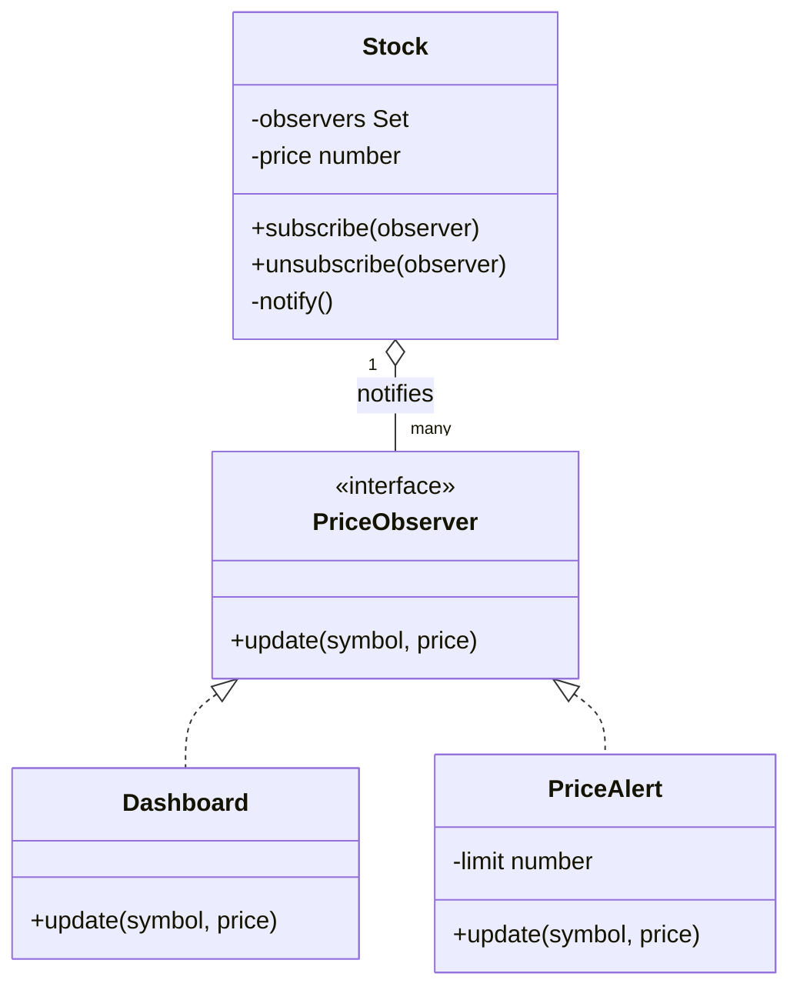
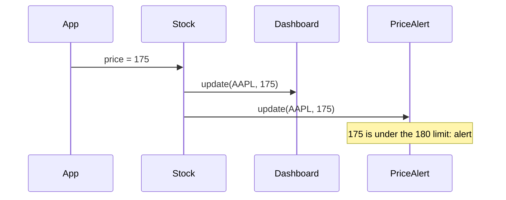

**Intent:** when one object changes, it tells every object that signed up to hear about it.
**Group:** Behavioral (patterns about how objects share work).

## The idea

Think of a **YouTube channel**. You press **Subscribe** once. From then on, every new video shows up in your feed. You don't visit the channel every hour to check. When you lose interest, you press **Unsubscribe**, and the updates stop. The channel doesn't know or care what each subscriber does with the news.

The pattern has two roles:

- the **subject** (the channel): the object that changes. It keeps a list of subscribers and tells them about each change;
- the **observers** (the subscribers): the objects that want to hear about changes. Each one has an `update` method that the subject calls.

You also know it as **events and listeners**.

## The problem

A `Stock` price changes. The email alert, the SMS alert and the dashboard all need to know. The first version calls each one by name:

```js
// Not complete code: it only shows the problem.
class Stock {
  setPrice(price) {
    this.price = price;
    emailAlerts.check(this.symbol, price); // Stock must know about email...
    smsAlerts.check(this.symbol, price);   // ...and SMS...
    dashboard.refresh(this.symbol, price); // ...and the dashboard.
    // A new push alert means editing Stock again.
  }
}
```

Why it hurts:

- `Stock` is **tied to every listener**. It must know each one and how to call it. See [Coupling and Cohesion](../design-principles/coupling-cohesion.mdx).
- **Every new listener edits `Stock`.**
- You can't switch a listener on or off while the program runs, for example when a user turns off alerts.

The other bad fix is **polling**: every listener asks "has the price changed?" every second. That wastes work and still sees changes late.

## The pattern

The subject keeps a list of observers behind one interface, `PriceObserver`. It doesn't know what kind of observer each one is.



```js
class PriceObserver { // interface
  update(symbol, price) { throw new Error('not implemented'); }
}

class Stock { // the subject
  #observers = new Set();
  #price;
  constructor(symbol, price) { this.symbol = symbol; this.#price = price; }

  subscribe(observer) { this.#observers.add(observer); }
  unsubscribe(observer) { this.#observers.delete(observer); }

  get price() { return this.#price; }
  set price(newPrice) {
    this.#price = newPrice;
    this.#notify();
  }
  #notify() {
    for (const observer of this.#observers) observer.update(this.symbol, this.#price);
  }
}

class Dashboard extends PriceObserver {
  update(symbol, price) { console.log(`Dashboard: ${symbol} = ${price}`); }
}

class PriceAlert extends PriceObserver {
  #limit;
  constructor(limit) { super(); this.#limit = limit; }
  update(symbol, price) {
    if (price <= this.#limit) console.log(`Alert: ${symbol} fell to ${price}`);
  }
}

const apple = new Stock('AAPL', 200);
const alert = new PriceAlert(180);
apple.subscribe(new Dashboard());
apple.subscribe(alert);

apple.price = 190; // Dashboard: AAPL = 190
apple.price = 175; // Dashboard: AAPL = 175
                   // Alert: AAPL fell to 175
apple.unsubscribe(alert);
apple.price = 170; // Dashboard: AAPL = 170
```

When the price changes, the stock calls each observer in turn:



What changed:

- `Stock` doesn't know about email, SMS or dashboards. It only knows "things with an `update` method".
- A new listener is a **new class plus one `subscribe` call**. `Stock` doesn't change.
- Observers come and go **at run time**.

Here the subject **pushes** the data (`symbol` and `price`) to each observer. In the **pull** style it only says "I changed", and each observer reads what it needs from the subject.

### The JavaScript way: EventEmitter and callbacks

In JavaScript you rarely write the subscriber list yourself. An observer is usually just a function (a callback), and Node.js gives you `EventEmitter`:

```js
import { EventEmitter } from 'node:events';

class Channel extends EventEmitter { // EventEmitter already has the subscriber list
  upload(title) { this.emit('video', title); }
}

const channel = new Channel();
const asha = (title) => console.log(`Asha gets: ${title}`);
channel.on('video', asha); // subscribe
channel.on('video', (title) => console.log(`Ben gets: ${title}`));

channel.upload('Strategy in 5 minutes');
// Asha gets: Strategy in 5 minutes
// Ben gets: Strategy in 5 minutes

channel.off('video', asha); // unsubscribe
channel.upload('Observer in 5 minutes');
// Ben gets: Observer in 5 minutes
```

`on` subscribes, `off` unsubscribes and `emit` notifies. In the browser, `addEventListener` does the same job. In Java, you write a listener `interface` (like Swing's `ActionListener`) and keep a list of listeners yourself.

## When to use it

- One change must reach **many** objects, and the list of who cares **changes over time**.
- The thing that changes **shouldn't know** who listens: screens, alerts, logs, analytics.
- Users **subscribe and unsubscribe** while the app runs: price alerts, "notify me when it's back in stock".

## When not to use it

- There is **one listener** that never changes. A direct call is clearer.
- The order matters, or you need an **answer back**. Observers can't easily say "stop" or return a result. Call them in order instead.
- Events start firing more events, and nobody can follow the flow any more.

## Common mistakes

- **Forgetting to unsubscribe.** The subject still holds the observer, so it is never freed: a memory leak. Node prints a `MaxListenersExceededWarning` when more than 10 listeners are added to one event, as a hint of this.
- **One failing observer stops the rest.** `EventEmitter` calls listeners one by one; if one throws, the ones after it don't run. In your own subject, wrap each `update` call in `try`/`catch`.
- **Slow observers slow down the subject.** Notifying is a normal function call. Hand slow work, like sending an email, to a queue. See [Producer-Consumer](../concurrency/producer-consumer.mdx).

## In the real world

- **Node.js `EventEmitter`** is everywhere in Node: HTTP servers, streams and sockets are all event emitters (`server.on('request', ...)`, `stream.on('data', ...)`).
- **The browser DOM:** `button.addEventListener('click', handler)`.
- **Redux:** `store.subscribe(listener)` runs the listener after every state change, and returns a function that unsubscribes it.
- **Between services**, the same idea becomes **pub/sub**: a message broker sits in the middle, so publishers and subscribers don't know each other at all. See [Message Queues and Pub/Sub](/learn/system-design/messaging/message-queues-pub-sub).

## In the interview

Observer fits the words "notify", "alert" and "when X happens, update Y": a parking lot display board that shows free spots, order status updates, "notify me when the price drops".

> "When a spot is taken or freed, the display board and the mobile app both need the new count. I'll make `ParkingLot` the subject, with `subscribe` and a private `notify`. The board and the app are observers. The lot doesn't know who is listening, so adding an SMS alert later is just one more observer."

**Likely follow-up:** "What if one observer is slow or throws an error?"

**Answer:** "I'll wrap each `update` call in `try`/`catch`, so one bad observer can't stop the others. For slow work, like sending an email, the observer only puts a job on a queue and returns, and a worker sends it later. Across services, I'd use a message broker instead."

<Callout title="Remember this" type="success">
  - **Observer = subscribe to a channel.** The subject keeps a list; observers subscribe, unsubscribe and get `update` calls.
  - The subject **doesn't know** who listens, so you add listeners without editing it.
  - In JavaScript: callbacks, `EventEmitter` (`on`, `off`, `emit`) and `addEventListener`.
  - **Always unsubscribe**, and don't let one slow or failing observer block the rest.
  - Between services, it becomes **pub/sub** with a broker in the middle.
</Callout>
